<p align="center">
  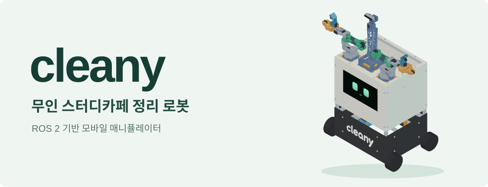
</p>

<p align="center"><a href="README.md">English</a> | <strong>한국어</strong></p>

# 끌리니 (Cleany)

[](docs/implementation/development-setup.md)
[](docs/implementation/development-setup.md)
[](docs/implementation/how-to/control-plane-integration.md)

끌리니는 **무인 스터디카페에서 사용이 끝난 책상을 정리하기 위해 개발 중인 로봇**입니다. 운영자가 좌석을 지정하면 해당 위치로 이동해 책상 위 물체를 확인하고 쓰레기를 수거하는 것을 목표로 합니다.

XLeRobot 기반 양팔과 Mecanum 베이스에 RGB-D 카메라, LiDAR를 장착했습니다. 이 저장소에는 ROS 2 기반 주행, 인식, 조작 코드와 MCU 펌웨어가 있습니다. 대시보드와 서버는 [cleany-control-plane](https://github.com/asm17-moving-agent/cleany-control-plane)에서 개발합니다.

[주요 기능](#주요-기능) · [시연](#시연) · [기술 스택](#기술-스택) · [시스템 구성](#시스템-구성) · [실행 방법](#실행-방법) · [팀 소개](#팀-소개)

## 주요 기능

- **자율주행**: LiDAR로 실내 지도를 만들고, Nav2로 지정한 위치까지의 경로를 계획합니다. Mecanum 베이스의 전후진, 회전과 횡이동을 지원합니다.
- **물체 인식과 조작**: RGB-D 영상에서 물체를 찾고 3D 위치와 파지 후보를 구합니다. MoveIt 2로 로봇팔의 동작을 계획하고 Behavior Tree로 실행합니다.
- **작업 관리**: 서버에서 받은 작업의 진행 상태와 결과를 관리합니다. 작업 취소, 중복 요청 처리와 오류 발생 시 복구 절차를 구현했습니다.
- **수동 조종**: 브라우저의 조종 스틱으로 이동하거나 지도에서 목표 위치를 지정할 수 있습니다. 로봇 위치와 카메라 영상도 확인할 수 있습니다.

## 시연

### 로봇 동작과 지도 생성

<table>
  <tr>
    <th width="50%">실물 작업 장면</th>
    <th width="50%">SLAM 지도 생성</th>
  </tr>
  <tr>
    <td align="center">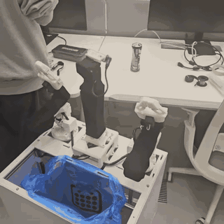</td>
    <td align="center">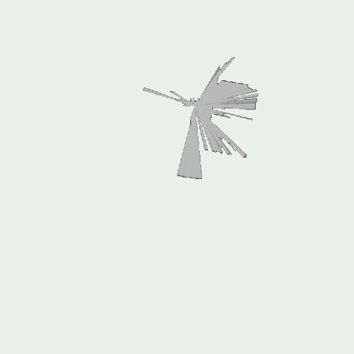</td>
  </tr>
</table>

### 인식과 이동

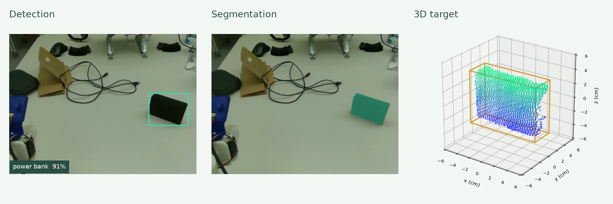

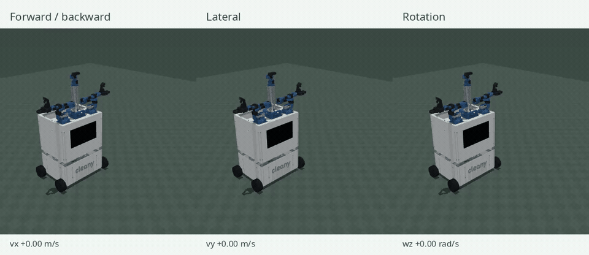

### 시뮬레이션

<table>
  <tr>
    <th width="50%">Gazebo 스터디카페</th>
    <th width="50%">Isaac Sim 병렬 환경</th>
  </tr>
  <tr>
    <td align="center" valign="middle">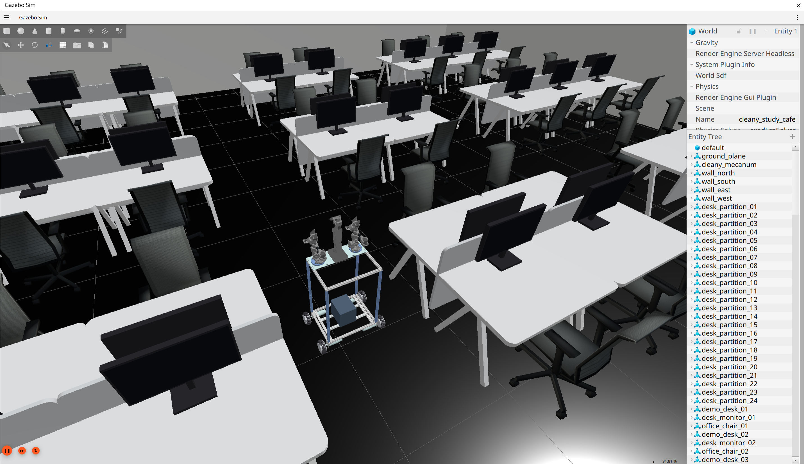</td>
    <td align="center" valign="middle">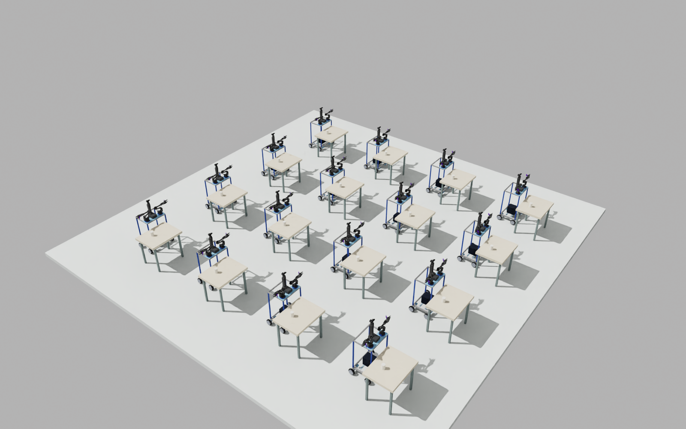</td>
  </tr>
  <tr>
    <th width="50%">MuJoCo</th>
    <th width="50%">RViz</th>
  </tr>
  <tr>
    <td align="center" valign="middle">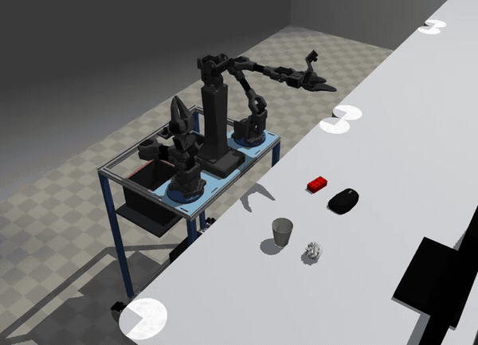</td>
    <td align="center" valign="middle">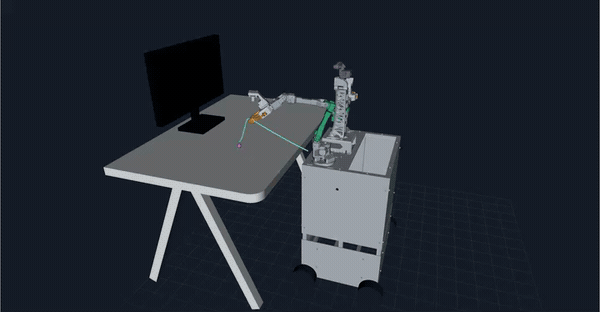</td>
  </tr>
</table>

### 대시보드와 CAD

<table>
  <tr>
    <th width="50%">관제 대시보드 (예시 데이터)</th>
    <th width="50%">FreeCAD</th>
  </tr>
  <tr>
    <td align="center" valign="middle"><a href="https://github.com/asm17-moving-agent/cleany-control-plane">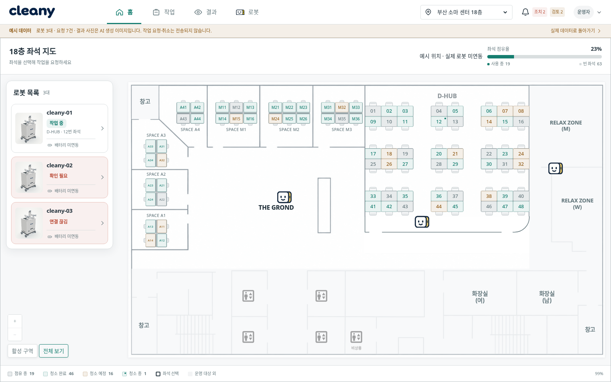</a></td>
    <td align="center" valign="middle">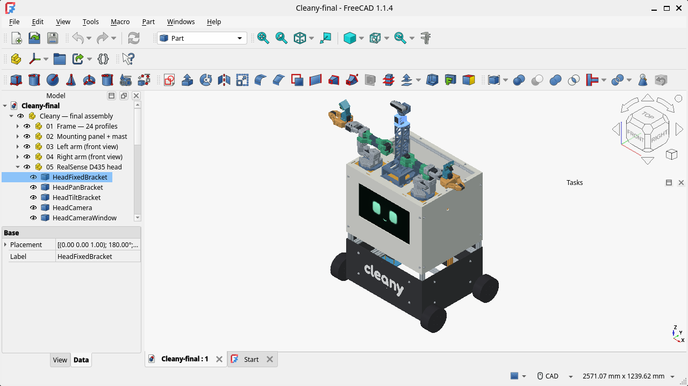</td>
  </tr>
</table>

## 기술 스택

| 구분 | 기술 |
|---|---|
| 개발 환경 | Ubuntu 22.04, ROS 2 Humble, Python 3.10, C++ |
| 하드웨어 | NVIDIA Jetson Orin, ESP32, micro-ROS |
| 주행 | Cartographer, Nav2, AMCL, Smac Lattice, MPPI |
| 인식 | RGB-D, YOLOE, OpenCV |
| 조작 | MoveIt 2, ros2_control, BehaviorTree.CPP, Feetech Servo |
| 모델과 시뮬레이션 | FreeCAD, URDF/Xacro, MJCF, Gazebo Fortress, MuJoCo, Isaac Sim (실험) |

## 시스템 구성

서버에서 받은 작업은 Control Bridge를 거쳐 Mission Runtime으로 전달됩니다. Mission Runtime은 주행과 조작을 요청하고, Supervisor는 로봇 상태를 확인해 실행 허가와 복구를 관리합니다.

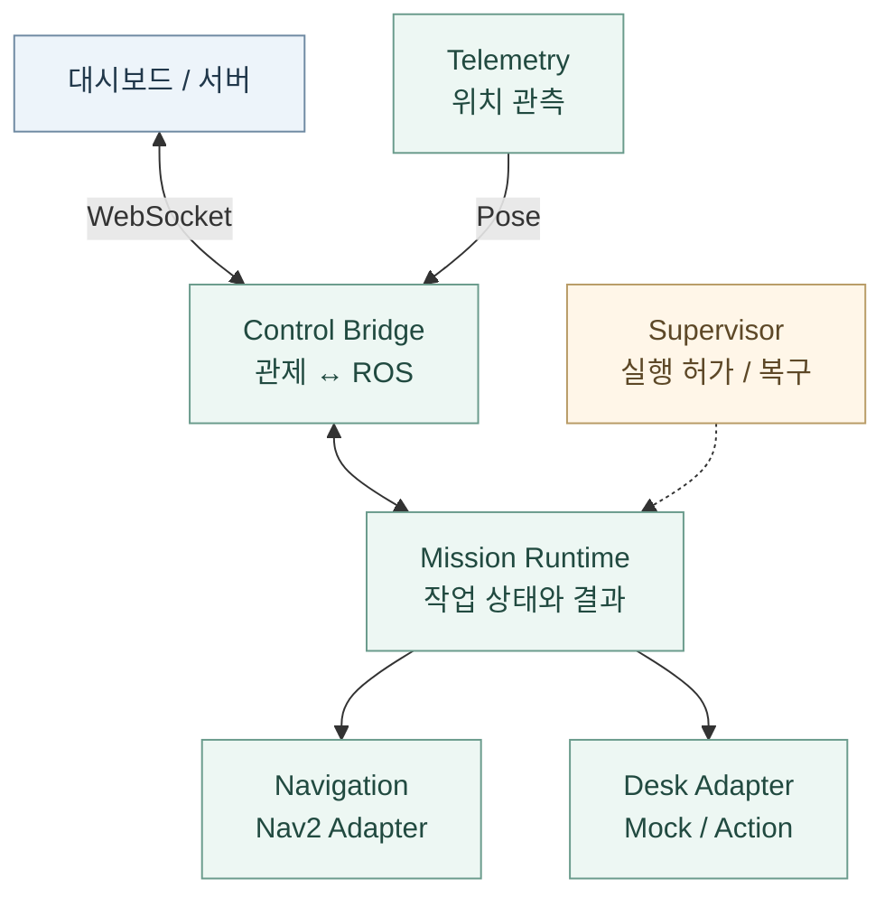

수동 조종은 `cleany_teleop`, 위치와 카메라 관측은 `cleany_telemetry`가 담당합니다. Telemetry는 서버 없이 실행할 수 있으며, 서버와의 통신은 Control Bridge와 카메라 프록시에서 처리합니다.

책상 작업은 실행 설정에 따라 Mock 또는 조작 Action 서버에 연결합니다. 자세한 내용은 [연동 구조](docs/implementation/integration.md)와 [패키지별 인터페이스](docs/implementation/ros-interfaces.md)를 참고하세요.

## 개발 현황

주행, 조작과 관제 기능을 통합하고 있습니다. **작업 요청부터 책상 정리와 복귀까지의 전체 실물 검증은 남아 있습니다.**

- [ ] 현장 좌석 배치에 맞춰 접근 좌표와 로봇 보정값 확인
- [ ] Jetson에서 작업 요청 → 이동 → 책상 정리 → 복귀 → 결과 보고 검증

[검증 기록](docs/EVIDENCE.md)

## 실행 방법

Ubuntu 22.04와 ROS 2 Humble을 기준으로 합니다. 처음 설치한다면 [개발환경 설정](docs/implementation/development-setup.md)을 먼저 진행해 주세요. 아래 명령은 ROS 설치와 rosdep 초기화, 프로젝트 규칙 등록을 마친 환경에서 실행합니다.

```bash
git clone --recurse-submodules https://github.com/asm17-moving-agent/cleany.git
cd cleany
source /opt/ros/humble/setup.bash

make deps
make build
source "$(make -s print-install-base)/setup.bash"
```

테스트와 Gazebo 실행:

```bash
make test
make sim-gazebo
```

`make sim-gazebo`는 Gazebo를 headless로 실행합니다. Nav2와 미션 연결, 실물 장치 설정은 다음 가이드를 참고하세요.

- [SLAM 매핑](docs/implementation/how-to/mapping.md) / [휴대폰 주행](docs/implementation/how-to/phone-navigation.md)
- [물체 인식과 로봇팔 조작](docs/implementation/how-to/manipulation.md)
- [서버와 미션 연결](docs/implementation/how-to/mission.md) / [Jetson 배포](docs/implementation/how-to/control-plane-integration.md)

## 팀 소개

**AI·SW마에스트로 제17기 | AI 에이전트는 움직이고 싶어**

이동근, 박창수, 이정현

[GitHub](https://github.com/asm17-moving-agent) · [관제 저장소](https://github.com/asm17-moving-agent/cleany-control-plane)

---

[개발 문서](docs/index.md) · [학습 가이드](docs/guide/README.md) · [기획 문서](docs/cleany-docs/README.md) · [이미지와 영상 출처](docs/assets/readme/sources.json)
