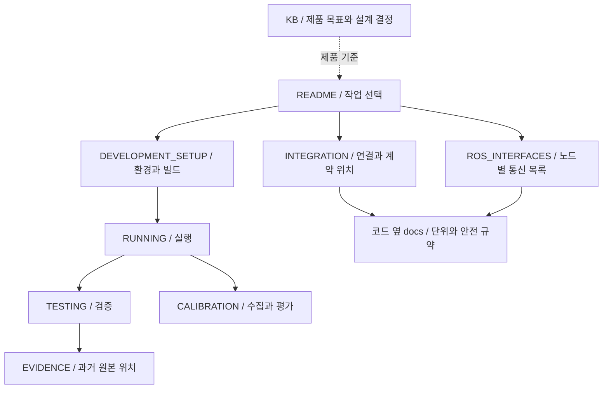

# Cleany 로봇 런타임

Cleany 로봇의 ROS 2 runtime, Gazebo/MuJoCo 시뮬레이션, ESP32 펌웨어를 관리하는 저장소입니다. 제품 목표와 설계 결정은 [KB](docs/cleany-docs/README.md)에서 확인합니다. 각 구현과 시험의 상태는 제품 전체의 완료 여부와 구분합니다.

## 문서 지도



## 개발 시작

기준 환경은 Ubuntu 22.04, ROS 2 Humble, Python 3.10, Gazebo Fortress 6입니다. 새 환경은 [개발환경 설치](docs/DEVELOPMENT_SETUP.md)를 먼저 따릅니다. 아래 명령은 저장소 루트의 Humble 터미널에서 실행합니다.

```bash
git submodule update --init --recursive docs/cleany-docs
source /opt/ros/humble/setup.bash
make deps-gazebo
make test-gazebo
make sim-gazebo
```

전체 workspace는 `make deps`, `make build`, `make test`를 사용합니다. 각 검사의 범위와 시뮬레이션, 실물 검증의 차이는 [테스트 가이드](docs/TESTING.md)에서 확인합니다.

## 필요한 문서

| 작업 | 문서 |
|---|---|
| 환경 설치, 의존성, 빌드 경로 | [개발환경](docs/DEVELOPMENT_SETUP.md) |
| 시뮬레이션, Mission Runtime, Monitor 실행 | [실행](docs/RUNNING.md) |
| 변경 검증, runtime 시험, 결과 저장 | [테스트](docs/TESTING.md) |
| hand-eye 데이터 수집과 검토 | [Calibration](docs/CALIBRATION.md) |
| 노드별 토픽, 서비스, 액션 찾기 | [ROS 인터페이스 색인](docs/ROS_INTERFACES.md) |
| Backend, ROS, MCU 연동 | [연동과 계약](docs/INTEGRATION.md) |
| 펌웨어 빌드, 업로드, 장치 확인 | [ESP32](esp32/README.md), [배선](esp32/PINMAP.md) |
| 과거 보고서와 실행 원본 찾기 | [근거 색인](docs/EVIDENCE.md) |
| 코드 구조와 구현 학습 | [학습 가이드](docs/guide/README.md), [HTML 뷰어](docs/guide/index.html) |
| 인식과 sorting 실행 | [Perception](ros2_ws/src/cleany_perception/docs/runtime.md), [Manipulation](ros2_ws/src/cleany_skill_executor/docs/manipulation.md) |
| 물체 하나의 Action 실행 | [Mock 서버](ros2_ws/src/cleany_skill_executor/docs/manipulation_mock_usage.md), [MuJoCo BT 서버](ros2_ws/src/cleany_manipulation_bt/README.md) |
| 실물 로봇 조작(Jetson) 실행 및 제어 | [실물 실행](docs/RUNNING.md#jetson-실물-실행-경로), [조작 경로 규격](ros2_ws/src/cleany_skill_executor/docs/physical-manipulation.md), [Dev Monitor 웹 제어](ros2_ws/src/cleany_dev_monitor/README.md) |
| 제품, 설계, 미해결 질문 | [KB](docs/cleany-docs/README.md) |

## 코드 위치

| 위치 | 책임 |
|---|---|
| `ros2_ws/src/` | ROS 패키지, 순수 core, launch와 package 설정 |
| `esp32/` | micro-ROS 펌웨어, 빌드 보조 도구, 장치 없는 검사와 PCB |
| `tests/` | 패키지 경계를 넘는 통합 검사 |
| `tools/` | 빌드 출력 정리와 vision 환경 준비 도구 |

생성물과 실행 원본은 기본적으로 worktree 옆 `../cleany-data/`에 둡니다. 사용 가능한 명령은 `make help`, 실제 옵션은 Makefile, launch, config에서 확인합니다. 문서 변경은 기존 설명에 반영하며, README에는 날짜별 구현 일지를 추가하지 않습니다.
