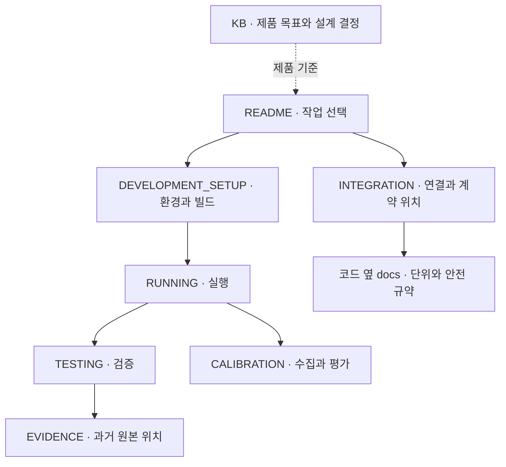

# Cleany 로봇 런타임

- 구현: ROS 2 runtime·Gazebo/MuJoCo·ESP32
- 제품 목표·설계 결정: [KB](docs/cleany-docs/README.md)
- 구현 상태 ≠ 제품 전체 완료

## 문서 지도



## 개발 시작

- 기준 환경은 Ubuntu 22.04, ROS 2 Humble, Python 3.10, Gazebo Fortress 6
- 새 환경은 [개발환경 설치](docs/DEVELOPMENT_SETUP.md)를 먼저 따른다
- 아래 명령은 저장소 루트의 Humble 터미널에서 실행

```bash
git submodule update --init --recursive docs/cleany-docs
source /opt/ros/humble/setup.bash
make deps-gazebo
make test-gazebo
make sim-gazebo
```

- 전체 workspace는 `make deps`, `make build`, `make test`를 사용
- 정적·단위 검사와 시뮬레이션·실물 검증의 차이는 [테스트 가이드](docs/TESTING.md)를 기준

## 필요한 문서

| 작업 | 문서 |
|---|---|
| 환경 설치, 의존성, 빌드 경로 | [개발환경](docs/DEVELOPMENT_SETUP.md) |
| 시뮬레이션, Mission Runtime, Monitor 실행 | [실행](docs/RUNNING.md) |
| 변경 검증, runtime 시험, 결과 저장 | [테스트](docs/TESTING.md) |
| hand-eye 데이터 수집과 검토 | [Calibration](docs/CALIBRATION.md) |
| Backend·ROS·MCU 연동 | [연동과 계약](docs/INTEGRATION.md) |
| 펌웨어 빌드, 업로드, 장치 확인 | [ESP32](esp32/README.md), [배선](esp32/PINMAP.md) |
| 과거 보고서와 실행 원본 찾기 | [근거 색인](docs/EVIDENCE.md) |
| 제품·설계·미해결 질문 | [KB](docs/cleany-docs/README.md) |

## 코드 위치

| 위치 | 책임 |
|---|---|
| `ros2_ws/src/` | ROS 패키지, 순수 core, launch와 package 설정 |
| `esp32/` | micro-ROS 펌웨어, 빌드 보조 도구, 장치 없는 검사와 PCB |
| `configs/robot/` | 실제 base 초기 시험 설정과 mock 전용 설정 |
| `tests/` | 패키지 경계를 넘는 검사, 시뮬레이션 평가와 실행 보조 코드 |
| `tools/ros2/` | 해당 worktree의 외부 빌드 출력 정리 |

- 생성물과 실행 원본은 기본적으로 worktree 옆 `../cleany-data/`에 둔다
- `make help`는 사용 가능한 명령, Makefile·launch·config는 실제 옵션의 기준
- 문서 변경은 기존 설명을 갱신하며 날짜별 구현 일지를 README에 추가하지 않음
