<p align="center">
  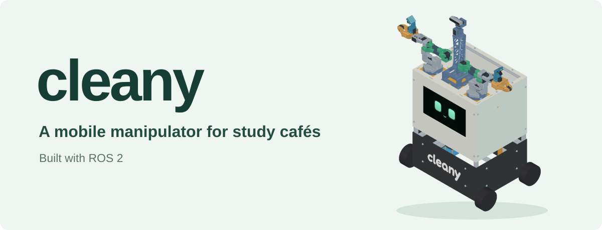
</p>

<p align="center"><strong>English</strong> | <a href="README.ko.md">한국어</a></p>

# Cleany

[](docs/implementation/development-setup.md)
[](docs/implementation/development-setup.md)
[](docs/implementation/how-to/control-plane-integration.md)

Cleany is a **mobile manipulator project for clearing desks in unattended study cafés**. The goal is to let an operator select a seat, then have the robot navigate to the desk, inspect the objects on it, and collect waste.

The robot combines XLeRobot-based dual arms, a Mecanum drive base, RGB-D cameras, and LiDAR. This repository contains the ROS 2 navigation, perception, and manipulation code, along with MCU firmware. The dashboard and backend are developed in [cleany-control-plane](https://github.com/asm17-moving-agent/cleany-control-plane).

[Features](#features) · [Demos](#demos) · [Tech stack](#tech-stack) · [Architecture](#architecture) · [Getting started](#getting-started) · [Team](#team)

## Features

- **Navigation**: Build indoor maps with LiDAR and plan routes with Nav2. The Mecanum base supports forward, lateral, and rotational motion.
- **Perception and manipulation**: Detect objects in RGB-D images, estimate their 3D positions, and generate grasp candidates. MoveIt 2 plans arm motion, and a Behavior Tree coordinates execution.
- **Mission management**: Track work requested by the backend and report progress and results. Handle cancellation, duplicate requests, and recovery after faults.
- **Manual control**: Drive the robot with a browser joystick or select a goal on the map. View robot position and camera previews.

## Demos

### Desk work and mapping

<table>
  <tr>
    <th width="50%">Physical desk work</th>
    <th width="50%">SLAM mapping</th>
  </tr>
  <tr>
    <td align="center">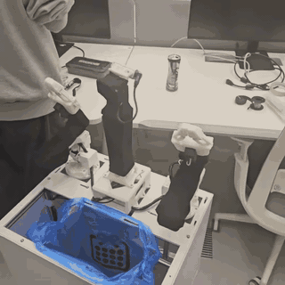</td>
    <td align="center">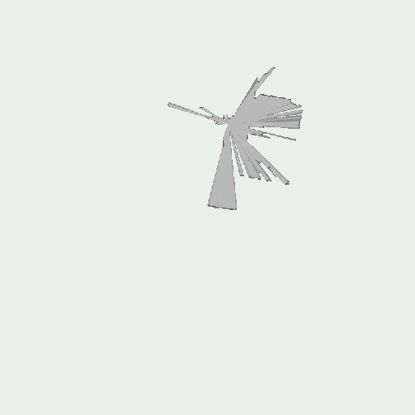</td>
  </tr>
</table>

### Perception and mobility

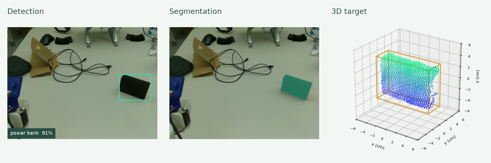

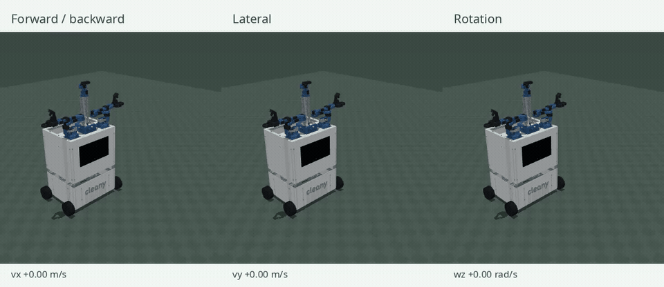

### Simulation

<table>
  <tr>
    <th width="50%">Gazebo study café</th>
    <th width="50%">Isaac Sim parallel environments</th>
  </tr>
  <tr>
    <td align="center" valign="middle">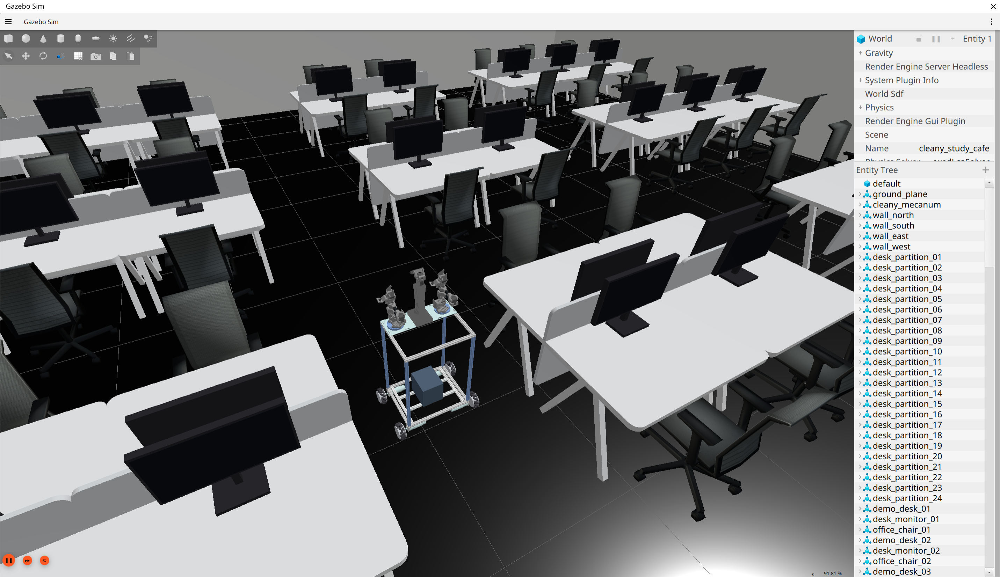</td>
    <td align="center" valign="middle">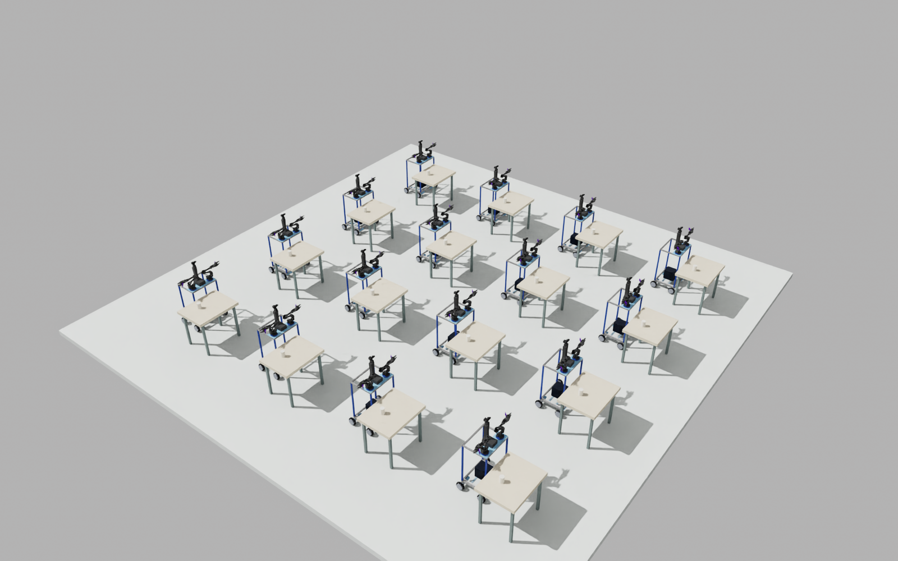</td>
  </tr>
  <tr>
    <th width="50%">MuJoCo</th>
    <th width="50%">RViz</th>
  </tr>
  <tr>
    <td align="center" valign="middle">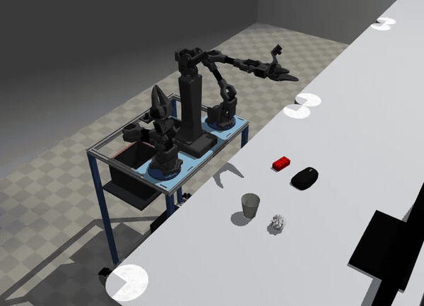</td>
    <td align="center" valign="middle">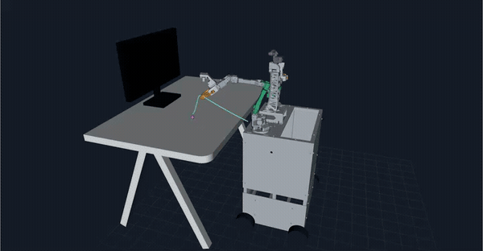</td>
  </tr>
</table>

### Dashboard and CAD

<table>
  <tr>
    <th width="50%">Dashboard (example data)</th>
    <th width="50%">FreeCAD</th>
  </tr>
  <tr>
    <td align="center" valign="middle"><a href="https://github.com/asm17-moving-agent/cleany-control-plane">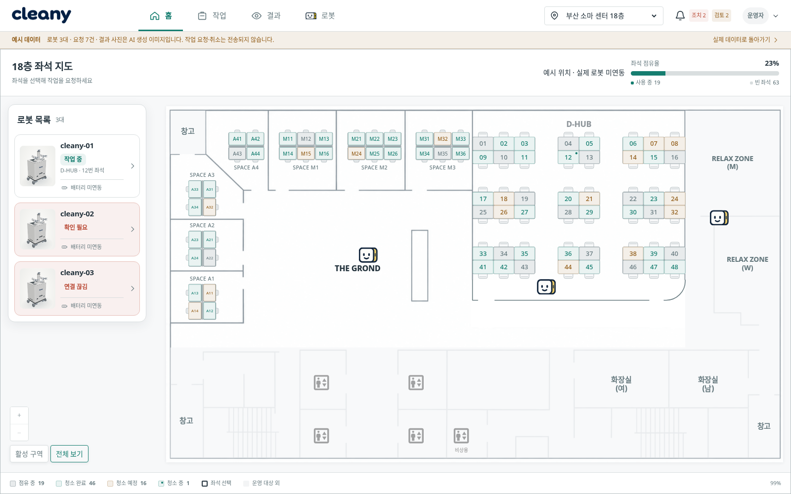</a></td>
    <td align="center" valign="middle">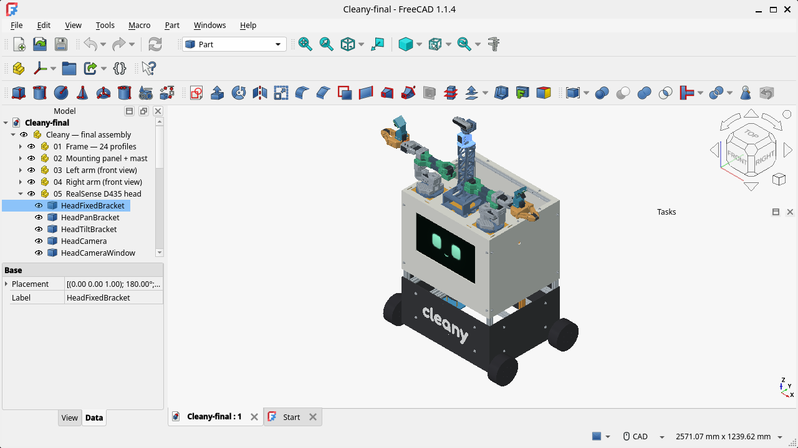</td>
  </tr>
</table>

## Tech stack

| Area | Technologies |
|---|---|
| Development | Ubuntu 22.04, ROS 2 Humble, Python 3.10, C++ |
| Hardware | NVIDIA Jetson Orin, ESP32, micro-ROS |
| Navigation | Cartographer, Nav2, AMCL, Smac Lattice, MPPI |
| Perception | RGB-D, YOLOE, OpenCV |
| Manipulation | MoveIt 2, ros2_control, BehaviorTree.CPP, Feetech Servo |
| Modeling and simulation | FreeCAD, URDF/Xacro, MJCF, Gazebo Fortress, MuJoCo, Isaac Sim (experiments) |

## Architecture

Control Bridge forwards backend requests to Mission Runtime, which coordinates navigation and manipulation. Supervisor checks robot availability and manages execution permission and recovery.

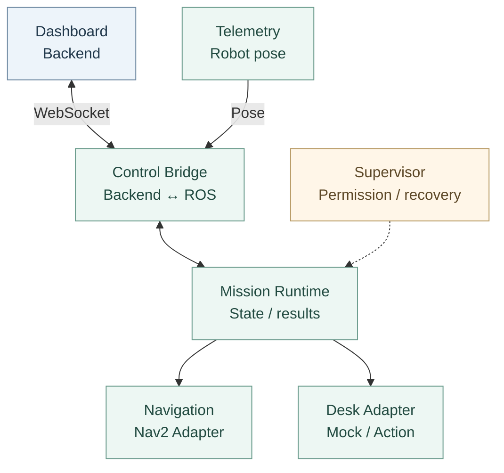

`cleany_teleop` handles manual commands. `cleany_telemetry` provides read-only pose and camera observations and runs without the backend. Control Bridge and the camera proxy handle backend communication.

Depending on the launch configuration, desk tasks use a mock or a manipulation Action server. See the [integration guide](docs/implementation/integration.md) and [package interfaces](docs/implementation/ros-interfaces.md) for details.

## Development status

Navigation, manipulation, and dashboard integration are in progress. **The full physical workflow still needs field validation.**

- [ ] Verify desk approach coordinates and robot calibration at the deployment site.
- [ ] Validate the complete request → navigation → desk clearing → return → result sequence on Jetson.

[Validation records](docs/EVIDENCE.md)

## Getting started

The reference environment is Ubuntu 22.04 with ROS 2 Humble. Follow the [development setup guide](docs/implementation/development-setup.md) first. The commands below assume ROS is installed, rosdep is initialized, and the project rosdep rules are registered.

```bash
git clone --recurse-submodules https://github.com/asm17-moving-agent/cleany.git
cd cleany
source /opt/ros/humble/setup.bash

make deps
make build
source "$(make -s print-install-base)/setup.bash"
```

Run tests and start Gazebo:

```bash
make test
make sim-gazebo
```

`make sim-gazebo` starts Gazebo in headless mode. For Nav2, missions, and physical hardware setup, see the guides below. The implementation guides are currently written in Korean.

- [SLAM mapping](docs/implementation/how-to/mapping.md) / [Phone navigation](docs/implementation/how-to/phone-navigation.md)
- [Perception and arm manipulation](docs/implementation/how-to/manipulation.md)
- [Backend and mission integration](docs/implementation/how-to/mission.md) / [Jetson deployment](docs/implementation/how-to/control-plane-integration.md)

## Team

**AI·SW Maestro, 17th cohort | AI 에이전트는 움직이고 싶어**

이동근, 박창수, 이정현

[GitHub](https://github.com/asm17-moving-agent) · [Control plane repository](https://github.com/asm17-moving-agent/cleany-control-plane)

---

[Documentation](docs/index.md) · [Learning guide](docs/guide/README.md) · [Project planning](docs/cleany-docs/README.md) · [Image and video sources](docs/assets/readme/sources.json)
