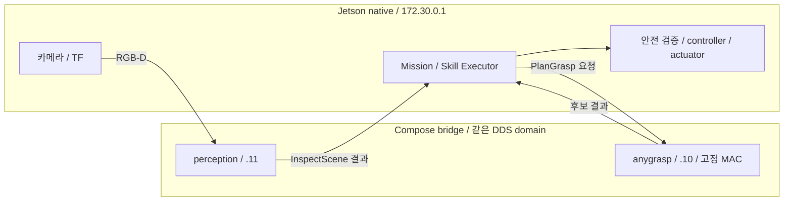

# Jetson 혼합형 GPU runtime

안전·제어·mission stack은 Jetson의 native ROS 2 Humble에 유지하고, CUDA dependency가
필요한 모델만 container로 격리합니다. `cleany-vision:jp6.2` image와 그 안의 AnyGrasp SDK
binary는 기존 것을 그대로 공유하지만 runtime service와 mount는 분리합니다.

| 위치/service | 책임 | 고정 주소 |
|---|---|---|
| Native | Mission Manager, Skill Executor, Robot Interface, `ros2_control`, hardware driver, Nav2, safety watchdog, AI 결과 검증 | host |
| `anygrasp` | `grasp/plan` (`PlanGrasp.srv`) | `172.30.0.10`, license에 묶인 고정 MAC |
| `perception` | YOLOE-seg, depth, 3D reconstruction와 `perception/inspect_scene` (`InspectScene.action`) | `172.30.0.11` |
| `motion` | cuRobo/cuMotion service 예약; 아직 Compose service 없음 | `172.30.0.13` 예약 |

RGB-D driver도 초기에는 native에 둡니다. 실제 profiling에서 DDS 전송이 병목으로 확인된
뒤에만 perception container 이전을 검토합니다. AI service는 ROS 결과만 반환하며
`cmd_vel`, controller action 또는 actuator command를 발행하지 않습니다.



| 순서 | 작업 | 확인 |
|---|---|---|
| 1 | [Host/image](#host와-image-준비) | JetPack ABI와 NVIDIA runtime |
| 2 | [Identity](#root-owned-jetson-identity) | license와 일치하는 root 소유 파일 |
| 3 | [서비스](#실행-명령) | container 및 ROS server 시작 |
| 4 | [DDS 연결](#ros-2-dds-연결) | native에서 endpoint 확인 |
| 5 | [인수 검사](#migration-검증) | 실제 inference와 재생성/reboot 경계 |

## Host와 image 준비

Jetson에는 JetPack 6.2, NVIDIA Container Toolkit과 Docker Compose가 필요합니다.
image는 Jetson aarch64 CUDA/cuBLAS ABI를 제공하는 NVIDIA 공식
`nvcr.io/nvidia/l4t-jetpack:r36.4.0` digest에 고정합니다. 일반 ARM server용
`nvidia/cuda` SBSA image는 Jetson에서 CUDA device가 보여도 cuBLAS 실행이 실패하므로
사용하지 않습니다.

```bash
uname -m
nvcc --version
docker info
tools/vision-container host-setup
```

JetPack 6.2.1 kernel에 `CONFIG_IP_NF_RAW`가 없을 때 `tools/vision-container host-setup`은 Docker가 제공하는
`DOCKER_INSECURE_NO_IPTABLES_RAW=1` systemd drop-in을 설치하고 daemon을 재시작합니다. 이
설정은 Docker 전체에 적용됩니다. GPU service는 port를 publish하지 않습니다.

기존 `cleany-vision:jp6.2` image가 SBSA 기반이거나 Dockerfile dependency를 갱신했다면
다시 빌드합니다. 이후에는 migration-controlled AnyGrasp SDK commit을 바꾸지 않는 한
같은 image를 재사용합니다.

```bash
tools/vision-container build
```

license와 checkpoint는 image에 넣지 않습니다. 예시 identity 기준 host layout은 다음과
같습니다.

```text
/home/cleany/.local/share/cleany/anygrasp/license/
  licenseCfg.json
  <license-name>.lic
  <license-name>.public_key
  <license-name>.signature
/home/cleany/models/anygrasp/checkpoint_detection.tar
/home/cleany/models/yoloe/yoloe-26s-seg.pt
```

AnyGrasp license directory와 model directory는 `anygrasp`에만 read-only로 mount됩니다.
`perception`에는 YOLOE model만 read-only로 mount되고 AnyGrasp identity, license와
checkpoint는 노출되지 않습니다.

## Root-owned Jetson identity

Compose용 개발 `.env`는 더 이상 사용하지 않습니다. 다음 명령은 pinned identity template을
`/etc/cleany/jetson-identity.env`에 `root:root`, mode `0644`로 설치합니다.

```bash
tools/vision-container init
sudoedit /etc/cleany/jetson-identity.env
tools/vision-container hybrid-config
```

template의 `ANYGRASP_MAC_ADDRESS`, `ANYGRASP_EXPECTED_FEATURE_ID`,
`ANYGRASP_LICENSE_FILE`은 placeholder입니다. Jetson에서 발급받은 license 기준 값으로
바꾸고, 실제 값은 저장소에 커밋하지 않습니다. 이 값과 service network는 일반 개발 변경
대상이 아니며, 변경하려면 별도 AnyGrasp license migration이 필요합니다.

identity 파일이 없거나 root 소유가 아니거나 group/other writable이면 모든 Compose 명령이
실패합니다. 호출 shell의 동명 환경변수는 wrapper가 제거하므로 identity를 덮어쓸 수 없습니다.
Compose interpolation에도 기본값이 없어서 wrapper를 우회해도 누락된 값은 configuration
단계에서 실패합니다.

## 실행 명령

서비스별로 container를 먼저 올리고 ROS server를 실행합니다.

```bash
tools/vision-container anygrasp-up
tools/vision-container anygrasp-run

# 다른 terminal
export GEMINI_API_KEY='<api-key>'  # Gemini 분류를 사용할 때 필요
tools/vision-container perception-up
tools/vision-container perception-run
```

> [!TIP]
> **OpenBLAS CPU 스레드 최적화 (`CLEANY_PERCEPTION_BLAS_THREADS`)**:
> - 인식 컨테이너의 NumPy / SciPy 연산은 기본 **1개 스레드**(`OPENBLAS_NUM_THREADS=1`)를 사용합니다.
> - VLM API 응답을 대기하는 동안 씬 매핑 및 경로 계획이 동시에 돌 때 발생하는 CPU 코어 경합을 완화하기 위함입니다.
> - 스레드 수를 변경하려면 `export CLEANY_PERCEPTION_BLAS_THREADS=2` 등으로 지정한 뒤 `make perception-up`으로 컨테이너를 재생성하고 `tools/vision-container perception-run`을 실행합니다.

`cleany_perception`은 YOLOE-seg의 검출과 마스크에 Gemini 분류를 결합합니다.
API 키는 환경 변수로 실행 프로세스에 전달하며 identity 파일에는 저장하지 않습니다.
모델 프로파일과 TensorRT 변환은 [모델 설정](../../configs/models/README.md)을 따릅니다.

전체 lifecycle 명령은 다음과 같습니다.

```bash
tools/vision-container hybrid-up
tools/vision-container hybrid-run
tools/vision-container hybrid-down
```

`vision-feature-id`와 `vision-license-check`는 SDK 확인 명령이다.
`hybrid-down`은 같은 Compose project의 이전 `vision` orphan도 함께 정리한다. 이전
container와 새 `anygrasp`가 같은 MAC으로 동시에 실행 중이면 시작 wrapper가 거부한다.

## AnyGrasp fail-closed preflight

`anygrasp` entrypoint는 model을 읽기 전에 다음을 모두 확인하고 성공 marker를 만든다.

- root-owned identity가 read-only mount인지
- 비-loopback interface가 `eth0` 하나뿐인지
- `eth0` MAC/IP가 identity의 `ANYGRASP_MAC_ADDRESS`, `172.30.0.10`인지
- SDK feature ID가 identity의 `ANYGRASP_EXPECTED_FEATURE_ID`와 정확히 같은지
- license directory와 checkpoint 경로가 read-only mount에 포함되는지

호스트 wrapper도 Docker inspect로 `network_mode: host`, 둘 이상의 network, MAC/IP 변경을
검사한다. 어느 검사든 실패하면 container가 종료되고 `grasp/plan` node는 시작하지 않는다.
실행 직전에 preflight를 다시 수행하므로 대기 container에 network를 나중에 추가해도
`make anygrasp-run`은 실패한다.

feature ID와 license/checkpoint 초기화를 별도로 확인할 수 있다.

```bash
make vision-feature-id
make vision-license-check
```

첫 명령은 값을 출력만 하는 것이 아니라 identity의 feature ID와 일치해야 성공한다. 두 번째 명령은
SDK license validation 뒤 checkpoint를 읽어 detector까지 생성한다. 실제 CUDA inference
warm-up은 유효한 RGB-D point cloud로 `grasp/plan`을 한 번 호출해 확인한다.

## Migration 검증

코드를 바꾸기 전에 기존 `vision` container의 ID가 기준값인지 기록하고 container를
내린다. 새 구성을 받은 뒤 다음 순서로 재생성 안정성을 확인한다.

```bash
make hybrid-down
make anygrasp-up
make vision-feature-id

for attempt in 1 2 3; do
  make hybrid-down
  make anygrasp-up
  make vision-feature-id
done
```

네 출력은 모두 identity의 `ANYGRASP_EXPECTED_FEATURE_ID`와 같아야 한다. 이어서 Docker daemon 재시작과 Jetson
재부팅 뒤에도 같은 명령을 반복한다. 새 license 설치 뒤에는 다음을 확인한다.

```bash
make vision-license-check
make anygrasp-run
# native ROS terminal에서 실제 point cloud를 포함한 /grasp/plan 요청 1회
```

다음 negative test도 Jetson 인수검사에 포함한다.

- identity 파일 누락/권한 변경: Compose 단계에서 실패
- identity의 IP 변경: migration-controlled 값 검사에서 실패
- identity의 MAC/Feature ID가 실제 container MAC 또는 SDK feature ID와 다름: runtime 검사에서 실패
- `network_mode: host`, MAC override: host inspect 또는 container IP/MAC 검사에서 실패
- `docker network connect`로 추가 network 연결 후 `anygrasp-run`: interface 검사에서 실패
- license/model mount를 read-write로 변경: mount 검사에서 실패

AnyGrasp process를 강제 종료한 통합 시험에서는 native Skill Executor가 작업을 `BLOCKED`
또는 `MODEL_UNAVAILABLE`로 끝내고 actuator command를 만들지 않는지 별도로 확인한다. 현재
ROS 계약의 `PlanGrasp.ERROR_MODEL_UNAVAILABLE`는 유지되며, AI service 결과를 motion/control
명령으로 직접 연결하지 않는다.

## ROS 2 DDS 연결

현재 `perception-run`은 YOLOE-seg + Gemini 공통 프로필을 사용합니다.
root-owned identity는 `jetson-identity.env.example`의 현재 키 목록에 맞춥니다.
`YOLOE_MODEL_HOST_DIR`는 checkpoint와 text encoder를 담은 폴더이며 컨테이너의
`/models/yoloe`에 read-only로 연결합니다. AnyGrasp identity/MAC/license 값은 유지합니다.

```bash
CLEANY_PERCEPTION_USE_SIM_TIME=true CLEANY_PERCEPTION_USE_WRIST_CAMERA=true tools/vision-container perception-run
ros2 launch cleany_skill_executor study_cafe_sorting.launch.py start_perception:=false
```

컨테이너와 native 시뮬레이터의 시계를 맞춥니다. 실카메라는
`CLEANY_PERCEPTION_USE_SIM_TIME=false`가 기본입니다. 컨테이너는 CUDA를 명시합니다.

native와 container는 ROS 2 Humble, `rmw_cyclonedds_cpp`를 사용합니다. 두 container는
`eth0`만 사용하고 host bridge gateway `172.30.0.1`을 peer로 지정합니다. native terminal은
Wi-Fi/Ethernet 자동 선택 대신 bridge gateway `172.30.0.1`을 DDS interface로 고정하고,
두 service 주소가 등록된 host 설정을 사용합니다. 따라서 Compose network를 먼저 올린 뒤
native ROS process를 시작합니다.

```bash
source /opt/ros/humble/setup.bash
source ros2_ws/install/setup.bash
export RMW_IMPLEMENTATION=rmw_cyclonedds_cpp
export CYCLONEDDS_URI="file://${PWD}/containers/vision/cyclonedds/host.xml"
export ROS_DOMAIN_ID=0
ros2 node list
ros2 action info /perception/inspect_scene
ros2 service type /grasp/plan
```

외부 machine까지 ROS graph를 연결하는 topology는 DDS Router 또는 별도 robot network
설계가 필요합니다.

## 시작 결과와 복구

| 관측 | 의미 / 조치 |
|---|---|
| container up | server/inference 준비까지 보장하지 않음; run과 endpoint 확인 필요 |
| feature ID 확인 성공 | identity 일치; license와 모델 초기화는 별도 |
| license-check 성공 | detector 생성; 실제 CUDA warm-up은 유효한 point cloud 요청 필요 |
| endpoint가 안 보임 | bridge 선기동, native interface, 같은 domain/clock/overlay 확인 |
| model service 단절 | native에서 BLOCKED 또는 MODEL_UNAVAILABLE 처리; AI 결과를 actuator에 직접 연결하지 않음 |

종료는 `tools/vision-container hybrid-down`을 사용합니다. 변경 전 image와 설정을 복원할 때도 같은 root identity, network/MAC, read-only mount 계약을 유지하고 feature-ID/license 검사를 다시 수행합니다. License identity 자체를 바꾸는 복구는 별도 migration입니다. 재생성 전후 확인은 아래 절차를 따릅니다.

## AnyGrasp fail-closed preflight

`anygrasp` entrypoint는 model을 읽기 전에 다음을 모두 확인하고 성공 marker를 만듭니다.

| 검사 | 통과 조건 |
|---|---|
| identity | root-owned, read-only mount |
| network interface | non-loopback은 eth0 하나 |
| MAC / IP | identity MAC / 172.30.0.10 |
| SDK feature ID | `ANYGRASP_EXPECTED_FEATURE_ID` 정확 일치 |
| license / checkpoint | read-only mount 경로 안 |

호스트 wrapper도 Docker inspect로 `network_mode: host`, 둘 이상의 network, MAC/IP 변경을
검사합니다. 어느 검사든 실패하면 container가 종료되고 `grasp/plan` 노드는 시작하지 않습니다.
실행 직전에 preflight를 다시 수행하므로 대기 container에 network를 나중에 추가해도
`tools/vision-container anygrasp-run`은 실패합니다.

feature ID와 license/checkpoint 초기화를 별도로 확인할 수 있습니다.

```bash
tools/vision-container feature-id
tools/vision-container check-license
```

첫 명령은 값을 출력만 하는 것이 아니라 identity의 feature ID와 일치해야 성공합니다. 두 번째 명령은
SDK license validation 뒤 checkpoint를 읽어 detector까지 생성합니다. 실제 CUDA inference
warm-up은 유효한 RGB-D point cloud로 `grasp/plan`을 한 번 호출해 확인합니다.

## Migration 검증

코드를 바꾸기 전에 기존 `vision` container의 ID가 기준값인지 기록하고 container를
내립니다. 새 구성을 받은 뒤 다음 순서로 재생성 안정성을 확인합니다.

```bash
tools/vision-container hybrid-down
tools/vision-container anygrasp-up
tools/vision-container feature-id

for attempt in 1 2 3; do
  tools/vision-container hybrid-down
  tools/vision-container anygrasp-up
  tools/vision-container feature-id
done
```

네 출력은 모두 identity의 `ANYGRASP_EXPECTED_FEATURE_ID`와 같아야 합니다. 이어서 Docker daemon 재시작과 Jetson
재부팅 뒤에도 같은 명령을 반복합니다. 새 license 설치 뒤에는 다음을 확인합니다.

```bash
tools/vision-container check-license
tools/vision-container anygrasp-run
# native ROS terminal에서 실제 point cloud를 포함한 /grasp/plan 요청 1회
```

| Negative test | 실패해야 하는 경계 |
|---|---|
| identity 누락 / 소유·쓰기 권한 변경 | Compose |
| 고정 IP 변경 | migration-controlled 값 검사 |
| MAC / SDK feature ID 불일치 | runtime preflight |
| host network / MAC override | host inspect 또는 IP/MAC 검사 |
| 대기 container에 추가 network 연결 | run 직전 interface 검사 |
| license/model read-write mount | mount 검사 |

AnyGrasp process를 강제 종료한 통합 시험에서는 native Skill Executor가 작업을 `BLOCKED`
또는 `MODEL_UNAVAILABLE`로 끝내고 actuator command를 만들지 않는지 별도로 확인합니다. 현재
ROS 계약의 `PlanGrasp.ERROR_MODEL_UNAVAILABLE`는 유지되며, AI service 결과를 motion/control
명령으로 직접 연결하지 않습니다.

## 로컬 deterministic test

Jetson SDK 없이 identity/network/mount 정책의 순수 로직을 검사할 수 있습니다.

```bash
python3 -m pytest -q containers/vision/test
tools/vision-container hybrid-config
```

Feature ID 재생성, Docker daemon/reboot, NVIDIA runtime, license, detector 초기화와 실제
ROS DDS 호출은 Jetson에서만 검증할 수 있습니다.
