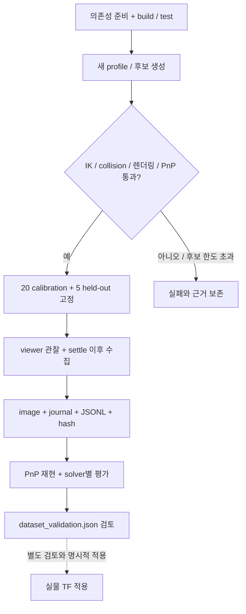

# 캘리브레이션 작업 가이드

## 2026-11-09 머리 모터 교체와 허용 범위

사용자가 지정한 좌우 끝과 상하 끝을 각각 5 Hz로 15회 수집해 다음 범위를
등록했다. 각 끝점의 15개 tick은 모두 같았다. 14번의 정면 영점은 별도로
수집한 425 tick이며 13번은 2009 tick을 사용한다.

| 모터 | 허용 tick 범위 | 정면 영점 tick | 정면 기준 각도 범위 |
|---|---|---|---|
| 13번 좌우 | 8~4001 | 2009 | −175.078125°~+175.869141° |
| 14번 상하 | 44~1101 | 425 | −33.486328°~+59.414063° |

모터 EEPROM의 최소 위치 주소 9와 최대 위치 주소 11에 범위를 저장하고
잠금 주소 55를 다시 잠갔다. 포트를 닫았다 다시 열어 저장값과 토크 OFF를
확인했다. 회전 방향은 왼쪽 및 위쪽 이동에서 raw tick이 감소하는 측정과
대조했다.

운영 매핑은 `configs/robot/head_preview_joints.json`이며
`joint_position_bounds`의 rad 범위를 상태 모델과 제어 모델에 적용한다.
읽기 전용 RViz의 별도 매핑은 Jetson
`~/.config/cleany/head-rviz-mapping.json`에 저장한다. 원본 측정, 변경 전 값과
적용 검증은 [실행 근거](EVIDENCE.md)에 연결한다.

## 양팔의 수동 ROS 영점 정렬

2026-11-02에 사용자가 양팔을 차례로 URDF의 다섯 관절이 모두 0 rad인
자세로 유지한 상태에서 ID 1–5와 7–11의 엔코더를 읽었다. 현재 운영 설정
`cleany_robot_interface/config/arm_preview.yaml`은 다음 `zero_tick`을 사용한다.

| 관절 | 왼팔 모터 | 왼팔 영점 tick | 오른팔 모터 | 오른팔 영점 tick |
|---|---:|---:|---:|---:|
| shoulder_pan | 1 | 1997 | 7 | 2042 |
| shoulder_lift | 2 | 3075 | 8 | 3111 |
| elbow_flex | 3 | 1066 | 9 | 997 |
| wrist_flex | 4 | 1995 | 10 | 2081 |
| wrist_roll | 5 | 3092.5 | 11 | 3055.5 |

초기값은 20 Hz로 읽은 연속 60개 표본의 중앙값이다. 오른팔 팔꿈치의 최종
영점은 사용자가 양쪽 팔꿈치의 접힘 각도가 같다고 지정한 자세에서
왼쪽 ID 3의 ROS 각도와 일치하도록 보완한 값이다. 이는 왼팔 기준의
상대 각도 보정이다. 채택한 구간의 관절별
최대 변동은 양팔 모두 8 tick 이하였다. `direction`과 `offset_rad`, 양쪽
그리퍼와 모터 EEPROM은 변경하지 않았다. 이는 사용자 수동 정렬에 대한
기준점이며 절대 각도 정확도나 구동 검증 결과가 아니다.

손목 회전은 실물의 양쪽 카메라 마운트가 위쪽을 향하는 자세를 기준으로
RViz에서 방향을 확인한 뒤 보완했다. 현재 영점은 이 미리보기의 회전량을
실측 tick의 ROS 변환에 반영한 값이다. 카메라 외부 보정과 다른 관절 값은
유지했으며, 시각적 방향 확인을 카메라 광학축의 정밀 보정으로 간주하지 않는다.

다시 정렬할 때는 제어기와 조회 프로세스의 포트 점유를 해제하고, 토크가
꺼진 팔을 기준 자세로 지지한 뒤 안정된 엔코더 구간을 수집한다. 현재 팔의
`offset_rad`는 0이므로 해당 중앙값을 `zero_tick`으로 사용한다. 새 설정은
읽기 전용 상태 조회 또는 제어 프로세스가 다음에 시작할 때 읽는다.
원본 측정과 적용 근거는 [실행 근거](EVIDENCE.md)를 따른다.

## Jetson 실물 모델과 2026-10-09 보정 프로파일

`cleany_description/config/calibration/jetson_20261009/`는 Jetson에서 사용한
헤드와 양손목 카메라 외부 보정, 해당 RGB 내부 보정, 팔과 헤드의 관절 기준을
보존한다. 카메라 외부 보정은 각각 20개 학습 뷰와 별도 5개 검증 뷰로 평가한
`provisional_20plus5_manual_stationary` 결과다.

| 변환 | 적용 내용 |
|---|---|
| `head_camera_rgb_frame` → `head_camera_rgb_optical_frame` | 헤드 RGB 외부 보정 |
| `left_gripper_frame` → `left_wrist_camera_optical_frame` | 왼손목 외부 보정 |
| `right_gripper_frame` → `right_wrist_camera_optical_frame` | 오른손목 외부 보정 |
| 각 `*_wrist_camera_optical_frame` → `*_wrist_rgb_optical_frame` | 항등 변환 alias |

`xyz`는 parent frame 기준 m, `rpy`는 고정축 XYZ의 rad이며,
`parent_T_child`는 child 좌표를 parent 좌표로 변환한다. 보정은 광학 좌표계에
적용하며 카메라 케이스 mesh의 CAD 배치를 옮기지 않는다. 헤드 depth frame은
명목값을 유지한다.

v8 손목 마운트 형상 반영 시 Jetson의 양손목 외부 보정 파일은 이전 수집본과
바이트 단위로 같았다. 형상에서 추정한 광학 좌표로 이 보정값을 대체하지 않는다.
이번 변경은 새로운 hand-eye 보정이나 v8 장착 상태에서의 정확도 검증을 포함하지
않는다. 실제 카메라 장착 위치가 보정 당시와 달라졌다면 재검증이 필요하다.

빌드한 workspace의 `setup.bash`를 읽은 뒤 모델을 실행한다.

```bash
ros2 launch cleany_description description.launch.py \
  model_variant:=legacy_runtime use_sim_time:=false calibration_profile:=jetson_20261009
```

이 launch는 `robot_state_publisher`만 실행한다. 관절 상태는 별도 `/joint_states`
입력이 필요하며, 저장된 encoder 영점으로 tick을 변환하거나 모터를 제어하지 않는다.
`calibration_profile`의 기본값은 빈 문자열이다. `legacy_runtime`에서 보정을 지정하지
않으면 명목 헤드 TF를 유지하고 손목 보정 optical frame을 추가하지 않는다.

노드를 실행하지 않고 보정된 URDF만 확인하려면 다음 명령을 사용한다.

```bash
xacro "$(ros2 pkg prefix --share cleany_description)/urdf/cleany.urdf.xacro" \
  calibration_profile:=jetson_20261009 > /tmp/cleany-calibrated.urdf
```

`arm_joint_calibration.yaml`에는 좌우 12개 모터의 현재 영점, 방향과 rad 오프셋을
담았다. `q = direction × (Present_Position - zero_tick) × 2π/4096 + offset_rad`로
해석한다. Present_Position에 이미 반영된 EEPROM homing offset을 다시 더하지 않는다.
`motors/`의 원본 JSON과 `reference/`의 과거 자세 기록은 측정 근거이며 자동 적용하지
않는다. 현재 매핑은 `arm_joint_calibration.yaml`이 기준이다. 오른쪽 elbow 영점처럼
과거 자세 기록 이후 보완된 값이 있다. 절대 관절 각도 정확도는 검증되지 않았다.

`head_joint_calibration.json`의 pan/tilt 기준 tick은 각각 2009와 2067,
방향은 -1과 +1이다. 이는 수동 영점과 회전 방향 확인이며 회전축 추정 결과가 아니다.
내부 보정 JSON은 외부 보정 입력을 보존하기 위한 자료로, 이 launch에서
`CameraInfo`를 발행하거나 카메라 드라이버 설정을 바꾸지 않는다.

| 카메라 | 검증 보드 위치 RMS | 검증 보드 회전 RMS |
|---|---:|---:|
| 헤드 RGB | 1.246 mm | 0.247° |
| 왼손목 | 8.525 mm | 1.540° |
| 오른손목 | 8.895 mm | 1.739° |

이 수치는 고정 보드 가정에 대한 일관성이다. 절대 위치 ground truth와 하드웨어
노출 동기화는 검증되지 않았다. 오른손목 학습 뷰 3개에는 manual torque hold
기록이 없으며, k3=0 모델은 held-out 평가 전에 선택했다. 각 YAML의 원본 검증
조건과 `absolute_calibration_verified: false`를 유지한다.
원본 보고서 경로와 SHA-256은 프로파일의 `provenance.json`에 기록하며,
절대 경로는 과거 근거 위치로만 사용한다.

## 기존 hand-eye 수집과 평가 도구

현재 패키지는 calibration core, ROS 수집 adapter와 오프라인 평가를 유지합니다. MuJoCo calibration 장면과 전용 launch는 제거됐습니다. 현행 기능은 [패키지 안내](../ros2_ws/src/cleany_handeye_calibration/docs/offline-tools.md)를 따릅니다. 아래 MuJoCo 전용 절차는 이전 구현의 참고 기록이며 현재 실행 절차가 아닙니다. 결과 transform은 검토용 artifact로 저장하며 TF에 자동 적용하지 않습니다. 실물 calibration과 grasp 성공은 별도로 검증합니다.

## 작업 흐름



실선은 현재 MuJoCo 수집, 평가 흐름입니다. 실패 표본을 새 pose로 대체하지 않으며, TF 적용에는 별도 검토가 필요합니다.

## 1. 준비

[개발환경](DEVELOPMENT_SETUP.md)에 따라 MoveIt, ros2_control, OpenCV 의존성을 준비하고 아래 검사까지 실행합니다. 좌표, camera, 동기화, dataset 계약은 [frames-and-data](../ros2_ws/src/cleany_handeye_calibration/docs/frames-and-data.md)를 따릅니다.

이전 `pose_generation.mujoco.yaml`은 시뮬레이션 전용입니다. `*.template.*`의 null/미승인 값은 실제 장치 값으로 사용하지 않습니다.

```bash
source /opt/ros/humble/setup.bash
make build-handeye
make test-handeye
```

## 2. 새 pose set 생성

저장소 루트에서 새 이름과 출력 경로를 정합니다. 기존 profile은 덮어쓰지 않습니다.

```bash
export CLEANY_DATA_ROOT="$(dirname "$PWD")/cleany-data"
profile="$CLEANY_DATA_ROOT/fixtures/handeye/my-run"
artifacts="$CLEANY_DATA_ROOT/runs/handeye"
make handeye-generate-mujoco \
  HANDEYE_PROFILE_DIR="$profile" HANDEYE_ARTIFACT_ROOT="$artifacts" \
  HANDEYE_RUN_ID=my-run
```

후보 생성은 headless로 실행합니다. 후보 cap을 넘기면 실패하며, runtime에서 새 pose로 빈 항목을 채우지 않습니다. 생성 후 `materialized_poses.yaml`, `materialized_runtime.json`, materialized URDF와 분석을 확인합니다.

## 3. 수집

```bash
make handeye-mujoco \
  HANDEYE_PROFILE_DIR="$profile" HANDEYE_ARTIFACT_ROOT="$artifacts" \
  HANDEYE_RUN_ID=my-run \
  HANDEYE_POSE_MANIFEST="$profile/materialized_poses.yaml" \
  HANDEYE_RUNTIME_CONFIG="$profile/materialized_runtime.json"
```

Make target은 `headless:=false`로 실행합니다. Viewer/RViz에서 동작과 target visibility를 확인하고, 생성한 profile의 허용 motion, timeout, settle, collision 설정을 검토합니다. 다른 arm/controller/backend는 동시에 실행하지 않습니다.

| 수집 실패 조건 | 처리 |
|---|---|
| Joint feedback, camera 단절 | 실패를 보존하고 다음 표본으로 대체하지 않음 |
| PnP, settle 실패 | 실패를 보존하고 다음 표본으로 대체하지 않음 |

## 4. Dataset 확인

```bash
make handeye-validate-mujoco \
  HANDEYE_PROFILE_DIR="$profile" HANDEYE_ARTIFACT_ROOT="$artifacts" \
  HANDEYE_RUN_ID=my-run \
  HANDEYE_POSE_MANIFEST="$profile/materialized_poses.yaml" \
  HANDEYE_RUNTIME_CONFIG="$profile/materialized_runtime.json"
```

실제 robot-specific offset envelope를 검토한 경우 `HANDEYE_MAX_TRANSLATION_NORM_M`를 함께 지정합니다. 유효성 상한은 검토한 기준을 유지하며, 결과에 맞춰 늘려 실패를 숨기지 않습니다.

### 출력 확인

- run manifest의 code, 환경, URDF/MJCF, profile, camera, board provenance
- 25개 row와 image, row/image/camera hash 및 calibration/held-out split
- 원본 ChArUco 대응점에서 재계산한 PnP와 solver별 유효성, 실패 이유
- `dataset_validation.json`의 누락, 불일치, 평가 결과

표본 저장 완료, solver 성능, 물리 타당성은 각각 확인합니다. 한 solver의 실패는 다른 solver의 성공과 별도로 보존합니다. 실물 적용은 frame 방향, 장착 치수, offset, held-out 결과를 검토한 뒤 명시적으로 수행합니다.

## 실패와 재현

부분 쓰기는 journal로 복구하며 이미 저장한 표본은 재수집으로 덮어쓰지 않습니다. 재현에는 manifest가 기록한 동일 버전, profile, camera 계약이 필요합니다. Container Git이 host worktree 형식을 지원하지 않으면 provenance 수집 문제를 먼저 해결합니다.

과거 실행 결과는 [근거 색인](EVIDENCE.md), 수학, 저장 계약은 [reference](../ros2_ws/src/cleany_handeye_calibration/docs/frames-and-data.md)에서 확인합니다.

## 실물 상태 프로파일

`cleany_robot_interface`의 상태 프로파일은 기존 엔코더 보정과 카메라 외부 보정을
읽어 실물 모델을 생성합니다.
기록된 보정의 적용 범위와 정확도는 원본 metadata를 따릅니다.

손목 외부 보정은 `cleany_description/config/calibration/jetson_20261009/`에서
관리합니다. 실물 모델에는 `calibration_profile:=jetson_20261009`로 적용합니다.

## ToF 근접 보호 commissioning

[ToF 설정](../ros2_ws/src/cleany_tof/config/tof.yaml)은 실측하지 않은 후보값이다.
모터를 분리하거나 바퀴를 띄운 상태에서 다음 항목을 확인한 뒤 별도 로봇 프로파일을 만든다.

- 각 native zone에 작은 표적을 움직여 flip, 장착 roll/pitch/yaw, 위치와 유효 FOV를 측정한다.
- 알려진 거리와 기울기의 넓은 평판으로 radial range, 거리 오차, sigma, fit residual,
  접근 거리와 yaw 오차를 확인한다. 선택 행이 책상 앞면을 실제로 관측해야 한다.
  약 3.5m 미검출 관찰은 검출 보장 거리나 자유 공간 하한으로 사용하지 않는다.
- 빈 공간, 검정 표면, 유리, 금속, 햇빛, 책상 다리와 얇은 물체에서 zone 유효율과 사각을
  기록한다. NO_RETURN과 불신뢰 분류, ROI의 보호 높이, 얇은 물체와 다른 센서도 놓치는 경우를 검증한다.
- USB 부하, read 지연, 끊김과 재연결에서 acquisition 추정, 실제 정지 지연과 watchdog을
  측정한다. first-frame 시간 offset의 불확실성도 reaction budget에 포함한다.
- 감독자와 독립 e-stop이 있는 통제 공간에서 payload, 바닥, 배터리 조건별 전후진,
  횡이동, 회전의 최악 제동 거리와 감속도 하한을 측정한다. `deceleration`,
  `reaction_s`, footprint와 margin을 이에 맞추며 software 정지와 실제 정지를 구분한다.
- 저속 접근, 비스듬한 평판, 전면 가림, Nav2 동시 goal, cancel, Mission/Supervisor/가드
  재시작, lease 회수와 완료 후 정지 유지가 실제 구동에서 성립하는지 확인한다.
- 정지 상태에서 ROI와 검출 점을 기록하고 바닥/몸체 return을 구분한다. 15Hz 기준 인접
  검출 수, cluster 거리, confirm_s, release_s와 거리 hysteresis를 실제 물체와 순간 노이즈로
  튜닝한다. 비상 단일 return과 일반 검출의 지연/오탐/미탐을 각각 측정한다.
- 책상 ROI의 분산된 유효 column/row, 최소 폭, residual를 확인한다. 일부 품질 불량에서
  평면을 유지하는 경우와 평면 소실 시 zero/abort를 구분하고 접근 거리/yaw 오차를 측정한다.

위 근거와 사용한 설정을 보존한 뒤에만 `calibrated=true`를 적용한다. 평면의 좌우 중심은
ToF만으로 관측되지 않으므로 staging 위치와 팔 도달성은 별도 검증한다.

## 저장된 손목 영상으로 기구학 보정

`tools/kinematics_calibration/fit.py`는 실물 모터에 연결하지 않고 기존 ChArUco 영상의 대응점과 실제 엔코더 피드백으로 관절 영점, 회전축 방향, 두 링크의 길이 보정을 추정한다. 리밋, EEPROM, 운영 URDF와 카메라 TF는 변경하지 않는다. NumPy, SciPy, OpenCV가 필요하다.

입력 JSON은 `urdf`, `datasets`, `priors`, `training_folds`, `max_evaluations`를 지정한다. `datasets`의 각 항목은 동결된 `extrinsics`와 `intrinsics` 결과 JSON 경로다. 해당 결과가 참조하는 원본 dataset과 split manifest도 존재해야 한다. 도구는 URDF, manifest, intrinsics, split, 표본 record와 원본 이미지의 해시를 대조한다.

```json
{
  "urdf": "/absolute/path/cleany_freecad_kinematic.urdf",
  "datasets": [
    {"extrinsics": "/absolute/path/left-extrinsics.json", "intrinsics": "/absolute/path/left-intrinsics.json"}
  ],
  "training_folds": 4,
  "max_evaluations": 240,
  "priors": {"zero_sigma_deg": 10, "axis_sigma_deg": 2, "length_sigma_m": 0.003, "pixel_sigma_px": 1.0}
}
```

```bash
OPENBLAS_NUM_THREADS=1 python3 -s tools/kinematics_calibration/fit.py \
  --config "$CLEANY_DATA_ROOT/kinematics_calibration/inputs.json" \
  --output "$CLEANY_DATA_ROOT/kinematics_calibration/new-fit"
python3 -s -m pytest tests/tools/test_kinematics_calibration.py -q
```

출력 디렉터리는 새 경로여야 한다. 카메라 장착 변환만 조정하는 모델부터 중간 세 관절의 영점, 네 축의 방향, 팔 위쪽과 아래쪽 링크 길이를 순서대로 추가한다. 마지막 `screw_axes` 모델은 링크 길이 두 개 대신 각 회전축의 위치를 축에 수직인 두 방향으로 보정한다. 기존 학습 표본 20장 안에서 교차 검증하고, 최적 평균 오차의 표준오차 하나 이내인 가장 단순한 모델을 선택한다. 남겨둔 5장은 모델 선택에 사용하지 않는다. 엔코더 각도 배율은 4096 tick/rev로 유지한다.

첫 관절과 마지막 관절의 영점은 각각 보드 위치와 카메라 장착 변환에 흡수될 수 있어 입력 기준에 고정한다. 나머지 보정에는 지정한 표준편차의 prior와 5배 경계를 사용한다. 픽셀 잔차는 `pixel_sigma_px`로 나눈 뒤 prior와 결합한다. 원본 CAD 대비 축 보정, 링크 길이 보정, 카메라 장착 위치 차이와 경계 도달 여부를 함께 검토한다. `axis_line_offsets_m`가 있는 결과는 `joint_motion_convention`의 축 위치 이동을 포함해서 FK를 계산해야 한다. 결과의 `scaled_measurement_jacobian_rank`는 prior를 제외한 측정 정보의 수치적 rank이며, 물리 파라미터의 독립 측정을 대신하지 않는다.

결과는 항상 `review_only`다. 영상 재투영 오차 감소만으로 실제 공구 위치 정확도나 반복 정밀도를 보장하지 않는다. 실제 링크의 독립 기준 측정과 요구 정확도 검증 후 운영 모델 반영을 별도로 결정한다.
