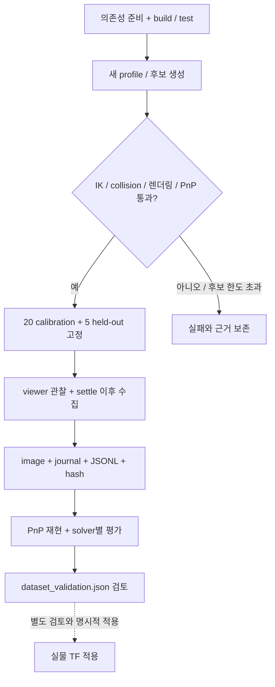

# 캘리브레이션 작업 가이드

## LiDAR 평면 익스트린식

휠 오도메트리 평가는
[`lidar_extrinsic_20261031.json`](../ros2_ws/src/cleany_base_driver/config/lidar_extrinsic_20261031.json)의
`p_base = R(yaw) p_laser + t` 변환을 사용한다. 현재 값은 yaw 179.878864°,
x 0.141531308 m, y 0.001145536 m다. 평가기의 ICP 초기값과 결과 변환에
적용하며, URDF나 TF를 갱신하지 않는다. Z, roll과 pitch는 이 보정의 범위가 아니다.

1. 센서와 프레임을 고정하고 구동 비활성, fault 0, 목표 속도와 PWM 0을 확인한다.
   실제 `/scan`의 각도, 거리와 timestamp를 원본으로 보존한다.
2. `../cleany_cad/cad/Cleany.FCStd`의 현재 장착 위치와 스캔 높이를 확인하고,
   네 수직 프로파일의 실제 단면을 추출한다. 단순 사각형 대신 홈과 곡면을 포함한다.
3. 근거리 반사점을 단면에 강체 정합한다. 사각 배치의 180° 대칭은 CAD의
   전면 장착 위치로 구분하고, 시간 분할과 기둥 하나씩을 제외한 검증을 수행한다.
4. 기존 실물 평가 규약인 CAD −Y → 전진 +X, CAD +X → 좌측 +Y를 유지한다.
   CAD의 표시용 `DriveBase` 등록은 반대 방향이므로 그대로 혼용하지 않는다.
5. 새 날짜의 보정 파일에 원본 위치와 CAD 해시를 기록하고
   [`wheel_odometry_evaluation.json`](../configs/mission/wheel_odometry_evaluation.json)의
   `extrinsic_config`를 선택한다. 저장 스캔을 재검증한 뒤 정지 준비 검사를 거쳐 주행한다.

표면 정합 잔차와 시간별 반복성은 절대 위치 정확도가 아니다. 장착 상태가 바뀌면
다시 측정하며 이전 보정과 원본 시험 결과는 보존한다. 원본 위치는
[실행 근거](EVIDENCE.md#2026-10-31-lidar-재보정)에서 확인한다.

## 휠 측방 부호

실물에서 +Y 명령이 오른쪽 이동으로 확인되면 장착과 연결을 점검하고,
확정한 응답에 맞춰 hardware profile의 `geometry.lateral_sign`을 설정한다.
현재 실물의 값은 −1이며 기본 및 합성 profile은 +1이다.
Base launch는 이 값을 명령 역기구학과 wheel odometry에 함께 적용한다.
한쪽만 바꾸면 폐루프 거리 제어의 방향이 일치하지 않는다.

설정 후 저속 횡이동에서 실제 좌측 이동, 양의 odometry Y와 LiDAR 변위를
함께 확인한다. 그다음 전후, 회전과 대각선 시험을 수행한다.
부호 보정은 기계적 장착각이나 노면 슬립을 보상하지 않는다.
파라미터의 적용 위치는 [Base 계약](../ros2_ws/src/cleany_base_driver/docs/command-and-odometry.md)을
따른다.

## 회전 기반 유효 휠 간격

`base_hardware.yaml`의 `wheel_separation_m`은 실제 폭과 구분한 기구학
유효값이다. 현재 값은 20°, 45°와 90° 회전의 유효한 21개 편도를 함께
맞춘 최소제곱 결과 0.136949 m를 5 mm 단위로 반올림한 **0.135 m**다.
Wheelbase는 0.350 m로 고정했다.

부호가 일치하고 품질 검사를 통과한 LiDAR 회전각을 `l`, 같은 구간의 휠
odometry 회전각을 `o`라고 하면, 원점을 지나는 최소제곱 추정은 다음과 같다.

```text
q_i = (wheelbase + wheel_separation_i) * o_i
S_fit = sum(l_i * q_i) / sum(l_i * l_i)
wheel_separation_fit = S_fit - wheelbase
wheel_separation_applied = round(wheel_separation_fit / 0.005) * 0.005
```

반시계와 시계 회전, 서로 다른 속도를 모두 포함하고, 반올림한 값을 명령
변환과 odometry에 함께 적용한다. 새 회전 시험은 피팅 자료와 분리해 저장한다.
5 mm는 설정값의 양자화 단위이며 측정 정확도나 반복성을 뜻하지 않는다.
회전 방향과 속도에 따른 잔차는 별도로 확인한다.
현재 자료에서는 속도별 유효폭 차이가 남으므로 이 값을 실제 장착 폭이나
모든 속도에서 오차가 제거된 값으로 해석하지 않는다.

## Hand-eye

현재 패키지는 calibration core, ROS 수집 adapter와 오프라인 평가를 유지합니다. MuJoCo calibration 장면과 전용 launch는 제거됐습니다. 현행 기능은 [패키지 안내](../ros2_ws/src/cleany_handeye_calibration/docs/offline-tools.md)를 따릅니다. 아래 MuJoCo 전용 절차는 이전 구현의 참고 기록이며 현재 실행 절차가 아닙니다. 결과 transform은 검토용 artifact로 저장하며 TF에 자동 적용하지 않습니다. 실물 calibration과 grasp 성공은 별도로 검증합니다.

## 작업 흐름



실선은 현재 MuJoCo 수집, 평가 흐름입니다. 실패 표본을 새 pose로 대체하지 않으며, TF 적용에는 별도 검토가 필요합니다.

## 1. 준비

[개발환경](DEVELOPMENT_SETUP.md)에 따라 MoveIt, ros2_control, OpenCV 의존성을 준비하고 아래 검사까지 실행합니다. 좌표, camera, 동기화, dataset 계약은 [frames-and-data](../ros2_ws/src/cleany_handeye_calibration/docs/frames-and-data.md)를 따릅니다.

이전 `pose_generation.mujoco.yaml`은 시뮬레이션 전용입니다. `*.template.*`의 null/미승인 값은 실제 장치 값으로 사용하지 않습니다.

```bash
source /opt/ros/humble/setup.bash
make build-handeye
make test-handeye
```

## 2. 새 pose set 생성

저장소 루트에서 새 이름과 출력 경로를 정합니다. 기존 profile은 덮어쓰지 않습니다.

```bash
export CLEANY_DATA_ROOT="$(dirname "$PWD")/cleany-data"
profile="$CLEANY_DATA_ROOT/fixtures/handeye/my-run"
artifacts="$CLEANY_DATA_ROOT/runs/handeye"
make handeye-generate-mujoco \
  HANDEYE_PROFILE_DIR="$profile" HANDEYE_ARTIFACT_ROOT="$artifacts" \
  HANDEYE_RUN_ID=my-run
```

후보 생성은 headless로 실행합니다. 후보 cap을 넘기면 실패하며, runtime에서 새 pose로 빈 항목을 채우지 않습니다. 생성 후 `materialized_poses.yaml`, `materialized_runtime.json`, materialized URDF와 분석을 확인합니다.

## 3. 수집

```bash
make handeye-mujoco \
  HANDEYE_PROFILE_DIR="$profile" HANDEYE_ARTIFACT_ROOT="$artifacts" \
  HANDEYE_RUN_ID=my-run \
  HANDEYE_POSE_MANIFEST="$profile/materialized_poses.yaml" \
  HANDEYE_RUNTIME_CONFIG="$profile/materialized_runtime.json"
```

Make target은 `headless:=false`로 실행합니다. Viewer/RViz에서 동작과 target visibility를 확인하고, 생성한 profile의 허용 motion, timeout, settle, collision 설정을 검토합니다. 다른 arm/controller/backend는 동시에 실행하지 않습니다.

| 수집 실패 조건 | 처리 |
|---|---|
| Joint feedback, camera 단절 | 실패를 보존하고 다음 표본으로 대체하지 않음 |
| PnP, settle 실패 | 실패를 보존하고 다음 표본으로 대체하지 않음 |

## 4. Dataset 확인

```bash
make handeye-validate-mujoco \
  HANDEYE_PROFILE_DIR="$profile" HANDEYE_ARTIFACT_ROOT="$artifacts" \
  HANDEYE_RUN_ID=my-run \
  HANDEYE_POSE_MANIFEST="$profile/materialized_poses.yaml" \
  HANDEYE_RUNTIME_CONFIG="$profile/materialized_runtime.json"
```

실제 robot-specific offset envelope를 검토한 경우 `HANDEYE_MAX_TRANSLATION_NORM_M`를 함께 지정합니다. 유효성 상한은 검토한 기준을 유지하며, 결과에 맞춰 늘려 실패를 숨기지 않습니다.

### 출력 확인

- run manifest의 code, 환경, URDF/MJCF, profile, camera, board provenance
- 25개 row와 image, row/image/camera hash 및 calibration/held-out split
- 원본 ChArUco 대응점에서 재계산한 PnP와 solver별 유효성, 실패 이유
- `dataset_validation.json`의 누락, 불일치, 평가 결과

표본 저장 완료, solver 성능, 물리 타당성은 각각 확인합니다. 한 solver의 실패는 다른 solver의 성공과 별도로 보존합니다. 실물 적용은 frame 방향, 장착 치수, offset, held-out 결과를 검토한 뒤 명시적으로 수행합니다.

## 실패와 재현

부분 쓰기는 journal로 복구하며 이미 저장한 표본은 재수집으로 덮어쓰지 않습니다. 재현에는 manifest가 기록한 동일 버전, profile, camera 계약이 필요합니다. Container Git이 host worktree 형식을 지원하지 않으면 provenance 수집 문제를 먼저 해결합니다.

과거 실행 결과는 [근거 색인](EVIDENCE.md), 수학, 저장 계약은 [reference](../ros2_ws/src/cleany_handeye_calibration/docs/frames-and-data.md)에서 확인합니다.
