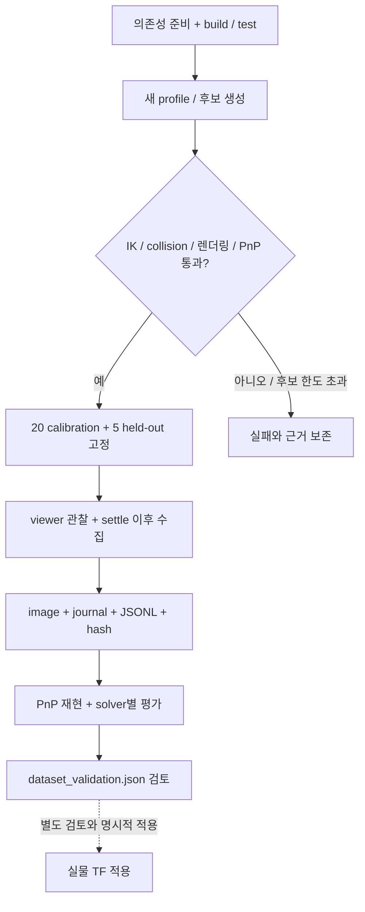

# 캘리브레이션 작업 가이드

## Jetson 실물 모델과 2026-10-09 보정 프로파일

`cleany_description/config/calibration/jetson_20261009/`는 Jetson에서 사용한
헤드와 양손목 카메라 외부 보정, 해당 RGB 내부 보정, 팔과 헤드의 관절 기준을
보존한다. 카메라 외부 보정은 각각 20개 학습 뷰와 별도 5개 검증 뷰로 평가한
`provisional_20plus5_manual_stationary` 결과다.

| 변환 | 적용 내용 |
|---|---|
| `head_camera_rgb_frame` → `head_camera_rgb_optical_frame` | 헤드 RGB 외부 보정 |
| `left_gripper_frame` → `left_wrist_camera_optical_frame` | 왼손목 외부 보정 |
| `right_gripper_frame` → `right_wrist_camera_optical_frame` | 오른손목 외부 보정 |
| 각 `*_wrist_camera_optical_frame` → `*_wrist_rgb_optical_frame` | 항등 변환 alias |

`xyz`는 parent frame 기준 m, `rpy`는 고정축 XYZ의 rad이며,
`parent_T_child`는 child 좌표를 parent 좌표로 변환한다. 보정은 광학 좌표계에
적용하며 카메라 케이스 mesh의 CAD 배치를 옮기지 않는다. 헤드 depth frame은
명목값을 유지한다.

v8 손목 마운트 형상 반영 시 Jetson의 양손목 외부 보정 파일은 이전 수집본과
바이트 단위로 같았다. 형상에서 추정한 광학 좌표로 이 보정값을 대체하지 않는다.
이번 변경은 새로운 hand-eye 보정이나 v8 장착 상태에서의 정확도 검증을 포함하지
않는다. 실제 카메라 장착 위치가 보정 당시와 달라졌다면 재검증이 필요하다.

빌드한 workspace의 `setup.bash`를 읽은 뒤 모델을 실행한다.

```bash
ros2 launch cleany_description description.launch.py \
  use_sim_time:=false calibration_profile:=jetson_20261009
```

이 launch는 `robot_state_publisher`만 실행한다. 관절 상태는 별도 `/joint_states`
입력이 필요하며, 저장된 encoder 영점으로 tick을 변환하거나 모터를 제어하지 않는다.
`calibration_profile`의 기본값은 빈 문자열이다. 기본 실행은 명목 헤드 TF를
유지하고 손목 보정 optical frame을 추가하지 않는다.

노드를 실행하지 않고 보정된 URDF만 확인하려면 다음 명령을 사용한다.

```bash
xacro "$(ros2 pkg prefix --share cleany_description)/urdf/cleany.urdf.xacro" \
  calibration_profile:=jetson_20261009 > /tmp/cleany-calibrated.urdf
```

`arm_joint_calibration.yaml`에는 좌우 12개 모터의 현재 영점, 방향과 rad 오프셋을
담았다. `q = direction × (Present_Position - zero_tick) × 2π/4096 + offset_rad`로
해석한다. Present_Position에 이미 반영된 EEPROM homing offset을 다시 더하지 않는다.
`motors/`의 원본 JSON과 `reference/`의 과거 자세 기록은 측정 근거이며 자동 적용하지
않는다. 현재 매핑은 `arm_joint_calibration.yaml`이 기준이다. 오른쪽 elbow 영점처럼
과거 자세 기록 이후 보완된 값이 있다. 절대 관절 각도 정확도는 검증되지 않았다.

`head_joint_calibration.json`의 pan/tilt 기준 tick은 각각 2009와 2067,
방향은 -1과 +1이다. 이는 수동 영점과 회전 방향 확인이며 회전축 추정 결과가 아니다.
내부 보정 JSON은 외부 보정 입력을 보존하기 위한 자료로, 이 launch에서
`CameraInfo`를 발행하거나 카메라 드라이버 설정을 바꾸지 않는다.

| 카메라 | 검증 보드 위치 RMS | 검증 보드 회전 RMS |
|---|---:|---:|
| 헤드 RGB | 1.246 mm | 0.247° |
| 왼손목 | 8.525 mm | 1.540° |
| 오른손목 | 8.895 mm | 1.739° |

이 수치는 고정 보드 가정에 대한 일관성이다. 절대 위치 ground truth와 하드웨어
노출 동기화는 검증되지 않았다. 오른손목 학습 뷰 3개에는 manual torque hold
기록이 없으며, k3=0 모델은 held-out 평가 전에 선택했다. 각 YAML의 원본 검증
조건과 `absolute_calibration_verified: false`를 유지한다.
원본 보고서 경로와 SHA-256은 프로파일의 `provenance.json`에 기록하며,
절대 경로는 과거 근거 위치로만 사용한다.

## 기존 hand-eye 수집과 평가 도구

현재 패키지는 calibration core, ROS 수집 adapter와 오프라인 평가를 유지합니다. MuJoCo calibration 장면과 전용 launch는 제거됐습니다. 현행 기능은 [패키지 안내](../ros2_ws/src/cleany_handeye_calibration/docs/offline-tools.md)를 따릅니다. 아래 MuJoCo 전용 절차는 이전 구현의 참고 기록이며 현재 실행 절차가 아닙니다. 결과 transform은 검토용 artifact로 저장하며 TF에 자동 적용하지 않습니다. 실물 calibration과 grasp 성공은 별도로 검증합니다.

## 작업 흐름



실선은 현재 MuJoCo 수집, 평가 흐름입니다. 실패 표본을 새 pose로 대체하지 않으며, TF 적용에는 별도 검토가 필요합니다.

## 1. 준비

[개발환경](DEVELOPMENT_SETUP.md)에 따라 MoveIt, ros2_control, OpenCV 의존성을 준비하고 아래 검사까지 실행합니다. 좌표, camera, 동기화, dataset 계약은 [frames-and-data](../ros2_ws/src/cleany_handeye_calibration/docs/frames-and-data.md)를 따릅니다.

이전 `pose_generation.mujoco.yaml`은 시뮬레이션 전용입니다. `*.template.*`의 null/미승인 값은 실제 장치 값으로 사용하지 않습니다.

```bash
source /opt/ros/humble/setup.bash
make build-handeye
make test-handeye
```

## 2. 새 pose set 생성

저장소 루트에서 새 이름과 출력 경로를 정합니다. 기존 profile은 덮어쓰지 않습니다.

```bash
export CLEANY_DATA_ROOT="$(dirname "$PWD")/cleany-data"
profile="$CLEANY_DATA_ROOT/fixtures/handeye/my-run"
artifacts="$CLEANY_DATA_ROOT/runs/handeye"
make handeye-generate-mujoco \
  HANDEYE_PROFILE_DIR="$profile" HANDEYE_ARTIFACT_ROOT="$artifacts" \
  HANDEYE_RUN_ID=my-run
```

후보 생성은 headless로 실행합니다. 후보 cap을 넘기면 실패하며, runtime에서 새 pose로 빈 항목을 채우지 않습니다. 생성 후 `materialized_poses.yaml`, `materialized_runtime.json`, materialized URDF와 분석을 확인합니다.

## 3. 수집

```bash
make handeye-mujoco \
  HANDEYE_PROFILE_DIR="$profile" HANDEYE_ARTIFACT_ROOT="$artifacts" \
  HANDEYE_RUN_ID=my-run \
  HANDEYE_POSE_MANIFEST="$profile/materialized_poses.yaml" \
  HANDEYE_RUNTIME_CONFIG="$profile/materialized_runtime.json"
```

Make target은 `headless:=false`로 실행합니다. Viewer/RViz에서 동작과 target visibility를 확인하고, 생성한 profile의 허용 motion, timeout, settle, collision 설정을 검토합니다. 다른 arm/controller/backend는 동시에 실행하지 않습니다.

| 수집 실패 조건 | 처리 |
|---|---|
| Joint feedback, camera 단절 | 실패를 보존하고 다음 표본으로 대체하지 않음 |
| PnP, settle 실패 | 실패를 보존하고 다음 표본으로 대체하지 않음 |

## 4. Dataset 확인

```bash
make handeye-validate-mujoco \
  HANDEYE_PROFILE_DIR="$profile" HANDEYE_ARTIFACT_ROOT="$artifacts" \
  HANDEYE_RUN_ID=my-run \
  HANDEYE_POSE_MANIFEST="$profile/materialized_poses.yaml" \
  HANDEYE_RUNTIME_CONFIG="$profile/materialized_runtime.json"
```

실제 robot-specific offset envelope를 검토한 경우 `HANDEYE_MAX_TRANSLATION_NORM_M`를 함께 지정합니다. 유효성 상한은 검토한 기준을 유지하며, 결과에 맞춰 늘려 실패를 숨기지 않습니다.

### 출력 확인

- run manifest의 code, 환경, URDF/MJCF, profile, camera, board provenance
- 25개 row와 image, row/image/camera hash 및 calibration/held-out split
- 원본 ChArUco 대응점에서 재계산한 PnP와 solver별 유효성, 실패 이유
- `dataset_validation.json`의 누락, 불일치, 평가 결과

표본 저장 완료, solver 성능, 물리 타당성은 각각 확인합니다. 한 solver의 실패는 다른 solver의 성공과 별도로 보존합니다. 실물 적용은 frame 방향, 장착 치수, offset, held-out 결과를 검토한 뒤 명시적으로 수행합니다.

## 실패와 재현

부분 쓰기는 journal로 복구하며 이미 저장한 표본은 재수집으로 덮어쓰지 않습니다. 재현에는 manifest가 기록한 동일 버전, profile, camera 계약이 필요합니다. Container Git이 host worktree 형식을 지원하지 않으면 provenance 수집 문제를 먼저 해결합니다.

과거 실행 결과는 [근거 색인](EVIDENCE.md), 수학, 저장 계약은 [reference](../ros2_ws/src/cleany_handeye_calibration/docs/frames-and-data.md)에서 확인합니다.

## 실물 상태 프로파일과 헤드 보정

`cleany_robot_interface`의 상태 프로파일은 기존 엔코더 보정과 카메라 외부 보정을
읽어 실물 모델을 생성합니다. `headcam_core`와 `headcam_handeye`는 ChArUco 관측,
헤드 기구학과 정지 구간 검사를 제공합니다. 영상 시각과 엔코더 읽기 구간의 연결은
소프트웨어 시각 추정이며 하드웨어 동기화로 취급하지 않습니다.
기록된 보정의 적용 범위와 정확도는 원본 metadata를 따릅니다.
