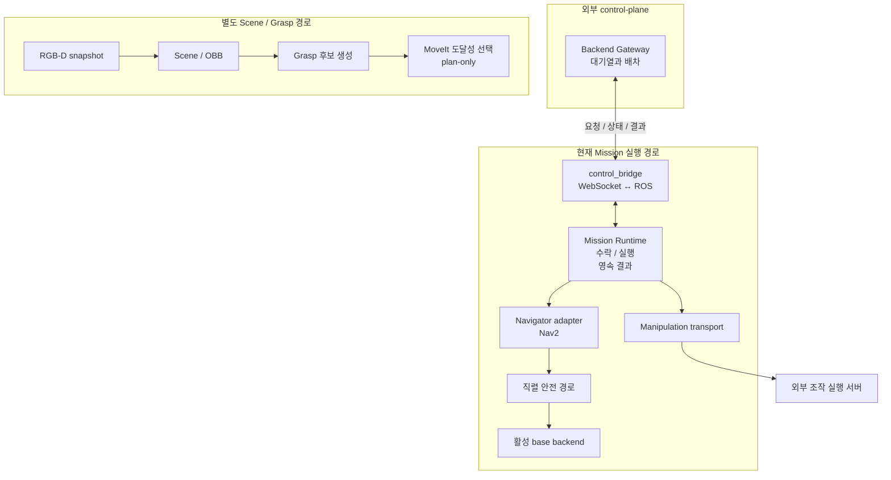

# 연동과 계약

이 문서는 연결 흐름과 각 계약의 소유 위치를 안내합니다. 제품 책임과 안전 원칙은 [KB Technical](cleany-docs/README.md), 정확한 wire type과 실행 옵션은 현재 코드를 기준으로 확인합니다.

## 연결 흐름

실선은 현재 연결 경로입니다. Mission은 lifecycle과 최종 결과를, Backend는 대기열과 배차를 관리합니다.

`grasp/select_reachable`은 plan-only 후보 선택입니다. Trajectory 실행과 수거 완료는 별도 단계이며, 외부 조작 실행 서버와 MuJoCo 접근 데모도 서로 다른 실행 경로입니다.

## Robot interface의 예정 경계

점선은 예정된 공통 adapter 구조입니다. `cleany_robot_interface` adapter는 아직 미구현이며, 현재 구체적인 adapter는 [`cleany_mission_manager/adapters/`](../ros2_ws/src/cleany_mission_manager/cleany_mission_manager/adapters/)에 있습니다. 하드웨어 좌표계와 안전 한계는 adapter와 설정이 소유합니다.

설계 경계의 근거는 KB의 [ROS 2 Software Architecture](<cleany-docs/20_TECHNICAL/11 - ROS 2 Software Architecture.md>)에서 확인합니다.

## 노드별 통신 목록

발행, 구독, 서비스와 액션의 방향, 타입, QoS와 조건은 [ROS 인터페이스 색인](ROS_INTERFACES.md)에서 찾습니다. 각 패키지의 `docs/interfaces.md`가 노드별 표를 관리합니다. 아래 계약 원본은 통신의 의미와 안전 규칙을 설명합니다.

## 계약 원본

| 경계 | 문서와 원본 |
|---|---|
| Mission 수락, 중복, 취소, 복구, Gateway | [Mission](../ros2_ws/src/cleany_interfaces/docs/mission.md) |
| Scene, Grasp snapshot/frame/후보 | [Scene와 Grasp](../ros2_ws/src/cleany_interfaces/docs/scene-and-grasp.md) |
| Manipulation ID, timeout, 중복, 결과 | [Manipulation](../ros2_ws/src/cleany_interfaces/docs/manipulation.md) |
| 공통 base Twist | [Mobile base](../ros2_ws/src/cleany_interfaces/docs/mobile_base.md) |
| ROS driver, odometry, 구동 허가 | [Base driver](../ros2_ws/src/cleany_base_driver/docs/command-and-odometry.md) |
| ROS↔MCU wheel protocol | [Protocol v2](../ros2_ws/src/cleany_base_interfaces/docs/protocol.md) |
| Navigation 직렬 안전, 관측, 정지 | [Safety](../ros2_ws/src/cleany_navigation/docs/safety.md) |
| Robot model, 좌표, 형상 | [Model](../ros2_ws/src/cleany_description/docs/model.md) |
| joint, TCP, MoveIt 그룹 | [Planning](../ros2_ws/src/cleany_moveit_config/docs/planning.md) |
| MuJoCo backend, 시간, sensor | [Backends](../ros2_ws/src/cleany_mujoco_sim/docs/backends.md) |
| Monitor 기록, 재생, stale | [관측 데이터](../ros2_ws/src/cleany_dev_monitor/docs/data.md) |
| Calibration frame, 동기화, dataset | [Frames and data](../ros2_ws/src/cleany_handeye_calibration/docs/frames-and-data.md) |

메시지 필드는 [cleany_interfaces](../ros2_ws/src/cleany_interfaces)와 [cleany_base_interfaces](../ros2_ws/src/cleany_base_interfaces)의 `.msg/.srv/.action`을 기준으로 확인합니다. 위 reference는 필드 목록을 복제하지 않고 단위, 소유권, 오류, 멱등성을 설명합니다.

## 실행과 설정

실행 절차는 [RUNNING](RUNNING.md), 시험 선택은 [TESTING](TESTING.md)를 따릅니다.

| 영역 | 설정 원본 |
|---|---|
| Mission deadline, port, 정책 | [runtime.yaml](../ros2_ws/src/cleany_mission_manager/config/runtime.yaml) |
| 좌석 ID→map pose | [study_cafe_targets.yaml](../ros2_ws/src/cleany_mission_manager/config/study_cafe_targets.yaml) |
| Navigation | [config](../ros2_ws/src/cleany_navigation/config) |
| Grasp predictor | [anygrasp.yaml](../ros2_ws/src/cleany_grasping/config/anygrasp.yaml) |
| 후보 선택 | [grasp_selection.yaml](../ros2_ws/src/cleany_skill_executor/config/grasp_selection.yaml) |
| 실물, mock base | [configs/robot](../configs/robot) |

| 조건 | 연동 규칙 |
|---|---|
| Simulation 접근 목표 | Dock, 팔 도달성, 실환경 좌표는 별도 검증 |
| 초기 `base_hardware.yaml` | 바퀴를 띄운 시험용; 바닥 주행은 별도 허가 |
| 한 실행의 명령과 위치 정보 | 명령원과 canonical odom/TF 소유자를 각각 하나만 유지 |
| 재연결, 재시작 | Cached motion과 미션을 자동 재개하지 않음 |

외부 Backend의 schema, 인증, media 정책은 별도 control-plane 저장소가 관리합니다.
