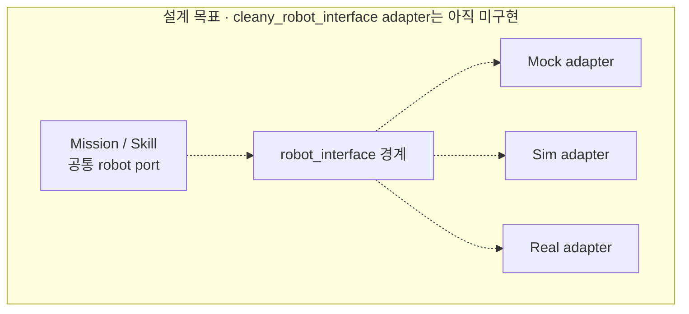

# 연동과 계약

- 이 문서는 연결 순서와 계약의 소유 위치를 안내
- 제품 책임·안전 원칙은 [KB Technical](cleany-docs/README.md), 정확한 wire type과 실행 옵션은 현재 코드가 기준

## 연결 흐름

- 실선: 현재 연결 경로
- 후보 선택 ≠ trajectory 실행·물체 수거 완료

- Mission: lifecycle·최종 결과. Backend: 대기열·배차
- grasp/select_reachable: plan-only
- 외부 실행 서버 ≠ MuJoCo 접근 데모

## Robot interface의 예정 경계

- 점선: 예정된 공통 adapter 구조
- 현재 adapter: [`cleany_mission_manager/adapters/`](../ros2_ws/src/cleany_mission_manager/cleany_mission_manager/adapters/)에 있음
- 하드웨어 좌표계·안전 한계는 adapter와 설정이 소유
- 이 설계 경계의 KB 근거는 [ROS 2 Software Architecture](<cleany-docs/20_TECHNICAL/11 - ROS 2 Software Architecture.md>)다

## 계약 원본

| 경계 | 읽을 문서·원본 |
|---|---|
| Mission 수락·중복·취소·복구·Gateway | [Mission](../ros2_ws/src/cleany_interfaces/docs/mission.md) |
| Scene·Grasp snapshot/frame/후보 | [Scene와 Grasp](../ros2_ws/src/cleany_interfaces/docs/scene-and-grasp.md) |
| Manipulation ID·timeout·중복·결과 | [Manipulation](../ros2_ws/src/cleany_interfaces/docs/manipulation.md) |
| 공통 base Twist | [Mobile base](../ros2_ws/src/cleany_interfaces/docs/mobile_base.md) |
| ROS driver·odometry·구동 허가 | [Base driver](../ros2_ws/src/cleany_base_driver/docs/command-and-odometry.md) |
| ROS↔MCU wheel protocol | [Protocol v2](../ros2_ws/src/cleany_base_interfaces/docs/protocol.md) |
| Navigation 직렬 안전·관측·정지 | [Safety](../ros2_ws/src/cleany_navigation/docs/safety.md) |
| Robot model·좌표·형상 | [Model](../ros2_ws/src/cleany_description/docs/model.md) |
| joint·TCP·MoveIt 그룹 | [Planning](../ros2_ws/src/cleany_moveit_config/docs/planning.md) |
| MuJoCo backend·시간·sensor | [Backends](../ros2_ws/src/cleany_mujoco_sim/docs/backends.md) |
| Monitor 기록·재생·stale | [관측 데이터](../ros2_ws/src/cleany_dev_monitor/docs/data.md) |
| Calibration frame·동기화·dataset | [Frames and data](../ros2_ws/src/cleany_handeye_calibration/docs/frames-and-data.md) |

- 메시지 필드는 [cleany_interfaces](../ros2_ws/src/cleany_interfaces)와 [cleany_base_interfaces](../ros2_ws/src/cleany_base_interfaces)의 `.msg/.srv/.action`이 기준
- Reference 대상: 단위·소유권·오류·멱등성. 필드 목록 중복 금지

## 실행과 설정

- 실행 절차는 [RUNNING](RUNNING.md), 시험 선택은 [TESTING](TESTING.md)를 기준

| 영역 | 설정 원본 |
|---|---|
| Mission deadline·port·정책 | [runtime.yaml](../ros2_ws/src/cleany_mission_manager/config/runtime.yaml) |
| 좌석 ID→map pose | [study_cafe_targets.yaml](../ros2_ws/src/cleany_mission_manager/config/study_cafe_targets.yaml) |
| Navigation | [config](../ros2_ws/src/cleany_navigation/config) |
| Grasp predictor | [anygrasp.yaml](../ros2_ws/src/cleany_grasping/config/anygrasp.yaml) |
| 후보 선택 | [grasp_selection.yaml](../ros2_ws/src/cleany_skill_executor/config/grasp_selection.yaml) |
| 실물·mock base | [configs/robot](../configs/robot) |

- simulation 접근 목표는 dock·팔 도달성·실환경 좌표의 검증값이 아님
- `base_hardware.yaml`의 초기 제한값은 바퀴를 띄운 시험용이며 바닥 주행 허가가 아님

- 한 실행에서는 명령원과 canonical odom/TF 소유자를 하나만 둔다
- 재연결과 재시작은 cached motion 또는 미션을 자동 재개할 근거가 아님
- 외부 Backend의 schema·인증·media 정책은 별도 control-plane 저장소가 관리
