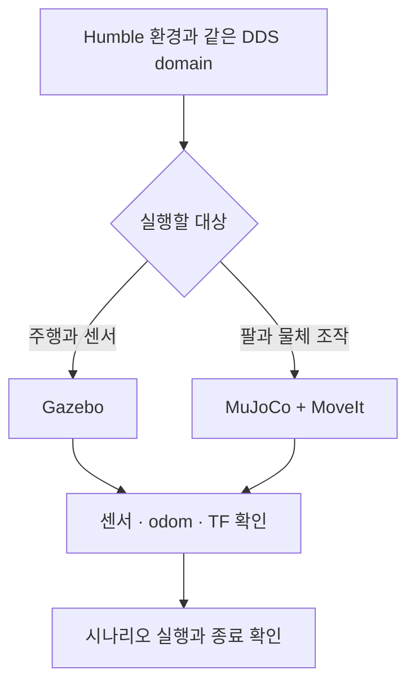

# 실행 가이드

할 일을 선택하고 준비 → 실행 → 관측 → 종료 순서로 진행합니다. 각 가이드는 같은 저장소의 명령과 설정을 기준으로 합니다.



| 하려는 일 | 가이드 | 확인할 결과 |
|---|---|---|
| 가상 환경에서 센서·주행 확인 | [시뮬레이션](how-to/simulation.md) | scan, odom, TF |
| LiDAR로 지도 생성·저장 | [매핑](how-to/mapping.md) | map.yaml, PGM, pbstream |
| 저장 지도에서 목표 주행 | [휴대폰 주행](how-to/phone-navigation.md) | 경로 미리보기와 정지 응답 |
| 물체 관찰·후보 계획·조작 | [조작](how-to/manipulation.md) | snapshot, 계획, Action 결과 |
| Backend 요청과 실행 연결 | [Mission](how-to/mission.md) | 요청 수락, 허가, 결과 |
| 센서 입력과 장애물 관측 | [센서](how-to/sensors.md) | 영상·점군·frame·시각 |
| MCU와 베이스 연결 | [베이스](how-to/base.md), [펌웨어](../esp32/README.md) | 휠 피드백과 STOP ACK |
| 기록과 화면 확인 | [관측·기록](how-to/monitoring.md) | Logger 세션과 Monitor 화면 |

## 실행 선택과 준비 순서

위 표에서 작업을 고른 뒤 해당 가이드의 준비 조건을 확인합니다.

## 공통 준비

명령은 저장소 루트의 Ubuntu 22.04 / Humble 터미널에서 실행합니다. [환경과 출력 경로](DEVELOPMENT_SETUP.md), [연동 계약](INTEGRATION.md)을 확인한 뒤, 각 터미널에 같은 DDS domain과 같은 worktree overlay를 적용합니다.

```bash
source /opt/ros/humble/setup.bash
source "$(make -s print-install-base)/setup.bash"
```

Navigation 전용 빌드는 `print-navigation-install-base`로 overlay를 조회합니다. 빌드 때 바꾼 Make 변수는 경로 조회 때도 동일하게 전달합니다.

## 세부 절차 바로가기

## Gazebo

[Gazebo 절차](how-to/simulation.md#gazebo)

## 시설 생성 도구와 종료

[시설 생성 도구와 종료 절차](how-to/simulation.md#시설-생성-도구와-종료)

## 저장 지도 Navigation

[저장 지도 Navigation 절차](how-to/mapping.md#저장-지도-navigation)

## 실물 휠 odometry와 2D LiDAR 매핑

[실물 휠 odometry와 2D LiDAR 매핑 절차](how-to/mapping.md#실물-휠-odometry와-2d-lidar-매핑)

### 오프라인 SLAM 비교용 원본 bag

[오프라인 SLAM 비교용 원본 bag 절차](how-to/mapping.md#오프라인-slam-비교용-원본-bag)

## 실물 depth local costmap 연결

[실물 depth local costmap 연결 절차](how-to/sensors.md#실물-depth-local-costmap-연결)

### 기존 지도 병행 확장

[지도 확장 절차](how-to/mapping.md#기존-지도-병행-확장)

## MuJoCo와 조작 데모

[MuJoCo와 조작 데모 절차](how-to/manipulation.md#mujoco와-조작-데모)

### 단일 물체 Manipulation Action

[단일 물체 Manipulation Action 절차](how-to/manipulation.md#단일-물체-manipulation-action)

### Plan-only 후보 선택

[Plan-only 후보 선택 절차](how-to/manipulation.md#plan-only-후보-선택)

### MuJoCo 접근 데모

[MuJoCo 접근 데모 절차](how-to/manipulation.md#mujoco-접근-데모)

## Mission Runtime과 Backend

[Mission Runtime과 Backend 절차](how-to/mission.md#mission-runtime과-backend)

### 주행 구성을 함께 실행

[주행 구성을 함께 실행 절차](how-to/mission.md#주행-구성을-함께-실행)

### 기존 주행 구성에 Runtime 연결

[기존 주행 구성에 Runtime 연결 절차](how-to/mission.md#기존-주행-구성에-runtime-연결)

### System Supervisor 감독 stack

[System Supervisor 감독 stack 절차](how-to/mission.md#system-supervisor-감독-stack)

### Gazebo 주행과 Mock 조작

[Gazebo 주행과 Mock 조작 절차](how-to/mission.md#gazebo-주행과-mock-조작)

### 주행도 Mock으로 Action 연결 확인

[주행도 Mock으로 Action 연결 확인 절차](how-to/mission.md#주행도-mock으로-action-연결-확인)

## 실물 IMU

[실물 IMU 절차](how-to/sensors.md#실물-imu)

## ToF 근접 보호와 책상 접근

[ToF 근접 보호와 책상 접근 절차](how-to/sensors.md#tof-근접-보호와-책상-접근)

## D435 장애물 미리보기

[D435 장애물 미리보기 절차](how-to/sensors.md#d435-장애물-미리보기)

## Base와 plot

[Base와 plot 절차](how-to/base.md#base와-plot)

### 장치 없는 mock

[장치 없는 mock 절차](how-to/base.md#장치-없는-mock)

### 실물 base와 관측 GUI

[실물 base와 관측 GUI 절차](how-to/base.md#실물-base와-관측-gui)

## 개발 Monitor

[개발 Monitor 절차](how-to/monitoring.md#개발-monitor)

### 독립 Logger

[독립 Logger 절차](how-to/monitoring.md#독립-logger)

## Jetson 얼굴 디스플레이

[Jetson 얼굴 디스플레이 절차](how-to/monitoring.md#jetson-얼굴-디스플레이)

## 휴대폰 Omni 주행의 슬립 복구

[휴대폰 Omni 주행의 슬립 복구 절차](how-to/phone-navigation.md#휴대폰-omni-주행의-슬립-복구)

## 휴대폰 지도 클릭 주행 (LiDAR 전용 시연)

[휴대폰 지도 클릭 주행 (LiDAR 전용 시연) 절차](how-to/phone-navigation.md)
