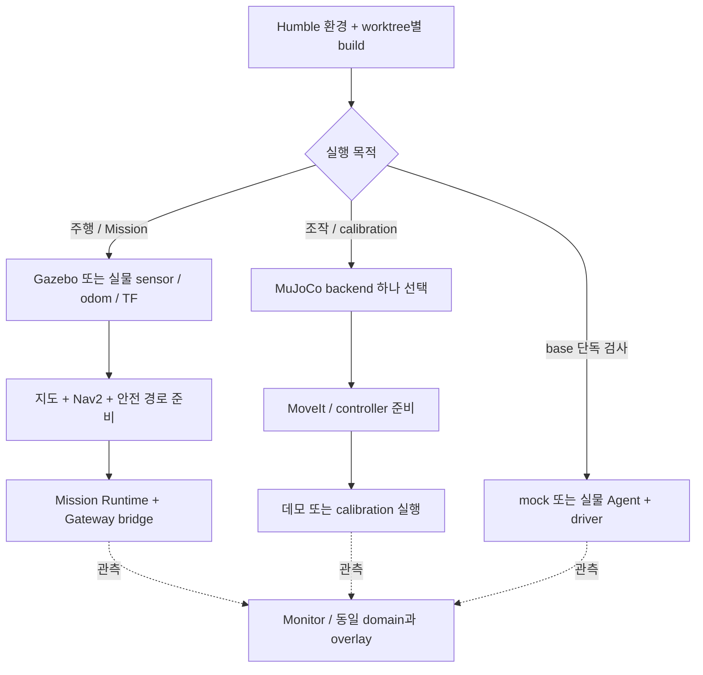

# 실행 가이드

## 휴대폰 Omni 주행의 슬립 복구

LiDAR 전용 `phone_navigation.launch.py`의 Omni 프로필은 `slip_recovery:=true`가
기본이다. `config/phone_slip_recovery.yaml`에서 감지와 복구 시간을 조정한다.
`slip_recovery:=false`는 기존 기본 BT와 명령 경로를 사용한다. 기본 종방향
프로필과 다른 launch에는 이 복구가 자동 적용되지 않는다.

약 1초의 LiDAR/휠 이동 비교가 2개 연속 의심이면 BT가 현재 추종을 취소하고
감속 정지한다. fresh odom과 감속 게이트의 0 출력으로 0.5초 연속 정지를 확인한 뒤 `Longitudinal`
플래너와 컨트롤러로 같은 목표를 한 번 재시도한다. 해당 목표가 종료될 때까지
종방향 모드를 유지하며, 정지 중 신호가 사라져도 Omni로 복귀하지 않는다.
재시도 이후 새 비교 창에서 슬립이 다시 확인되거나 재시도가 실패하면 정지 후
목표를 실패 처리한다. 슬립 분기에는 costmap 초기화나 무조건적인 회전, 후진
복구가 없다. 일반 탐색 실패에는 기존 기본 BT 복구를 유지한다.

재시도 플래너는 `/traction_retry/compute_path_to_pose`를 제공하는 별도
프로세스로 실행한다. 두 Lattice 모델이 내부 static motion table을 공유하는
간섭을 피하고, 동일한 지도와 안전 footprint를 쓰는 별도 global costmap을 갖는다.
종방향 MPPI 컨트롤러는 기존 controller server의 `Longitudinal` plugin이다.

감지의 `unknown`은 정상 판정이 아니다. 유효한 측정이 3초 이상 없으면 정지 후
실패한다. 첫 측정 전에는 명령을 허용하지 않는다. 정지 확인은 5초 제한이며,
확인 실패도 목표 실패로 끝난다. 센서 비교와 BT tick 주기로 인해 즉시 감지나
물리 정지 거리를 보장하지 않는다.

명령 흐름은 `motion/cmd_vel → traction_brake → motion/traction_cmd_vel →
collision_monitor → navigation/safe_cmd_vel → 기존 최종 구동 소유자`다.
BT 요청에 따른 감속은 충돌 검사 전에 수행한다. 충돌 STOP과 기존 Supervisor,
MCU 허가 및 정지 확인은 계속 우선한다. BT heartbeat가 0.5초 또는 명령이
0.3초 이상 끊기면 게이트는 0을 출력한다. 수동 조종 경로에는 게이트를 삽입하지 않는다.

명령은 저장소 루트의 Ubuntu 22.04 / Humble 터미널에서 실행합니다. [환경과 출력 경로](DEVELOPMENT_SETUP.md), [연동 계약](INTEGRATION.md)을 확인한 뒤, 각 터미널에 같은 DDS domain과 같은 worktree overlay를 적용합니다.

```bash
source /opt/ros/humble/setup.bash
source "$(make -s print-install-base)/setup.bash"
```

Navigation 전용 빌드는 `print-navigation-install-base`로 overlay를 조회합니다. 빌드 때 바꾼 Make 변수는 경로 조회 때도 동일하게 전달합니다.

## 실행 선택과 준비 순서



`mission_sim.launch.py`는 주행과 Mission 구성을 함께 띄웁니다. Sensor와 Nav2가 이미 준비돼 있다면 `mission_runtime.launch.py`만 붙입니다. 아래에서 실행 목적에 맞는 절차를 선택합니다.

## Gazebo

1. 의존성과 실행 환경을 확인합니다.
2. Headless base, study-cafe GUI, 전체 시설 GUI 중 하나를 실행합니다.

```bash
make deps-gazebo
make check-gazebo-env
make sim-gazebo                 # headless base
make sim-gazebo-study-cafe      # study-cafe GUI; 위 실행과 별도로 사용
make sim-gazebo-facility        # 전체 시설 GUI; 위 실행과 별도로 사용
```

GUI renderer는 `GAZEBO_GUI_RENDER_ENGINE=ogre|ogre2`로 선택합니다. 센서 서버는 OGRE2를 사용하므로 GPU LiDAR와 camera는 headless에서도 OpenGL context가 필요합니다. 지원 환경은 Fortress/Humble입니다.

3. 같은 overlay/domain의 별도 터미널에서 sensor와 odometry를 확인합니다.

```bash
ros2 topic hz /clock
ros2 topic hz /scan
ros2 topic echo /odom --once
ros2 run tf2_ros tf2_echo odom base_link
```

Topic 등록 이후 실제 발행, 이동, 정지를 각각 확인합니다. 실행별 sensor와 odometry 소유권은 [연동 가이드](INTEGRATION.md)를 따릅니다.

## Mission Runtime과 Backend

### 주행 구성을 함께 실행

빌드와 overlay 적용 후 Gazebo, Nav2, Runtime, Gateway를 함께 실행합니다.

```bash
make build-mission-sim
source "$(make -s print-install-base)/setup.bash"
ros2 launch cleany_bringup mission_sim.launch.py \
  gateway_url:=ws://127.0.0.1:8080/api/robots/cleany-01/gateway/ws \
  post_mission:=wait_for_next
```

Backend는 별도 `cleany-control-plane` 저장소에서 실행합니다. 같은 robot에 Runtime, bridge, canonical odometry producer를 중복 실행하지 않습니다. 책상 작업은 기본 mock이며 관측 ID에는 실제 사진이 포함되지 않습니다.

### 기존 주행 구성에 Runtime 연결

AMCL/Nav2가 이미 실행 중이면 아래 명령으로 Runtime을 연결합니다.

```bash
make build-mission-runtime
source "$(make -s print-install-base)/setup.bash"
ros2 launch cleany_mission_manager mission_runtime.launch.py \
  gateway_url:=ws://127.0.0.1:8080/api/robots/cleany-01/gateway/ws \
  post_mission:=wait_for_next
```

`mission_runtime.launch.py`의 기본 `supervision_mode:=required`는 아래 System Supervisor 감독 stack이 함께 실행 중이어야 미션을 받습니다. 감독 없이 실행하면 `SUPERVISOR_UNAVAILABLE` 사유로 거절합니다.

| 실행 조건 | 설정과 동작 |
|---|---|
| 감독 없이 단독 실험 | `supervision_mode:=disabled`; snapshot의 `supervision`에 기록. 시스템 Fault와 E-stop 증거를 확인하지 않음 |
| Nav2 없이 구조 확인 | `navigation_backend:=mock` 추가 |
| 완료 후 동작 선택 | `post_mission:=return_home\|wait_for_next`; 제품 복귀 정책은 별도 결정 |
| 독립 실험 | 별도 `journal_path`, `bridge_journal_path` 사용 |
| 동일 미션 복구 | 기존 journal DB 유지 |

재연결, 중복, 취소, 재시작 동작은 [Mission 계약](../ros2_ws/src/cleany_interfaces/docs/mission.md)을 따릅니다.

### System Supervisor 감독 stack

Supervisor, safety adapter, Nav2 lifecycle 복구 owner를 Runtime 옆에 실행합니다. 센서, Nav2와 Runtime은 각자의 launch가 소유합니다.

```bash
make build-supervision
source "$(make -s print-navigation-install-base)/setup.bash"
source "$(make -s print-install-base)/setup.bash"
ros2 launch cleany_system_supervisor supervision.launch.py \
  estop_released_topic:=<하드웨어 해제 Bool> protection_ready_topic:=<보호 계층 Bool>
ros2 run cleany_system_supervisor supervisor_operator            # 활성 Fault 확인
ros2 run cleany_system_supervisor supervisor_operator ESTOP --operator <name>
```

| 실행 조건 | 설정과 동작 |
|---|---|
| 안전 증거 topic 미지정 | 의도된 `FAULT_LOCKED`; Runtime은 `SYSTEM_FAULT_LOCKED`로 거절 |
| 팔 controller가 있는 구성 | `arm_health:=true`로 `arm_health_monitor` 추가 |
| Gazebo 통합 실행 | `mission_sim.launch.py supervision:=true`; 시뮬레이션에는 안전 하드웨어가 없어 evidence topic을 주지 않으면 잠김 |
| 상태 파일 | 기본 `~/.ros/cleany/system_supervisor_state.json`; latched Fault가 재시작 뒤에도 유지 |

Fault, 복구와 운영자 절차는 [System Supervisor](../ros2_ws/src/cleany_system_supervisor/docs/supervision.md)를 따릅니다. 영구 기록이 필요하면 `cleany_logger` 기록 대상에 `/system/events`, `/system/state`, `/system/faults`, `/safety/status`를 추가합니다.

### Gazebo 주행과 Mock 조작

베이스 주행은 Gazebo/Nav2, 인식과 계획 및 팔 조작은 Mock이다. 모든 터미널에 같은 overlay와 DDS domain을 적용한다. 기본 로컬 Mock 실행과 별도로 사용한다.

1. 통합 package를 빌드하고 환경을 적용한다.

```bash
make build-mission-sim
source "$(make -s print-install-base)/setup.bash"
export ROS_DOMAIN_ID=186
```

2. Gateway 없이 시작한다. 세 DB 경로는 분리하고 재시작 시험에서는 보존한다.

```bash
ros2 launch cleany_bringup mission_sim.launch.py \
  profile:=fortress headless:=true \
  runtime_config:=$PWD/ros2_ws/src/cleany_mission_manager/config/runtime_gazebo_manipulation_mock.yaml \
  start_manipulation_mock:=true manipulation_scenario:=success \
  post_mission:=wait_for_next enable_bridge:=false enable_telemetry:=false \
  journal_path:=$HOME/.local/state/cleany/mission-mock/missions.db \
  bridge_journal_path:=$HOME/.local/state/cleany/mission-mock/bridge.db \
  manipulation_database_path:=$HOME/.local/state/cleany/mission-mock/manipulation.sqlite3
```

3. 별도 터미널에서 `ros2 topic echo /mission/status`로 `ready: true`를 확인한 뒤 요청한다. 새 미션에는 새 ID를 사용한다. `NAV2_NOT_READY`이면 Nav2 lifecycle, odom과 TF를 먼저 확인한다.

```bash
ros2 service call /mission/offer cleany_interfaces/srv/OfferMission \
  "{mission_id: gazebo-mock-demo-001, mission_type: clean_desk, target_kind: SEAT, target_id: seat-12, requested_by: manual-test}"
ros2 topic echo /mission/result
```

수락 응답은 완료 결과가 아니다. 정상 실행은 두 물체를 서로 다른 execution ID로 처리한 뒤 추가 빈 관측을 확인한다. 물체당 정상 조작 시간은 약 40초다. [개발 Monitor](#개발-monitor)의 실행 → BT에서 ExecuteOne을 선택하거나 매니퓰레이션 화면을 연다. 같은 domain과 overlay를 사용한다.

Backend 조합과 주행 설정은 [Mock 연결 reference](../ros2_ws/src/cleany_mission_manager/docs/manipulation_mock_integration.md)를 따른다. 기본 종료 정책은 `return_home`이며 위 명령의 첫 시험은 `wait_for_next`를 명시한다.

### 주행도 Mock으로 Action 연결 확인

두 터미널에서 같은 overlay와 `ROS_DOMAIN_ID=186`을 사용한다. 첫 터미널에서 서버를 시작한다.

```bash
make build-mission-mock
source "$(make -s print-install-base)/setup.bash"
export ROS_DOMAIN_ID=186
ros2 launch cleany_skill_executor manipulation_mock.launch.py \
  mock_config:=$PWD/ros2_ws/src/cleany_mission_manager/config/manipulation_server_fixture.yaml \
  database_path:=$HOME/.local/state/cleany/mission-mock/manipulation.sqlite3
```

두 번째 터미널에서 Runtime을 시작한 뒤 위의 준비 확인과 미션 요청을 수행한다. 이 구성의 주행 성공은 Gazebo 주행 증거가 아니다.

```bash
ros2 run cleany_mission_manager mission_runtime --ros-args \
  --params-file ros2_ws/src/cleany_mission_manager/config/runtime_manipulation_mock.yaml \
  -p targets_file:=$PWD/ros2_ws/src/cleany_mission_manager/config/study_cafe_targets.yaml \
  -p post_mission:=wait_for_next \
  -p journal_path:=$HOME/.local/state/cleany/mission-mock/missions.db
```

## 저장 지도 Navigation

```bash
make build-navigation
source "$(make -s print-navigation-install-base)/setup.bash"
ros2 launch cleany_navigation navigation.launch.py --show-args
```

[Launch](../ros2_ws/src/cleany_navigation/launch/navigation.launch.py)에서 지도, backend, sensor 옵션을 확인합니다. `map → odom`의 소유자는 하나만 선택하므로 Mapping과 AMCL을 함께 실행하지 않습니다.

주행 명령은 Mission의 Navigator/Nav2가 생성합니다. Runtime은 `/cmd_vel`을 직접 만들지 않으며, 안전 경로와 sensor 만료 규칙은 [Navigation reference](../ros2_ws/src/cleany_navigation/docs/safety.md)를 따릅니다.

## MuJoCo와 조작 데모

```bash
make sim
# viewer가 필요하면 build와 overlay source 후:
ros2 launch cleany_mujoco_sim mujoco_sim.launch.py headless:=false
ros2 launch cleany_mujoco_sim rgbd_pick_demo.launch.py
```

위 두 실행과 `handeye_backend.launch.py` 중 backend 하나만 실행합니다. RGB-D scene 출력은 grasp/skill 입력으로 사용하며, 수거 완료는 별도로 확인해야 합니다.

### 단일 물체 Manipulation Action

Mock 서버의 요청, 취소, 조회와 모니터 사용은
[Mock 실행 안내](../ros2_ws/src/cleany_skill_executor/docs/manipulation_mock_usage.md)를 따릅니다.
실제 인식과 MoveIt을 사용하는 MuJoCo BT 스택은 다음 명령으로 실행합니다.

```bash
make sim-mujoco-manipulation
```

이 스택은 승인된 물체 하나를 실행하며, 기존 sorting coordinator와 별도 구성입니다.
입력, 세부 옵션과 검증 범위는 [MuJoCo BT 서버](../ros2_ws/src/cleany_manipulation_bt/README.md)를 따릅니다.

### Plan-only 후보 선택

MoveIt을 준비한 뒤 같은 overlay의 별도 터미널에서 후보 선택을 실행합니다.

```bash
ros2 launch cleany_moveit_config mock_planning.launch.py
# 같은 overlay의 별도 터미널
ros2 launch cleany_skill_executor grasp_selection.launch.py
```

### MuJoCo 접근 데모

아래 데모는 MuJoCo controller까지 연결합니다. 두 launch는 각각 별도로 실행합니다.

```bash
ros2 launch cleany_skill_executor grasp_execution_demo.launch.py
ros2 launch cleany_skill_executor can_grasp_execution_demo.launch.py
```

| 데모 | 확인 범위 | 실행 조건 |
|---|---|---|
| 기본 grasp | 후보 선택, 두 trajectory 실행, 최종 joint 수렴 | MuJoCo controller 연결 |
| can grasp | RGB-D 검출, 후보 생성, 충돌 검사, 그리퍼 개방, 방향 보정 pre-grasp 접근 | Viewer/OpenGL 필요; `headless:=true` 미지원 |

두 데모 모두 gripper close, attach, lift와 실제 수거는 검증하지 않습니다. Plan-only action과 데모의 차이는 [Manipulation 계약](../ros2_ws/src/cleany_interfaces/docs/manipulation.md)을 따릅니다.

## 개발 Monitor

```bash
make build-dev-monitor
make run-dev-monitor
```

브라우저에서 `http://127.0.0.1:8768`을 엽니다. Monitor는 관측 전용이며, 관측 대상과 같은 DDS domain과 메시지 overlay가 필요합니다. Frontend 준비는 [개발환경](DEVELOPMENT_SETUP.md)을 따릅니다.

실시간 입력과 logger 연결은 [monitor.yaml](../ros2_ws/src/cleany_dev_monitor/config/monitor.yaml)에서
설정합니다. `make build-dev-monitor`는 logger도 빌드하지만 Monitor 실행은 logger를
자동 시작하지 않습니다. 기록은 아래 절차로 별도 실행합니다. 웹 자산 갱신 후에는
`make build-dev-monitor-ros`로 설치 자산도 갱신합니다.

### 독립 Logger

1. 웹 없이 logger만 빌드하려면 `make build-logger`를 실행합니다.
2. 빌드 overlay를 source한 별도 터미널에서 logger를 시작합니다.
   CLI에서 토픽을 먼저 설정하려면 녹화 대기 상태로 실행합니다.

   ```bash
   ros2 launch cleany_logger logger.launch.py record_on_start:=false
   ```

   기본값인 `record_on_start:=true`는 즉시 녹화하며, 시뮬레이션에서는
   `use_sim_time:=true`를 지정합니다. `make run-logger LOGGER_LAUNCH_ARGS='record_on_start:=true'`도
   사용할 수 있습니다.
3. 같은 DDS domain과 빌드 overlay를 사용하는 다른 터미널에서 CLI로 설정하고
   녹화합니다. 설정을 먼저 바꾸려면 logger를 `record_on_start:=false`로 실행합니다.
   이미 녹화 중이면 `stop` 후 설정합니다.

   ```bash
   ros2 run cleany_logger logger status
   ros2 run cleany_logger logger topics
   ros2 run cleany_logger logger topics set camera --topic /camera/head/color/image_raw --hz 2 --enable
   ros2 run cleany_logger logger topics set path_topic --topic /plan --hz 1 --enable
   ros2 run cleany_logger logger start
   ros2 run cleany_logger logger stop
   ```

   `topics set <ID> --disable`은 해당 항목을 끕니다. ID는 `topics` 출력에서 확인합니다.
   속도 체인은 `topics set velocity_topics --topic /first --topic /second`로 전체를
   지정하거나 `velocity_topics:0`처럼 특정 항목만 변경합니다. 출처별 `--hz all`은
   수신마다 기록하며 카메라 등 센서 원본은 숫자 Hz가 필요합니다. 카메라와 점군
   원본은 대용량이므로 필요한 토픽과 주기를 선택합니다.

   루트에서 `make logger LOGGER_ARGS='status'`로도 호출할 수 있습니다.
   다른 노드는 `--node /robot/logger`, 대기 시간은 `--timeout 3`, 자동화 출력은
   `--json`으로 지정합니다. 이 옵션은 하위 명령 앞이나 뒤에 쓸 수 있습니다.
   CLI는 한 번 요청하고 종료하며 logger 프로세스와 녹화는 계속됩니다.
4. 대시보드를 사용하려면 별도 터미널에서 `make run-dev-monitor`를 실행합니다.
   기본 저장 위치는 두 프로세스 모두 `~/.local/state/cleany/recordings`입니다.
   다른 경로는 logger YAML의 `state_directory`와 Monitor의
   `MONITOR_ROS_ARGS='-p state_directory:=/absolute/path'`에 동일하게 지정합니다.
   이전 기록은 기존 디렉터리를 명시해 조회합니다. 대시보드나 브라우저를 종료해도
   logger는 같은 세션을 녹화합니다.

`mission_sim.launch.py`는 `enable_logger:=true record_on_start:=true`로 logger를
함께 실행할 수 있습니다. 기본은 비활성이며 `logger_config:=/absolute/logger.yaml`로
설정을 지정합니다. 이 launch 구성은 시뮬레이션 시계를 logger에 전달합니다.

기록 구조는 [Logger 데이터 계약](../ros2_ws/src/cleany_logger/docs/data.md),
HTTP와 stale 처리는 [Monitor 계약](../ros2_ws/src/cleany_dev_monitor/docs/data.md)을 따릅니다.

상세 SLAM, LiDAR, 점군과 costmap은 같은 domain의 RViz에서 확인합니다. 완료된 원본 bag ZIP을 내려받아 압축을 푼 뒤 다음과 같이 재생합니다. Bag에 기록된 토픽, TF와 CameraInfo만 사용할 수 있으며 SQLite 가공 기록은 RViz 입력이 아닙니다.

```bash
ros2 bag info <bag-directory>
ros2 bag play <bag-directory> --clock
rviz2 --ros-args -p use_sim_time:=true
```

Fixed Frame은 `map_frame`에 맞추고 Cartographer Submaps display에는 해당 plugin을 설치합니다.

진단 토픽은 `<bag-directory>/diagnostics`의 별도 bag에 있습니다. 센서와 함께
보려면 동일한 시작 시각 기준으로 두 bag을 재생합니다. 센서 bag은 `/clock`을
발행하고 진단 bag은 `--clock` 없이 재생합니다. 정밀 비교에는 각 bag의 첫 메시지
시각 차이도 맞춰야 합니다.

LiDAR 매핑의 보정 분석용 기록에서는 `/scan_raw`,
`/odom`, `/base/wheel_state`, TF를 full-rate로 남기고, 중복 `/scan`, `/wheel/odom`,
`/joint_states`는 기록에서 제외할 수 있습니다. 재생성에는 당시 필터와 휠 변환
설정도 보존해야 합니다. 궤적은 1 Hz, 제약선은 0.5 Hz로 기록하고 submap 목록,
matched points, map과 가공 관측의 주기는 기존 설정을 유지합니다.
카메라와 depth 점군은 별도로 선택합니다. 설정은 녹화가 정지된
상태에서 적용하며 실시간 RViz 표시나 센서 발행 주기는 바꾸지 않습니다.
시간당 용량은 지도와 그래프 크기에 따라 달라지므로 실제 입력으로 확인합니다.
이 분석용 주기에 이전의 0.1 Hz 절약 설정에서 측정한 0.97 GB/h를 적용하면 안 됩니다.
`limit_mib`는 시간당 속도가 아닌 세션 총량 제한입니다.

## Base와 plot

### 장치 없는 mock

별도 domain에서 빌드한 mock를 실행합니다.

```bash
make build-base
export ROS_DOMAIN_ID=173
source "$(make -s print-install-base)/setup.bash"
ros2 launch cleany_base_driver base_driver.launch.py mock:=true
```

Mock domain에는 실물 MCU/Agent를 연결하지 않습니다. 고장 주입 service는 mock node와 테스트가 관리합니다.

### 실물 base와 관측 GUI

Agent와 driver 양쪽에 domain 0을 적용하고 검토한 hardware config를 선택합니다.

```bash
export ROS_DOMAIN_ID=0
ros2 launch cleany_base_driver base_driver.launch.py \
  mock:=false config:="$(ros2 pkg prefix --share cleany_base_driver)/config/base_hardware.yaml"
# 같은 overlay/domain의 별도 터미널에서 관측 GUI:
ros2 launch cleany_base_driver base_monitor.launch.py preset:=true
```

초기 hardware config는 바퀴를 띄운 시험용입니다. Launch 이후 구동 허가는 별도 절차로 수행하며, mock domain과 실제 MCU domain을 혼용하지 않습니다. 실물 시험은 [ESP32 가이드](../esp32/README.md)와 [base 계약](../ros2_ws/src/cleany_base_driver/docs/command-and-odometry.md)을 따릅니다.

Plot은 목표, slew/reversal 이후 목표, encoder 속도(rad/s), PWM(%), diagnostics를 표시합니다. `preset:=false wheel:=fl|fr|rl|rr|all`로 관측 범위를 바꿀 수 있습니다. GUI를 종료해도 별도로 실행한 driver/Agent는 계속 실행됩니다.

## 시설 생성 도구와 종료

`ros2 run cleany_gazebo_sim <스크립트명> --help`로 각 도구의 입력을 확인합니다.

| CLI | 출력 |
|---|---|
| `generate_mission_targets.py` | 접근 목표 YAML과 검증 JSON |
| `render_layout_overlay.py` | 명시한 layout, reference image로 배치 SVG |
| `generate_felt_texture.py` | 명시한 PNG 경로에 펠트 질감 |
| `generate_roly_textures.py` | 명시한 폴더에 seat/back PNG |

시설 reference 이미지와 입력 fixture는 clone에 포함되지 않을 수 있으므로 [근거 색인](EVIDENCE.md)에서 위치를 확인합니다. 목표 생성은 정적 footprint 여유를 검사하며, 전체 경로와 팔 도달성은 별도 검증이 필요합니다.

Launch는 `Ctrl-C`로 종료한 뒤 센서와 명령의 발행 중단과 해당 실행의 자식 종료를 확인합니다. 시나리오 runner의 실패, cleanup 판정은 [테스트 가이드](TESTING.md)를 따릅니다.

## 실물 IMU

MCU 부팅 보정과 gyro 수신 실행은 [IMU 안내](../ros2_ws/src/cleany_base_driver/docs/imu.md)를 따른다.

## 실물 휠 odometry와 2D LiDAR 매핑

1. [개발환경](DEVELOPMENT_SETUP.md#실물-매핑-의존성)의 외부 Agent와 LiDAR 드라이버를 준비하고 `make build-hardware-mapping`을 실행한다.
2. 저장소 루트에서 `make run-hardware-mapping`으로 실행할 수 있다. 기존 base, Nav2, 조종기와 중복 실행하지 않는다.
   별도 터미널에서 직접 launch하려면 빌드한 overlay를 먼저 source한다.
3. 현재 센서 장착과 일치하는 [프로필](../ros2_ws/src/cleany_bringup/docs/hardware-mapping.md)을 선택한다.

   ```bash
   ros2 launch cleany_bringup hardware_mapping.launch.py \
     profile:="$(ros2 pkg prefix --share cleany_bringup)/config/mapping_legacy.yaml"
   ```

4. 로그의 조종 주소와 state_root/web-token 키로 접속한다. 주소의 127.0.0.1만 노트북 LAN 주소로 바꾼다.
   연결 후 지도 초기화를 누르고 running 상태를 확인한 뒤 휴대폰으로 조종한다. 초기화 접수는 완료를 뜻하지 않는다.
5. Ctrl+C로 종료하면 입력을 막고 STOP, 지도/pbstream 저장과 Logger flush를 확인한 뒤 장치를 종료한다.
   지도는 기본 `~/.local/state/cleany/hardware/maps/`, 녹화는 `recordings/`에 보존한다.

`state_root`, `host`, `phone_port`, `mock`은 launch 인자다. 모의 모드는 별도 ROS domain에서 사용하며
실물 장치 대신 main의 mock MCU를 실행한다. 모의 LiDAR 입력은 런타임 검사 도구가 제공한다.
새 SLAM은 IMU를 사용하지 않으며 raw scan 원본과 0.30m 마스킹을 유지한다.
프로필의 `scan_filter.half_angle_deg: 90`은 전방 180도, `180`은 실험용 전방위 360도다.
각도 변경은 해당 프로필로 하드웨어 런타임을 시작할 때 적용되며, 지도 초기화만으로는 바뀌지 않는다.
기존 Dev Monitor는 별도로 실행해 지도와 센서를 관측할 수 있다.

휴대폰만 독립 실행할 때는 같은 geometry의 base driver가 먼저 실행돼 있어야 한다.

```bash
ros2 launch cleany_teleop teleop.launch.py \
  base_config:="$(ros2 pkg prefix --share cleany_base_driver)/config/base_hardware.yaml"
```

문제가 발생하면 조종 상태 API의 `last_permission_error`, `event_log`와 매핑 상태 API의
`status_age_ms`, `error_code`, `error_file`을 먼저 확인한다. 기본 실행의 조종 사건은
`~/.local/state/cleany/hardware/teleop-events.jsonl`, 매핑 오류 JSON은
`~/.local/state/cleany/hardware/maps/errors/`에 남는다. `state_root`를 바꿨다면 해당 경로를
따른다. 오류 JSON을 쓰지 못한 경우 `state_root/mapping.log`에서 traceback을 확인한다.

### 오프라인 SLAM 비교용 원본 bag

Logger의 가공 기록과 별도로 연속적인 센서 입력을 확보하려면 Jetson에서 빌드한
ROS overlay를 source한 뒤 다음 도구를 실행한다. Python 관측기의 큐를 거치지 않고
네이티브 rosbag2가 `/scan_raw`, `/odom`, `/tf`, `/tf_static`, `/base/wheel_state`,
`/joint_states`를 저장한다. 조종 명령과 기존 지도 출력은 입력에 포함하지 않는다.
SQLite에는 `resilient` preset을 적용하며 기본 native cache는 64 MiB다.

```bash
python3 tools/validation/record_mapping_bag.py \
  --output "$HOME/.local/state/cleany/mapping-bags/trial-$(date +%Y%m%dT%H%M%S)" \
  --duration-s 180
```

180초가 지나거나 Ctrl+C를 누르면 해당 recorder만 SIGINT로 종료해 cache와 metadata를
마감한다. 기존 bag 경로는 덮어쓰지 않는다. 같은 비교 주행 중에는 지도 초기화로
odom 원점을 바꾸지 않는다. 사용한 하드웨어 프로필과 Cartographer 설정도 함께 보존한다.
원본 bag에서도 시각 공백과 메시지 수를 확인한 뒤 재처리에 사용한다.

## ToF 근접 보호와 책상 접근

[ToF 계약](../ros2_ws/src/cleany_tof/docs/interfaces.md)의 명령 경로와 보정 항목을 먼저
확인한다. 기본 프로파일은 주행을 차단한다. 이 절차는 물리 시험 통과를 의미하지 않는다.

1. `make build-tof`를 실행한다. 공통 navigation은 Ubuntu/Humble 환경에서
   `make build-navigation`으로 빌드한다. 호스트에서는 `distrobox enter --name ros2-humble
   --no-tty --clean-path -- make build-navigation`을 사용할 수 있다.
2. navigation overlay와 `make print-install-base`의 overlay를 순서대로 source한다.
   기존 로봇 센서, localization, base와 독립 safety evidence를 구성한다.
3. 공통 `cleany_navigation navigation.launch.py`에 기존 map/robot profile 인자와 함께
   `tof_enabled:=true tof_params_file:=/absolute/path/to/commissioned-tof.yaml`을 전달한다.
4. `cleany_system_supervisor supervision.launch.py`는 `tof_required:=true`로 실행한다.
   실제 estop/protection evidence 인자는 기존 절차를 따른다. ToF 가용성만으로 하드웨어
   estop 해제나 arm 가용성을 만들어내지 않는다.
5. Mission launch에 `desk_approach_enabled:=true desk_distance_m:=0.75`를 전달한다.
   목표는 base 원점 기준 거리이며 현장 좌석과 guard envelope에 맞게 조정한다.
   Mission, 두 ToF 제어 노드와 기존 안전 경로가 동일한 canonical odom을 보도록 remap한다.
6. 좌석 pose는 책상 전면을 바라보는 staging pose로 설정한다. Mission이 Nav2 도착과
   정지를 확인한 뒤 접근을 요청하며, home 복귀에는 접근을 수행하지 않는다.

`tof_driver`의 serial port는 기본적으로 공급 펌웨어 보드의 by-id 경로다. 다른 보드는
해당 노드의 `port`를 별도 설정한다. 재연결 시 64 zone, 15Hz로 재설정한다. 별도
teleop도 `nav2/cmd_vel` 입력을 사용하며 ToF 활성 상태에서 `cmd_vel`에 직접 발행하지 않는다.

정상 NO_RETURN은 장애물 미검출로 처리하며 RGB-D proof 없이 주행 입력을 허용한다.
ToF 전용 coverage observer 설정과 no_return_max_*, min_valid/required_zones는 제거한다.
기존 head-pan depth coverage는 기존 설정에 따른다. 감시 ROI, 인접 검출 수, 확인/해제
시간과 비상 거리는 ToF YAML의 조정 가능한 후보다. sensor_ready=false나 오래된 frame은
계속 정지하며, 정상 미검출을 센서 fault로 보고하지 않는다. 미검출이 빈 공간을 보장하지
않으므로 기존 독립 안전 계층을 활성 상태로 유지한다.

voxel guard의 충돌 검사와 속도 출력 기본은 `update_period_s: 0.10`(10Hz)다.
이 값은 voxel 지도 갱신 주기와 별개이며 명시적 robot profile override가 있으면 그 값을
사용한다. 주기를 조정할 때 상류 출력과 ToF의 command_timeout_s를 함께 확인한다.

## Jetson 얼굴 디스플레이

전용 앱은 `/home/cleany/cleany-display`에 독립 설치한다. 자동 로그인 후 로컬 Chromium 키오스크를 실행하고 ROS 상태를 구독한다. 설치, 서비스 재시작과 자동 시작 해제는 [디스플레이 운영](../ros2_ws/src/cleany_display/README.md)을 따른다. 기존 `/home/cleany/cleany` checkout과 그 실행 프로세스를 변경하지 않는다.

## 휴대폰 지도 클릭 주행 (LiDAR 전용 시연)

폴더 정리 후에는 `tools/ros2/run-phone-navigation`에 현재 데이터 경로를 명시한다.
이 도구는 `ros2-humble` 컨테이너에 들어가 사용자 캐시의 새 빌드와 외부 드라이버를
읽는다. 빌드는 `make build-hardware-mapping`으로 준비하며 이전 실행의 `analysis/run.sh`는
당시 절대경로를 보존한 근거이므로 현재 실행 진입점으로 사용하지 않는다.

```bash
python3 tools/ros2/run-phone-navigation \
  --run-root /absolute/cleany-data/runs/navigation/traction/YYYY-MM-DD_HHMMSS_physical-validation \
  --profile /absolute/current-hardware-profile.yaml \
  --map /absolute/current-map.yaml \
  --dds-profile /absolute/current-fastdds-profile.xml
```

기본 motion profile은 `omni`다. `--motion-profile longitudinal`은 횡이동을 차단한다.
`--slip-recovery false`는 Omni의 슬립 관측과 기록을 유지하면서 슬립 BT 재시도만
끈다. 이때 속도는 기존 충돌 감시기로 직접 전달하며, 위치 정합 검사와 정지 보호는
유지한다. 다시 켜려면 `--slip-recovery true`를 사용한다. 하위
`hardware_mapping.launch.py`와 `phone_navigation.launch.py`에서는 같은 값을
`slip_recovery:=false` 또는 `true`로 전달한다.
실행 데이터는 지정한 run 아래 `runtime/`과 `ros-log/`에 모인다. 기존 데이터는
읽기만 하며 빌드·다운로드는 `~/.cache/cleany/`를 사용한다. 이 도구는 초기 위치나
이동 목표를 자동 발행하지 않는다.

`hardware_mapping.launch.py`에 `navigation_map:=<저장 map.yaml>`을 주면 매핑 대신 저장 지도와 AMCL, Nav2를 실행한다. `phone_motion_profile:=longitudinal`이 기본이며 횡이동을 차단한다. `omni`는 횡이동을 허용한다. 두 프로필은 Smac Lattice와 통합 MPPI를 사용하며 일반 매핑 프로필은 변경하지 않는다.

```bash
ros2 launch cleany_bringup hardware_mapping.launch.py \
  profile:=<하드웨어 profile.yaml> navigation_map:=<저장 map.yaml> \
  phone_motion_profile:=longitudinal
```

조종 화면에서 먼저 STOP을 누르고 초기 위치 설정을 선택해 지도에 현재 위치와 방향을 지정한다. 위치 추정과 구동 준비가 완료되면 목표를 선택하고 이동을 누른다. 지도 클릭만으로 이동하지 않는다. 취소 또는 기존 STOP은 자동 목표를 취소하며 정지 완료 후 수동 조종을 재개한다.

수락된 자동 목표는 휴대폰 화면이 꺼지거나 앱을 전환해도 계속 실행된다. 수동 조종은 입력이 만료되거나 화면을 이탈하면 정지한다. 자동 목표의 센서 갱신 지연은 상태의 `last_input_failure`에서 입력별 수신 나이와 사유를 확인한다.

이 시연 프로필은 LiDAR 평면 장애물만 감시한다. depth, pan, 3D 검사와 물리 E-stop 증거를 제공하지 않으며, 일반 안전 프로필과 구분한다. MCU 피드백, LiDAR, 위치 추정, Nav2 lifecycle과 Supervisor 허가가 만료되면 자동 주행은 중단된다.

`localization_guard`가 지도와 scan 정합도 검사한다. 검증된 위치에서 가벼운 불일치가
생기면 화면에 `위치 정합 회복 중 · 감속 주행`을 표시하며 정상 상한의 30%로 낮추고
기존 목표를 유지한다. 4초간 개선이 없거나 총 8초가 지나면 정지하며, 심한 불일치와
입력 단절은 더 빨리 정지한다. 정상 정합을 1초 유지하면 기존 가속도 제한으로
속도를 회복한다. 정지가 필요한 경우 Supervisor가 목표를 취소하고 MCU 비활성과
기존 목표의 정지를 확인한 뒤 위치 복구를 요청한다. 기본 탐색 범위는 현재 추정 주변
0.8m와 yaw ±0.7rad다. 후보가 모호하거나
새 관측과 일치하지 않으면 적용하지 않는다. 복구 후에도 이전 목표를 자동 재개하지
않으므로 정합 상태를 확인하고 새로 이동을 요청한다. 수동 initialpose는 자동 복구를
중단시킨다. 지도·scan이 충분하지 않으면 수동으로 정확한 초기 위치를 지정해야 한다.
설정은 `phone_localization.yaml`, 원본 근거는 실행의 `runtime/localization/`에 둔다.

재기동 시 이전 통신 단절의 `BASE_UNAVAILABLE`만 남아 있으면 시연 프로필의
`startup_base_reconnect`가 복구를 확인한다. MCU와 host의 구동 비활성, 휠 정지와
출력 0, 정상 통신, LiDAR 및 Nav2 상태가 1초 이상 유지되고 이전 목표의 정지도
확인돼야 잠금이 해제된다. 목표는 자동 재개하지 않는다. 실행 중 새로 발생한 오류,
모터/프로토콜 고장, 다른 잠금과 원인이 기록되지 않은 기존 상태 파일은 자동 해제하지
않는다. 남은 잠금은 `supervisor_operator`로 원인을 확인한 뒤 처리한다.

휴대폰 지도에서 목적지 위치와 방향을 선택하면 이동 전에 Nav2 전역 경로를 미리 계산한다. 파란 경로가 표시되고 주행 준비 조건을 만족하면 이동 버튼이 활성화된다. 경로 미리보기 자체로 로봇이 움직이지 않는다. 경로를 찾지 못하면 목표를 다시 지정한다.

Omni 자동주행의 병진 합성 속도 상한은 0.5m/s, 회전은 0.7rad/s다. 주황 영역은
바퀴 외곽 +16cm이며 병진 0.16m/s와 회전 0.3rad/s를 적용한다. 도착점 20cm 안의
목표 상한은 0.06m/s와 0.15rad/s다. 가감속 한도를 지키도록 그 이전부터 감속하며,
최종 휠 구동 상한 10rad/s는 유지한다. 빨간 정지 영역은 바퀴 외곽 +5cm다.
이 시연의 `collision_monitor`는 `cleany_navigation/phone_collision_monitor`로 실행하며
일반 안전 launch는 기존 Nav2 실행 파일을 사용한다.

Omni 프로필은 순정 Smac Lattice 단독 전역 계획과 MPPI 비용 기반 추종을 사용한다.
거리별 방향 선택과 강제 회전 단계를 사용하지 않는다. 균형 primitive의 검색 비용,
3초 MPPI 예측, 목표 비용과 휠 명령 가속도 3rad/s²를 유지한다. Lattice의 반환 목표는
5cm 격자와 16개 방향으로 양자화된다. 바닥 슬립과 실물 제동 성능은 별도 확인이
필요하다. 세부 설정은 [경로 계획](../ros2_ws/src/cleany_navigation/docs/planning.md#휴대폰-시연-프로필)을 따른다.

횡이동 시험은 로봇의 정지 응답을 확인하고 위치를 기록한 뒤 같은 launch를 `phone_motion_profile:=omni`로 재실행한다. 초기 위치를 복원하고 준비 상태를 확인하면 수동 조이스틱의 좌우 입력과 자동주행의 횡이동이 함께 허용된다. 횡이동 차단으로 돌아갈 때는 같은 절차로 `longitudinal`을 선택한다. 두 프로필 모두 LiDAR 감시, 전체 정지와 자동 목표 취소를 공유한다.

### 기존 지도 병행 확장

`tools/validation/map_extension/extend.py`는 실행 중인 센서의 `/scan`과
`/odom`, TF를 읽어 저장된 Cartographer 상태에 새 궤적을 추가한다.
기존 궤적은 고정하고 `/map_extension` namespace에 지도와 추정 자세를
발행한다. 기존 `/tf`를 전용 `/map_extension/tf`로 단방향 전달하며 Cartographer도
그 전용 토픽에만 연결한다. 전역 TF와 주행 명령은 발행하지 않으므로 AMCL/Nav2와 함께 실행할 수 있다.
입력은 지도 이미지가 아닌 `.pbstream`이다. 시작 시 현재 `map -> base_link`
자세와 저장 상태의 원점을 이용하므로 기존 AMCL 위치가 맞아 있어야 한다.
확장 영역에서 기존 AMCL 지도가 부족해져도 확장 Cartographer는 자체 추정을
계속한다. 자동주행 지도 교체는 별도 작업이며 수동조종으로 확장 영역을 주행한다.

노트북 실험 실행과 저장 종료:

```bash
bash /home/ehdrms/workspace/cleany-data/experiments/map-extension/start.sh
bash /home/ehdrms/workspace/cleany-data/experiments/map-extension/stop.sh
```

실험 wrapper는 고유한 `cleany-data/runs/map-extension/<timestamp>`에
입력 사본 `seed.pbstream`, 원점과 시작 자세 `session.json`, 60초 주기의
`latest.pbstream`, `map.yaml`, `map.pgm`을 저장한다. 종료 wrapper는 해당
Python 소유 프로세스에 SIGINT를 보내 궤적 종료 후 `final.pbstream`을 저장한다.
완료는 `journalctl --user -u cleany-map-extension`에서 확인한다.
별도 RViz 설정은 실험 폴더의 `extension.rviz`이며 `/map_extension/map`과
`/map_extension/tracked_pose`를 표시한다. 원본 지도와 기존 로거는 변경하지 않는다.

확장 RViz는 `/tf`를 `/map_extension/view_tf`로 remap해 실행한다.
`tools/validation/map_extension/view_tf.py`를 함께 실행하면 LiDAR와 odometry를
확장 SLAM의 자세 기준으로 표시한다. 궤적과 지도는 `/map_extension` 토픽을
선택한다. 제약선, raw scan, scan-matched point cloud는 표시 항목에서 켤 수 있다.

확장 중 센서/장치 재시작이나 odom 원점 초기화를 하면 기존 궤적을 계속 사용할 수 없다.
확장 입력은 `/map_extension/odom`으로 전달되며, 원본 `/odom`에 2초 이상 공백,
샘플 간 0.25m 초과 이동, 0.35rad 초과 회전 또는 역행 시각이 있으면 전달을 차단하고
현재 확장 세션을 종료 저장한다. 임계값은 `extend.py --odom-max-*` 인자로 지정한다.
문제를 해결한 후 깨끗한 원본 상태 또는 마지막 정상 저장 상태로 새 확장을 시작한다.


Phone Omni의 횡/대각 선호는 `nav2_phone_omni.yaml`의 `FollowPath.DirectionalMotionCritic`
두 가중치로 조정한다. 현재 시험값은 lateral=1, diagonal=20 cost/m이며 controller 재구성 시 적용된다.
이동 1m당 전후진 0, 횡이동 1, 45도 대각이동 20.5가 된다.
슬립 복구 BT와 자동 학습을 연결하는 설정은 없다. 로거의 motion 항목을 켜면
`/navigation/slip`의 위치/명령 문맥과 `/navigation/traction_recovery`가 기존 bag에 저장된다.


## D435 장애물 미리보기

실제 head TF와 카메라가 실행된 ROS 환경에서 다음 명령을 사용한다.
`FILTER_JSON`은 실행 폴더의 `obstacle-filter.json`, `BODY_JSON`은
`ros2_ws/src/cleany_navigation/config/d435_fixed_body_boxes.json` 경로다.

```bash
ros2 run cleany_navigation depth_obstacles_preview --ros-args -p filter_file:="$FILTER_JSON" -p body_boxes_file:="$BODY_JSON"
ros2 run rviz2 rviz2 -d tools/validation/config/d435_obstacles.rviz
```

LiDAR 아래를 제외하려면 filter JSON에 `min_base_z: 0.192`를 지정하고 미리보기 노드만 재시작한다.
초록 점이 장애물 후보, 주황 점이 CAD 높이의 LiDAR다. 원본 점군은 별도 토픽에 보존한다.
현재 미리보기는 Nav2 costmap과 Collision Monitor에 연결하지 않는다.

## 실물 depth local costmap 연결

`tools/ros2/run-phone-navigation`에 `--depth-params ros2_ws/src/cleany_navigation/config/phone_depth_local.yaml`을 추가한다. 기존 map, profile, DDS와 slip-recovery 선택은 유지한다. 하위 launch의 `depth_params_file`과 hardware runtime의 `--depth-params`로 전달된다. 생략하면 LiDAR 전용이다. D435 카메라와 실제 head encoder TF는 별도로 실행돼 있어야 한다.

이 overlay는 local VoxelLayer, depth 투영 노드와 기존 Collision Monitor의 depth 입력만 추가한다. global costmap과 3D 누적 장애물 지도, voxel guard는 추가하지 않는다. 원본 유효 광선은 제거용, LiDAR 높이 이상의 필터 점은 표시용이다.

적용 전 조종을 pause하고 MCU 정지 확인, 현재 지도와 pose를 보존한다. 실행 관리자를 정상 종료해 logger를 마무리한 뒤 같은 설정에 overlay를 추가하여 재시작한다. 저장한 pose는 로봇이 움직이지 않은 경우에만 초기 추정으로 복원하고 지도 정합을 확인한다. `tools/validation/check_depth_navigation.py --output /path/to/run/state.json`으로 점군 및 costmap 상태를 기록할 수 있다. 실물 적용 후 위치 복원은 이 도구의 `--restore-pose /path/to/before/state.json`을 명시적으로 사용한다.

롤백은 `--depth-params`를 제거한 뒤 같은 절차로 재시작한다. systemd 실행에서는 해당 인자를 추가한 drop-in만 제거 또는 비활성 이름으로 바꾸고 daemon-reload한다. 카메라가 꺼진 채 depth 프로파일을 유지하면 자동주행 속도 출력은 0으로 제한된다.
