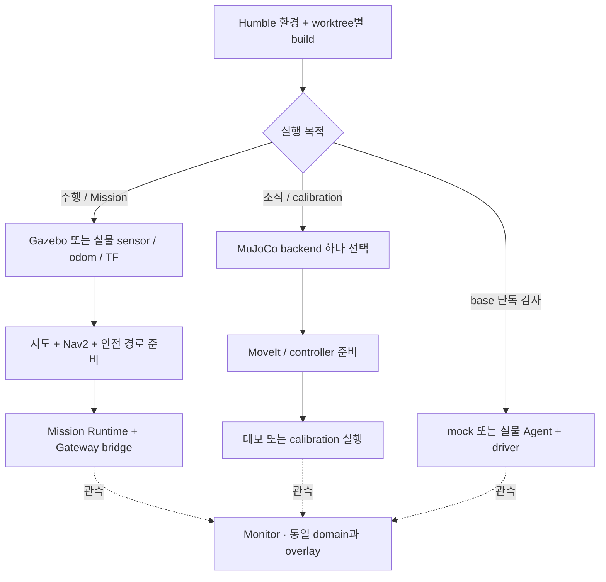

# 실행 가이드

명령은 저장소 루트의 Ubuntu 22.04 / Humble 터미널 기준이다.
[환경과 출력 경로](DEVELOPMENT_SETUP.md), [연동 계약](INTEGRATION.md)을 먼저 확인한다.
각 터미널에서 같은 DDS domain과 같은 worktree overlay를 사용한다.

```bash
source /opt/ros/humble/setup.bash
source "$(make -s print-install-base)/setup.bash"
```

`print-navigation-install-base`, `print-scenario-install-base`는 각각 전용 빌드의 overlay다.
빌드 때 바꾼 Make 변수는 경로 조회 때도 동일하게 전달한다.

## 실행 선택과 준비 순서



`mission_sim.launch.py`는 주행/Mission 구성을 함께 띄운다. 이미 sensor·Nav2가 준비돼 있으면
`mission_runtime.launch.py`만 붙인다. 실행별 명령은 아래에서 선택한다.

## Gazebo

```bash
make deps-gazebo
make check-gazebo-env
make sim-gazebo                 # headless base
make sim-gazebo-study-cafe      # study-cafe GUI; 위 실행과 별도로 사용
make sim-gazebo-facility        # 전체 시설 GUI; 위 실행과 별도로 사용
```

GUI renderer는 `GAZEBO_GUI_RENDER_ENGINE=ogre|ogre2`로 선택한다. 센서 서버는 OGRE2를 사용한다.
GPU LiDAR·camera는 headless에서도 OpenGL context가 필요하다.
지원 환경은 Fortress/Humble이며 이전 Harmonic 실험 기록은 [근거 색인](EVIDENCE.md)에서 찾는다.

같은 overlay/domain의 별도 터미널에서 상태를 확인한다.

```bash
ros2 topic hz /clock
ros2 topic hz /scan
ros2 topic echo /odom --once
ros2 run tf2_ros tf2_echo odom base_link
```

topic 등록만으로 sensor 발행·이동·정지가 확인된 것은 아니다.
실행별 sensor와 odometry 소유권은 [연동 가이드](INTEGRATION.md)를 따른다.

## Mission Runtime과 Backend

Gazebo·Nav2·Runtime·Gateway를 함께 실행할 때:

```bash
make build-mission-sim
source "$(make -s print-install-base)/setup.bash"
ros2 launch cleany_bringup mission_sim.launch.py \
  gateway_url:=ws://127.0.0.1:8080/api/robots/cleany-01/gateway/ws \
  post_mission:=wait_for_next
```

Backend는 별도 `cleany-control-plane` 저장소에서 실행한다. 같은 robot에 Runtime·bridge·
canonical odometry producer를 중복 실행하지 않는다. 책상 작업은 기본 mock이며 관측 ID는 사진이 아니다.

이미 AMCL/Nav2를 실행 중이면 simulator를 다시 시작하지 않고 Runtime만 붙인다.

```bash
make build-mission-runtime
source "$(make -s print-install-base)/setup.bash"
ros2 launch cleany_mission_manager mission_runtime.launch.py \
  gateway_url:=ws://127.0.0.1:8080/api/robots/cleany-01/gateway/ws \
  post_mission:=wait_for_next
```

Nav2 없이 구조를 확인하려면 `navigation_backend:=mock`을 추가한다.
`post_mission:=return_home|wait_for_next`는 실행 옵션이며 제품 복귀 정책의 확정이 아니다.
재연결·중복·취소·재시작 계약은 [Mission 계약](../ros2_ws/src/cleany_interfaces/docs/mission.md)을 따른다.
실험에는 별도 `journal_path`, `bridge_journal_path`를 사용하고 동일 미션 복구에는 기존 DB를 유지한다.

## 저장 지도 Navigation

```bash
make build-navigation
source "$(make -s print-navigation-install-base)/setup.bash"
ros2 launch cleany_navigation navigation.launch.py --show-args
```

[launch](../ros2_ws/src/cleany_navigation/launch/navigation.launch.py)에서
지도·backend·sensor 옵션을 확인한다. Mapping과 AMCL을 같은 `map → odom` 소유자로 함께 실행하지 않는다.
주행 명령은 Mission의 Navigator/Nav2가 맡고 Runtime은 `/cmd_vel`을 직접 만들지 않는다.
안전 경로와 sensor 만료 규칙은 [Navigation reference](../ros2_ws/src/cleany_navigation/docs/safety.md)를 따른다.

## MuJoCo와 조작 데모

```bash
make sim
# viewer가 필요하면 build와 overlay source 후:
ros2 launch cleany_mujoco_sim mujoco_sim.launch.py headless:=false
ros2 launch cleany_mujoco_sim rgbd_pick_demo.launch.py
```

위 두 실행과 `handeye_backend.launch.py`는 배타적인 backend다.
RGB-D scene 출력은 grasp/skill 연동용이며 물체 수거의 완료 증거가 아니다.

MoveIt plan-only 후보 선택:

```bash
ros2 launch cleany_moveit_config mock_planning.launch.py
# 같은 overlay의 별도 터미널
ros2 launch cleany_skill_executor grasp_selection.launch.py
```

MuJoCo controller까지 연결한 접근 데모는 각각 별도 실행한다.

```bash
ros2 launch cleany_skill_executor grasp_execution_demo.launch.py
ros2 launch cleany_skill_executor can_grasp_execution_demo.launch.py
```

기본 grasp 데모는 후보 선택·두 trajectory 실행·최종 joint 수렴을 확인한다.
can 데모는 RGB-D 검출·후보 생성·충돌 검사·그리퍼 개방·방향 보정 pre-grasp 접근까지다.
둘 다 gripper close, attach, lift와 실제 수거를 증명하지 않는다.
can 데모는 viewer/OpenGL이 필요하며 `headless:=true`를 지원하지 않는다.
plan-only action과 데모의 차이는 [Manipulation 계약](../ros2_ws/src/cleany_interfaces/docs/manipulation.md)을 따른다.

## 개발 Monitor

```bash
make build-dev-monitor
make run-dev-monitor
```

브라우저에서 `http://127.0.0.1:8768`을 연다. Monitor는 관측 전용이며 robot 명령을 보내지 않는다.
같은 DDS domain과 같은 메시지 overlay가 필요하다. Frontend 환경은 [개발환경](DEVELOPMENT_SETUP.md)을 따른다.
[monitor.yaml](../ros2_ws/src/cleany_dev_monitor/config/monitor.yaml)에서 입력·기록을 설정한다.
기록 DB·재생·stale 표시의 의미는 [관측 데이터 계약](../ros2_ws/src/cleany_dev_monitor/docs/data.md)을 따른다.

## Base와 plot

장치 없는 mock는 별도 domain에서 실행한다.

```bash
make build-base
export ROS_DOMAIN_ID=173
source "$(make -s print-install-base)/setup.bash"
ros2 launch cleany_base_driver base_driver.launch.py mock:=true
```

Mock domain에는 실물 MCU/Agent를 연결하지 않는다. 고장 주입 service는 mock node와 테스트가 관리한다.
실물은 Agent와 driver 양쪽에 domain 0을 적용하고, 검토한 hardware config를 선택한다.

```bash
export ROS_DOMAIN_ID=0
ros2 launch cleany_base_driver base_driver.launch.py \
  mock:=false config:="$(pwd)/configs/robot/base_hardware.yaml"
# 같은 overlay/domain의 별도 터미널에서 관측 GUI:
ros2 launch cleany_base_driver base_monitor.launch.py preset:=true
```

초기 hardware config는 바퀴를 띄운 시험용이다. 이 launch만으로 구동 허가하지 않는다.
Plot은 목표·slew/reversal 이후 목표·encoder 속도(rad/s)와 PWM(%)·diagnostics를 표시한다.
GUI 종료는 별도로 실행한 driver/Agent를 종료하지 않는다.
`preset:=false wheel:=fl|fr|rl|rr|all`로 관측 범위를 바꾼다.

실물 base와 plot은 [ESP32 가이드](../esp32/README.md)와
[base 계약](../ros2_ws/src/cleany_base_driver/docs/command-and-odometry.md)을 따른다.
mock domain과 실제 MCU domain을 혼용하지 않는다.

## 시설 생성 도구와 종료

`ros2 run cleany_gazebo_sim <스크립트명> --help`로 입력을 확인한다.

| CLI | 출력 |
|---|---|
| `generate_mission_targets.py` | 접근 목표 YAML과 검증 JSON |
| `render_layout_overlay.py` | 명시한 layout·reference image로 배치 SVG |
| `generate_felt_texture.py` | 명시한 PNG 경로에 펠트 질감 |
| `generate_roly_textures.py` | 명시한 폴더에 seat/back PNG |

시설 reference 이미지와 입력 fixture는 clone에 포함되지 않을 수 있다. [근거 색인](EVIDENCE.md)에서 위치를 확인한다.
목표 생성은 정적 footprint 여유 검사이며 전체 경로·팔 도달성을 증명하지 않는다.

launch는 `Ctrl-C`로 종료한다. 센서·명령 발행 중단과 해당 실행의 자식 종료를 확인한다.
시나리오 runner의 실패·cleanup 판정은 [테스트 가이드](TESTING.md)를 따른다.
