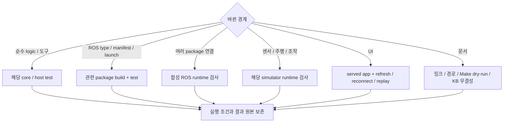

# 테스트 가이드

명령은 저장소 루트의 Humble/Fortress 환경에서 실행합니다. 변경 범위를 확인한 뒤 가장 작은 관련 검사부터 선택합니다. Make target의 실제 동작은 [Makefile](../Makefile)을 기준으로 확인합니다.

## FreeCAD 정적 기준 모델

`make test-freecad-model`은 부품 해시, URDF의 시각·충돌 표면 일치, 단위와
원점 변환, 560 mm 기둥, 화면 텍스처, 잘못된 보정 선택의 거부를 확인합니다.
MuJoCo 로드 후 관절과 actuator가 없고 주요 부품 경계가 URDF 메시와 같은지도
검사합니다. 기존 Make 변수 `GEOMETRY_PYTHON`으로 NumPy, pytest와 MuJoCo가 있는
Python을 선택할 수 있으며 이 검사는 ROS나 모터를 실행하지 않습니다.
내보내기 도구 검사는 메시 분할 경계의 삼각형 보존, 이전 manifest의 호환과
재실행 시 중복 제거를 확인합니다. 출력 실패 후 재시도와 사용자 파일 보존도 검사합니다.

`make test-description-models`와 패키지의 colcon test에도 새 모델 검사가
포함됩니다. 기존 실행 모델의 FK와 관절 검사 통과는 새 CAD의 운동학이나
실물 정확도를 검증한 결과가 아닙니다.

`test_freecad_kinematics.py`는 서보·구동 혼·지지 혼의 공통 축 근거, 부품의 단일
링크 소유, 저장 자세 재현과 임의 변화량의 독립 URDF FK 일치를 검사합니다.
MuJoCo mocap 배치도 FK와 대조하며 질량이나 actuator가 생성되지 않는지 확인합니다.
`test_freecad_gripper_linkage.py`는 양쪽 집게의 핀 거리, 폐쇄 링크 잔차,
URDF FK에서 연결된 두 부품의 핀 일치와 해가 모호한 자세의 거부를 검사합니다.
종속 관절을 독립 입력으로 지정하면 거부하며 물리 영점·운용 한계는 null로 유지합니다.
`test_freecad_tip_mounts.py`는 네 팁의 공통 체결축, 양방향 간섭 근거와 고정
자식 링크를 검사합니다. 캠을 움직여도 운반 링크와 팁의 상대 배치가 유지되고
URDF FK와 MuJoCo의 고정 자식 배치가 일치하는지 확인합니다. 체결력과 재질의
탄성은 이 검사에서 확정하지 않습니다.
변화량 표본은 수치 검사 입력이며 운용 제한이나 실물 정확도를 증명하지 않습니다.

## FreeCAD MoveIt와 OctoMap, cuRobo 검사

[검사 launch](RUNNING.md#freecad-moveit와-octomap-검사)를 실행하고 같은 ROS
domain에서 아래 명령으로 CAD 저장 자세와 합성 점군을 보냅니다. MoveIt의 모델
이름, 관절 상태, OctoMap과 동작 인터페이스 비활성화를 확인합니다.

```bash
python3 ros2_ws/src/cleany_moveit_config/runtime_test/check_freecad_scene.py
```

Jetson의 cuRobo CUDA 환경에서는 아래 명령으로 CAD 저장 자세의 메시 충돌을
확인합니다. LiDAR 표면과 차체에서 떨어진 지점에 시험 구를 배치합니다.

```bash
"$HOME/cleany/runtime/curobo-venv/bin/python" tools/validation/check_freecad_curobo.py \
  ros2_ws/src/cleany_description
```

인덱스 캐시는 같은 overlay를 읽은 상태에서 cuRobo 검사에
`--collision-cache "$collision_cache"`를 추가해 검증합니다. MoveIt과 OctoMap은
동일한 점군으로 STL과 GLB를 각각 검사하고 결과 지도 해시를 대조합니다.
캐시 생성기의 좌표, 모델 해시와 손상 검사에는 아래 명령을 사용합니다.

```bash
python3 -m pytest -q tests/tools/test_freecad_collision_cache.py \
  tests/tools/test_freecad_mesh_reduction.py tests/tools/test_freecad_moveit_cache.py
```

표면 감면 검사는 정점 일치만으로 판정하지 않습니다. 삼각형 내부까지 거리를
확인하고, 검사량 제한에 도달하면 후보를 거부합니다. 테스트는 좁은 구멍,
삼각형 내부 누락, 다른 대각선 분할, 오차 입력과 캐시 손상을 포함합니다.
`manifest.json`에는 파일별 감면 수와 양방향 표면 거리 상한을 기록합니다.
이 상한은 표본의 최대 거리나 실물 오차가 아니며, 감면 메시가 원본 입체를
완전히 감싼다는 보증도 아닙니다. cuRobo 링크 캐시는 저장 전후 삼각형 배열의
완전 일치를 확인합니다.

MoveIt 하부 캐시 검사는 직렬화한 박스와 원통의 원본 포함, 바퀴축 보존,
서로 움직이는 링크의 병합 거부와 비충돌 XML 보존을 확인합니다. 하부 primitive는
작은 구멍과 홈을 채우므로 이 부분에 표면 감면의 거리 상한을 적용하지 않습니다.
몸통 검사는 상판 투입구 추출, 기존 횡대 높이의 유지와 투입구를 가로지르는
삼각형의 거부를 포함합니다. 모든 꼭짓점이 구멍 밖에 있어도 내부를 가로지르는
삼각형은 거부합니다. cuRobo 검사는 CAD 저장 자세의 FK, 단순 입체별 객체 분리,
저장 후 삼각형 일치와 관절 URDF 변경의 거부를 확인합니다. GPU 실행 시에는
몸통의 깊은 내부와 투입구의 양쪽 경계도 검사해야 합니다.

분할 외피 검사는 조각 사이 틈, 링크와 시각 모델 보존, GLB의 닫힘과 원본
포함 관계를 확인합니다. 확장 상한은 원본 조각의 볼록 외피 기준입니다.
`cleany_moveit_collision`의 native 테스트는 검사 전용 detector가 미선언
CAD 표면을 유지하면서, 선언한 외피의 내부 장애물을 scene 복사 후에도
검출하는지 확인합니다. 잘못된 외피는 거부해야 합니다. 실제 캐시에서는
기둥 허리 바깥의 빈 공간과 각 외피 조각 내부를 자체 필터, MoveIt 접촉과
GPU 구 쿼리로 대조합니다.
추가 외장 감면에서는 보호 부품의 메시 해시, 동일 링크 안의 강체 묶음과
다른 링크 병합의 거부도 검사합니다. cuRobo native cuboid는 관절 변환 후의
위치와 quaternion, 미리보기 삼각형 일치와 박스 데이터 변조 거부를 확인합니다.
실제 GPU에서는 같은 쿼리로 메시 박스와 native cuboid의 판정 및 시간을
비교합니다. 삼각형 감소만으로 실행 시간이 개선됐다고 판단하지 않습니다.
캠과 가동 링크 감면에서는 원본 삼각형 포함 외에 접촉 패드의 삼각형과 관절
변환 일치를 검사합니다. CAD 비교 자세별로 패드 사이 입구 공간과 새 볼록
외피의 교차 여부를 확인하고, 열린 자세의 점군과 접촉 쿼리를 전후 대조합니다.
결합부 수정은 감면 전 표면 모델, 수정 전 외피와 수정 후 모델의 자기 접촉
쌍을 같은 CAD 자세에서 비교합니다. 실제 MoveIt의 충돌 허용 행렬이 같은지
확인하고, 대상 링크 사이의 최소 거리도 별도로 측정합니다. 접촉 허용 쌍
추가나 접촉 조회 결과의 제외로 형상 수정 검사를 통과시키지 않습니다.
원본 메시와 판정이 다른 쌍은 FreeCAD 원본 솔리드의 최소 거리와 교집합
부피를 대조합니다. 표면 감면 후보는 구멍과 접촉 패드를 보존하면서 검증
자세의 원본 체적 겹침과 조립 접촉 판정을 유지하는지 확인합니다.

별도 inspection domain에서는 아래 검사로 합성 점군 자체 필터와 장애물 접촉을
확인합니다. 입력 JSON의 `cloud`에는 `name`, CAD base frame의 `point`(m),
필터 통과 여부 `keep`을 넣습니다. `contacts`에는 `name`, `point`, 박스의
`size`(m), 예상 `collision`을 넣습니다. 검사는 저장 자세를 발행하고, 시험 박스를
추가해 접촉을 조회한 뒤 제거합니다. 기존 CAD 자기 접촉은 시험 박스 접촉과
구분합니다. 실행 프로필에는 사용하지 않습니다.
선택적 `joint_positions_rad`는 CAD 관절 이름에서 rad 값으로의 매핑입니다.
생략한 좌표는 0이며, 미등록 좌표와 비유한 값은 거부합니다. 집게의 열린 자세를
검사할 때는 기존 명목 링크 해석기로 종속 관절까지 계산해서 넣습니다.
이 입력은 실물 보정값이나 허용 가동 범위를 설정하지 않습니다.

```bash
python3 ros2_ws/src/cleany_moveit_config/runtime_test/check_freecad_lower_body.py \
  /path/to/lower-body-probes.json
```

실제 CAD에서 만든 입력과 생성 스크립트의 위치는
[하부 최적화 실행 근거](EVIDENCE.md#2026-11-05-freecad-moveit-하부-단순-형상)에 있습니다.
투입구 보존과 상부 추가 감면의 입력은
[몸통과 상부 최적화 실행 근거](EVIDENCE.md#2026-11-05-freecad-투입구-보존과-상부-추가-감면)에 있습니다.
기둥 상세화와 팔 분할 외피의 입력은
[분할 외피 실행 근거](EVIDENCE.md#2026-11-05-freecad-기둥-상세화와-팔-분할-외피)에 있습니다.
집게 입구 보존, 강체 묶음과 native cuboid의 입력은
[추가 최적화 실행 근거](EVIDENCE.md#2026-11-05-집게-입구-보존과-curobo-기본-박스-최적화)에 있습니다.
캠과 링크 감면, 개방 자세별 입구 검사의 입력은
[그리퍼 단순화 실행 근거](EVIDENCE.md#2026-11-05-그리퍼-캠과-링크-추가-단순화)에 있습니다.
추가 자기 접촉의 형상 수정과 세 모델 대조는
[결합부 복원 실행 근거](EVIDENCE.md#2026-11-05-그리퍼-결합부-형상-복원과-자기-접촉-회귀-검사)에 있습니다.
저장 자세의 검사 통과는 모든 관절 자세나 실물 계획 검증을 대신하지 않습니다.


## 인식과 파지 후보 검증

```bash
make build-perception-candidates
make test-perception-candidates
```

인터페이스 직렬화, RGB-D 검사, 모델 어댑터, 파지 후보와 GPU 작업 잠금,
비전 컨테이너 설정 및 모델 도구를 검사합니다. 모델 호출은 가짜 추론기로
검증하며 실제 Gemini API나 AnyGrasp SDK 성능을 측정하지 않습니다.
RealSense 실물 검사는 명시적으로 활성화할 때만 실행합니다.
검사 경로와 옵션은 `PERCEPTION_TEST_PATHS`, `PERCEPTION_PYTEST_ARGS`,
ROS domain은 `PERCEPTION_TEST_DOMAIN_ID`로 바꿀 수 있습니다.
운영 노드와 분리한 빌드 경로와 domain을 사용합니다.

## 테스트와 도구 위치

테스트는 검사 대상을 소유한 위치에 둡니다. 루트 `tests/`에는 저장소 도구의 자동 검사와 패키지를 연결하는 통합 검사만 둡니다. 실행, 관찰과 보고 코드는 검증 도구로 분리합니다.

| 위치 | 책임 |
|---|---|
| `ros2_ws/src/<package>/test/`, `tests/` | 패키지 기능과 계약의 자동 검사 |
| `ros2_ws/src/<package>/runtime_test/` | 해당 패키지의 명시 실행 smoke와 runtime 검사 |
| `tests/integration/` | Backend, Mission 등 여러 구성 요소의 연동 검사 |
| `tests/tools/` | 저장소 검증 도구의 자동 검사 |
| `tools/validation/` | Simulator 실행과 영상·로그 수집 |

패키지 내부에도 통합 검사가 있을 수 있습니다. 파일의 책임과 실행 조건으로 위치를 정하며, runtime CLI를 `tests/`에 넣었다고 pytest가 자동 실행하는 것은 아닙니다.

## 검사 선택



아래 표에서 변경 범위에 맞는 명령을 선택합니다. Simulator, mock 통과는 해당 입력과 backend의 증거이며, 실물 검증은 별도로 수행합니다.

| 변경 범위 | 명령 | 확인 범위 |
|---|---|---|
| 전체 ROS workspace | `make test` | build, colcon package test와 결과 집계 |
| Mission, Gateway core | `make test-mission-core` | ROS 없는 lifecycle, 영속성, 중복, 재전송 |
| Mock 조작 core | `make test-manipulation-core` | 서버 실행, 취소, 영속 기록과 모니터 |
| Mission과 Mock Action | `make test-mission-mock BASE_TEST_ROS_DOMAIN_ID=186` | 공통 타입, Action, 조회, 취소와 재시작; 주행은 Mock |
| Gazebo와 Mock Action | `make test-gazebo-manipulation BASE_TEST_ROS_DOMAIN_ID=186` | Nav2 도착과 정지, 두 수거, 추가 빈 관측과 보고 |
| Mission ROS 설치, 연동 | `make test-mission-runtime` | 관련 package build/test |
| Supervisor core | `make test-supervision-core` | ROS 없는 Fault, 허가, 복구, 영속성, Runtime 감독 port, 안전 증거 |
| Supervisor와 Runtime 연동 | `make test-supervision` | Supervisor ROS graph와 실제 Runtime, base driver, safety adapter, lifecycle 복구의 E2E; 센서, Nav2와 안전 하드웨어는 합성. 장애→정지 지연을 `$(CLEANY_DATA_ROOT)/runs/supervision/latency.json`에 기록 |
| Navigation core, plugin | `make test-navigation` | Python core와 C++ plugin |
| 합성 Navigation runtime | `make test-navigation-runtime` | ROS lifecycle, goal, 취소, sensor 단절 |
| Gazebo, Navigation | `make test-gazebo` | package 검사와 C++ plugin; 선택 runtime은 제외 |
| Gazebo sensor runtime | `make test-gazebo-nav-runtime` | 실제 simulator의 sensor, odom, TF |
| 시설 목표 생성 | `make test-gazebo-facility-tools` | simulator 없는 ID, 여유, 제거 의자 처리 |
| MuJoCo | `make test-mujoco` | scene loader; 모든 조작 runtime을 뜻하지 않음 |
| Mock Manipulation Action | `make test-manipulation` | ROS Action, 취소, 조회와 재시작 복구 |
| MuJoCo BT 경계 | `make test-manipulation-bt` | native BT, Action, 관련 인식과 수거 회귀; 실제 물리 수거 성공은 별도 |
| Hand-eye 경계 | `make test-handeye` | description, MuJoCo, MoveIt, calibration |
| Base ROS | `make test-base` | interface, driver, odometry; mock MCU |
| ESP32 준비, motor core | `make test-micro-ros-setup test-motor-core` | Python 준비 도구와 장치 없는 C++ |
| Logger | `make test-logger` | CLI 정책 편집과 종료 코드, 기록 정책, 읽기 전용 archive, 디렉터리 독점, 세션과 복구 경계 |
| Monitor와 Logger | `make test-dev-monitor` | Logger 검사와 ROS 수집, 저장, HTTP와 UI 데이터 경계 |
| Telemetry | `make test-telemetry` | odom relay |
| CI 준비 도구 | `make test-ci-tools` | 의존성 이미지 무효화, build context와 명령 전달 |
| Jetson USB 카메라 초기화 | `make test-camera-orientation` | 장치 식별, USB 제어와 복구, 설치 경로, unit과 udev 규칙; 실제 장치는 열지 않음 |

Fedora에서는 native ROS target을 Humble Distrobox에서 실행합니다. `test-micro-ros-setup`, `test-motor-core`는 Makefile의 `BASE_EXEC`가 환경을 선택합니다.

CI는 `PYTEST_DISABLE_PLUGIN_AUTOLOAD=1`로 runtime 의존성이 설치한 외부 pytest plugin의 자동 로드를 끕니다. 프로젝트의 `conftest.py`와 pytest 기본 plugin은 유지하며, 로컬에서는 `PYTEST_DISABLE_PLUGIN_AUTOLOAD=1 make test`로 같은 설정을 적용합니다.

`make test`는 package test가 실패해도 `colcon test-result --verbose`로 실패 상세를 출력하고 실패 상태를 반환합니다.

## Jetson 실물 변경 검증

제어 패키지는 운영 install과 분리된 빌드 경로에서 검사합니다.

```bash
make build-jetson-control
make test-jetson-control
make test-jetson-control-native
make test-jetson-controller
```

`test-jetson-control`은 상태 매핑, 제어 프로파일, 카메라,
MoveIt의 실물 관절 한계 및 호스트 도구를 검사합니다.
범위는 `JETSON_CONTROL_TEST_PATHS`, pytest 옵션은
`JETSON_CONTROL_PYTEST_ARGS`로 지정합니다.

`test-jetson-control-native`는 `cleany_robot_interface`의 C++ Feetech 드라이버와
Python 검사, 모델과 MoveIt 패키지의 colcon 검사를 실행합니다.

`test-jetson-controller`는 PTY 가상 시리얼과 실제 C++ 드라이버, ROS 컨트롤러를 연결합니다.
실물 USB 포트를 열지 않으며 읽기 전용, 쓰기 제한, 정지와 통신 장애를 검증합니다.
`JETSON_CONTROLLER_TEST_ARGS`로 검사 범위를 지정할 수 있습니다.
이 검사는 실물 보정 정확도나 수거 성공의 근거가 아닙니다.

## 배포한 소스와 설정 확인

배포 receipt의 `files` 항목에 있는 `path`와 `after_sha256`을 현재 Python import
경로와 ament share에 대조합니다. Python 소스, config, launch, URDF와 mesh가 검사 대상입니다.

```bash
python3 tools/validation/verify_installed_sources.py \
  --deployment /absolute/path/to/deployment.json --packages cleany_robot_interface
```

검사하지 않은 항목은 `skipped`로 표시하며, 요청한 패키지 기록이 없거나 파일이
누락되거나 hash가 다르면 실패합니다. 복사 설치는 `--resolved-root`로 설치 루트를
제한할 수 있습니다. Native symlink 설치에서는 생략합니다. ROS 노드나 모터를 시작하지 않습니다.

## Jetson USB 카메라 인수검사

`make test-camera-orientation`은 가짜 sysfs, 프로세스 정보와 USB ioctl을 사용합니다.
Python 3.10에서 helper의 요청 형식, 대상 장치 제한, 사용 중인 장치 보호, readback과
오류 시 드라이버 복구를 검사합니다. 설치 검사는 임시 디렉터리만 사용하며
`systemd-analyze`가 있으면 unit 문법도 확인합니다. CI는 Ubuntu 22.04 환경에서 같은
target을 실행합니다.

실제 Jetson Orin에서는 [설치](DEVELOPMENT_SETUP.md#jetson-orin-usb-카메라-회전) 후
다음을 별도로 확인합니다.

1. 캡처를 닫고 DECXIN 모듈을 연결해 journal의 설정값과 readback이 `3`인지 확인합니다.
2. 영상을 열어 180도 방향을 확인하고 캡처를 종료합니다.
3. USB를 분리하고 다시 연결한 뒤 같은 확인을 반복합니다.
4. 카메라가 연결된 상태로 재부팅하고 초기화 완료 후 캡처 방향을 확인합니다.
5. 다른 VID/PID 카메라에 unit이 요청되지 않는지 확인합니다. 같은 모델 여러 대는 각 USB
   이름의 unit과 영상 방향을 따로 확인합니다.
6. 캡처 중 수동 초기화를 요청하면 드라이버 분리 없이 실패하는지 확인합니다. 캡처를 닫고
   `reset-failed`와 수동 시작으로 복구합니다.

각 실행의 JetPack, kernel, Python 버전, USB 이름과 VID/PID, journal, 영상 방향 확인
결과를 남깁니다. 장치 없는 자동 검사 통과는 Orin의 USB 재연결과 재부팅 검증을 대신하지
않습니다.

## CI 실행과 재사용

CI는 Ubuntu 22.04 amd64에서 모든 PR의 전체 workspace 검사, ESP32 motor core, 합성 Navigation runtime과 Gazebo sensor runtime을 실행합니다. 베이스의 pytest는 colcon에 직접 등록하며 전체 workspace 검사에서 한 번 실행합니다. Navigation과 Gazebo runtime은 같은 실행에서 이미 빌드한 workspace를 사용합니다.

| 재사용 대상 | 갱신 조건 | 검증 경계 |
|---|---|---|
| GHCR 의존성 이미지 | 모든 `package.xml`, rosdep YAML, `containers/ci/`, 이미지 준비 도구, platform 변경 | ROS, apt, pip 의존성만 포함하며 응용 소스와 빌드 결과는 포함하지 않음 |
| ccache | compiler 내용, 소스, header와 옵션에 따라 hit/miss 결정 | 빌드 명령은 매번 실행하며 CTest/pytest 결과는 캐시하지 않음 |
| 같은 실행의 workspace | 전체 빌드 완료 후 runtime 검사에서 재사용 | 다른 실행의 `build/`, `install/`, test result는 복원하지 않음 |

이미지 key가 없으면 digest로 고정한 [기존 이미지 후보](../containers/ci/compatible-image.json)를 검사합니다.
설치 스크립트, 저장소 시점, Python 버전, rosdep 규칙과 platform이 같아야 후보로 선택합니다.
후보 컨테이너에서 현재 manifest의 `rosdep check`와 현재 버전 검사를 모두 통과한 경우에만
새 의존성 key로 등록합니다. 필요한 패키지가 없으면 고정된 ROS 저장소의 index만 갱신해
추가 설치하고 다시 검사합니다. Ubuntu 기본 패키지는 기존 이미지의 버전을 유지합니다.
의존성을 만족시키지 못하거나 버전이 다르면 후보를 사용하지 않습니다.
후보가 없거나 검사에 실패하면 고정한 저장소 snapshot과 Python 버전으로 이미지를 만듭니다.
이 재사용은 응용 소스나 빌드 결과를 포함하지 않으며 전체 빌드와 테스트는 매번 실행합니다.
기하 검사의 Python 패키지는 [검증용 버전 목록](../tests/requirements-geometry.txt)으로
실행 컨테이너에 설치합니다. NumPy와 ROS Python 버전은 변경하지 않습니다.
같은 저장소의 실행은 환경 확인 후 의존성 이미지를 게시합니다. 응용 테스트의 성공 여부와 별개로 의존성 이미지와 compiler cache를 보존해 실패 수정 시에도 재사용하며, 다음 실행의 전체 검사와 실패 판정은 그대로 유지합니다. Fork PR은 이미지를 게시하지 않습니다. 매주 월요일 실행도 동일한 의존성 이미지를 재사용합니다.

기준은 2026-11-02에 조회한 Jetson의 system Python과 설치된 ROS 패키지입니다.
[repository-snapshots.env](../containers/ci/repository-snapshots.env)는 Ubuntu와 ROS 저장소의 시점을,
[pip-constraints.txt](../containers/ci/pip-constraints.txt)는 MuJoCo와 google-genai 및 전이 의존성 버전을 고정합니다.
베이스에 이미 설치된 ROS 패키지도 선택한 snapshot으로 갱신한 뒤 workspace 의존성을 설치합니다.
CI는 설치 후와 검사 시작 전에 [버전 검사](../containers/ci/verify-versions.py)를 실행합니다.
공통 ROS 패키지는 아키텍처별 빌드 시각을 제외한 upstream 버전을 비교하며,
Jetson에만 설치된 패키지를 CI에 추가로 설치하지 않습니다. JetPack, GPU 라이브러리와 실물 동작은 이 검사 범위가 아닙니다.
BT.CPP `4.9.1`의 amd64 패키지는 라이브러리 설치 위치와 CMake 검색 경로가 달라, CI 이미지에서 같은 바이너리를 가리키는 호환 링크를 추가합니다.

외부 의존성 갱신은 snapshot, Python constraints와 Jetson ROS 버전 기준을 명시적으로 변경하고 전체 CI로 검증합니다.
Dockerfile의 `DEPENDENCY_REVISION`만 올리면 같은 버전으로 이미지를 다시 만들며 패키지 버전은 갱신하지 않습니다.
저장소와 서명 키 갱신은 [ROS snapshot 안내](https://github.com/ros2/ros2_documentation/blob/rolling/source/Get-Started/Installation/Snapshot-Repository.rst)와 [Ubuntu snapshot 안내](https://snapshot.ubuntu.com/)를 따릅니다.

패키지 빌드는 최대 2개, 패키지 내부 컴파일은 runner CPU 수의 절반으로 제한해 두 병렬화 계층의 경합을 줄입니다. 최적화 수준은 기존 `RelWithDebInfo`를 유지합니다. 모델 검사에서는 같은 인자의 xacro 출력 bytes만 재사용하고 각 검사는 독립 XML tree를 받습니다.

`MAKEFLAGS`도 함께 지정해 colcon이 전체 CPU 수의 `-j` 옵션으로 CMake의 병렬 제한을 덮어쓰지 않도록 합니다.

CI artifact에는 test XML, 실패 로그, 설치된 apt/pip 버전과 ccache 통계를 남깁니다. 속도는 이미지 생성과 compiler cache miss가 있는 최초 실행, 이미지와 cache를 재사용하는 실행으로 구분해 비교합니다. 이미지 pull과 cache 복원 시간도 포함한 GitHub job 전체 시간을 기준으로 판단합니다.

전체 job 제한은 40분이며 이미지 생성은 별도로 15분 안에 완료해야 합니다.
APT는 서명을 검증한 snapshot index에서 버전, 파일 경로와 SHA256을 결정합니다.
Ubuntu 패키지 파일은 동일한 pool 경로의 archive 미러에서 먼저 받고, 없거나 검증에 실패하면 원래 snapshot에서 받습니다.
다운로드는 4개씩 수행하고 SHA256과 크기가 일치하는 파일만 APT cache에 보관하며 설치 시 APT가 다시 검증합니다.
미러의 최신 index나 다른 버전으로 대체하지 않습니다.
연결 timeout은 15초, 파일 다운로드는 60초, 한 설치 명령의 다운로드 준비는 5분으로 제한합니다.
APT 자체 재시도는 1회, 의존성 준비 명령은 10초 대기 후 최대 2회 실행합니다.
계속 실패하면 CI를 실패 처리합니다. 빌드와 테스트는 이 재시도 대상에 포함하지 않습니다.

## 선택 runtime과 UI

### 카메라 영상 수집

현재 workspace를 빌드한 뒤 `tools/validation/capture_cameras.py`로 실제 ROS
카메라 영상을 수집합니다. 각 출력 경로는 아직 없는 새 디렉터리여야 합니다.

```bash
source /opt/ros/humble/setup.bash
source "$(make -s print-install-base)/local_setup.bash"
python3 tools/validation/capture_cameras.py --backend mujoco \
  --output /absolute/new-camera-run/mujoco
python3 tools/validation/capture_cameras.py --backend gazebo --gazebo-model cad-with-arms \
  --output /absolute/new-camera-run/gazebo
PYTEST_DISABLE_PLUGIN_AUTOLOAD=1 python3 -m pytest -q tests/tools/test_capture_cameras.py
```

GUI가 없는 환경에서는 촬영 명령 앞에 `xvfb-run --auto-servernum`을 붙입니다.
VM에서 GPU 렌더링이 불안정하면 `LIBGL_ALWAYS_SOFTWARE=1`을 지정합니다.
Gazebo의 `--gazebo-model legacy`로 레거시 모델도 선택할 수 있습니다.

도구는 head와 양손목 영상의 크기, encoding, frame, buffer 및 시뮬레이션 clock과
상태 메시지를 확인하고 PNG, `report.json`, `launch.log`를 남깁니다. 누락, timeout과
조기 종료는 실패 코드로 보고하고 실행한 프로세스 그룹을 종료합니다. 촬영 성공은
전체 집기 미션의 성공을 뜻하지 않습니다. 기본 CAD 주행 프로파일은 팔을 제외하며,
`cad-with-arms`는 촬영 검증에만 팔을 포함합니다.

### 선택 실행 조건

Gazebo package의 `--run-sim-runtime`, `--run-evaluation-tests`와 Mission core의 `CLEANY_RUN_ROS_TESTS=1`은 별도로 활성화하는 검사입니다. 실행 결과에서 통과와 skip을 구분합니다.

```bash
source /opt/ros/humble/setup.bash
source "$(make -s print-install-base)/setup.bash"
ROS_DOMAIN_ID=82 CLEANY_RUN_ROS_TESTS=1 make test-mission-core
```

Logger 독립 녹화 검사는 빌드 overlay를 source한 뒤 빈 출력 경로에서 실행합니다.
logger와 Monitor를 별도 프로세스로 띄우고 합성 경로, 카메라와 점군을 발행합니다.
Monitor 종료 전후의 같은 세션에서 SQLite 증가, rosbag2 원문과 stamp, Monitor 재접속,
HTTP 시작과 정지, logger 단절과 writer 대체 금지를 확인합니다. 실제 로봇 구동과
센서 성능 검증은 포함하지 않습니다.

```bash
ROS_DOMAIN_ID=218 ROS_LOCALHOST_ONLY=1 make test-logger-independence \
  LOGGER_TEST_OUTPUT=/absolute/new-logger-run LOGGER_BASE_COMMIT=<base-commit>
CLEANY_RUN_ROS_TESTS=1 ROS_DOMAIN_ID=217 ROS_LOCALHOST_ONLY=1 make test-dev-monitor
```

CLI 실제 연결 검사는 logger를 별도 프로세스로 띄우고 설치된 `logger` 실행 파일로
조회, 토픽 설정, 시작과 정지를 호출합니다. 합성 경로와 이미지를 native bag에서
다시 읽으며 CLI 종료 후 녹화 유지, 활성 설정 거부, 세션 보호와 연결 실패를 확인합니다.

```bash
ROS_DOMAIN_ID=219 ROS_LOCALHOST_ONLY=1 make test-logger-cli \
  LOGGER_TEST_OUTPUT=/absolute/new-cli-run LOGGER_BASE_COMMIT=<base-commit>
```

Monitor smoke는 같은 domain에서 Monitor를 먼저 실행한 뒤 호출합니다.

```bash
ROS_DOMAIN_ID=187 python3 ros2_ws/src/cleany_dev_monitor/runtime_test/smoke.py --output /absolute/new-run
# frontend의 현재 Playwright 설정과 package scripts:
cat ros2_ws/src/cleany_dev_monitor/web/package.json
```

Frontend 검사는 `ros2_ws/src/cleany_dev_monitor/web`에서 `pnpm exec tsc --noEmit`과 `pnpm exec playwright test`를 실행한다. 실제 Monitor가 필요한 검사는 `MONITOR_URL`을 지정하고 해당 ROS 입력도 준비한다. 기본 fixture 검사는 로컬 Vite를 시작한다.

UI 변경은 실제 served app에서 새로고침, 재연결, 기록 재생까지 확인합니다. Playwright browser가 없으면 configured browser를 설치한 뒤 다시 실행합니다.

Mission Gateway smoke는 `tests/integration/mission_runtime/`, Monitor smoke는 `ros2_ws/src/cleany_dev_monitor/runtime_test/`에 있습니다. 실제 Backend, ROS, Gazebo 입력 조건을 준비한 경우에 명시적으로 실행합니다.

## 결과와 증거

| 증거 | 의미 |
|---|---|
| 소스, manifest, 단위 검사 | 구현과 검사된 입력의 계약 |
| mock / 합성 ROS | 합성 backend의 lifecycle과 메시지 경계 |
| Gazebo, MuJoCo runtime | 해당 simulator, 입력, 버전의 동작 |
| 장치 통신 | 실제 USB, UART, DDS 등 확인한 계층 |
| 물리 시험 | 실제 sensor, actuator, 정지, 시나리오 결과 |

결과에는 다음 항목을 남깁니다.

- Code commit와 dirty 상태, 환경, overlay
- 입력, config, asset hash
- 요청 범위와 실제 완료 범위, 실패, skip, 중단
- 로그와 출력 위치

CTest wrapper와 pytest 집계가 겹치면 중복 합산하지 않습니다. 실행 원본은 `CLEANY_DATA_ROOT/runs/`, 과거 보고서는 [근거 색인](EVIDENCE.md)에서 찾습니다.

## 문서 변경 검사

내부 파일 링크, anchor, 코드, 설정, launch 경로, Make target의 존재와 native dry-run을 확인합니다. 문서 검증만을 위해 실제 로봇을 움직이거나 새 calibration을 수행하지 않습니다.

KB를 변경한 경우에는 KB의 `kb-quality-checks`도 실행합니다. 검사 통과와 내용 승인은 별도로 기록합니다.

## 실물 매핑 패키지 경계

`make test-hardware-mapping-core`는 입력 lease, ordered permission의 MCU 확인, 스캔 필터,
설정 검증, map origin yaw와 원자적 저장, 초기화 직렬화와 저장 실패를 검사한다.
매핑 heartbeat 만료와 재수신, RPC 실패 원인 보존, 시작 실패의 로그 경로와 traceback,
이벤트 파일 회전과 재시작 보존, 큐 포화와 디스크 장애도 검사한다.
`make test-base BASE_TEST_ROS_DOMAIN_ID=174`는 기존 base 회귀와 새 구동 허가 계약을 검사한다.
ROS graph 검사는 같은 domain에서 동시에 실행하지 않는다.

설치된 패키지의 모의 통합은 다음 명령으로 실행한다. 새 출력 디렉터리를 지정한다.

```bash
make build-hardware-mapping
make test-hardware-mapping-runtime MAPPING_TEST_OUTPUT=/absolute/path/to/new-artifact-dir
```

이 검사는 domain 173에서 synthetic MCU와 합성 LiDAR를 사용한다. 저장소 밖 `/tmp`에서
설치된 launch를 시작하고 단일 휠 publisher, 휴대폰 명령/해제, 지도 초기화와 중복 요청,
두 세션의 map/pbstream 및 Logger bag, 최종 저장 후 종료를 확인한다. 관리자 종료 후 ROS
상태 만료와 조종 이벤트 파일 저장도 확인한다. 실물 USB는 열지 않는다.
물리 정지 거리, 현재 장착 TF의 정확도와 실제 바닥에서의 지도 품질은 별도 실물 검사다.

`make test-hardware-mapping`은 관련 ROS 패키지를 domain 174에서 순서대로 검사한다.
Base graph fixture는 BASE_TEST_ROS_DOMAIN_ID도 따르므로 두 domain 변수를 함께 설정한다.
위 통합 결과의 bag은 domain 175에서 실제 ROS 재생으로 확인할 수 있다.

```bash
make test-hardware-mapping-replay \
  MAPPING_BAG=/absolute/path/to/recordings/bags/session-id \
  MAPPING_TEST_OUTPUT=/absolute/path/to/replay-verification.json
```

## ToF와 Supervisor 통합

`make test-tof-core`는 거리 투영, 평면 fit, 제동 envelope, timeout과 navigation 경로의
순수 검사를 실행한다. `make test-tof`는 interface, ToF, Mission, safety adapter와
Supervisor를 빌드하고 패키지 검사를 실행한다. ToF ROS 검사는 독립 DDS domain의 합성
frame/odom/lease와 pseudo-terminal을 사용하며 실제 센서나 모터를 열지 않는다.

기존 navigation C++/Python 회귀 검사는 Humble 환경에서 `make test-navigation`으로
실행한다. Mission의 선택 ROS 시나리오는 `CLEANY_RUN_ROS_TESTS=1`과 독립
`ROS_DOMAIN_ID`에서 별도 실행한다. colcon의 선택 시나리오 skip은 성공으로 해석하지 않는다.
실물 검증 항목은 [CALIBRATION](CALIBRATION.md#tof-근접-보호-commissioning)을 따른다.

ToF 분류 회귀에는 단독 보드 로그의 3개 frame과 합성 입력을 사용한다. 정상 미검출의
주행 허용, 부분 품질 불량 제외, 전부 불량 정지, 인접/물리 cluster, 15Hz 지속 확인,
flash/고립 noise, 비상 단일 검출, 해제 hysteresis와 필터 reset을 검사한다. ROS 검사는
센서 fault와 stale 정지, 일부 불량 Zone의 책상 접근, 평면 소실과 기존 lease/cancel 경계를
검사한다. Navigation은 ToF 활성 여부와 독립 head-pan observer 설정 조합을 검사한다.
합성 graph는 기존 안전 chain을 identity로 대체하며 실제 Nav2/모터 주행이 아니다.

원본 측정 로그를 ROS 개발환경에서 오프라인 감사하려면 다음을 사용한다. 장치를 열지 않는다.

```bash
PYTHONPATH="$PWD/ros2_ws/src/cleany_tof" python3 tools/validation/tof/replay.py \
  /absolute/path/to/range-15hz-2min.jsonl --output /absolute/path/to/audit.json
```


## 얼굴 디스플레이

상태 로직은 Jetson의 독립 설치 폴더에서 `make test`로 검사한다. 저장소의 `make test`가 실행하는 colcon 검사에도 같은 pytest가 등록된다.

ROS→HTTP 전환, 결과 수량과 연결 복구는 구현 레포 루트에서 다음 명령으로 검사한다. `/cleany_display_validation/` 토픽과 domain 173을 사용하며 로봇 제어기는 실행하지 않는다.

```bash
source /opt/ros/humble/setup.bash
source /home/cleany/cleany-display/ros2_ws/install/local_setup.bash
ROS_DOMAIN_ID=173 python3 tools/validation/verify_cleany_display_ros.py \
  --config /home/cleany/cleany-display/config/display.json \
  --output output/cleany-display-jetson/ros-verification.json
```

브라우저 검사는 [Dev Monitor 웹 의존성](DEVELOPMENT_SETUP.md#monitor-웹)과 로컬 Chrome을 설치한 구현 레포에서 `node tools/validation/verify_cleany_display_web.cjs`로 실행한다. 7개 표정의 60fps와 Zzz 주기, 화면 비율과 720p 상한, 설정 변경, 60.01Hz 입력에서 균등한 30fps 간격, 동일 상태의 DOM 변경 부재, 모션 감소 설정과 HTTP 복구를 검사한다. 결과는 Git에서 제외한 `output/cleany-display-jetson/`에 기록한다.

전환 검사는 같은 환경에서 `node tools/validation/verify_cleany_display_transitions.cjs`로 실행한다. HTTP 상태를 바꾸면서 60Hz 프레임을 제어해 깜빡임의 연속성, 눈과 입의 중간 모양, 얼굴 위치, 땀방울과 Zzz의 사라짐을 확인한다. 안내 교체 중 추가 상태 수신, 도움 요청과 일반 안내의 겹침, 모션 감소 설정도 검사한다. 결과와 중간 프레임은 `output/cleany-display-jetson/transitions/`에 기록하며, 실제 장치의 프레임 성능 측정과 구분한다.

실물 성능 측정은 Jetson에서 다음 순서로 실행한다.

1. `systemctl --user set-environment CLEANY_DISPLAY_DEBUG_PORT=9223`과 `systemctl --user restart cleany-display-kiosk`로 전용 브라우저의 로컬 디버깅 포트를 연다.
2. 설치 폴더의 `browser-tools/bin/python`으로 `tools/validation/measure_cleany_display.py --output <결과.json>`을 실행한다. `--modes idle moving checking collecting complete charging help`를 추가하면 브라우저 응답만 임시로 바꿔 표정별로 측정하고 실제 ROS 상태 화면으로 복구한다.
3. 측정 종료 후 `systemctl --user unset-environment CLEANY_DISPLAY_DEBUG_PORT`와 키오스크 재시작으로 디버깅 포트를 닫는다.

결과의 `frames.canvas.fps`는 실제 캔버스 렌더링 빈도이고 `frames.raf.fps`는 브라우저 콜백 빈도다. CPU 수치는 단일 코어 기준이며 GPU 사용률이 아니다. 실물 화면, 장시간 동시 운용과 재부팅 후 자동 시작은 별도 검증한다.
## MoveIt 충돌 형상과 MuJoCo 동등성 검사

`make test-description-models`는 ROS 2와 MuJoCo, NumPy, SciPy 환경에서
원본 URDF와 MJCF의 동등성 및 최적화 충돌 자산을 검사합니다.
원본 대조에는 `optimized_arm_collision_meshes:=false head_collision_meshes:=false`를
명시하고, 기본 최적화 모델에는 시각 형상, 관성, 관절 보존과 모터 충돌 메시
배치를 검사합니다. MuJoCo 물리 접촉 형상은 기존 MJCF를 유지하며,
시뮬레이션의 MoveIt 경로 계획은 최적화 URDF를 사용합니다.
`COLLISION_TEST_ARGS`로 `-k`와 `--junitxml` 등을 전달할 수 있습니다.

## 충돌 메시와 내부 장애물 검사

```bash
make build COLCON_BUILD_ARGS="--packages-up-to cleany_moveit_config"
make test-moveit-collision
```

첫 명령은 description, 충돌 플러그인과 기존 scene mapping 의존성을 함께
빌드합니다. Jetson의 MoveIt 2.5.9 전용 환경을 사용하는 경우 해당 overlay를
먼저 source합니다. 검사 시 불러오는 설치 경로는 `INSTALL_BASE`를 따릅니다.

`test-moveit-collision`은 형상 검사, SolidFCL 단위 검사, 계획 설정 및 실제
MoveIt 서비스 검사를 실행합니다. 서비스 검사는 기본 detector가 내부 장애물
36개를 검출하는지, 같은 입력을 표면 FCL이 놓치는지와 존재하지 않는 detector를
선택했을 때 프로세스가 종료하는지 확인합니다. 가상 장애물만 사용하고
trajectory execution은 끄며 모터 드라이버를 실행하지 않습니다.


## 실물 계획과 실행 기반 검증

운영 install과 다른 `CLEANY_BUILD_ROOT`를 지정한다. 모든 결과는 그 경로나 외부 보고서 디렉터리에 보관한다.

```bash
export CLEANY_BUILD_ROOT="$CLEANY_DATA_ROOT/builds/motion-review"
make build-motion-foundation
make test-motion-foundation MOTION_TEST_PYTHON="$CLEANY_BUILD_ROOT/test-env/bin/python3"
make test-motion-native
make test-motion-runtime
make test-jetson-controller
```

| 명령 | 범위 |
|---|---|
| `test-motion-foundation` | Python 계획, 실행 core, 인식, 파지, 제어 호환성과 도구 검사. 합성 입력과 가짜 서비스 사용 |
| `test-motion-native` | C++ 장면 필터, 배치 검사, 시간 배정, SolidFCL과 드라이버 |
| `test-motion-runtime` | 별도 ROS domain의 MoveIt, 합성 장면, 머리 충돌, 배치, OctoMap 조회. 장치 드라이버를 시작하지 않음 |
| `test-motion-gpu` | 모션 컨테이너의 CUDA FK/IK, 경로, mast 충돌과 양팔 예열 버퍼 재사용. 장치와 외부 ROS 서버 불필요 |
| `test-jetson-controller` | PTY 가상 시리얼 controller. 실제 모터를 구동하지 않음 |

테스트 Python은 [개발환경 안내](DEVELOPMENT_SETUP.md#실물-모션-기반)에 따라 준비한다.
`MOTION_TEST_PYTHON`, `MOTION_TEST_PATHS`, `MOTION_PYTEST_ARGS`, `MOTION_TEST_DOMAIN_ID`로
실행 환경, 범위와 결과 파일을 지정한다.
GPU 검사는 `cleany_skill_executor/runtime_test/`에 두며 고정 CUDA 환경에서
`CLEANY_RUN_CUROBO=1` 등 각 파일의 실행 조건을 명시해야 한다. 일반 검사 통과는 GPU 성능,
실물 동작이나 전체 수거 시나리오의 검증을 뜻하지 않는다.

컨테이너 준비 후 `make test-motion-gpu`로 독립 실행 가능한 GPU 검사를 실행한다.
`MOTION_GPU_PYTEST_ARGS`로 pytest 옵션을 전달하며 컨테이너 결과 파일은
쓰기 가능한 `/opt/cleany-motion/cache/` 아래에 둔다. 나머지 GPU 런타임 검사는
별도로 시작한 MoveIt과 GenericSystem mock controller가 필요하다.

## 실물 수거 실행과 복귀 검사

`make build-collection-execution`은 BT와 실물 실행 의존 패키지를 빌드한다.
`make test-collection-execution`은 수거, 복귀, 복구와 직접 연결된 모션 및 안전 검사를 실행한다.
`make test-collection-regression`은 인식, 파지 후보 생성과 저장소 도구를 포함한
기존 모션 회귀 검사까지 함께 실행한다. 수거 코드를 수정할 때는 전자를 먼저 실행하고,
여러 패키지를 함께 변경하거나 병합을 준비할 때는 후자로 범위를 넓힌다.
`CLEANY_BUILD_ROOT`로 운영 install과 분리하고 `MOTION_TEST_PYTHON`,
`COLLECTION_TEST_PATHS`, `MOTION_PYTEST_ARGS`로 Python, 검사 범위와 pytest 인자를 지정한다.

실측 FK 재사용 검사는 `cleany_skill_executor/test/test_measured_fk_reuse.py`에 모은다.
실제 `CollectionPipeline.pose`에 합성 관절 상태와 가짜 FK 응답을 넣어 재사용, 무효화,
실시간 감시 실패와 서비스 오류 처리를 검증하며 `test-collection-execution`에 포함한다.

검사는 합성 센서, 가상 모션 포트, 임시 SQLite와 독립 ROS domain을 사용한다.
실물 시리얼 포트를 열거나 모터를 움직이지 않으며, 종료, 취소, 늦은 응답,
복구 차단과 기존 MuJoCo BT 계약을 함께 확인한다.
