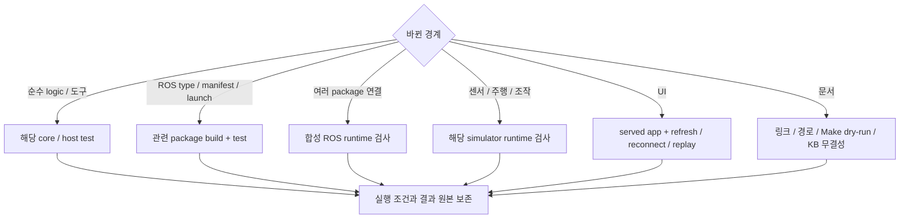

# 테스트 가이드

명령은 저장소 루트의 Humble/Fortress 환경에서 실행합니다. 변경 범위를 확인한 뒤 가장 작은 관련 검사부터 선택합니다. Make target의 실제 동작은 [Makefile](../Makefile)을 기준으로 확인합니다.


## 인식과 파지 후보 검증

```bash
make build-perception-candidates
make test-perception-candidates
```

인터페이스 직렬화, RGB-D 검사, 모델 어댑터, 파지 후보와 GPU 작업 잠금,
비전 컨테이너 설정 및 모델 도구를 검사합니다. 모델 호출은 가짜 추론기로
검증하며 실제 Gemini API나 AnyGrasp SDK 성능을 측정하지 않습니다.
RealSense 실물 검사는 명시적으로 활성화할 때만 실행합니다.
검사 경로와 옵션은 `PERCEPTION_TEST_PATHS`, `PERCEPTION_PYTEST_ARGS`,
ROS domain은 `PERCEPTION_TEST_DOMAIN_ID`로 바꿀 수 있습니다.
운영 노드와 분리한 빌드 경로와 domain을 사용합니다.

## 테스트와 도구 위치

테스트는 검사 대상을 소유한 위치에 둡니다. 루트 `tests/`에는 저장소 도구의 자동 검사와 패키지를 연결하는 통합 검사만 둡니다. 실행, 관찰과 보고 코드는 검증 도구로 분리합니다.

| 위치 | 책임 |
|---|---|
| `ros2_ws/src/<package>/test/`, `tests/` | 패키지 기능과 계약의 자동 검사 |
| `ros2_ws/src/<package>/runtime_test/` | 해당 패키지의 명시 실행 smoke와 runtime 검사 |
| `tests/integration/` | Backend, Mission 등 여러 구성 요소의 연동 검사 |
| `tests/tools/` | 저장소 검증 도구의 자동 검사 |
| `tools/validation/` | Simulator 실행과 영상·로그 수집 |

패키지 내부에도 통합 검사가 있을 수 있습니다. 파일의 책임과 실행 조건으로 위치를 정하며, runtime CLI를 `tests/`에 넣었다고 pytest가 자동 실행하는 것은 아닙니다.

## 검사 선택



아래 표에서 변경 범위에 맞는 명령을 선택합니다. Simulator, mock 통과는 해당 입력과 backend의 증거이며, 실물 검증은 별도로 수행합니다.

| 변경 범위 | 명령 | 확인 범위 |
|---|---|---|
| 전체 ROS workspace | `make test` | build, colcon package test와 결과 집계 |
| Mission, Gateway core | `make test-mission-core` | ROS 없는 lifecycle, 영속성, 중복, 재전송 |
| Mock 조작 core | `make test-manipulation-core` | 서버 실행, 취소, 영속 기록과 모니터 |
| Mission과 Mock Action | `make test-mission-mock BASE_TEST_ROS_DOMAIN_ID=186` | 공통 타입, Action, 조회, 취소와 재시작; 주행은 Mock |
| Gazebo와 Mock Action | `make test-gazebo-manipulation BASE_TEST_ROS_DOMAIN_ID=186` | Nav2 도착과 정지, 두 수거, 추가 빈 관측과 보고 |
| Mission ROS 설치, 연동 | `make test-mission-runtime` | 관련 package build/test |
| Navigation core, plugin | `make test-navigation` | Python core와 C++ plugin |
| 합성 Navigation runtime | `make test-navigation-runtime` | ROS lifecycle, goal, 취소, sensor 단절 |
| Gazebo, Navigation | `make test-gazebo` | package 검사와 C++ plugin; 선택 runtime은 제외 |
| Gazebo sensor runtime | `make test-gazebo-nav-runtime` | 실제 simulator의 sensor, odom, TF |
| 시설 목표 생성 | `make test-gazebo-facility-tools` | simulator 없는 ID, 여유, 제거 의자 처리 |
| MuJoCo | `make test-mujoco` | scene loader; 모든 조작 runtime을 뜻하지 않음 |
| Mock Manipulation Action | `make test-manipulation` | ROS Action, 취소, 조회와 재시작 복구 |
| MuJoCo BT 경계 | `make test-manipulation-bt` | native BT, Action, 관련 인식과 수거 회귀; 실제 물리 수거 성공은 별도 |
| Hand-eye 경계 | `make test-handeye` | description, MuJoCo, MoveIt, calibration |
| Base ROS | `make test-base` | interface, driver, odometry; mock MCU |
| ESP32 준비, motor core | `make test-micro-ros-setup test-motor-core` | Python 준비 도구와 장치 없는 C++ |
| Logger | `make test-logger` | CLI 정책 편집과 종료 코드, 기록 정책, 읽기 전용 archive, 디렉터리 독점, 세션과 복구 경계 |
| Monitor와 Logger | `make test-dev-monitor` | Logger 검사와 ROS 수집, 저장, HTTP와 UI 데이터 경계 |
| Telemetry | `make test-telemetry` | odom relay |
| CI 준비 도구 | `make test-ci-tools` | 의존성 이미지 무효화, build context와 명령 전달 |

Fedora에서는 native ROS target을 Humble Distrobox에서 실행합니다. `test-micro-ros-setup`, `test-motor-core`는 Makefile의 `BASE_EXEC`가 환경을 선택합니다.

CI는 `PYTEST_DISABLE_PLUGIN_AUTOLOAD=1`로 runtime 의존성이 설치한 외부 pytest plugin의 자동 로드를 끕니다. 프로젝트의 `conftest.py`와 pytest 기본 plugin은 유지하며, 로컬에서는 `PYTEST_DISABLE_PLUGIN_AUTOLOAD=1 make test`로 같은 설정을 적용합니다.

`make test`는 package test가 실패해도 `colcon test-result --verbose`로 실패 상세를 출력하고 실패 상태를 반환합니다.

## Jetson 실물 변경 검증

제어 패키지는 운영 install과 분리된 빌드 경로에서 검사합니다.

```bash
make build-jetson-control
make test-jetson-control
make test-jetson-control-native
make test-jetson-controller
```

`test-jetson-control`은 상태 매핑, 제어 프로파일, 카메라,
MoveIt의 실물 관절 한계 및 호스트 도구를 검사합니다.
범위는 `JETSON_CONTROL_TEST_PATHS`, pytest 옵션은
`JETSON_CONTROL_PYTEST_ARGS`로 지정합니다.

`test-jetson-controller`는 PTY 가상 시리얼과 실제 C++ 드라이버, ROS 컨트롤러를 연결합니다.
실물 USB 포트를 열지 않으며 읽기 전용, 쓰기 제한, 정지와 통신 장애를 검증합니다.
`JETSON_CONTROLLER_TEST_ARGS`로 검사 범위를 지정할 수 있습니다.
이 검사는 실물 보정 정확도나 수거 성공의 근거가 아닙니다.

## 배포한 소스와 설정 확인

배포 receipt의 `files` 항목에 있는 `path`와 `after_sha256`을 현재 Python import
경로와 ament share에 대조합니다. Python 소스, config, launch, URDF와 mesh가 검사 대상입니다.

```bash
python3 tools/validation/verify_installed_sources.py \
  --deployment /absolute/path/to/deployment.json --packages cleany_robot_interface
```

검사하지 않은 항목은 `skipped`로 표시하며, 요청한 패키지 기록이 없거나 파일이
누락되거나 hash가 다르면 실패합니다. 복사 설치는 `--resolved-root`로 설치 루트를
제한할 수 있습니다. Native symlink 설치에서는 생략합니다. ROS 노드나 모터를 시작하지 않습니다.

## CI 실행과 재사용

CI는 모든 PR에서 전체 workspace 검사, ESP32 motor core, 합성 Navigation runtime과 Gazebo sensor runtime을 실행합니다. 베이스의 pytest는 colcon에 직접 등록하며 전체 workspace 검사에서 한 번 실행합니다. Navigation과 Gazebo runtime은 같은 실행에서 이미 빌드한 workspace를 사용합니다.

| 재사용 대상 | 갱신 조건 | 검증 경계 |
|---|---|---|
| GHCR 의존성 이미지 | 모든 `package.xml`, rosdep YAML, `containers/ci/`, 이미지 준비 도구, platform 또는 UTC ISO 주차 변경 | ROS, apt, pip 의존성만 포함하며 응용 소스와 빌드 결과는 포함하지 않음 |
| ccache | compiler 내용, 소스, header와 옵션에 따라 hit/miss 결정 | 빌드 명령은 매번 실행하며 CTest/pytest 결과는 캐시하지 않음 |
| 같은 실행의 workspace | 전체 빌드 완료 후 runtime 검사에서 재사용 | 다른 실행의 `build/`, `install/`, test result는 복원하지 않음 |

이미지가 없거나 pull할 수 없으면 동일한 Dockerfile로 의존성을 설치한 뒤 전체 검사를 실행합니다. 같은 저장소의 실행은 환경 확인 후 의존성 이미지를 게시합니다. 응용 테스트의 성공 여부와 별개로 의존성 이미지와 compiler cache를 보존해 실패 수정 시에도 재사용하며, 다음 실행의 전체 검사와 실패 판정은 그대로 유지합니다. Fork PR은 이미지를 게시하지 않습니다. 매주 월요일 실행은 새 주차 이미지를 준비하며, 같은 주에 수동 갱신하려면 Dockerfile의 `DEPENDENCY_REVISION`을 올립니다. Python 외부 의존성 버전은 `containers/ci/pip-constraints.txt`에서 갱신합니다.

패키지 빌드는 최대 2개, 패키지 내부 컴파일은 runner CPU 수의 절반으로 제한해 두 병렬화 계층의 경합을 줄입니다. 최적화 수준은 기존 `RelWithDebInfo`를 유지합니다. 모델 검사에서는 같은 인자의 xacro 출력 bytes만 재사용하고 각 검사는 독립 XML tree를 받습니다.

CI artifact에는 test XML, 실패 로그, 설치된 apt/pip 버전과 ccache 통계를 남깁니다. 속도는 이미지 생성과 compiler cache miss가 있는 최초 실행, 이미지와 cache를 재사용하는 실행으로 구분해 비교합니다. 이미지 pull과 cache 복원 시간도 포함한 GitHub job 전체 시간을 기준으로 판단합니다.

## 선택 runtime과 UI

### 카메라 영상 수집

현재 workspace를 빌드한 뒤 `tools/validation/capture_cameras.py`로 실제 ROS
카메라 영상을 수집합니다. 각 출력 경로는 아직 없는 새 디렉터리여야 합니다.

```bash
source /opt/ros/humble/setup.bash
source "$(make -s print-install-base)/local_setup.bash"
python3 tools/validation/capture_cameras.py --backend mujoco \
  --output /absolute/new-camera-run/mujoco
python3 tools/validation/capture_cameras.py --backend gazebo --gazebo-model cad-with-arms \
  --output /absolute/new-camera-run/gazebo
PYTEST_DISABLE_PLUGIN_AUTOLOAD=1 python3 -m pytest -q tests/tools/test_capture_cameras.py
```

GUI가 없는 환경에서는 촬영 명령 앞에 `xvfb-run --auto-servernum`을 붙입니다.
VM에서 GPU 렌더링이 불안정하면 `LIBGL_ALWAYS_SOFTWARE=1`을 지정합니다.
Gazebo의 `--gazebo-model legacy`로 레거시 모델도 선택할 수 있습니다.

도구는 head와 양손목 영상의 크기, encoding, frame, buffer 및 시뮬레이션 clock과
상태 메시지를 확인하고 PNG, `report.json`, `launch.log`를 남깁니다. 누락, timeout과
조기 종료는 실패 코드로 보고하고 실행한 프로세스 그룹을 종료합니다. 촬영 성공은
전체 집기 미션의 성공을 뜻하지 않습니다. 기본 CAD 주행 프로파일은 팔을 제외하며,
`cad-with-arms`는 촬영 검증에만 팔을 포함합니다.

### 선택 실행 조건

Gazebo package의 `--run-sim-runtime`, `--run-evaluation-tests`와 Mission core의 `CLEANY_RUN_ROS_TESTS=1`은 별도로 활성화하는 검사입니다. 실행 결과에서 통과와 skip을 구분합니다.

```bash
source /opt/ros/humble/setup.bash
source "$(make -s print-install-base)/setup.bash"
ROS_DOMAIN_ID=82 CLEANY_RUN_ROS_TESTS=1 make test-mission-core
```

Logger 독립 녹화 검사는 빌드 overlay를 source한 뒤 빈 출력 경로에서 실행합니다.
logger와 Monitor를 별도 프로세스로 띄우고 합성 경로, 카메라와 점군을 발행합니다.
Monitor 종료 전후의 같은 세션에서 SQLite 증가, rosbag2 원문과 stamp, Monitor 재접속,
HTTP 시작과 정지, logger 단절과 writer 대체 금지를 확인합니다. 실제 로봇 구동과
센서 성능 검증은 포함하지 않습니다.

```bash
ROS_DOMAIN_ID=218 ROS_LOCALHOST_ONLY=1 make test-logger-independence \
  LOGGER_TEST_OUTPUT=/absolute/new-logger-run LOGGER_BASE_COMMIT=<base-commit>
CLEANY_RUN_ROS_TESTS=1 ROS_DOMAIN_ID=217 ROS_LOCALHOST_ONLY=1 make test-dev-monitor
```

CLI 실제 연결 검사는 logger를 별도 프로세스로 띄우고 설치된 `logger` 실행 파일로
조회, 토픽 설정, 시작과 정지를 호출합니다. 합성 경로와 이미지를 native bag에서
다시 읽으며 CLI 종료 후 녹화 유지, 활성 설정 거부, 세션 보호와 연결 실패를 확인합니다.

```bash
ROS_DOMAIN_ID=219 ROS_LOCALHOST_ONLY=1 make test-logger-cli \
  LOGGER_TEST_OUTPUT=/absolute/new-cli-run LOGGER_BASE_COMMIT=<base-commit>
```

Monitor smoke는 같은 domain에서 Monitor를 먼저 실행한 뒤 호출합니다.

```bash
ROS_DOMAIN_ID=187 python3 ros2_ws/src/cleany_dev_monitor/runtime_test/smoke.py --output /absolute/new-run
# frontend의 현재 Playwright 설정과 package scripts:
cat ros2_ws/src/cleany_dev_monitor/web/package.json
```

Frontend 검사는 `ros2_ws/src/cleany_dev_monitor/web`에서 `pnpm exec tsc --noEmit`과 `pnpm exec playwright test`를 실행한다. 실제 Monitor가 필요한 검사는 `MONITOR_URL`을 지정하고 해당 ROS 입력도 준비한다. 기본 fixture 검사는 로컬 Vite를 시작한다.

UI 변경은 실제 served app에서 새로고침, 재연결, 기록 재생까지 확인합니다. Playwright browser가 없으면 configured browser를 설치한 뒤 다시 실행합니다.

Mission Gateway smoke는 `tests/integration/mission_runtime/`, Monitor smoke는 `ros2_ws/src/cleany_dev_monitor/runtime_test/`에 있습니다. 실제 Backend, ROS, Gazebo 입력 조건을 준비한 경우에 명시적으로 실행합니다.

## 결과와 증거

| 증거 | 의미 |
|---|---|
| 소스, manifest, 단위 검사 | 구현과 검사된 입력의 계약 |
| mock / 합성 ROS | 합성 backend의 lifecycle과 메시지 경계 |
| Gazebo, MuJoCo runtime | 해당 simulator, 입력, 버전의 동작 |
| 장치 통신 | 실제 USB, UART, DDS 등 확인한 계층 |
| 물리 시험 | 실제 sensor, actuator, 정지, 시나리오 결과 |

결과에는 다음 항목을 남깁니다.

- Code commit와 dirty 상태, 환경, overlay
- 입력, config, asset hash
- 요청 범위와 실제 완료 범위, 실패, skip, 중단
- 로그와 출력 위치

CTest wrapper와 pytest 집계가 겹치면 중복 합산하지 않습니다. 실행 원본은 `CLEANY_DATA_ROOT/runs/`, 과거 보고서는 [근거 색인](EVIDENCE.md)에서 찾습니다.

## 문서 변경 검사

내부 파일 링크, anchor, 코드, 설정, launch 경로, Make target의 존재와 native dry-run을 확인합니다. 문서 검증만을 위해 실제 로봇을 움직이거나 새 calibration을 수행하지 않습니다.

KB를 변경한 경우에는 KB의 `kb-quality-checks`도 실행합니다. 검사 통과와 내용 승인은 별도로 기록합니다.

## MoveIt 충돌 형상과 MuJoCo 동등성 검사

`make test-description-models`는 ROS 2와 MuJoCo, NumPy, SciPy 환경에서
원본 URDF와 MJCF의 동등성 및 최적화 충돌 자산을 검사합니다.
원본 대조에는 `optimized_arm_collision_meshes:=false head_collision_meshes:=false`를
명시하고, 기본 최적화 모델에는 시각 형상, 관성, 관절 보존과 모터 충돌 메시
배치를 검사합니다. MuJoCo 물리 접촉 형상은 기존 MJCF를 유지하며,
시뮬레이션의 MoveIt 경로 계획은 최적화 URDF를 사용합니다.
`COLLISION_TEST_ARGS`로 `-k`와 `--junitxml` 등을 전달할 수 있습니다.

## 충돌 메시와 내부 장애물 검사

```bash
make build COLCON_BUILD_ARGS="--packages-up-to cleany_moveit_config"
make test-moveit-collision
```

첫 명령은 description, 충돌 플러그인과 기존 scene mapping 의존성을 함께
빌드합니다. Jetson의 MoveIt 2.5.9 전용 환경을 사용하는 경우 해당 overlay를
먼저 source합니다. 검사 시 불러오는 설치 경로는 `INSTALL_BASE`를 따릅니다.

`test-moveit-collision`은 형상 검사, SolidFCL 단위 검사, 계획 설정 및 실제
MoveIt 서비스 검사를 실행합니다. 서비스 검사는 기본 detector가 내부 장애물
36개를 검출하는지, 같은 입력을 표면 FCL이 놓치는지와 존재하지 않는 detector를
선택했을 때 프로세스가 종료하는지 확인합니다. 가상 장애물만 사용하고
trajectory execution은 끄며 모터 드라이버를 실행하지 않습니다.


## 실물 계획과 실행 기반 검증

운영 install과 다른 `CLEANY_BUILD_ROOT`를 지정한다. 모든 결과는 그 경로나 외부 보고서 디렉터리에 보관한다.

```bash
export CLEANY_BUILD_ROOT="$CLEANY_DATA_ROOT/builds/motion-review"
make build-motion-foundation
make test-motion-foundation MOTION_TEST_PYTHON="$CLEANY_BUILD_ROOT/test-env/bin/python3"
make test-motion-native
make test-motion-runtime
make test-jetson-controller
```

| 명령 | 범위 |
|---|---|
| `test-motion-foundation` | Python 계획, 실행 core, 인식, 파지, 제어 호환성과 도구 검사. 합성 입력과 가짜 서비스 사용 |
| `test-motion-native` | C++ 장면 필터, 배치 검사, 시간 배정, SolidFCL과 드라이버 |
| `test-motion-runtime` | 별도 ROS domain의 MoveIt, 합성 장면, 머리 충돌, 배치, OctoMap 조회. 장치 드라이버를 시작하지 않음 |
| `test-motion-gpu` | 모션 컨테이너의 CUDA FK/IK, 경로, mast 충돌과 양팔 예열 버퍼 재사용. 장치와 외부 ROS 서버 불필요 |
| `test-jetson-controller` | PTY 가상 시리얼 controller. 실제 모터를 구동하지 않음 |

테스트 Python은 [개발환경 안내](DEVELOPMENT_SETUP.md#실물-모션-기반)에 따라 준비한다.
`MOTION_TEST_PYTHON`, `MOTION_TEST_PATHS`, `MOTION_PYTEST_ARGS`, `MOTION_TEST_DOMAIN_ID`로
실행 환경, 범위와 결과 파일을 지정한다.
GPU 검사는 `cleany_skill_executor/runtime_test/`에 두며 고정 CUDA 환경에서
`CLEANY_RUN_CUROBO=1` 등 각 파일의 실행 조건을 명시해야 한다. 일반 검사 통과는 GPU 성능,
실물 동작이나 전체 수거 시나리오의 검증을 뜻하지 않는다.

컨테이너 준비 후 `make test-motion-gpu`로 독립 실행 가능한 GPU 검사를 실행한다.
`MOTION_GPU_PYTEST_ARGS`로 pytest 옵션을 전달하며 컨테이너 결과 파일은
쓰기 가능한 `/opt/cleany-motion/cache/` 아래에 둔다. 나머지 GPU 런타임 검사는
별도로 시작한 MoveIt과 GenericSystem mock controller가 필요하다.

## 실물 수거 실행과 복귀 검사

`make build-collection-execution`은 BT와 실물 실행 의존 패키지를 빌드한다.
`make test-collection-execution`은 수거, 복귀, 복구와 직접 연결된 모션 및 안전 검사를 실행한다.
`make test-collection-regression`은 인식, 파지 후보 생성과 저장소 도구를 포함한
기존 모션 회귀 검사까지 함께 실행한다. 수거 코드를 수정할 때는 전자를 먼저 실행하고,
여러 패키지를 함께 변경하거나 병합을 준비할 때는 후자로 범위를 넓힌다.
`CLEANY_BUILD_ROOT`로 운영 install과 분리하고 `MOTION_TEST_PYTHON`,
`COLLECTION_TEST_PATHS`, `MOTION_PYTEST_ARGS`로 Python, 검사 범위와 pytest 인자를 지정한다.

실측 FK 재사용 검사는 `cleany_skill_executor/test/test_measured_fk_reuse.py`에 모은다.
실제 `CollectionPipeline.pose`에 합성 관절 상태와 가짜 FK 응답을 넣어 재사용, 무효화,
실시간 감시 실패와 서비스 오류 처리를 검증하며 `test-collection-execution`에 포함한다.

검사는 합성 센서, 가상 모션 포트, 임시 SQLite와 독립 ROS domain을 사용한다.
실물 시리얼 포트를 열거나 모터를 움직이지 않으며, 종료, 취소, 늦은 응답,
복구 차단과 기존 MuJoCo BT 계약을 함께 확인한다.
