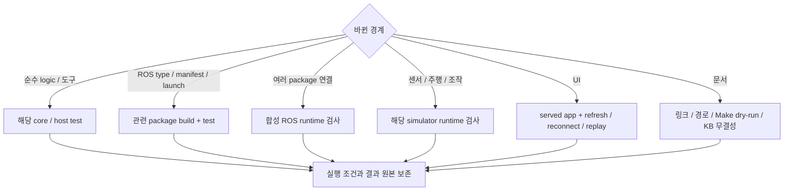

# 테스트 가이드

명령은 저장소 루트의 Humble/Fortress 환경에서 실행합니다. 변경 범위를 확인한 뒤 가장 작은 관련 검사부터 선택합니다. Make target의 실제 동작은 [Makefile](../Makefile)을 기준으로 확인합니다.

## 테스트와 도구 위치

테스트는 검사 대상을 소유한 위치에 둡니다. 루트 `tests/`에는 저장소 도구의 자동 검사와 패키지를 연결하는 통합 검사만 둡니다. 실행, 관찰과 보고 코드는 검증 도구로 분리합니다.

| 위치 | 책임 |
|---|---|
| `ros2_ws/src/<package>/test/`, `tests/` | 패키지 기능과 계약의 자동 검사 |
| `ros2_ws/src/<package>/runtime_test/` | 해당 패키지의 명시 실행 smoke와 runtime 검사 |
| `tests/integration/` | Backend, Mission 등 여러 구성 요소의 연동 검사 |
| `tests/tools/` | 저장소 검증 도구의 자동 검사 |
| `tools/validation/` | Simulator 실행과 영상·로그 수집 |

패키지 내부에도 통합 검사가 있을 수 있습니다. 파일의 책임과 실행 조건으로 위치를 정하며, runtime CLI를 `tests/`에 넣었다고 pytest가 자동 실행하는 것은 아닙니다.

## 검사 선택

bag 기반 휠/LiDAR 이동 불일치 도구는 `make test-slip-detection`으로 검사한다.
시간 보간과 좌표 변환, 합성 스캔 정합, 퇴화된 단일 벽, 정합 품질 실패,
odom 단절과 연속 감지 조건을 검증한다. ROS 노드나 모터 명령을 만들지 않는다.
실제 기록의 분석 절차와 판정 한계는 [캘리브레이션 가이드](CALIBRATION.md#bag-기반-슬립-의심-구간-분석)를 따른다.

실시간 노드와 BT를 빌드한 뒤 `make test-slip-recovery`로 navigation CTest를
격리된 `BASE_TEST_ROS_DOMAIN_ID`에서 실행한다. 실제 BT 플러그인의 child halt,
정지 확인, 목표별 재시도 유지, 지연된 이전 비교 무시와 반복 실패를 검사한다.
게이트 단위 검사는 병진 방향 유지와 휠별 감속 상한, heartbeat 단절을 확인한다.
전체 Nav2 smoke에는 `tools/validation/slip_recovery_smoke.py`를 사용한다.
별도 도메인에 빈 시험 지도와 `phone_navigation.launch.py phone_motion_profile:=omni`를
먼저 실행한 뒤 같은 도메인에서 도구를 실행한다. 합성 센서와 명령 전달만으로
경로 추종 시작과 취소 후 0 출력을 검사하며, 도구는 하드웨어 도메인 0에서 실행을 거부한다.



아래 표에서 변경 범위에 맞는 명령을 선택합니다. Simulator, mock 통과는 해당 입력과 backend의 증거이며, 실물 검증은 별도로 수행합니다.

| 변경 범위 | 명령 | 확인 범위 |
|---|---|---|
| 전체 ROS workspace | `make test` | build, colcon package test와 결과 집계 |
| Mission, Gateway core | `make test-mission-core` | ROS 없는 lifecycle, 영속성, 중복, 재전송 |
| Mock 조작 core | `make test-manipulation-core` | 서버 실행, 취소, 영속 기록과 모니터 |
| Mission과 Mock Action | `make test-mission-mock BASE_TEST_ROS_DOMAIN_ID=186` | 공통 타입, Action, 조회, 취소와 재시작; 주행은 Mock |
| Gazebo와 Mock Action | `make test-gazebo-manipulation BASE_TEST_ROS_DOMAIN_ID=186` | Nav2 도착과 정지, 두 수거, 추가 빈 관측과 보고 |
| Mission ROS 설치, 연동 | `make test-mission-runtime` | 관련 package build/test |
| Supervisor core | `make test-supervision-core` | ROS 없는 Fault, 허가, 복구, 영속성, Runtime 감독 port, 안전 증거 |
| Supervisor와 Runtime 연동 | `make test-supervision` | Supervisor ROS graph와 실제 Runtime, base driver, safety adapter, lifecycle 복구의 E2E; 센서, Nav2와 안전 하드웨어는 합성. 장애→정지 지연을 `$(CLEANY_DATA_ROOT)/runs/supervision/latency.json`에 기록 |

Supervisor 검사는 시연 프로필의 재기동 통신 복구도 포함한다. 원인이 기록된 통신
Fault만 base 정지와 fresh health 이후 해제하고, 오래된 피드백, 실제 고장, 원인 미상
상태, 미확인 목표 정지 및 기본 수동 정책은 계속 차단하는지 검사한다. ROS E2E는
실제 base driver와 합성 MCU를 사용해 단절, 재연결, Supervisor 재기동 순서를 검증하며
물리 USB 차단이나 실제 정지 성능 검증과 구분한다.
Base driver의 `test_stop_retry.py`는 STOP 3회 유실 후 동일 sequence의 ACK를 확인하고,
watchdog 정지와 알 수 없는 MCU Fault를 구분한다. 어느 경우에도 복구를 위한
ENABLE 명령이 나가지 않아야 한다.

위치 정합 검사는 `cleany_navigation/test/test_localization_alignment.py`와
`test_localization_guard_ros.py`에 있다. 작은 공분산의 잘못된 pose, 지도 회전,
정합 미확인, 가벼운 불일치 중 lease 유지와 감속, 회복/개선 중단/최대 대기 시간,
높은 공분산에서의 탐색과 재검증, 제한된 후보 탐색, 모호한 통로, 정지 미확인,
동시 복구와 수동 초기 위치 선점을 확인한다. ROS 검사는 별도 domain의 실제 Guard와 Supervisor에 합성
LiDAR·AMCL 응답을 연결하며 물리 위치 정확도 검증과 구분한다.

기존 주행 기록의 위치 정합 정책 비교는 ROS 환경에서
`tools/validation/validate_recorded_localization.py --help`로 실행 인자를 확인한다.
`--bag`에는 원본과 진단 DB가 포함된 완료된 bag 폴더를 반복 지정한다.
`--settings`는 비교할 localization 설정, `--old-source-tar`는 이전 정지 정책의
소스 스냅샷, `--draft-source`는 비교할 수정 전 감속 정책 Python 파일이다.
`--output`은 데이터 루트의 해당 실행 폴더로 지정한다. 도구는 원본 DB를 읽기 전용으로
열고 해시를 전후 비교하며, DDS domain 196에서 실제 Guard를 재생한다.
기록된 AMCL·TF를 고정한 비교이므로 변경한 속도로 이동했을 때의 위치 정확도와
최적 감속 비율을 입증하지 않는다. 기록에 없는 initialpose는 AMCL 수신 로그로
보수적으로 신뢰를 초기화하며, 센서 저장 주기와 입력 누락을 그대로 반영한다.

기록된 정합 점수 자체의 시간 그래프는
`tools/validation/plot_localization_history.py --bag BAG --end ISO_TIME --minutes 10 --output RUN_DIR`
로 생성한다. 종료 시각에는 시간대를 포함한다. 읽기 전용 DB 트랜잭션으로
위치 정합, 출력 속도 명령과 목표 취소 기록을 추출하고 PNG, PDF, CSV와 HTML을 저장한다.
점수를 재계산하지 않으며 수신 공백과 오래된 점수는 그래프에서 연결하지 않는다.

복구 하한과 판정 흐름 비교는 `tools/validation/localization_policy_experiment.py`에
`--bag`을 반복 지정하고 `--output RUN_DIR`로 실행한다. 기록 중인 DB는 먼저
SQLite backup으로 고정하며 필요하면 `--end UNIX_SECONDS`로 범위를 제한한다.
원본 지도와 인과적 TF로 정지 관측 창을 구성하고, 위치·방향 오차를 전체 참조
스트림에 유지한 채 기존 하한과 구조 변경 후보를 비교한다.
`tools/validation/report_localization_policy_experiment.py RUN_DIR`는 HTML, CSV와
그래프를 만든다. 도구 검사는 `tests/tools/test_localization_policy_experiment.py`에 있다.
기록된 AMCL은 실측 정답이 아니며, 재초기화 후의 AMCL이나 물리 복구 성공률은
이 실험으로 입증하지 않는다. 실행 프로필은 자동으로 변경하지 않는다.

| Navigation core, plugin | `make test-navigation` | Python core와 C++ plugin |
| 합성 Navigation runtime | `make test-navigation-runtime` | ROS lifecycle, goal, 취소, sensor 단절 |
| Gazebo, Navigation | `make test-gazebo` | package 검사와 C++ plugin; 선택 runtime은 제외 |
| Gazebo sensor runtime | `make test-gazebo-nav-runtime` | 실제 simulator의 sensor, odom, TF |
| 시설 목표 생성 | `make test-gazebo-facility-tools` | simulator 없는 ID, 여유, 제거 의자 처리 |
| MuJoCo | `make test-mujoco` | scene loader; 모든 조작 runtime을 뜻하지 않음 |
| Mock Manipulation Action | `make test-manipulation` | ROS Action, 취소, 조회와 재시작 복구 |
| MuJoCo BT 경계 | `make test-manipulation-bt` | native BT, Action, 관련 인식과 수거 회귀; 실제 물리 수거 성공은 별도 |
| Hand-eye 경계 | `make test-handeye` | description, MuJoCo, MoveIt, calibration |
| Base ROS | `make test-base` | interface, driver, odometry; mock MCU |
| ESP32 준비, motor core | `make test-micro-ros-setup test-motor-core` | Python 준비 도구와 장치 없는 C++ |
| Logger | `make test-logger` | CLI 정책 편집과 종료 코드, 기록 정책, 읽기 전용 archive, 디렉터리 독점, 세션과 복구 경계 |
| 매핑 원본 bag 도구 | `python3 -m pytest tests/tools/test_mapping_bag_recorder.py` | 센서 토픽 선택, 기존 bag 보존, native recorder 종료와 flush |
| Monitor와 Logger | `make test-dev-monitor` | Logger 검사와 ROS 수집, 저장, HTTP와 UI 데이터 경계 |
| Telemetry | `make test-telemetry` | odom relay |
| CI 준비 도구 | `make test-ci-tools` | 의존성 이미지 무효화, build context와 명령 전달 |

Fedora에서는 `make test-hardware-mapping-core`를 호스트에서 실행합니다. Python 검사는 Humble Distrobox에서 ROS 설치 환경과 `BASE_TEST_ROS_DOMAIN_ID`를 사용하고, 버튼 입력 검사는 호스트 Node.js에서 실행합니다. Navigation의 Python 묶음은 격리 ROS lifecycle과 센서 신선도 검사를 포함하므로 CTest 실행 한도를 300초로 둡니다. 개별 검사 내부의 판정 시간과 임계값은 별도로 유지합니다.

Fedora에서는 native ROS target을 Humble Distrobox에서 실행합니다. `test-micro-ros-setup`, `test-motor-core`는 Makefile의 `BASE_EXEC`가 환경을 선택합니다.

CI는 `PYTEST_DISABLE_PLUGIN_AUTOLOAD=1`로 runtime 의존성이 설치한 외부 pytest plugin의 자동 로드를 끕니다. 프로젝트의 `conftest.py`와 pytest 기본 plugin은 유지하며, 로컬에서는 `PYTEST_DISABLE_PLUGIN_AUTOLOAD=1 make test`로 같은 설정을 적용합니다.

`make test`는 package test가 실패해도 `colcon test-result --verbose`로 실패 상세를 출력하고 실패 상태를 반환합니다.

## CI 실행과 재사용

CI는 Ubuntu 22.04 amd64에서 모든 PR의 전체 workspace 검사, ESP32 motor core, 합성 Navigation runtime과 Gazebo sensor runtime을 실행합니다. 베이스의 pytest는 colcon에 직접 등록하며 전체 workspace 검사에서 한 번 실행합니다. Navigation과 Gazebo runtime은 같은 실행에서 이미 빌드한 workspace를 사용합니다.

| 재사용 대상 | 갱신 조건 | 검증 경계 |
|---|---|---|
| GHCR 의존성 이미지 | 모든 `package.xml`, rosdep YAML, `containers/ci/`, 이미지 준비 도구, platform 변경 | ROS, apt, pip 의존성만 포함하며 응용 소스와 빌드 결과는 포함하지 않음 |
| ccache | compiler 내용, 소스, header와 옵션에 따라 hit/miss 결정 | 빌드 명령은 매번 실행하며 CTest/pytest 결과는 캐시하지 않음 |
| 같은 실행의 workspace | 전체 빌드 완료 후 runtime 검사에서 재사용 | 다른 실행의 `build/`, `install/`, test result는 복원하지 않음 |

이미지가 없거나 pull할 수 없으면 고정한 저장소 snapshot과 Python 버전으로 이미지를 만든 뒤 전체 검사를 실행합니다. 같은 저장소의 실행은 환경 확인 후 의존성 이미지를 게시합니다. 응용 테스트의 성공 여부와 별개로 의존성 이미지와 compiler cache를 보존해 실패 수정 시에도 재사용하며, 다음 실행의 전체 검사와 실패 판정은 그대로 유지합니다. Fork PR은 이미지를 게시하지 않습니다. 매주 월요일 실행도 동일한 의존성 이미지를 재사용합니다.

기준은 2026-11-02에 조회한 Jetson의 system Python과 설치된 ROS 패키지입니다.
[repository-snapshots.env](../containers/ci/repository-snapshots.env)는 Ubuntu와 ROS 저장소의 시점을,
[pip-constraints.txt](../containers/ci/pip-constraints.txt)는 MuJoCo와 google-genai 및 전이 의존성 버전을 고정합니다.
베이스에 이미 설치된 ROS 패키지도 선택한 snapshot으로 갱신한 뒤 workspace 의존성을 설치합니다.
CI는 설치 후와 검사 시작 전에 [버전 검사](../containers/ci/verify-versions.py)를 실행합니다.
공통 ROS 패키지는 아키텍처별 빌드 시각을 제외한 upstream 버전을 비교하며,
Jetson에만 설치된 패키지를 CI에 추가로 설치하지 않습니다. JetPack, GPU 라이브러리와 실물 동작은 이 검사 범위가 아닙니다.
BT.CPP `4.9.1`의 amd64 패키지는 라이브러리 설치 위치와 CMake 검색 경로가 달라, CI 이미지에서 같은 바이너리를 가리키는 호환 링크를 추가합니다.

외부 의존성 갱신은 snapshot, Python constraints와 Jetson ROS 버전 기준을 명시적으로 변경하고 전체 CI로 검증합니다.
Dockerfile의 `DEPENDENCY_REVISION`만 올리면 같은 버전으로 이미지를 다시 만들며 패키지 버전은 갱신하지 않습니다.
저장소와 서명 키 갱신은 [ROS snapshot 안내](https://github.com/ros2/ros2_documentation/blob/rolling/source/Get-Started/Installation/Snapshot-Repository.rst)와 [Ubuntu snapshot 안내](https://snapshot.ubuntu.com/)를 따릅니다.

패키지 빌드는 최대 2개, 패키지 내부 컴파일은 runner CPU 수의 절반으로 제한해 두 병렬화 계층의 경합을 줄입니다. 최적화 수준은 기존 `RelWithDebInfo`를 유지합니다. 모델 검사에서는 같은 인자의 xacro 출력 bytes만 재사용하고 각 검사는 독립 XML tree를 받습니다.

`MAKEFLAGS`도 함께 지정해 colcon이 전체 CPU 수의 `-j` 옵션으로 CMake의 병렬 제한을 덮어쓰지 않도록 합니다.

CI artifact에는 test XML, 실패 로그, 설치된 apt/pip 버전과 ccache 통계를 남깁니다. 속도는 이미지 생성과 compiler cache miss가 있는 최초 실행, 이미지와 cache를 재사용하는 실행으로 구분해 비교합니다. 이미지 pull과 cache 복원 시간도 포함한 GitHub job 전체 시간을 기준으로 판단합니다.

전체 job 제한은 40분이며 이미지 생성은 별도로 15분 안에 완료해야 합니다.
APT는 서명을 검증한 snapshot index에서 버전, 파일 경로와 SHA256을 결정합니다.
Ubuntu 패키지 파일은 동일한 pool 경로의 archive 미러에서 먼저 받고, 없거나 검증에 실패하면 원래 snapshot에서 받습니다.
다운로드는 4개씩 수행하고 SHA256과 크기가 일치하는 파일만 APT cache에 보관하며 설치 시 APT가 다시 검증합니다.
미러의 최신 index나 다른 버전으로 대체하지 않습니다.
연결 timeout은 15초, 파일 다운로드는 60초, 한 설치 명령의 다운로드 준비는 5분으로 제한합니다.
APT 자체 재시도는 1회, 의존성 준비 명령은 10초 대기 후 최대 2회 실행합니다.
계속 실패하면 CI를 실패 처리합니다. 빌드와 테스트는 이 재시도 대상에 포함하지 않습니다.

## 선택 runtime과 UI

### 카메라 영상 수집

현재 workspace를 빌드한 뒤 `tools/validation/capture_cameras.py`로 실제 ROS
카메라 영상을 수집합니다. 각 출력 경로는 아직 없는 새 디렉터리여야 합니다.

```bash
source /opt/ros/humble/setup.bash
source "$(make -s print-install-base)/local_setup.bash"
python3 tools/validation/capture_cameras.py --backend mujoco \
  --output /absolute/new-camera-run/mujoco
python3 tools/validation/capture_cameras.py --backend gazebo --gazebo-model cad-with-arms \
  --output /absolute/new-camera-run/gazebo
PYTEST_DISABLE_PLUGIN_AUTOLOAD=1 python3 -m pytest -q tests/tools/test_capture_cameras.py
```

GUI가 없는 환경에서는 촬영 명령 앞에 `xvfb-run --auto-servernum`을 붙입니다.
VM에서 GPU 렌더링이 불안정하면 `LIBGL_ALWAYS_SOFTWARE=1`을 지정합니다.
Gazebo의 `--gazebo-model legacy`로 레거시 모델도 선택할 수 있습니다.

도구는 head와 양손목 영상의 크기, encoding, frame, buffer 및 시뮬레이션 clock과
상태 메시지를 확인하고 PNG, `report.json`, `launch.log`를 남깁니다. 누락, timeout과
조기 종료는 실패 코드로 보고하고 실행한 프로세스 그룹을 종료합니다. 촬영 성공은
전체 집기 미션의 성공을 뜻하지 않습니다. 기본 CAD 주행 프로파일은 팔을 제외하며,
`cad-with-arms`는 촬영 검증에만 팔을 포함합니다.

### 선택 실행 조건

Gazebo package의 `--run-sim-runtime`, `--run-evaluation-tests`와 Mission core의 `CLEANY_RUN_ROS_TESTS=1`은 별도로 활성화하는 검사입니다. 실행 결과에서 통과와 skip을 구분합니다.

Logger의 `CLEANY_RUN_ROS_TESTS=1 make test-logger`는 native rosbag2의 활성 읽기,
센서와 진단 bag 분리, CDR 조회, 합산 용량과 ZIP 내보내기도 검사합니다.
실물 ROS domain과 분리해서 실행하며, 이 검사는 실물 주행의 누락률이나
시간당 저장 용량을 보장하지 않습니다.

```bash
source /opt/ros/humble/setup.bash
source "$(make -s print-install-base)/setup.bash"
ROS_DOMAIN_ID=82 CLEANY_RUN_ROS_TESTS=1 make test-mission-core
```

Logger 독립 녹화 검사는 빌드 overlay를 source한 뒤 빈 출력 경로에서 실행합니다.
logger와 Monitor를 별도 프로세스로 띄우고 합성 경로, 카메라와 점군을 발행합니다.
Monitor 종료 전후의 같은 세션에서 SQLite 증가, rosbag2 원문과 stamp, Monitor 재접속,
HTTP 시작과 정지, logger 단절과 writer 대체 금지를 확인합니다. 실제 로봇 구동과
센서 성능 검증은 포함하지 않습니다.

```bash
ROS_DOMAIN_ID=218 ROS_LOCALHOST_ONLY=1 make test-logger-independence \
  LOGGER_TEST_OUTPUT=/absolute/new-logger-run LOGGER_BASE_COMMIT=<base-commit>
CLEANY_RUN_ROS_TESTS=1 ROS_DOMAIN_ID=217 ROS_LOCALHOST_ONLY=1 make test-dev-monitor
```

CLI 실제 연결 검사는 logger를 별도 프로세스로 띄우고 설치된 `logger` 실행 파일로
조회, 토픽 설정, 시작과 정지를 호출합니다. 합성 경로와 이미지를 native bag에서
다시 읽으며 CLI 종료 후 녹화 유지, 활성 설정 거부, 세션 보호와 연결 실패를 확인합니다.

```bash
ROS_DOMAIN_ID=219 ROS_LOCALHOST_ONLY=1 make test-logger-cli \
  LOGGER_TEST_OUTPUT=/absolute/new-cli-run LOGGER_BASE_COMMIT=<base-commit>
```

Monitor smoke는 같은 domain에서 Monitor를 먼저 실행한 뒤 호출합니다.

```bash
ROS_DOMAIN_ID=187 python3 ros2_ws/src/cleany_dev_monitor/runtime_test/smoke.py --output /absolute/new-run
# frontend의 현재 Playwright 설정과 package scripts:
cat ros2_ws/src/cleany_dev_monitor/web/package.json
```

Frontend 검사는 `ros2_ws/src/cleany_dev_monitor/web`에서 `pnpm exec tsc --noEmit`과 `pnpm exec playwright test`를 실행한다. 실제 Monitor가 필요한 검사는 `MONITOR_URL`을 지정하고 해당 ROS 입력도 준비한다. 기본 fixture 검사는 로컬 Vite를 시작한다.

UI 변경은 실제 served app에서 새로고침, 재연결, 기록 재생까지 확인합니다. Playwright browser가 없으면 configured browser를 설치한 뒤 다시 실행합니다.

Mission Gateway smoke는 `tests/integration/mission_runtime/`, Monitor smoke는 `ros2_ws/src/cleany_dev_monitor/runtime_test/`에 있습니다. 실제 Backend, ROS, Gazebo 입력 조건을 준비한 경우에 명시적으로 실행합니다.

## 결과와 증거

| 증거 | 의미 |
|---|---|
| 소스, manifest, 단위 검사 | 구현과 검사된 입력의 계약 |
| mock / 합성 ROS | 합성 backend의 lifecycle과 메시지 경계 |
| Gazebo, MuJoCo runtime | 해당 simulator, 입력, 버전의 동작 |
| 장치 통신 | 실제 USB, UART, DDS 등 확인한 계층 |
| 물리 시험 | 실제 sensor, actuator, 정지, 시나리오 결과 |

결과에는 다음 항목을 남깁니다.

- Code commit와 dirty 상태, 환경, overlay
- 입력, config, asset hash
- 요청 범위와 실제 완료 범위, 실패, skip, 중단
- 로그와 출력 위치

CTest wrapper와 pytest 집계가 겹치면 중복 합산하지 않습니다. 실행 원본은 `CLEANY_DATA_ROOT/runs/`, 과거 보고서는 [근거 색인](EVIDENCE.md)에서 찾습니다.

## 문서 변경 검사

내부 파일 링크, anchor, 코드, 설정, launch 경로, Make target의 존재와 native dry-run을 확인합니다. 문서 검증만을 위해 실제 로봇을 움직이거나 새 calibration을 수행하지 않습니다.

KB를 변경한 경우에는 KB의 `kb-quality-checks`도 실행합니다. 검사 통과와 내용 승인은 별도로 기록합니다.

## 실물 매핑 패키지 경계

`make test-hardware-mapping-core`는 입력 lease, ordered permission의 MCU 확인, 스캔 필터,
설정 검증, map origin yaw와 원자적 저장, 초기화 직렬화와 저장 실패를 검사한다.
매핑 heartbeat 만료와 재수신, RPC 실패 원인 보존, 시작 실패의 로그 경로와 traceback,
이벤트 파일 회전과 재시작 보존, 큐 포화와 디스크 장애도 검사한다.
`make test-base BASE_TEST_ROS_DOMAIN_ID=174`는 기존 base 회귀와 새 구동 허가 계약을 검사한다.
ROS graph 검사는 같은 domain에서 동시에 실행하지 않는다.

설치된 패키지의 모의 통합은 다음 명령으로 실행한다. 새 출력 디렉터리를 지정한다.

```bash
make build-hardware-mapping
make test-hardware-mapping-runtime MAPPING_TEST_OUTPUT=/absolute/path/to/new-artifact-dir
```

이 검사는 domain 173에서 synthetic MCU와 합성 LiDAR를 사용한다. 저장소 밖 `/tmp`에서
설치된 launch를 시작하고 단일 휠 publisher, 휴대폰 명령/해제, 지도 초기화와 중복 요청,
두 세션의 map/pbstream 및 Logger bag, 최종 저장 후 종료를 확인한다. 관리자 종료 후 ROS
상태 만료와 조종 이벤트 파일 저장도 확인한다. 실물 USB는 열지 않는다.
물리 정지 거리, 현재 장착 TF의 정확도와 실제 바닥에서의 지도 품질은 별도 실물 검사다.

`make test-hardware-mapping`은 관련 ROS 패키지를 domain 174에서 순서대로 검사한다.
Base graph fixture는 BASE_TEST_ROS_DOMAIN_ID도 따르므로 두 domain 변수를 함께 설정한다.
위 통합 결과의 bag은 domain 175에서 실제 ROS 재생으로 확인할 수 있다.

```bash
make test-hardware-mapping-replay \
  MAPPING_BAG=/absolute/path/to/recordings/bags/session-id \
  MAPPING_TEST_OUTPUT=/absolute/path/to/replay-verification.json
```

## ToF와 Supervisor 통합

`make test-tof-core`는 거리 투영, 평면 fit, 제동 envelope, timeout과 navigation 경로의
순수 검사를 실행한다. `make test-tof`는 interface, ToF, Mission, safety adapter와
Supervisor를 빌드하고 패키지 검사를 실행한다. ToF ROS 검사는 독립 DDS domain의 합성
frame/odom/lease와 pseudo-terminal을 사용하며 실제 센서나 모터를 열지 않는다.

기존 navigation C++/Python 회귀 검사는 Humble 환경에서 `make test-navigation`으로
실행한다. Mission의 선택 ROS 시나리오는 `CLEANY_RUN_ROS_TESTS=1`과 독립
`ROS_DOMAIN_ID`에서 별도 실행한다. colcon의 선택 시나리오 skip은 성공으로 해석하지 않는다.
실물 검증 항목은 [CALIBRATION](CALIBRATION.md#tof-근접-보호-commissioning)을 따른다.

ToF 분류 회귀에는 단독 보드 로그의 3개 frame과 합성 입력을 사용한다. 정상 미검출의
주행 허용, 부분 품질 불량 제외, 전부 불량 정지, 인접/물리 cluster, 15Hz 지속 확인,
flash/고립 noise, 비상 단일 검출, 해제 hysteresis와 필터 reset을 검사한다. ROS 검사는
센서 fault와 stale 정지, 일부 불량 Zone의 책상 접근, 평면 소실과 기존 lease/cancel 경계를
검사한다. Navigation은 ToF 활성 여부와 독립 head-pan observer 설정 조합을 검사한다.
합성 graph는 기존 안전 chain을 identity로 대체하며 실제 Nav2/모터 주행이 아니다.

원본 측정 로그를 ROS 개발환경에서 오프라인 감사하려면 다음을 사용한다. 장치를 열지 않는다.

```bash
PYTHONPATH="$PWD/ros2_ws/src/cleany_tof" python3 tools/validation/tof/replay.py \
  /absolute/path/to/range-15hz-2min.jsonl --output /absolute/path/to/audit.json
```


## 얼굴 디스플레이

상태 로직은 Jetson의 독립 설치 폴더에서 `make test`로 검사한다. 저장소의 `make test`가 실행하는 colcon 검사에도 같은 pytest가 등록된다.

ROS→HTTP 전환, 결과 수량과 연결 복구는 구현 레포 루트에서 다음 명령으로 검사한다. `/cleany_display_validation/` 토픽과 domain 173을 사용하며 로봇 제어기는 실행하지 않는다.

```bash
source /opt/ros/humble/setup.bash
source /home/cleany/cleany-display/ros2_ws/install/local_setup.bash
ROS_DOMAIN_ID=173 python3 tools/validation/verify_cleany_display_ros.py \
  --config /home/cleany/cleany-display/config/display.json \
  --output output/cleany-display-jetson/ros-verification.json
```

브라우저 검사는 [Dev Monitor 웹 의존성](DEVELOPMENT_SETUP.md#monitor-웹)과 로컬 Chrome을 설치한 구현 레포에서 `node tools/validation/verify_cleany_display_web.cjs`로 실행한다. 7개 표정의 60fps와 Zzz 주기, 화면 비율과 720p 상한, 설정 변경, 60.01Hz 입력에서 균등한 30fps 간격, 동일 상태의 DOM 변경 부재, 모션 감소 설정과 HTTP 복구를 검사한다. 결과는 Git에서 제외한 `output/cleany-display-jetson/`에 기록한다.

전환 검사는 같은 환경에서 `node tools/validation/verify_cleany_display_transitions.cjs`로 실행한다. HTTP 상태를 바꾸면서 60Hz 프레임을 제어해 깜빡임의 연속성, 눈과 입의 중간 모양, 얼굴 위치, 땀방울과 Zzz의 사라짐을 확인한다. 안내 교체 중 추가 상태 수신, 도움 요청과 일반 안내의 겹침, 모션 감소 설정도 검사한다. 결과와 중간 프레임은 `output/cleany-display-jetson/transitions/`에 기록하며, 실제 장치의 프레임 성능 측정과 구분한다.

실물 성능 측정은 Jetson에서 다음 순서로 실행한다.

1. `systemctl --user set-environment CLEANY_DISPLAY_DEBUG_PORT=9223`과 `systemctl --user restart cleany-display-kiosk`로 전용 브라우저의 로컬 디버깅 포트를 연다.
2. 설치 폴더의 `browser-tools/bin/python`으로 `tools/validation/measure_cleany_display.py --output <결과.json>`을 실행한다. `--modes idle moving checking collecting complete charging help`를 추가하면 브라우저 응답만 임시로 바꿔 표정별로 측정하고 실제 ROS 상태 화면으로 복구한다.
3. 측정 종료 후 `systemctl --user unset-environment CLEANY_DISPLAY_DEBUG_PORT`와 키오스크 재시작으로 디버깅 포트를 닫는다.

결과의 `frames.canvas.fps`는 실제 캔버스 렌더링 빈도이고 `frames.raf.fps`는 브라우저 콜백 빈도다. CPU 수치는 단일 코어 기준이며 GPU 사용률이 아니다. 실물 화면, 장시간 동시 운용과 재부팅 후 자동 시작은 별도 검증한다.
## MoveIt 충돌 형상과 MuJoCo 동등성 검사

`make test-description-models`는 ROS 2와 MuJoCo, NumPy, SciPy 환경에서
원본 URDF와 MJCF의 동등성 및 최적화 충돌 자산을 검사합니다.
원본 대조에는 `optimized_arm_collision_meshes:=false head_collision_meshes:=false`를
명시하고, 기본 최적화 모델에는 시각 형상, 관성, 관절 보존과 모터 충돌 메시
배치를 검사합니다. MuJoCo 물리 접촉 형상은 기존 MJCF를 유지하며,
시뮬레이션의 MoveIt 경로 계획은 최적화 URDF를 사용합니다.
`COLLISION_TEST_ARGS`로 `-k`와 `--junitxml` 등을 전달할 수 있습니다.

## 충돌 메시와 내부 장애물 검사

```bash
make build COLCON_BUILD_ARGS="--packages-up-to cleany_moveit_config"
make test-moveit-collision
```

첫 명령은 description, 충돌 플러그인과 기존 scene mapping 의존성을 함께
빌드합니다. Jetson의 MoveIt 2.5.9 전용 환경을 사용하는 경우 해당 overlay를
먼저 source합니다. 검사 시 불러오는 설치 경로는 `INSTALL_BASE`를 따릅니다.

`test-moveit-collision`은 형상 검사, SolidFCL 단위 검사, 계획 설정 및 실제
MoveIt 서비스 검사를 실행합니다. 서비스 검사는 기본 detector가 내부 장애물
36개를 검출하는지, 같은 입력을 표면 FCL이 놓치는지와 존재하지 않는 detector를
선택했을 때 프로세스가 종료하는지 확인합니다. 가상 장애물만 사용하고
trajectory execution은 끄며 모터 드라이버를 실행하지 않습니다.

병행 지도 확장 도구의 원점 변환과 지도 저장 형식은 ROS Python 환경에서
`PYTEST_DISABLE_PLUGIN_AUTOLOAD=1 python3 -m pytest -q tests/tools/test_map_extension.py`로 검사한다.
실행 시 `/map`과 `/tf` 발행자에 확장 Cartographer가 없는지, `/map_extension/map`
및 `/map_extension/tracked_pose`가 수신되는지 확인한다. 실물 확장 품질은
연결 통로 왕복 관측과 복귀 시 벽 정합으로 별도 평가한다.

### 순정 Lattice와 Phone Omni MPPI 비교

`tools/validation/native_lattice_mppi`는 설치된 Smac Lattice와 통합 MPPI를 격리 실행한다. 실제 로봇에 속도를 발행하지 않는다. 입력 폴더에는 `map.txt`(크기, 해상도, 원점), `map.bin`(Nav2 cost byte 배열), `poses.txt`(시작/목표 x y yaw)가 필요하다. 설정은 controller_server, planner_server와 local_costmap의 합성 YAML이다.

```bash
cmake -S tools/validation/native_lattice_mppi -B /tmp/cleany-lattice-validation
cmake --build /tmp/cleany-lattice-validation -j2
python3 tools/validation/native_lattice_mppi/compare.py \
  /tmp/cleany-lattice-validation/closed_loop <artifact-root> <config-stem> <case> [<case> ...]
```

각 `<case>`는 입력 폴더이고 `<config-stem>.yaml`을 읽어 결과와 초기 경로 및 20Hz 명령을 저장한다. `--preview-goal`은 웹 UI처럼 최초 미리보기 끝점을 실제 이동 목표로 선택한다. 격리 domain은 188이며 운영 domain과 같으면 실행하지 않는다. 시험은 1Hz 재계획, 1.5m 지역 경로와 이상적 평면 운동 적분을 사용한다. 실제 PathHandler의 TF/지역 지도 갱신, AMCL 오차, 통신 지연, 모터 응답과 슬립은 재현하지 않는다. 120초 시뮬레이션 시간 안에 반환 경로 끝점의 3cm/0.1rad 이내 도착과 footprint 충돌 여부를 검사하며, 클릭 목표와의 오차도 별도로 출력한다. 이것은 실물 주행 성공 근거가 아니다.

`balance_primitives.py SOURCE DESTINATION`은 직선 primitive의 좌표를 변경하지 않고 길이 metadata를 재계산한다. `test_phone_profile.py`는 번들 원본과의 차이가 오른쪽 횡이동 16개의 길이 필드뿐인지, 모든 직선 길이가 기하와 일치하는지 검사한다.


고정 방향 비용은 `mppi_critics_tests`의 `Directional*` 및 `mppi_critic_manager_test`로
부호 대칭, 동일 거리의 각도별 비용과 봉우리, 시간 적분, DiffDrive 무효화, 플러그인 로딩을 확인한다. `test_slip_context.py`는
과거 TF/명령 선택, stale/null, bounded history와 지도 식별을 검사한다.
`cleany_logger/tests/test_logger_policy.py`는 문맥 토픽의 기록/제외/재매핑을 검사한다.
`tools/validation/native_lattice_mppi/compare.py`의 격리 실행은 실제 planner/controller와
이상적 운동학의 도착 및 명령 한계를 검사하며 실제 슬립 개선 증거로 사용하지 않는다.


`tools/validation/slip_context_recording.py --output <새 결과 폴더>`는 설치된 logger에
합성 String 메시지를 보내고 저장된 CDR을 다시 읽어 문맥을 비교한다. hardware domain 0에서는
실행을 거부한다. runner 환경 설정 뒤 별도 `ROS_DOMAIN_ID`를 지정해 실행한다.


### 기록된 Nav2 조건과 MPPI reset 검사

`tools/validation/native_lattice_mppi/extract_bag_fixture.py`는 bag의 지정 시각 이전에
수신된 global costmap, odom, plan과 map→odom TF를 읽어 정적 과제를 만든다.
수신 시각과 header의 미래 값, 오래된 입력, 좌표계 불일치를 거부한다. OccupancyGrid의
손실 압축을 역변환할 때 각 비용 구간의 상한을 사용하고 lethal과 unknown을 보존한다.
`tests/tools/test_bag_navigation_fixture.py`는 이 비용 변환과 SE(2) 합성을 검사한다.

`compare.py`의 폐루프는 정적 비용 지도에서 정지 출발하는 이상적 운동 모사다.
실제 scan의 시간 변화, SLAM/AMCL 오차, BT 복구, 마찰과 슬립을 재현하지 않는다.
`--preview-goal` 사용 시 반환된 Lattice 끝점을 도착 기준으로 사용하고 요청 좌표와의
오차를 별도로 기록한다. 실패한 과제도 결과에 보존해야 한다.

`noise_reset_probe`는 1000×60 후보의 reset 직후 잡음과 실행 시간을 100회 측정한다.
`mppi_noise_generator_test`는 비동기 생성 요청과 reset이 겹칠 때의 완전한 첫 묶음,
운동 모델 전환, 독립 controller 난수열과 종료를 검사한다. ROS domain은 실제 로봇과
분리한다. 헤더의 객체 배치가 바뀌면 비교용 바이너리도 해당 라이브러리와 함께 재빌드한다.

메모리 사용을 제한하는 격리 빌드는 패키지 수와 C++ 컴파일 작업 수를 모두 제한한다.
`CMAKE_BUILD_PARALLEL_LEVEL`은 CMake `-D` 인수가 아니라 환경 변수다.

```bash
CMAKE_BUILD_PARALLEL_LEVEL=2 MAKEFLAGS=-j2 make build \
  CLEANY_BUILD_ROOT=/path/to/isolated-build \
  COLCON_BUILD_ARGS='--packages-select cleany_navigation --parallel-workers 1'
```


## D435 높이 필터 검증

ROS 환경에서 `python3 -m pytest -q ros2_ws/src/cleany_navigation/test/test_depth_obstacles.py ros2_ws/src/cleany_navigation/test/test_depth_obstacle_preview_transport.py`로
높이 경계, 기울어진 관측 바닥과 독립적인 고정 하한, TF 소실 시 오래된 점군 제거를 확인한다.
실물 미리보기가 실행 중이면 `python3 tools/validation/probe_depth_obstacle_cutoff.py --min-z .192 --output /path/to/run/live-check.json`으로
신선한 비어 있지 않은 출력의 좌표계와 최소 높이를 확인한다. 이 검사는 물체 검출률이나 주행 안전성을 입증하지 않는다.

## 실물 depth costmap과 Monitor 격리 회귀

`test_depth_local_costmap.py`는 ROS domain 192에서 설치된 VoxelLayer의 표시, 관측 밖 유지, 빈 공간 재관측 후 제거를 검사한다. `test_phone_collision_monitor.py`는 domain 191에서 LiDAR와 depth 각각의 정지 우선순위, 절대 속도 상한, 필수 depth 중단 시 정지와 복구를 검사한다. 로봇 domain 0에 속도 명령을 보내지 않는다. `test_depth_transport.py`는 실제 형식의 깊이 메시지, 촬영 시각 TF, 무효 영상 차단과 floor clearing 보존을 검사한다. `test_phone_slip_launch.py`는 depth 옵션이 global costmap이나 slip 설정을 바꾸지 않는지 검사한다.

```bash
python3 -m pytest -q ros2_ws/src/cleany_navigation/test/test_depth_local_costmap.py ros2_ws/src/cleany_navigation/test/test_phone_collision_monitor.py ros2_ws/src/cleany_navigation/test/test_depth_transport.py ros2_ws/src/cleany_navigation/test/test_phone_slip_launch.py
```

격리 합성 입력 검사는 실물 의자 이동이나 실제 제동 거리의 검증과 구분한다. 실물에서는 조종 pause 상태에서 의자를 놓고 치운 관측과 costmap을 기록한 후 별도 주행 시험으로 진행한다.
