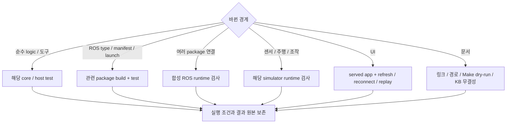

# 테스트 가이드

명령은 저장소 루트의 Humble/Fortress 환경에서 실행합니다. 변경 범위를 확인한 뒤 가장 작은 관련 검사부터 선택합니다. Make target의 실제 동작은 [Makefile](../Makefile)을 기준으로 확인합니다.
## DDS 수신 버퍼 단계 비교

`tools/validation/dds_buffer_sweep.py`는 동작 중인 런타임의 토픽을 읽는 별도 계측기를 순차 실행합니다. 호스트와 운영 인식 프로세스의 설정은 유지하고 계측기의 CycloneDDS 수신 소켓 요청값만 변경합니다. 로봇 명령이나 카메라 활성화 요청은 보내지 않습니다. 따라서 결과는 추가 호스트 Best Effort 수신기의 대기 상태 비교이며, 운영 인식의 Reliable 수신 및 파지 중 검증과 구분합니다.

1. 로봇이 대기 중인 상태에서 운영 런타임과 같은 ROS domain 및 네트워크 환경을 설정합니다.

   ```bash
   source /opt/ros/humble/setup.bash
   source tools/ros2/cleany-install-env
   source "$CLEANY_INSTALL_BASE/setup.bash"
   source tools/vision-ros-env
   export ROS_DOMAIN_ID=0
   export PYTHONPATH="$PWD/ros2_ws/src/cleany_dev_monitor:${PYTHONPATH:-}"
   export OPENBLAS_NUM_THREADS=1 OMP_NUM_THREADS=1
   ```

2. 새 출력 경로를 지정해 비교합니다. 기본값은 208 KiB, 512 KiB, 1 MiB, 2 MiB, 4 MiB, 8 MiB를 순방향과 역방향으로 각각 35초 측정합니다. 시스템 `rmem_max`보다 큰 요청값은 거부합니다. 다른 빈도 계측기를 동시에 실행하면 추가 부하가 생깁니다.

   ```bash
   python3 tools/validation/dds_buffer_sweep.py run \
     --output ../cleany-data/reports/dds-buffer-idle-NEW \
     --sizes-kib 208 512 1024 2048 4096 8192 --rounds 2 --seconds 35 --warmup 5
   ```

3. 측정 종료 후 보고서를 생성합니다. 렌더링 부하가 측정에 섞이지 않도록 순차 실행합니다.

   ```bash
   python3 tools/validation/dds_buffer_report.py ../cleany-data/reports/dds-buffer-idle-NEW
   ```

`report/index.html`과 PDF는 1초 이동 구간의 Hz를 0.1초 간격으로 표시합니다. 처음 5초와 이 구간에 걸친 이동 창은 비교 지표에서 제외합니다. 각 회차 `events.jsonl`에는 초기 연결 구간을 포함한 원본이 남습니다. `socket-limits.json`에서 Linux `SO_RCVBUF` 실효 크기를 확인하며, 요청값의 두 배가 아니면 해당 측정을 중지합니다. 소켓별 UDP 유실은 계측기 자신의 소켓만 집계하며 영상 프레임 유실률을 의미하지 않습니다. 손목 OFF는 정상 비활성으로 구분합니다.

보고서의 `idle_observed`와 기록 완전성을 확인합니다. 실행 이벤트, 활성 명령 또는 손목 ON이 관측되면 대기 상태 비교로 판정하지 않습니다. 실제 파지 중 후보값 검증에는 운영 수신기의 프로파일 적용과 새 소켓 생성 확인, 파이프라인 구간별 기록이 추가로 필요합니다. 계측기 버퍼만 줄인 결과로 OS 전체 상한의 적정성을 확정하지 않습니다.

## 테스트와 도구 위치

테스트는 검사 대상을 소유한 위치에 둡니다. 루트 `tests/`에는 저장소 도구의 자동 검사와 패키지를 연결하는 통합 검사만 둡니다. 실행, 관찰과 보고 코드는 검증 도구로 분리합니다.

| 위치 | 책임 |
|---|---|
| `ros2_ws/src/<package>/test/`, `tests/` | 패키지 기능과 계약의 자동 검사 |
| `ros2_ws/src/<package>/runtime_test/` | 해당 패키지의 명시 실행 smoke와 runtime 검사 |
| `tests/integration/` | Backend, Mission 등 여러 구성 요소의 연동 검사 |
| `tests/tools/` | 저장소 검증 도구의 자동 검사 |
| `tools/validation/` | Simulator 실행과 영상·로그 수집 |

패키지 내부에도 통합 검사가 있을 수 있습니다. 파일의 책임과 실행 조건으로 위치를 정하며, runtime CLI를 `tests/`에 넣었다고 pytest가 자동 실행하는 것은 아닙니다.

## 검사 선택



아래 표에서 변경 범위에 맞는 명령을 선택합니다. Simulator, mock 통과는 해당 입력과 backend의 증거이며, 실물 검증은 별도로 수행합니다.

| 변경 범위 | 명령 | 확인 범위 |
|---|---|---|
| 전체 ROS workspace | `make test` | build, colcon package test와 결과 집계 |
| Mission, Gateway core | `make test-mission-core` | ROS 없는 lifecycle, 영속성, 중복, 재전송 |
| Mock 조작 core | `make test-manipulation-core` | 서버 실행, 취소, 영속 기록과 모니터 |
| Mission과 Mock Action | `make test-mission-mock BASE_TEST_ROS_DOMAIN_ID=186` | 공통 타입, Action, 조회, 취소와 재시작; 주행은 Mock |
| Gazebo와 Mock Action | `make test-gazebo-manipulation BASE_TEST_ROS_DOMAIN_ID=186` | Nav2 도착과 정지, 두 수거, 추가 빈 관측과 보고 |
| Mission ROS 설치, 연동 | `make test-mission-runtime` | 관련 package build/test |
| Navigation core, plugin | `make test-navigation` | Python core와 C++ plugin |
| 합성 Navigation runtime | `make test-navigation-runtime` | ROS lifecycle, goal, 취소, sensor 단절 |
| Gazebo, Navigation | `make test-gazebo` | package 검사와 C++ plugin; 선택 runtime은 제외 |
| Gazebo sensor runtime | `make test-gazebo-nav-runtime` | 실제 simulator의 sensor, odom, TF |
| 시설 목표 생성 | `make test-gazebo-facility-tools` | simulator 없는 ID, 여유, 제거 의자 처리 |
| MuJoCo | `make test-mujoco` | scene loader; 모든 조작 runtime을 뜻하지 않음 |
| Mock Manipulation Action | `make test-manipulation` | ROS Action, 취소, 조회와 재시작 복구 |
| MuJoCo BT 경계 | `make test-manipulation-bt` | native BT, Action, 관련 인식과 수거 회귀; 실제 물리 수거 성공은 별도 |
| Hand-eye 경계 | `make test-handeye` | description, MuJoCo, MoveIt, calibration |
| Base ROS | `make test-base` | interface, driver, odometry; mock MCU |
| ESP32 준비, motor core | `make test-micro-ros-setup test-motor-core` | Python 준비 도구와 장치 없는 C++ |
| Monitor | `make test-dev-monitor` | 수집, 저장, HTTP와 UI 데이터 경계 |
| Monitor 승인 제안 | `CLEANY_RUN_ROS_TESTS=1 ROS_DOMAIN_ID=231 ROS_LOCALHOST_ONLY=1 make test-dev-monitor` | 별도 ROS domain의 관측 fixture, 제안 이미지와 대상 재확인; 실물 동작 없음 |
| Telemetry | `make test-telemetry` | odom relay |
| CI 준비 도구 | `make test-ci-tools` | 의존성 이미지 무효화, build context와 명령 전달 |

Fedora에서는 native ROS target을 Humble Distrobox에서 실행합니다. `test-micro-ros-setup`, `test-motor-core`는 Makefile의 `BASE_EXEC`가 환경을 선택합니다.

승인 화면은 `pnpm --dir ros2_ws/src/cleany_dev_monitor/web exec playwright test operator.spec.ts`로
확인합니다. `OPERATOR_VISUAL_DIR`를 지정하면 제안의 데스크톱·모바일 화면을 저장합니다.
Python 검사에는 만료, 장면 변화, 대상 대체 금지, 승인 중복·재시작, 정확한 Goal 전달,
다음 제안의 승인 대기를 포함합니다. ROS fixture 및 브라우저 mock 통과는 실제 파지
성공의 근거가 아닙니다.

CI는 `PYTEST_DISABLE_PLUGIN_AUTOLOAD=1`로 runtime 의존성이 설치한 외부 pytest plugin의 자동 로드를 끕니다. 프로젝트의 `conftest.py`와 pytest 기본 plugin은 유지하며, 로컬에서는 `PYTEST_DISABLE_PLUGIN_AUTOLOAD=1 make test`로 같은 설정을 적용합니다.

`make test`는 package test가 실패해도 `colcon test-result --verbose`로 실패 상세를 출력하고 실패 상태를 반환합니다.

## CI 실행과 재사용

CI는 모든 PR에서 전체 workspace 검사, ESP32 motor core, 합성 Navigation runtime과 Gazebo sensor runtime을 실행합니다. 베이스의 pytest는 colcon에 직접 등록하며 전체 workspace 검사에서 한 번 실행합니다. Navigation과 Gazebo runtime은 같은 실행에서 이미 빌드한 workspace를 사용합니다.

| 재사용 대상 | 갱신 조건 | 검증 경계 |
|---|---|---|
| GHCR 의존성 이미지 | 모든 `package.xml`, rosdep YAML, `containers/ci/`, 이미지 준비 도구, platform 또는 UTC ISO 주차 변경 | ROS, apt, pip 의존성만 포함하며 응용 소스와 빌드 결과는 포함하지 않음 |
| ccache | compiler 내용, 소스, header와 옵션에 따라 hit/miss 결정 | 빌드 명령은 매번 실행하며 CTest/pytest 결과는 캐시하지 않음 |
| 같은 실행의 workspace | 전체 빌드 완료 후 runtime 검사에서 재사용 | 다른 실행의 `build/`, `install/`, test result는 복원하지 않음 |

이미지가 없거나 pull할 수 없으면 동일한 Dockerfile로 의존성을 설치한 뒤 전체 검사를 실행합니다. 같은 저장소의 실행은 환경 확인 후 의존성 이미지를 게시합니다. 응용 테스트의 성공 여부와 별개로 의존성 이미지와 compiler cache를 보존해 실패 수정 시에도 재사용하며, 다음 실행의 전체 검사와 실패 판정은 그대로 유지합니다. Fork PR은 이미지를 게시하지 않습니다. 매주 월요일 실행은 새 주차 이미지를 준비하며, 같은 주에 수동 갱신하려면 Dockerfile의 `DEPENDENCY_REVISION`을 올립니다. Python 외부 의존성 버전은 `containers/ci/pip-constraints.txt`에서 갱신합니다.

패키지 빌드는 최대 2개, 패키지 내부 컴파일은 runner CPU 수의 절반으로 제한해 두 병렬화 계층의 경합을 줄입니다. 최적화 수준은 기존 `RelWithDebInfo`를 유지합니다. 모델 검사에서는 같은 인자의 xacro 출력 bytes만 재사용하고 각 검사는 독립 XML tree를 받습니다.

CI artifact에는 test XML, 실패 로그, 설치된 apt/pip 버전과 ccache 통계를 남깁니다. 속도는 이미지 생성과 compiler cache miss가 있는 최초 실행, 이미지와 cache를 재사용하는 실행으로 구분해 비교합니다. 이미지 pull과 cache 복원 시간도 포함한 GitHub job 전체 시간을 기준으로 판단합니다.

## 선택 runtime과 UI

### 카메라 영상 수집

현재 workspace를 빌드한 뒤 `tools/validation/capture_cameras.py`로 실제 ROS
카메라 영상을 수집합니다. 각 출력 경로는 아직 없는 새 디렉터리여야 합니다.

```bash
source /opt/ros/humble/setup.bash
source "$(make -s print-install-base)/local_setup.bash"
python3 tools/validation/capture_cameras.py --backend mujoco \
  --output /absolute/new-camera-run/mujoco
python3 tools/validation/capture_cameras.py --backend gazebo --gazebo-model cad-with-arms \
  --output /absolute/new-camera-run/gazebo
PYTEST_DISABLE_PLUGIN_AUTOLOAD=1 python3 -m pytest -q tests/tools/test_capture_cameras.py
```

GUI가 없는 환경에서는 촬영 명령 앞에 `xvfb-run --auto-servernum`을 붙입니다.
VM에서 GPU 렌더링이 불안정하면 `LIBGL_ALWAYS_SOFTWARE=1`을 지정합니다.
Gazebo의 `--gazebo-model legacy`로 레거시 모델도 선택할 수 있습니다.

도구는 head와 양손목 영상의 크기, encoding, frame, buffer 및 시뮬레이션 clock과
상태 메시지를 확인하고 PNG, `report.json`, `launch.log`를 남깁니다. 누락, timeout과
조기 종료는 실패 코드로 보고하고 실행한 프로세스 그룹을 종료합니다. 촬영 성공은
전체 집기 미션의 성공을 뜻하지 않습니다. 기본 CAD 주행 프로파일은 팔을 제외하며,
`cad-with-arms`는 촬영 검증에만 팔을 포함합니다.

### 선택 실행 조건

Gazebo package의 `--run-sim-runtime`, `--run-evaluation-tests`와 Mission core의 `CLEANY_RUN_ROS_TESTS=1`은 별도로 활성화하는 검사입니다. 실행 결과에서 통과와 skip을 구분합니다.

```bash
source /opt/ros/humble/setup.bash
source "$(make -s print-install-base)/setup.bash"
ROS_DOMAIN_ID=82 CLEANY_RUN_ROS_TESTS=1 make test-mission-core
```

Monitor smoke는 같은 domain에서 Monitor를 먼저 실행한 뒤 호출합니다.

```bash
ROS_DOMAIN_ID=187 python3 ros2_ws/src/cleany_dev_monitor/runtime_test/smoke.py --output /absolute/new-run
# frontend의 현재 Playwright 설정과 package scripts:
cat ros2_ws/src/cleany_dev_monitor/web/package.json
```

Frontend 검사는 `ros2_ws/src/cleany_dev_monitor/web`에서 `pnpm exec tsc --noEmit`과 `pnpm exec playwright test`를 실행한다. 실제 Monitor가 필요한 검사는 `MONITOR_URL`을 지정하고 해당 ROS 입력도 준비한다. 기본 fixture 검사는 로컬 Vite를 시작한다.

UI 변경은 실제 served app에서 새로고침, 재연결, 기록 재생까지 확인합니다. Playwright browser가 없으면 configured browser를 설치한 뒤 다시 실행합니다.

Mission Gateway smoke는 `tests/integration/mission_runtime/`, Monitor smoke는 `ros2_ws/src/cleany_dev_monitor/runtime_test/`에 있습니다. 실제 Backend, ROS, Gazebo 입력 조건을 준비한 경우에 명시적으로 실행합니다.

## 결과와 증거

| 증거 | 의미 |
|---|---|
| 소스, manifest, 단위 검사 | 구현과 검사된 입력의 계약 |
| mock / 합성 ROS | 합성 backend의 lifecycle과 메시지 경계 |
| Gazebo, MuJoCo runtime | 해당 simulator, 입력, 버전의 동작 |
| 장치 통신 | 실제 USB, UART, DDS 등 확인한 계층 |
| 물리 시험 | 실제 sensor, actuator, 정지, 시나리오 결과 |

결과에는 다음 항목을 남깁니다.

- Code commit와 dirty 상태, 환경, overlay
- 입력, config, asset hash
- 요청 범위와 실제 완료 범위, 실패, skip, 중단
- 로그와 출력 위치

CTest wrapper와 pytest 집계가 겹치면 중복 합산하지 않습니다. 실행 원본은 `CLEANY_DATA_ROOT/runs/`, 과거 보고서는 [근거 색인](EVIDENCE.md)에서 찾습니다.

## 문서 변경 검사

내부 파일 링크, anchor, 코드, 설정, launch 경로, Make target의 존재와 native dry-run을 확인합니다. 문서 검증만을 위해 실제 로봇을 움직이거나 새 calibration을 수행하지 않습니다.

KB를 변경한 경우에는 KB의 `kb-quality-checks`도 실행합니다. 검사 통과와 내용 승인은 별도로 기록합니다.

## Jetson 변경 검증

관련 native 패키지와 interfaces를 먼저 빌드한다. `make test-jetson-core`는 snapshot 버퍼, 재구성 캐시, worker, 실물 파지 core와 정지 표본을 검사한다. `make test-jetson-native`는 scene mapping, Feetech driver와 MoveIt batch capability의 C++ 검사를 실행한다. `make test-jetson-packages`는 인식, 파지, 실물 상태, 조작과 BT의 package 회귀 검사를 수행한다. `make test-jetson-tools`는 `tests/tools/`의 host 도구 검사를 수행한다.

검사는 localhost 전용의 별도 ROS domain을 사용한다. GPU, licensed SDK와 선택적인 LeRobot 환경이 필요한 검사는 해당 조건과 skip 이유를 구분한다. `runtime_test/`의 PTY controller와 TCP replay 검사는 명시적으로 실행하며 실물 USB 장치를 열지 않는다. 테스트 입력인 `supervised_collection_fixture.json`은 공용 실물 설정이나 commissioning 완료의 증거가 아니다.

모델 비교, 오차 주입 캠페인과 날짜별 보고서 원본은 자동 회귀 검사와 분리한다. 코드 수정의 작은 재현 사례는 해당 패키지 테스트로 유지하고 측정 JSON, 영상, 점군과 그래프는 데이터 루트에 보관한다.

PTY controller의 명시 실행은 `make test-jetson-controller`를 사용한다. 예를 들어 `JETSON_CONTROLLER_TEST_ARGS='-k "readonly_controllers_cannot_activate_or_execute or shared_bus_readonly_has_no_writes"'`는 READ 전용 활성화 차단과 쓰기 부재를 실제 native driver와 가상 serial에서 검사한다. 일반 pytest는 ROS launch 자동 수집 plugin을 비활성화해 인접한 runtime 검사를 암묵적으로 import하지 않는다.
