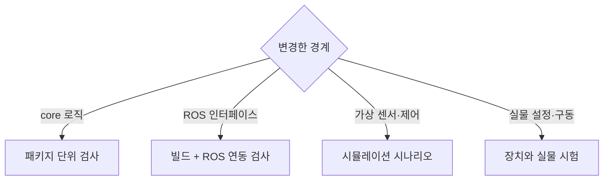

# 변경을 검증하기

수정한 경계에 맞는 검사를 고르고, 자동 검사와 시뮬레이션, 실물 결과를 구분합니다.



## 먼저 고를 검사

| 바꾼 것 | 첫 검사 | 추가로 확인할 것 |
|---|---|---|
| 순수 Python 로직 | 해당 패키지 pytest | 입력 오류, 상태 전이와 실패 경로 |
| ROS 타입·launch·설치 데이터 | 관련 package build/test | 실제 topic·service 연결 |
| 여러 패키지 연결 | 합성 ROS runtime | lifecycle, 취소, 재연결 |
| 주행·인식·조작 | 관련 simulator runtime | 실제 장치와 주행·정지는 별도 시험 |
| UI | 실제 제공 페이지의 브라우저 검사 | 갱신, 재접속, 모바일 레이아웃 |
| 문서 | 링크·명령 구문·생성 파일 검사 | 아래 문서 검증 명령 |

## 자주 쓰는 명령

| 범위 | 명령 |
|---|---|
| 전체 ROS workspace | `make test` |
| Mission core / Supervisor core | `make test-mission-core`, `make test-supervision-core` |
| Navigation / Gazebo | `make test-navigation`, `make test-gazebo` |
| ROS Navigation runtime | `make test-navigation-runtime` |
| 조작 Mock / MuJoCo BT | `make test-manipulation`, `make test-manipulation-bt` |
| Base / ESP32 | `make test-base`, `make test-motor-core` |
| 매핑 / 슬립 분석 | `make test-hardware-mapping-core`, `make test-slip-detection` |
| Logger / Monitor | `make test-logger`, `make test-dev-monitor` |

환경과 선택 실행 조건, 전체 명령표는 [상세 참조](reference/testing.md#검사-선택)를 따릅니다. 장치가 없는 검사와 실물 실행 검사는 같은 성공으로 합산하지 않습니다.

## 문서 사이트 검사

```bash
python3 tools/docs/build_site.py --check
python3 docs/guide/build_standalone.py --check
git diff --check
```

브라우저에서는 데스크톱과 모바일에서 메뉴, 검색, 도표 확대와 내부 링크를 확인합니다.

## 검사별 상세 참조

## 테스트와 도구 위치

[테스트와 도구 위치의 명령과 조건](reference/testing.md#테스트와-도구-위치)

## 검사 선택

[검사 선택의 명령과 조건](reference/testing.md#검사-선택)

## CI 실행과 재사용

[CI 실행과 재사용의 명령과 조건](reference/testing.md#ci-실행과-재사용)

## 선택 runtime과 UI

[선택 runtime과 UI의 명령과 조건](reference/testing.md#선택-runtime과-ui)

### 카메라 영상 수집

[카메라 영상 수집의 명령과 조건](reference/testing.md#카메라-영상-수집)

### 선택 실행 조건

[선택 실행 조건의 명령과 조건](reference/testing.md#선택-실행-조건)

## 결과와 증거

[결과와 증거의 명령과 조건](reference/testing.md#결과와-증거)

## 문서 변경 검사

[문서 변경 검사의 명령과 조건](reference/testing.md#문서-변경-검사)

## 실물 매핑 패키지 경계

[실물 매핑 패키지 경계의 명령과 조건](reference/testing.md#실물-매핑-패키지-경계)

## ToF와 Supervisor 통합

[ToF와 Supervisor 통합의 명령과 조건](reference/testing.md#tof와-supervisor-통합)

## 얼굴 디스플레이

[얼굴 디스플레이의 명령과 조건](reference/testing.md#얼굴-디스플레이)

## MoveIt 충돌 형상과 MuJoCo 동등성 검사

[MoveIt 충돌 형상과 MuJoCo 동등성 검사의 명령과 조건](reference/testing.md#moveit-충돌-형상과-mujoco-동등성-검사)

## 충돌 메시와 내부 장애물 검사

[충돌 메시와 내부 장애물 검사의 명령과 조건](reference/testing.md#충돌-메시와-내부-장애물-검사)

### 순정 Lattice와 Phone Omni MPPI 비교

[순정 Lattice와 Phone Omni MPPI 비교의 명령과 조건](reference/testing.md#순정-lattice와-phone-omni-mppi-비교)

### 기록된 Nav2 조건과 MPPI reset 검사

[기록된 Nav2 조건과 MPPI reset 검사의 명령과 조건](reference/testing.md#기록된-nav2-조건과-mppi-reset-검사)

## D435 높이 필터 검증

[D435 높이 필터 검증의 명령과 조건](reference/testing.md#d435-높이-필터-검증)

## 실물 depth costmap과 Monitor 격리 회귀

[실물 depth costmap과 Monitor 격리 회귀의 명령과 조건](reference/testing.md#실물-depth-costmap과-monitor-격리-회귀)
