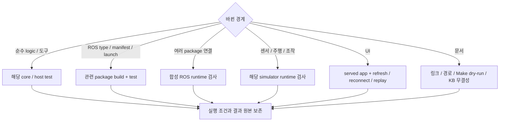

# 테스트 가이드

## 물체 종류명과 원본 검출 클래스 검증

1. ROS 인터페이스와 소비 패키지를 빌드한다.

   ```bash
   make build COLCON_BUILD_ARGS='--packages-select cleany_interfaces cleany_perception cleany_skill_executor cleany_manipulation_bt cleany_dev_monitor'
   ```

2. 인식 패키지와 승인 경계의 합성 입력 회귀를 실행한다.

   ```bash
   ROS_LOCALHOST_ONLY=1 ROS_DOMAIN_ID=223 make test-perception
   ROS_LOCALHOST_ONLY=1 ROS_DOMAIN_ID=223 make test-perception \
     PERCEPTION_TEST_PATHS='tests/integration/test_perception_label_contract.py'
   make test-jetson-packages
   make test-dev-monitor
   CLEANY_RUN_ROS_TESTS=1 ROS_LOCALHOST_ONLY=1 ROS_DOMAIN_ID=231 \
     make test-perception PERCEPTION_TEST_PATHS='ros2_ws/src/cleany_dev_monitor/tests/test_ros_proposals.py'
   make build-dev-monitor-web test-dev-monitor-web
   ```

`PERCEPTION_TEST_PATHS`와 `PERCEPTION_PYTEST_ARGS`로 검사 범위를 지정한다.
합성 응답 재생은 종류명 교정, 동의어 정규화, 원본 클래스 보존, 추적 ID,
손목 매칭, 분류 사유 없는 정상 처리와 승인 거절을 검증한다. 실제 Gemini 분류 정확도나 실물 파지의
성공을 검증하는 시험은 아니다.

### 저장 RGB-D와 실제 Gemini API 재생

`tools/validation/replay_semantic_pipeline.py`는 `captures.npz`, `capture.json`,
`parameters.json`이 있는 저장 입력을 사용한다. `detect`는 vision 컨테이너의
YOLOE TensorRT와 실제 복원 코드를 실행한다. 입력과 출력 디렉터리를 각각
읽기 전용, 쓰기 가능 volume으로 연결하고 다음 명령을 실행한다.

```bash
source /workspace/cleany/ros2_ws/install-perception/setup.bash
python3 /workspace/cleany/tools/validation/replay_semantic_pipeline.py detect \
  --capture /capture --output /evidence/replay \
  --model-path /models/yoloe/real34/active/yoloe-26s-seg-real34.engine
```

`classify`는 native overlay와 `GEMINI_API_KEY`가 설정된 환경에서 실행한다.
사유 제거 전 adapter 파일을 `--baseline`으로 전달한다. 이전 prompt와 schema는
그대로 사용하고 결과 parser만 현재 dataclass에 맞춰 사유를 버린다. 같은 입력을
두 방식으로 번갈아 요청하며 API 출력 토큰, 응답 시간, 라벨과 분류를 기록한다.

```bash
python3 tools/validation/replay_semantic_pipeline.py classify \
  --input /path/to/replay --baseline /path/to/previous/gemini_detector.py \
  --model gemini-3.5-flash-lite --repeats 2 --interval-seconds 15
```

호출 한도 등으로 중단되면 같은 입력, 모델, baseline으로 `--resume`을 지정해
성공한 요청을 보존한다. 이 명령은 실제 API 사용량을 소비한다. 결과는
`detections.json`, `classification-progress.json`, `classification-report.json`에 남는다.
카메라 좌표계 복원, 추적, ROS 직렬화와 합성 목적지 정책의 대상 선택을 확인하며
로봇 TF, 손목 관측, 경로 계획이나 모터 동작은 실행하지 않는다. 작은 저장 영상
묶음의 전후 비교는 일반적인 분류 정확도나 속도 개선을 보장하지 않는다.

명령은 저장소 루트의 Humble/Fortress 환경에서 실행합니다. 변경 범위를 확인한 뒤 가장 작은 관련 검사부터 선택합니다. Make target의 실제 동작은 [Makefile](../Makefile)을 기준으로 확인합니다.

## 변경 범위별 검사 선택

파일이나 디렉터리를 지정하면 해당 검사만 수집합니다. 경로를 생략하면 각 target의
기존 전체 범위를 실행합니다. `-k`는 수집 후 필터이므로 import 비용을 줄이려면
경로를 먼저 좁힙니다.

```bash
make test-jetson-packages \
  JETSON_TEST_PATHS='ros2_ws/src/cleany_skill_executor/test/test_automatic_goal.py' \
  JETSON_PYTEST_ARGS='--durations=10'
make test-logger LOGGER_TEST_PATHS='ros2_ws/src/cleany_logger/tests/test_resources.py'
make test-dev-monitor \
  DEV_MONITOR_TEST_PATHS='ros2_ws/src/cleany_dev_monitor/tests/test_operator.py ros2_ws/src/cleany_dev_monitor/tests/test_proposals.py' \
  DEV_MONITOR_PYTEST_ARGS='--durations=10'
```

`test-dev-monitor`는 Logger 검사도 먼저 실행합니다. Logger 범위는
`LOGGER_TEST_PATHS`, 옵션은 `LOGGER_PYTEST_ARGS`로 별도 지정합니다.
BT 실행 검사는 `make build-manipulation-bt`로 설치한 native 확장 모듈을 사용합니다.
BT 소스 디렉터리를 `PYTHONPATH` 앞에 넣으면 설치된 `_bt_runner`를 가릴 수 있습니다.

관절 보간 검사는 `test_joint_path.py`, snapshot 캐시 검사는 `test_snapshot_cache.py`,
공용 리소스 수집 검사는 Logger의 `tests/test_resources.py`가 관리합니다. BT의
`test_action_runtime.py`는 MuJoCo와 Jetson 서버 모두에 성공, 중단, 저장 장애와
종료 계약을 적용합니다. 합성 backend를 사용하며 실물 명령을 보내지 않습니다.

## 실물 크기 추정 변동 진단 (Footprint Stability)

`tools/validation/inspect_footprint_stability.py`는 실제 인식 노드의 설정을 읽고, 동기화된 RGB-D 입력을 저장하여 객체의 바닥면 크기(Footprint) 추정치가 흔들리는 원인을 진단합니다.
저장된 영상에 동일한 YOLOE 모델과 크기 계산 알고리즘을 적용한 후 깊이(Depth), 세그멘테이션 마스크, 지지 평면을 각각 고정하여 변동 원인을 독립적으로 분석합니다.

> [!NOTE]
> - Gemini API 및 실제 로봇 구동 Action은 호출하지 않습니다.
> - 별도 GPU 추론 부하가 발생하므로 로봇이 대기(Idle) 중일 때 실행하세요.

1. **RGB-D 프레임 수집 (호스트 환경)**:
   ```bash
   source /opt/ros/humble/setup.bash
   source tools/ros2/cleany-install-env
   source "$CLEANY_INSTALL_BASE/setup.bash"
   source tools/vision-ros-env
   OPENBLAS_NUM_THREADS=1 python3 tools/validation/inspect_footprint_stability.py capture \
     --output runtime/footprint-NEW --count 20 --interval 0.5
   ```

2. **저장 영상 분석 (Vision 컨테이너 환경)**:
   ```bash
   docker exec cleany-vision-perception-1 bash -c '
     source /opt/ros/humble/setup.bash
     source /workspace/cleany/ros2_ws/install-perception/setup.bash
     OPENBLAS_NUM_THREADS=1 OMP_NUM_THREADS=1 python3 \
       /workspace/cleany/tools/validation/inspect_footprint_stability.py analyze \
       --output /workspace/cleany/runtime/footprint-NEW --label "beverage can"'
   ```

3. **진단 보고서 및 그래프 생성**:
   `analysis.json`의 깊이 분포를 확인한 후, 진단용 기준값(아래 0.6m는 진단 예시값)을 지정하여 그래프를 생성합니다.
   ```bash
   OPENBLAS_NUM_THREADS=1 python3 tools/validation/inspect_footprint_stability.py report \
     --output runtime/footprint-NEW --depth-split-m 0.6
   ```

- **입력 및 산출물**:
  - 재현 입력: `captures.npz`, `masks.npz`, `parameters.json`
  - 분석 결과: `analysis.json`, `diagnostics.json`, `diagnostic.png`

## DDS 수신 버퍼 단계별 비교 (DDS Buffer Sweep)

`tools/validation/dds_buffer_sweep.py`는 실행 중인 런타임의 토픽을 구독하는 독립 계측기를 단계별로 실행하여 최적의 DDS 수신 버퍼 크기를 진단합니다.
운영 인식 프로세스의 설정은 유지한 채, 계측기의 CycloneDDS 수신 소켓 크기(`SO_RCVBUF`)만 변경하면서 패킷 처리율을 측정합니다. 로봇 구동 명령이나 카메라 ON 요청은 보내지 않습니다.

1. **측정 환경 설정**:
   로봇이 대기 중인 상태에서 운영 런타임과 동일한 환경을 구성합니다.
   ```bash
   source /opt/ros/humble/setup.bash
   source tools/ros2/cleany-install-env
   source "$CLEANY_INSTALL_BASE/setup.bash"
   source tools/vision-ros-env
   export ROS_DOMAIN_ID=0
   export PYTHONPATH="$PWD/ros2_ws/src/cleany_dev_monitor:${PYTHONPATH:-}"
   export OPENBLAS_NUM_THREADS=1 OMP_NUM_THREADS=1
   ```

2. **버퍼 크기별 스윕(Sweep) 측정**:
   기본값으로 208 KiB부터 8 MiB까지 정방향 및 역방향으로 각 35초씩 2회 반복 측정합니다. (시스템 `rmem_max`보다 큰 요청값은 자동 거부됨)
   ```bash
   python3 tools/validation/dds_buffer_sweep.py run \
     --output ../cleany-data/reports/dds-buffer-idle-NEW \
     --sizes-kib 208 512 1024 2048 4096 8192 --rounds 2 --seconds 35 --warmup 5
   ```

3. **보고서 생성**:
   측정 부하와의 간섭을 피하기 위해 측정이 완전히 종료된 후 리포트를 생성합니다.
   ```bash
   python3 tools/validation/dds_buffer_report.py ../cleany-data/reports/dds-buffer-idle-NEW
   ```

- **결과 확인**:
  - `report/index.html` 및 PDF 보고서에서 1초 이동 구간의 평균 Hz 변화를 확인합니다. (초기 5초 웜업 구간 제외)
  - `socket-limits.json`에서 커널의 실제 `SO_RCVBUF` 적용값(요청값의 2배)을 확인합니다.
  - 보고서의 `idle_observed` 항목을 확인하여 측정 도중 다른 활성 명령이나 외란이 없었는지 검증합니다.

## 테스트와 도구 위치

테스트는 검사 대상을 소유한 위치에 둡니다. 루트 `tests/`에는 저장소 도구의 자동 검사와 패키지를 연결하는 통합 검사만 둡니다. 실행, 관찰과 보고 코드는 검증 도구로 분리합니다.

벤치마크 결과, 실행 이력, 로그, 녹화와 화면 캡처는 저장소 밖
`CLEANY_DATA_ROOT/runs/` 또는 `CLEANY_DATA_ROOT/reports/`에 보관합니다.
새 실행 기록은 PR에 포함하지 않고, 코드와 설정, 검사 fixture 및 재현 절차를 관리합니다.
기존 도구가 저장소 안에 만든 `output/`, `reports/`와 검사 보고서도 Git에서 제외합니다.

| 위치 | 책임 |
|---|---|
| `ros2_ws/src/<package>/test/`, `tests/` | 패키지 기능과 계약의 자동 검사 |
| `ros2_ws/src/<package>/runtime_test/` | 해당 패키지의 명시 실행 smoke와 runtime 검사 |
| `tests/integration/` | Backend, Mission 등 여러 구성 요소의 연동 검사 |
| `tests/tools/` | 저장소 검증 도구의 자동 검사 |
| `tools/validation/` | Simulator 실행과 영상·로그 수집 |

패키지 내부에도 통합 검사가 있을 수 있습니다. 파일의 책임과 실행 조건으로 위치를 정하며, runtime CLI를 `tests/`에 넣었다고 pytest가 자동 실행하는 것은 아닙니다.

## 검사 선택



아래 표에서 변경 범위에 맞는 명령을 선택합니다. Simulator, mock 통과는 해당 입력과 backend의 증거이며, 실물 검증은 별도로 수행합니다.

| 변경 범위 | 명령 | 확인 범위 |
|---|---|---|
| 전체 ROS workspace | `make test` | build, colcon package test와 결과 집계 |
| Mission, Gateway core | `make test-mission-core` | ROS 없는 lifecycle, 영속성, 중복, 재전송 |
| Mock 조작 core | `make test-manipulation-core` | 서버 실행, 취소, 영속 기록과 모니터 |
| Mission과 Mock Action | `make test-mission-mock BASE_TEST_ROS_DOMAIN_ID=186` | 공통 타입, Action, 조회, 취소와 재시작; 주행은 Mock |
| Gazebo와 Mock Action | `make test-gazebo-manipulation BASE_TEST_ROS_DOMAIN_ID=186` | Nav2 도착과 정지, 두 수거, 추가 빈 관측과 보고 |
| Mission ROS 설치, 연동 | `make test-mission-runtime` | 관련 package build/test |
| Navigation core, plugin | `make test-navigation` | Python core와 C++ plugin |
| 합성 Navigation runtime | `make test-navigation-runtime` | ROS lifecycle, goal, 취소, sensor 단절 |
| Gazebo, Navigation | `make test-gazebo` | package 검사와 C++ plugin; 선택 runtime은 제외 |
| Gazebo sensor runtime | `make test-gazebo-nav-runtime` | 실제 simulator의 sensor, odom, TF |
| 시설 목표 생성 | `make test-gazebo-facility-tools` | simulator 없는 ID, 여유, 제거 의자 처리 |
| MuJoCo | `make test-mujoco` | scene loader; 모든 조작 runtime을 뜻하지 않음 |
| Mock Manipulation Action | `make test-manipulation` | ROS Action, 취소, 조회와 재시작 복구 |
| MuJoCo BT 경계 | `make test-manipulation-bt` | native BT, Action, 관련 인식과 수거 회귀; 실제 물리 수거 성공은 별도 |
| Hand-eye 경계 | `make test-handeye` | description, MuJoCo, MoveIt, calibration |
| Base ROS | `make test-base` | interface, driver, odometry; mock MCU |
| ESP32 준비, motor core | `make test-micro-ros-setup test-motor-core` | Python 준비 도구와 장치 없는 C++ |
| Logger | `make test-logger` | CLI 정책 편집과 종료 코드, 기록 정책, 읽기 전용 archive, 디렉터리 독점, 세션과 복구 경계 |
| Monitor와 Logger | `make test-dev-monitor` | Logger 검사와 ROS 수집, 저장, HTTP와 UI 데이터 경계 |
| Monitor 승인 제안 | `CLEANY_RUN_ROS_TESTS=1 ROS_DOMAIN_ID=231 ROS_LOCALHOST_ONLY=1 make test-dev-monitor` | 별도 ROS domain의 관측 fixture, 제안 이미지와 대상 재확인; 실물 동작 없음 |
| Telemetry | `make test-telemetry` | odom relay |
| CI 준비 도구 | `make test-ci-tools` | 의존성 이미지 무효화, build context와 명령 전달 |

Fedora에서는 native ROS target을 Humble Distrobox에서 실행합니다. `test-micro-ros-setup`, `test-motor-core`는 Makefile의 `BASE_EXEC`가 환경을 선택합니다.

승인 화면은 `pnpm --dir ros2_ws/src/cleany_dev_monitor/web exec playwright test operator.spec.ts`로
확인합니다. `OPERATOR_VISUAL_DIR`를 지정하면 제안의 데스크톱·모바일 화면을 저장합니다.
Python 검사에는 만료, 장면 변화, 대상 대체 금지, 승인 중복·재시작, 정확한 Goal 전달,
다음 제안의 승인 대기를 포함합니다. ROS fixture 및 브라우저 mock 통과는 실제 파지
성공의 근거가 아닙니다.

CI는 `PYTEST_DISABLE_PLUGIN_AUTOLOAD=1`로 runtime 의존성이 설치한 외부 pytest plugin의 자동 로드를 끕니다. 프로젝트의 `conftest.py`와 pytest 기본 plugin은 유지하며, 로컬에서는 `PYTEST_DISABLE_PLUGIN_AUTOLOAD=1 make test`로 같은 설정을 적용합니다.

`make test`는 package test가 실패해도 `colcon test-result --verbose`로 실패 상세를 출력하고 실패 상태를 반환합니다.

## CI 실행과 재사용

CI는 모든 PR에서 전체 workspace 검사, ESP32 motor core, 합성 Navigation runtime과 Gazebo sensor runtime을 실행합니다. 베이스의 pytest는 colcon에 직접 등록하며 전체 workspace 검사에서 한 번 실행합니다. Navigation과 Gazebo runtime은 같은 실행에서 이미 빌드한 workspace를 사용합니다.

| 재사용 대상 | 갱신 조건 | 검증 경계 |
|---|---|---|
| GHCR 의존성 이미지 | 모든 `package.xml`, rosdep YAML, `containers/ci/`, 이미지 준비 도구, platform 또는 UTC ISO 주차 변경 | ROS, apt, pip 의존성만 포함하며 응용 소스와 빌드 결과는 포함하지 않음 |
| ccache | compiler 내용, 소스, header와 옵션에 따라 hit/miss 결정 | 빌드 명령은 매번 실행하며 CTest/pytest 결과는 캐시하지 않음 |
| 같은 실행의 workspace | 전체 빌드 완료 후 runtime 검사에서 재사용 | 다른 실행의 `build/`, `install/`, test result는 복원하지 않음 |

이미지가 없거나 pull할 수 없으면 동일한 Dockerfile로 의존성을 설치한 뒤 전체 검사를 실행합니다. 같은 저장소의 실행은 환경 확인 후 의존성 이미지를 게시합니다. 응용 테스트의 성공 여부와 별개로 의존성 이미지와 compiler cache를 보존해 실패 수정 시에도 재사용하며, 다음 실행의 전체 검사와 실패 판정은 그대로 유지합니다. Fork PR은 이미지를 게시하지 않습니다. 매주 월요일 실행은 새 주차 이미지를 준비하며, 같은 주에 수동 갱신하려면 Dockerfile의 `DEPENDENCY_REVISION`을 올립니다. Python 외부 의존성 버전은 `containers/ci/pip-constraints.txt`에서 갱신합니다.

패키지 빌드는 최대 2개, 패키지 내부 컴파일은 runner CPU 수의 절반으로 제한해 두 병렬화 계층의 경합을 줄입니다. 최적화 수준은 기존 `RelWithDebInfo`를 유지합니다. 모델 검사에서는 같은 인자의 xacro 출력 bytes만 재사용하고 각 검사는 독립 XML tree를 받습니다.

CI artifact에는 test XML, 실패 로그, 설치된 apt/pip 버전과 ccache 통계를 남깁니다. 속도는 이미지 생성과 compiler cache miss가 있는 최초 실행, 이미지와 cache를 재사용하는 실행으로 구분해 비교합니다. 이미지 pull과 cache 복원 시간도 포함한 GitHub job 전체 시간을 기준으로 판단합니다.

## 선택 runtime과 UI

### 카메라 영상 수집

현재 workspace를 빌드한 뒤 `tools/validation/capture_cameras.py`로 실제 ROS
카메라 영상을 수집합니다. 각 출력 경로는 아직 없는 새 디렉터리여야 합니다.

```bash
source /opt/ros/humble/setup.bash
source "$(make -s print-install-base)/local_setup.bash"
python3 tools/validation/capture_cameras.py --backend mujoco \
  --output /absolute/new-camera-run/mujoco
python3 tools/validation/capture_cameras.py --backend gazebo --gazebo-model cad-with-arms \
  --output /absolute/new-camera-run/gazebo
PYTEST_DISABLE_PLUGIN_AUTOLOAD=1 python3 -m pytest -q tests/tools/test_capture_cameras.py
```

GUI가 없는 환경에서는 촬영 명령 앞에 `xvfb-run --auto-servernum`을 붙입니다.
VM에서 GPU 렌더링이 불안정하면 `LIBGL_ALWAYS_SOFTWARE=1`을 지정합니다.
Gazebo의 `--gazebo-model legacy`로 레거시 모델도 선택할 수 있습니다.

도구는 head와 양손목 영상의 크기, encoding, frame, buffer 및 시뮬레이션 clock과
상태 메시지를 확인하고 PNG, `report.json`, `launch.log`를 남깁니다. 누락, timeout과
조기 종료는 실패 코드로 보고하고 실행한 프로세스 그룹을 종료합니다. 촬영 성공은
전체 집기 미션의 성공을 뜻하지 않습니다. 기본 CAD 주행 프로파일은 팔을 제외하며,
`cad-with-arms`는 촬영 검증에만 팔을 포함합니다.

### 선택 실행 조건

Gazebo package의 `--run-sim-runtime`, `--run-evaluation-tests`와 Mission core의 `CLEANY_RUN_ROS_TESTS=1`은 별도로 활성화하는 검사입니다. 실행 결과에서 통과와 skip을 구분합니다.

```bash
source /opt/ros/humble/setup.bash
source "$(make -s print-install-base)/setup.bash"
ROS_DOMAIN_ID=82 CLEANY_RUN_ROS_TESTS=1 make test-mission-core
```

Logger 독립 녹화 검사는 빌드 overlay를 source한 뒤 빈 출력 경로에서 실행합니다.
logger와 Monitor를 별도 프로세스로 띄우고 합성 경로, 카메라와 점군을 발행합니다.
Monitor 종료 전후의 같은 세션에서 SQLite 증가, rosbag2 원문과 stamp, Monitor 재접속,
HTTP 시작과 정지, logger 단절과 writer 대체 금지를 확인합니다. 실제 로봇 구동과
센서 성능 검증은 포함하지 않습니다.

```bash
ROS_DOMAIN_ID=218 ROS_LOCALHOST_ONLY=1 make test-logger-independence \
  LOGGER_TEST_OUTPUT=/absolute/new-logger-run LOGGER_BASE_COMMIT=<base-commit>
CLEANY_RUN_ROS_TESTS=1 ROS_DOMAIN_ID=217 ROS_LOCALHOST_ONLY=1 make test-dev-monitor
```

CLI 실제 연결 검사는 logger를 별도 프로세스로 띄우고 설치된 `logger` 실행 파일로
조회, 토픽 설정, 시작과 정지를 호출합니다. 합성 경로와 이미지를 native bag에서
다시 읽으며 CLI 종료 후 녹화 유지, 활성 설정 거부, 세션 보호와 연결 실패를 확인합니다.

```bash
ROS_DOMAIN_ID=219 ROS_LOCALHOST_ONLY=1 make test-logger-cli \
  LOGGER_TEST_OUTPUT=/absolute/new-cli-run LOGGER_BASE_COMMIT=<base-commit>
```

Monitor smoke는 같은 domain에서 Monitor를 먼저 실행한 뒤 호출합니다.

```bash
ROS_DOMAIN_ID=187 python3 ros2_ws/src/cleany_dev_monitor/runtime_test/smoke.py --output /absolute/new-run
# frontend의 현재 Playwright 설정과 package scripts:
cat ros2_ws/src/cleany_dev_monitor/web/package.json
```

Frontend 검사는 `ros2_ws/src/cleany_dev_monitor/web`에서 `pnpm exec tsc --noEmit`과 `pnpm exec playwright test`를 실행한다. 실제 Monitor가 필요한 검사는 `MONITOR_URL`을 지정하고 해당 ROS 입력도 준비한다. 기본 fixture 검사는 로컬 Vite를 시작한다.

UI 변경은 실제 served app에서 새로고침, 재연결, 기록 재생까지 확인합니다. Playwright browser가 없으면 configured browser를 설치한 뒤 다시 실행합니다.

Mission Gateway smoke는 `tests/integration/mission_runtime/`, Monitor smoke는 `ros2_ws/src/cleany_dev_monitor/runtime_test/`에 있습니다. 실제 Backend, ROS, Gazebo 입력 조건을 준비한 경우에 명시적으로 실행합니다.

## 결과와 증거

| 증거 | 의미 |
|---|---|
| 소스, manifest, 단위 검사 | 구현과 검사된 입력의 계약 |
| mock / 합성 ROS | 합성 backend의 lifecycle과 메시지 경계 |
| Gazebo, MuJoCo runtime | 해당 simulator, 입력, 버전의 동작 |
| 장치 통신 | 실제 USB, UART, DDS 등 확인한 계층 |
| 물리 시험 | 실제 sensor, actuator, 정지, 시나리오 결과 |

결과에는 다음 항목을 남깁니다.

- Code commit와 dirty 상태, 환경, overlay
- 입력, config, asset hash
- 요청 범위와 실제 완료 범위, 실패, skip, 중단
- 로그와 출력 위치

CTest wrapper와 pytest 집계가 겹치면 중복 합산하지 않습니다. 실행 원본은 `CLEANY_DATA_ROOT/runs/`, 과거 보고서는 [근거 색인](EVIDENCE.md)에서 찾습니다.

## 문서 변경 검사

내부 파일 링크, anchor, 코드, 설정, launch 경로, Make target의 존재와 native dry-run을 확인합니다. 문서 검증만을 위해 실제 로봇을 움직이거나 새 calibration을 수행하지 않습니다.

KB를 변경한 경우에는 KB의 `kb-quality-checks`도 실행합니다. 검사 통과와 내용 승인은 별도로 기록합니다.

## 충돌 형상 시각화

`tools/validation/render_collision_visualization.py`는 저장된 URDF와 cuRobo cache를
읽어 원본과 최적화 충돌 메시, 병합 전후 구, GPU 볼록 형상과 정점을 그립니다.
비교 자세는 `test_head_collision_runtime.state()`의 기준 관절값이며 실시간 관측이 아닙니다.
원본 STL을 수정하거나 ROS 노드와 하드웨어를 실행하지 않습니다.

1. 입력 디렉터리에 `current.urdf`, `geometry-cache/*.npz`, 수집 근거를 담은
   `acquisition.json`을 준비합니다. 수집 근거에는 commit, 프로필, 원본 위치와
   `failures` 배열을 남깁니다. `fitting.json`에 `schema`, `spheres_per_mesh`,
   `budget_per_link`, `padding_m`을 기록합니다. 현재 값은 4, 64, 16, 0.0005이며,
   trimesh 4.5.3/cuRobo 0.7.8 캐시를 사용합니다. 설정 파일이 없으면 과거
   8개/mesh, 반경 0.002m의 schema 2 캐시를 읽습니다.
2. NumPy, SciPy, Matplotlib, trimesh, Plotly를 제공하는 별도 Python 환경에서 실행합니다.
   과거 실행 환경은 산출물의 `render-environment.txt`를 참고합니다.

   ```bash
   python3 tools/validation/render_collision_visualization.py \
     --source output/collision-visualization-20261023/source \
     --output output/collision-visualization-20261023
   ```

3. PNG와 `collision-inspector.html`을 열어 확인합니다. 입력 hash, 포함 조건,
   cache 일치 검사는 생성 중 실행되며, 출처와 집계는 `provenance.json`에 남습니다.
   정점 수 비교는 mesh 인스턴스 합계이며 primitive를 제외합니다.

저장된 구 재검토 결과를 HTML에 포함하려면 `--sphere-review <review.json>`을
추가합니다. JSON과 같은 디렉터리에 `sphere-overreach.png`가 있어야 합니다.
검토 결과의 형상 hash를 표시할 모델과 비교한 뒤 이미지와 JSON을 출력
디렉터리에 복사합니다. 이후 같은 출력 디렉터리로 다시 생성하면 저장된 검토
결과를 유지합니다. 이 옵션은 시각화만 갱신하며 구 배치나 로봇 설정은 바꾸지 않습니다.

형상에서 구를 직접 맞추는 비교안은 다음 순서로 생성합니다. 이 도구는
로봇 설정을 수정하지 않습니다. 기존 구 병합과 같은 개수의 비교안을 먼저
확인하고, 개수를 늘린 결과와 비교합니다.

```bash
python3 tools/validation/compare_sphere_fits.py \
  --source output/collision-angular-20261024/source \
  --output output/curobo-direct-fit-20261024 --budgets 16 24 32 48 64
python3 tools/validation/render_sphere_fit_comparison.py \
  --comparison output/curobo-direct-fit-20261024/comparison.json \
  --review output/curobo-sphere-review-20261024/review.json
```

HTML 생성 명령에 `--sphere-fit output/curobo-direct-fit-20261024/comparison.json`을
추가하면 16개와 32개 비교안을 3D 메뉴에서 선택할 수 있습니다. 기존 구 배열이
표시할 모델과 동일한지 확인하고, 검토용 배치임을 화면에 표시합니다. 구 중심
최적화가 수렴하지 않으면 유한한 후보 중심 중 작은 외접 반경을 선택하고 모든
분할 정점으로 반경을 다시 계산합니다. 수치적으로 퇴화한 분할은 제외합니다.
분할 전후 부피, 분할 정점의 포함 관계와 CAD 정점 및 면 표본을 검사하며,
전체 계획 성공률과 처리 속도는 별도 런타임 검증이 필요합니다.

## 충돌 근사 형상 회귀 검사

1. NumPy, SciPy, pytest 환경에서 `make test-collision-geometry`를 실행합니다.
   별도 환경은 `GEOMETRY_PYTHON=/path/to/python`으로 지정합니다. 셀의 면과 내부
   포함, 분리된 부품 사이의 공간, 구 병합, GPU 외접 상한과 캐시 무효화를 검사합니다.
2. ROS overlay 빌드 후 `make test-arm-collision-runtime`을 실행합니다.
   `INSTALL_BASE` 또는 `CLEANY_BUILD_ROOT`로 별도 빌드를 선택할 수 있습니다.
   원본/경량 MoveIt 형상의 자세, 근접 장애물과 경로를 비교하며 드라이버는 시작하지 않습니다.
   평면화 대상 17종과 이미 평면인 집게 5종을 모두 포함합니다. CAD의 미터와
   밀리미터 단위를 반영하고, 하완 포크의 틈과 모든 분할 표면의 외접 포함을
   별도로 확인합니다. 형상을 더 크게 감쌌더라도 내부 면이 사라지면 MoveIt의
   접촉 판정이 달라질 수 있으므로 근접 장애물 비교를 생략하지 않습니다.
3. ROS 2와 cuRobo 환경에서 `make test-curobo-model`과
   `make test-curobo-geometry`를 실행합니다. `COLLISION_TEST_ARGS`로 pytest의
   `-k`, `--junitxml`, `--basetemp`를 전달합니다. MoveIt 실행 의존성이 없는
   motion 이미지에서는 `-k 'gpu_fk_and_position or gpu_collision_aware_ik or
   gpu_convex_acceptance or generates_finite_joint_path'`로 CUDA 검사만 선택합니다.
   전체 GPU 비교는 네이티브 MoveIt에서 저장한 동일 자세와 ACM을 재생할 수 있으며,
   `CUROBO_GPU_TEST_FILE`로 비교 스크립트를 지정합니다. 전체 ROS 연동 검사는
   MoveIt을 제공하는 환경의 별도 DDS domain에서 GenericSystem을 사용합니다.
4. 같은 환경에서 `tools/validation/audit_collision_coverage.py --urdf ... --srdf ...
   --output ... --cache ...`를 실행합니다. 현재 프로필로 확장한 URDF/SRDF를
   제공하며, 원본 CAD의 모든 정점과 메시별 20,000개 표면 표본의 구 포함 여부를
   기록합니다. 이 표본 검사는 수학적 셀 포함 조건과 별개로 형상 누락을 찾는 검사입니다.

형상 개수 감소를 실행 속도 개선율로 해석하지 않습니다. 구는 제안 비용이며
최종 자기 충돌 판정은 전체 형상 검사를 통과해야 합니다. 좁은 틈의 도달성이나
실물 동작 확인은 이 검사와 구분합니다.

## Jetson 실물 변경 검증

Jetson 실물 관련 패키지를 수정한 경우 관련 네이티브 패키지와 인터페이스를 먼저 빌드한 후 검증합니다. 모든 테스트는 격리된 로컬 환경(`ROS_LOCALHOST_ONLY=1`) 및 별도의 ROS Domain에서 실행됩니다.

### 1. 단계별 검증 명령어

| 검증 대상 | 명령어 | 주요 검증 내용 |
|---|---|---|
| 핵심 로직 (Core) | `make test-jetson-core` | 스냅샷 버퍼, 복구 캐시, 워커, 실물 파지 코어 로직 및 정지 표본 검사 |
| 네이티브 C++ 패키지 | `make test-jetson-native` | 씬 매핑(`cleany_scene_mapping`), 모터 드라이버(`cleany_feetech_hardware`), MoveIt 배치 서비스 검사 |
| 파이프라인 패키지 | `make test-jetson-packages` | 인식, 파지 계획, 로봇 인터페이스 상태, 매니퓰레이션 BT 회귀 검사 |
| 저장소 검증 도구 | `make test-jetson-tools` | `tests/tools/`의 호스트 CLI 및 유틸리티 도구 검사 |
| 가상 제어기 (Controller) | `make test-jetson-controller` | 가상 시리얼(PTY) 기반으로 실제 하드웨어 연결 없이 읽기/쓰기 모드 및 제어기 안전 검사 |

> [!NOTE]
> - GPU 추론, 라이선스가 필요한 SDK, 선택적인 LeRobot 환경이 필요한 검사는 해당 환경이 없으면 자동으로 `skip` 처리되며 그 이유가 출력됩니다.
> - `runtime_test/`의 PTY 제어기 및 TCP 재생 검사는 가상 환경에서 수행되며 실제 USB 하드웨어 포트를 열지 않습니다.
> - `supervised_collection_fixture.json` 등의 테스트 픽스처는 계약 검증용이며 실물 로봇의 캘리브레이션 완료 근거로 대체할 수 없습니다.

### 2. 가상 제어기 세부 검사 예시
특정 제어기 안전 검사만 집중적으로 실행할 때는 `JETSON_CONTROLLER_TEST_ARGS`를 전달합니다.
```bash
# READ 전용 모드에서 모터 쓰기 차단 및 명령 거절 검사
make test-jetson-controller JETSON_CONTROLLER_TEST_ARGS='-k "readonly_controllers_cannot_activate_or_execute or shared_bus_readonly_has_no_writes"'
```

## Pregrasp와 그리퍼의 대기 및 명령 간소화

`test_collision_preparation`은 상태 메시지의 메타데이터와 독립성, 전체 표본의
clearance 검사, 준비 중 취소와 마지막 RPC 전 확인을 검증합니다.
`test_action_tracking`은 제어 연결 재사용 시 실행 소유권, 지연 수락 취소,
미확정 명령이 남은 연결의 재사용 거부와 종료 시 한 번만 해제됨을 확인합니다.
`test_execution_optimization`은 예비 센서 대기 통합 후 최종 검사와 정리를 확인합니다.

`benchmark_execution_preparation.py --baseline /path/to/source-before --output /path/to/result.json`은
Jetson에서 보존한 변경 전 소스와 현재 소스의 준비 시간을 비교합니다.
전체 관절 상태와 표본을 동일하게 유지하고 충돌 RPC를 기록용 응답으로
대체합니다. 제어 연결 비교는 별도 `ROS_DOMAIN_ID`와 `ROS_LOCALHOST_ONLY=1`에서
`/cleany_validation_motion_pool/` 아래의 즉시 성공 시험 서버를 사용합니다.
실제 제어기와 모터는 사용하지 않으며 서버 재생성 후 같은 연결도 확인합니다.
반복 사용과 첫 연결 시간을 구분하고, 이 결과를 물리 동작 전체 시간으로
보고하지 않습니다.

배포 후 `verify_execution_preparation_install.py --deployment /path/to/deployment.json`으로
설치된 네 실행 모듈의 hash와 연결 재사용을 확인합니다. Motion container에서는
`--container`를 추가해 설치된 두 skill executor 모듈을 확인합니다.
이 설치 검사는 ROS 노드나 모터 명령을 실행하지 않습니다.

모터 연결 없이 `make test-jetson-packages`의 `JETSON_PYTEST_ARGS`에
`-k "test_pregrasp_gripper_efficiency or test_execution_optimization or test_hardware_collection or test_joint_path or test_recorded_trajectory or test_front_shoulder_bounds or test_state_validity_batch or test_sensor_scene"`를 전달합니다.
정확한 전체 관절 수집 이력, stale 및 복구 거부, 최종 캘리브레이션 검사,
그리퍼 곡선과 검사 표본 보존, 64개 배치의 경계 실패 인덱스를 확인합니다.

계산 시간 비교는 ROS 환경을 source한 Jetson에서
`python3 tools/validation/benchmark_pregrasp_gripper.py --baseline-joint-path /path/to/before/joint_path.py --output /path/to/benchmark.json`으로 실행합니다.
기록된 닫기와 열기 끝점에 같은 속도 및 가속도 한계를 적용하고 변경 전후를
번갈아 측정합니다. 준비 계산, 메시지 직렬화와 예정 궤적 시간을 구분하며
이 결과로 실제 모터 이동 시간이나 전체 실행 단축량을 확정하지 않습니다.

배포 후 `verify_pregrasp_gripper_install.py --deployment /path/to/deployment.json`으로
native 설치 파일과 설정을 확인합니다. Motion container에서는 같은 도구에
`--container`를 추가합니다. 실물 확인에서는 새 실행 ID의 단계 시간과
`controller_points`, `command_samples`, `gripper_contact_wait`, 시작 수락 시각을
함께 기록합니다.


## s와 m의 저장 영상 TensorRT 비교

`tools/validation/compare_yoloe_models.py`는 같은 32종 프로파일의 s와 m
엔진에 저장 RGB를 재생합니다. 입력 디렉터리의 `local/`, `jetson/` 아래에
영상을 둡니다. 기본 비교는 긴 변을 640픽셀로 맞추며, `local/` 영상은 원본
크기도 별도로 비교합니다. 모델 입력은 모두 640, FP16, confidence 0.25입니다.

```bash
python3 tools/validation/compare_yoloe_models.py \
  --input-root /evidence/input --annotations /evidence/annotations.json \
  --s-engine /models/real32/s/active/yoloe-26s-seg-real32.engine \
  --m-engine /models/real32/m/active/yoloe-26m-seg-real32.engine \
  --profile ros2_ws/src/cleany_perception/config/yoloe_real32.yaml \
  --output /evidence/comparison
```

출력 디렉터리는 실행 전에 없어야 합니다. `report.html`과 표시 영상을
육안으로 검토하고, 원본 검출 및 입력과 모델 hash는 `results.json`에서
확인합니다. 기본 최대 후보 10개와 진단용 40개를 분리하고, 중복 박스로
검토 대상 회수율이 늘지 않도록 일대일로 대응합니다. 이 비교는 Gemini,
RGB-D 복원과 로봇 실행을 사용하지 않습니다.

`annotations.json`은 영상 파일의 확장자를 뺀 이름을 key로 사용합니다.
각 항목은 `reference_width`, `reference_height`, `targets`를 가지며,
각 target에는 허용 `labels`, 기준 영상의 `bbox: [xmin, ymin, xmax, ymax]`,
`scope: main`을 기록합니다. 불완전한 수동 박스는 검토 표본이며, 전체
정답 mAP나 마스크 정확도로 해석하지 않습니다. 요약 지연은 영상별 반복
중앙값의 분포이며 순수 GPU 실행 시간이나 영상 스트림 처리율과 다릅니다.


## 승인 대상 재확인

`cleany_interfaces`, `cleany_perception`, `cleany_dev_monitor`를 빌드한 뒤
별도 ROS domain에서 다음 합성 검사를 실행합니다.

```bash
CLEANY_RUN_ROS_TESTS=1 ROS_LOCALHOST_ONLY=1 ROS_DOMAIN_ID=231 make test-perception \
  PERCEPTION_TEST_PATHS='ros2_ws/src/cleany_perception/test/test_target_revalidation.py ros2_ws/src/cleany_perception/test/test_target_revalidation_service.py ros2_ws/src/cleany_dev_monitor/tests/test_proposals.py ros2_ws/src/cleany_dev_monitor/tests/test_ros_proposals.py'
```

승인 시 전체 장면 분류를 호출하지 않는지, 최신 기하와 원본 의미 분류를
분리하는지, 이동, 소실, 중복 후보, 잘못된 참조, 오래된 영상과 깊이 실패를
거절하는지 검사합니다. 제한된 재관측과 실패 기록, 원본 승인 대상의 단일 실행도
검사합니다. 합성 검사는 실물 동일성 인식률이나 파지 성공률 측정이 아닙니다.

실행 중인 작업이 없는 실물 환경에서 `CLEANY_MANIPULATION_COLLECTION_CONFIG`와
native overlay를 설정한 뒤 `python3 tools/validation/verify_approved_target.py
--output /absolute/new-directory --count 5`로 새 제안 하나와 반복 재확인을 측정할 수
있습니다. 최초 제안은 실제 Gemini를 호출합니다. 검사는 제어 작업 잠금을 유지하며
조작 Goal을 보내지 않습니다. 각 재확인 시간, 결과와 관측 값은 `verification.json`,
제안 이미지는 출력의 `operator/proposals/`에 남습니다.


## 조작 CPU 기하 성능 비교

변경 전 소스의 상대 경로를 유지한 사본과 materialized URDF를 준비한 뒤 실행한다.
소스 사본에는 perception의 `core/geometry.py`, grasping의 `core/selector.py`와
skill executor의 `core/urdf_fk.py`가 필요하다.

```bash
python3 tools/validation/benchmark_manipulation_geometry.py \
  --baseline-root /absolute/source-before \
  --urdf /absolute/runtime.urdf \
  --output /absolute/benchmark.json
```

검사는 고정 seed의 640×480과 1280×720 깊이 영상, outlier 유무가 다른 지지 평면,
12개와 1,000개 파지 후보 및 URDF의 관절 한계 안에서 생성한 각 팔 2,000개 상태를
사용한다. 전후 입력을 교차 실행해 중앙값과 개별 시간을 저장한다. 점군, 평면과
후보 순서의 동일성, FK 수치 오차도 검사한다. 모터와 모델 추론을 호출하지 않으며
이 수치는 전체 수거 시간이나 실물 파지 성공률을 뜻하지 않는다.


## MoveIt 최적화 형상과 MuJoCo 동등성 검사

`make test-description-models`는 ROS 2와 MuJoCo, NumPy, SciPy 환경에서
원본 URDF와 MJCF의 동등성 및 최적화 충돌 자산을 검사합니다.
원본 대조에는 `optimized_arm_collision_meshes:=false head_collision_meshes:=false`를
명시하고, 기본 최적화 모델에는 시각 형상, 관성, 관절 보존과 모터 충돌 메시
배치를 검사합니다. MuJoCo 물리 접촉 형상은 기존 MJCF를 유지하며,
시뮬레이션의 MoveIt 경로 계획은 최적화 URDF를 사용합니다.
`COLLISION_TEST_ARGS`로 `-k`와 `--junitxml` 등을 전달할 수 있습니다.


## 설치된 충돌 최적화 모델 확인

운영 설치본의 적용 여부는 `tools/motion-container exec -- python3
tools/validation/verify_deployed_collision_models.py`로 검사합니다. 기본 URDF가
최적화 메시를 선택하는지, 설치된 STL의 hash, 전체 118개와 좌우 팔 제안 비용의
60/61개 구, GPU 전체 형상의 정점 수와 캐시 재사용을 확인합니다. 실제 CUDA
배치 IK의 해는 독립 URDF FK와 전체 형상 검사로 검증합니다. ROS 조작 Action과
모터 제어는 시작하지 않습니다. 설치 갱신 순서는 [충돌 최적화 모델 갱신](RUNNING.md#충돌-최적화-모델-갱신)을 따릅니다.


### 실행 FK와 시간 분석

1. FK 대조 실패, 설정 전달, 중첩 타이머와 취소 동작을 검사합니다.

   ```bash
   make test-jetson-packages JETSON_PYTEST_ARGS='-k "physical_moveit_adapter or execution_fk_configuration or execution_timing or recorded_trajectory or hardware_collection"'
   make test-jetson-tools JETSON_PYTEST_ARGS='-k execution_bottlenecks'
   ```

2. 실제 FK 서비스 비교는 별도 localhost domain에서 모터 드라이버 없이
   `physical_move_group.launch.py allow_trajectory_execution:=false`와 검토할
   `robot_description_file`을 사용합니다. 같은 ROS 환경의 별도 터미널에서 실행합니다.

   ```bash
   export ROS_LOCALHOST_ONLY=1 ROS_DOMAIN_ID=226
   python3 tools/validation/benchmark_execution_fk.py \
     --urdf /absolute/path/to/runtime.urdf --output /absolute/path/to/fk-benchmark.json
   ```

   양팔 100개 고정 입력을 각 방식으로 5회 비교합니다. MoveIt 서비스와 로컬
   계산의 수치 오차, 서비스 호출 수와 시간을 기록하며 실제 움직임을 보내지 않습니다.

3. 기존 collision E2E 수집본의 `summary.json`, `executions.json`, runtime 로그를
   재분석합니다. 부모 타이머와 tracking에 반복 기록된 명령 시간을 중복 합산하지 않습니다.

   ```bash
   python3 tools/validation/analyze_execution_bottlenecks.py \
     --source output/collision-e2e-audit-20261024 --output output/execution-bottleneck-20261025
   ```

   전체 단계 시간에서 명시 타이머와 명령 궤적 시간을 뺀 값은 미분리 시간입니다.
   이를 전부 CPU 시간이나 제거 가능한 지연으로 해석하지 않습니다. 실물 E2E
   단축률은 같은 대상, 시작 자세와 설정으로 별도 반복 측정합니다.


## 실물 어깨 전방 범위 검증

Jetson에서 `make test-jetson-packages JETSON_PYTEST_ARGS='-k "test_control_profile or test_front_shoulder_bounds or test_recorded_trajectory"'`로
프로파일 생성, 금지 IK/경로, 충돌 검사 없는 복귀 명령과 cubic 내부 극값의
범위 검사를 실행합니다. 이 테스트는 모터에 연결하지 않습니다.

`tools/validation/verify_front_shoulder_limits.py --urdf /path/to/robot_control.urdf --output /path/to/result.json`은
설치된 실행기의 URDF와 드라이버 한계, 양팔 각 8개 목표의 CPU 보정 IK를
검사합니다. 실제 motion 컨테이너에서 `--gpu`를 추가하면 같은 목표로
cuRobo의 CUDA 한계 tensor, 반환 해의 범위와 독립 FK 오차도 확인합니다.
입력은 운영 control profile로 새로 생성한 쓰기 가능 모델이어야 하며,
검증 도구 자체는 모터와 ROS 서비스에 명령을 보내지 않습니다.
실물 이동이나 실시간 장애물 장면의 검증을 대신하지 않습니다.


## 후보별 빠른 경로 우선 선택과 기록 복귀 준비

ROS 2 Humble 환경에서 다음 검사는 모터 명령 없이 fake planner와 제어 포트를
사용한다. 새 정책의 후보 순서, RRT 보류와 대체 계획, 요청 내부 IK 재사용,
최신 장면 재검사, 취소 시 복구, 팔별 워밍업 순서와 기록 구간의 단일 모델
검증을 확인한다.

```bash
make test-jetson-packages \
  JETSON_PYTEST_ARGS='-k "fast_candidate or vlm_warmup or return_window"'
```

배포 후 `tools/validation/verify_selection_return_install.py --deployment PATH`로
native 설치본을 확인하고 motion container에서는 같은 명령에 `--container`를
추가한다. manifest에 기록된 실행 소스 hash와 설치된 hybrid 설정을 대조하며
ROS 노드나 모터를 시작하지 않는다. 이 검사는 실제 한 사이클 소요시간을
측정하지 않는다.


## 모델 조회 병렬화와 sparse cubic 명령

모터 대체 포트로 후보 동작을 검증하려면 Jetson에서 다음을 실행한다. 조밀한
검사 표본 보존, 같은 곡선의 재현, 중간 자세, 동기 시작, 기록 재생, 충돌 거부,
지연 수락, 조회 실패와 취소 후 pending request 정리를 검사한다.

```bash
make test-jetson-packages \
  JETSON_PYTEST_ARGS='-k "readonly_services or sparse_commands or physical_pregrasp_dispatches"'
```

ROS 2 Humble과 native overlay를 source한 뒤 다음 명령으로 메시지 준비 및
격리된 서비스 통신 시간을 비교한다. 입력은 보존된 관절 경로 JSON이며
제어기 sampler probe를 시스템의 `joint_trajectory_controller` 라이브러리와
연결해 빌드한다. 검사점 전체와 cubic 경계 양옆을 포함한 시각에서 비교한다.

```bash
ROS_LOCALHOST_ONLY=1 ROS_DOMAIN_ID=226 \
python3 tools/validation/benchmark_query_commands.py \
  --inputs output/further-execution-audit-20261029/command-inputs.json \
  --output output/query-command-transport-check
```

서비스 시험은 `/cleany_query_probe/` 아래 전용 노드만 사용한다. 세 조회는
같은 배타 callback group, 한 조회는 다른 서버를 사용하며 지연 0ms와 3ms의
합성 작업을 비교한다. 실제 하드웨어/MoveIt 서비스 시간이나 전체 사이클
절감량은 아니다. 제어기 Action이나 모터 명령을 보내지 않는다.
`benchmark.json`, `jtc-build.log`와 각 sampler 입력을 출력 위치에 보존한다.
설치 확인은 `verify_query_command_install.py --deployment PATH`를 사용하며
motion container에는 `--container`를 추가한다.


## 놓은 뒤 후퇴와 본 복귀의 준비 공유

Jetson의 ROS 2 환경에서 모터 대체 포트로 다음을 실행한다.

```bash
make test-jetson-packages \
  JETSON_PYTEST_ARGS='-k "return_preparation or readonly_services or release_retreat_efficiency"'
```

검사는 순차 후퇴/본 복귀, 도착 실패 후 명령 차단, 엄격한 도착 확인에서만
FK 재사용, 전체 관절 변화, 목표 변화, 모델 변화, 통신 복구, 추가 명령,
응답 수신 중 만료와 미사용 요청 정리를 확인한다. 실제 Cartesian 실행
어댑터를 모터 대체 포트와 연결해 중복 측정 FK 호출의 생략도 확인한다.
실물 이동시간이나 전체 사이클 단축은 이 검사로 측정하지 않는다.

`verify_return_handoff_install.py --deployment PATH`로 native 설치 모듈과
Jetson 설정을 확인한다. motion container에는 `--container`를 추가한다.
이 명령은 설치 모듈 hash를 비교하며 ROS 노드나 모터를 시작하지 않는다.


### 시작 GPU 예열과 전체 관절 정지 이력

Jetson에서 다음 검사로 예열 완료 전 준비 상태 차단, 중단 후 재시도,
14개 관절 이력, 머리 이동과 누락, 피드백 재발행과 통신 복구를 확인한다.

```bash
CLEANY_TEST_PIPELINE_RUNTIME=1 make test-jetson-packages \
  JETSON_PYTEST_ARGS='-k "full_scene_history or runtime_readiness or physical_grasp_selection_node or preparation_optimization"'
```

`tools/validation/benchmark_ik_startup_warmup.py`는 motion container에서 저장된
선택 통계와 runtime URDF로 `--mode interrupted`와 `--mode completed`를 각각
새 프로세스에서 비교한다. `--statistics PATH --runtime PATH`를 지정하며
GPU 준비 시간과 동일 8개 후보의 첫 요청 시간을 분리한다. 모터 명령은 없다.

`tools/validation/benchmark_scene_history_live.py --before BEFORE_PY --after AFTER_PY
--output RESULT_JSON`은 정지한 실물의 같은 전체 피드백을 두 실행기에 입력하고
현재 깊이 장면의 대기 시간을 동시에 비교한다. 실제 센서의 최신성 조건을
유지하며 모터 명령 없이 실행한다. 이 결과는 이동 중인 전체 작업 시간의
실측을 대신하지 않는다.


## 삭제한 Qwen 모델 재생성

Jetson에는 `qwen3-vl-2b`의 엔진과 외부 가중치만 보존한다.
`qwen3-vl-4b`, `qwen3.5-0.8b`, `qwen3.5-2b`, `qwen3.5-4b`는 재생성이 필요하다.
[재생성 lock](../configs/models/qwen-tensorrt-rebuild.lock.json)에 원본 저장소,
고정 revision, 가중치 크기와 SHA-256, 양자화 방식과 빌드 인자를 기록했다.
원본은 고정 revision에서 다시 내려받으며 엔진은 Jetson에서 다시 빌드한다.

공통 SDK와 Python 환경은 유지한다. 재생성 기록은 Jetson의
`/home/cleany/cleany-data/reports/qwen-model-retention-20261029/`와 로컬
`../cleany-data/reports/qwen-model-retention-20261029/`에 있다.
여기에는 실행 당시 변환 스크립트와 재포장 스크립트, `sources.json`,
원본 설정, 변환과 검증 기록, Python 패키지 목록, SDK 패치와 CMake 설정을 둔다.
로컬 `sdk-source.tar.gz`는 패치가 적용된 SDK 소스와 그 Python 의존성의
스냅샷이며, 삭제한 모델 가중치나 엔진의 백업은 아니다.

1. 기존 기록과 다른 새 출력 경로와 실제 존재하는 사진을 지정한다.
   기존 `conversion.json`의 `validated`는 과거 검증 결과다. 원래 폴더를
   그대로 쓰면 변환기가 완료된 작업으로 판단해 재생성을 건너뛴다.

   ```bash
   QWEN_RECORD=/home/cleany/cleany-data/reports/qwen-model-retention-20261029
   QWEN_REBUILD_ROOT=/home/cleany/cleany-data/reports/qwen-rebuild-new
   QWEN_IMAGE=/absolute/path/to/image.png
   ```

2. 네 모델을 순서대로 재생성한다. 한 모델만 필요하면 명령 끝에
   `qwen3.5-2b`처럼 모델 이름을 추가한다. 이 실행 파일은 보존한
   `qwen3-vl-2b`를 변경하지 않고 기존 출력 디렉터리를 거부한다.

   ```bash
   bash "$QWEN_RECORD/rebuild.sh" "$QWEN_REBUILD_ROOT" "$QWEN_IMAGE"
   ```

   변환기는 원본 가중치의 크기와 SHA-256을 확인하고 필요한 경우 AWQ로
   재포장한다. 프로필은 배치 1, 입력 2048토큰, KV cache 4096토큰,
   이미지 512토큰이다. 한 모델의 원본과 재포장 가중치를 동시에 둘 공간이
   필요하며, 모델별 사전 공간 검사에 실패하면 다음 모델로 넘어가지 않는다.

3. 각 모델의 새 `conversion.json`이 `validated`이고
   `smoke-verification.json`의 `passed`가 참인지 확인한다.
   새 `engines/`와 `checkpoint` 경로로 사진 추론을 확인한 뒤 사용한다.
   과거 벤치마크 이미지는 삭제했으므로 이전 성능 비교를 반복하려면
   별도로 입력 이미지를 준비해야 한다.

## 역재생 후퇴의 손목 방향

역재생 후퇴의 손목 유지와 검사 목표 일치는 `test_height_correction_runtime.py`에서 양팔의 합성 FK와 가짜 실행 포트로 검사한다. 접근 전과 잡은 뒤 손목 각도가 약 27도 다른 경우를 통과시키고, 위치 목표의 변경 없이 이동 전후 위치 오류와 새 목표 방향에 대한 21도 도착 오류를 계속 거부하는지 확인한다. `make test-jetson-packages JETSON_PYTEST_ARGS='-k "height_correction_runtime or arrival_approach"'`로 관련 검사를 실행한다.

## 기록 역재생 운반

기록 역재생 운반의 단일 명령 완료와 도착 검사 생략은 `test_reverse_pickup_return.py`와 `test_arrival_approach.py`에서 검사한다. 과거 높이 오류 0.0169204755m, 낮은 도착 및 큰 관절 오차에서도 추가 이동이나 위치 재검사 없이 놓기로 진행하는지 확인한다. 컨트롤러 실패와 취소가 후속 놓기를 차단하는지도 가짜 모터 전송으로 확인한다.

## 고정 중간 자세 복귀

고정 중간 자세 복귀의 충돌 설정은 `test_fixed_arm_return.py`, 동기 실행의 충돌 생략과 관절 제한은 `test_hardware_collection.py`에서 검사한다. `make test-jetson-packages JETSON_PYTEST_ARGS='-k "fixed_arm_return or arm_return_motion or hardware_collection or execution_optimization"'`로 관련 검사를 선택할 수 있다. 가짜 모터 전송을 사용하므로 실물 복귀 성공을 의미하지 않는다.
