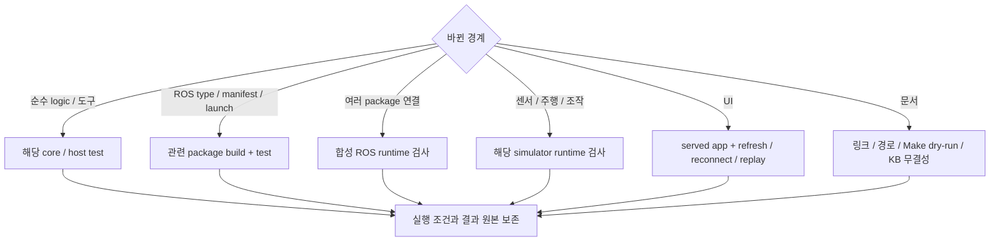

# 테스트 가이드

명령은 저장소 루트의 Humble/Fortress 환경에서 실행합니다. 변경 범위를 확인한 뒤 가장 작은 관련 검사부터 선택합니다. Make target의 실제 동작은 [Makefile](../Makefile)을 기준으로 확인합니다.

## 테스트와 도구 위치

테스트는 검사 대상을 소유한 위치에 둡니다. 루트 `tests/`에는 저장소 도구의 자동 검사와 패키지를 연결하는 통합 검사만 둡니다. 실행, 관찰과 보고 코드는 검증 도구로 분리합니다.

| 위치 | 책임 |
|---|---|
| `ros2_ws/src/<package>/test/`, `tests/` | 패키지 기능과 계약의 자동 검사 |
| `ros2_ws/src/<package>/runtime_test/` | 해당 패키지의 명시 실행 smoke와 runtime 검사 |
| `tests/integration/` | Backend, Mission 등 여러 구성 요소의 연동 검사 |
| `tests/tools/` | 저장소 검증 도구의 자동 검사 |
| `tools/validation/` | Simulator 실행과 영상·로그 수집 |

패키지 내부에도 통합 검사가 있을 수 있습니다. 파일의 책임과 실행 조건으로 위치를 정하며, runtime CLI를 `tests/`에 넣었다고 pytest가 자동 실행하는 것은 아닙니다.

## 검사 선택



아래 표에서 변경 범위에 맞는 명령을 선택합니다. Simulator, mock 통과는 해당 입력과 backend의 증거이며, 실물 검증은 별도로 수행합니다.

| 변경 범위 | 명령 | 확인 범위 |
|---|---|---|
| 전체 ROS workspace | `make test` | build, colcon package test와 결과 집계 |
| Mission, Gateway core | `make test-mission-core` | ROS 없는 lifecycle, 영속성, 중복, 재전송 |
| Mock 조작 core | `make test-manipulation-core` | 서버 실행, 취소, 영속 기록과 모니터 |
| Mission과 Mock Action | `make test-mission-mock BASE_TEST_ROS_DOMAIN_ID=186` | 공통 타입, Action, 조회, 취소와 재시작; 주행은 Mock |
| Gazebo와 Mock Action | `make test-gazebo-manipulation BASE_TEST_ROS_DOMAIN_ID=186` | Nav2 도착과 정지, 두 수거, 추가 빈 관측과 보고 |
| Mission ROS 설치, 연동 | `make test-mission-runtime` | 관련 package build/test |
| Navigation core, plugin | `make test-navigation` | Python core와 C++ plugin |
| 합성 Navigation runtime | `make test-navigation-runtime` | ROS lifecycle, goal, 취소, sensor 단절 |
| Gazebo, Navigation | `make test-gazebo` | package 검사와 C++ plugin; 선택 runtime은 제외 |
| Gazebo sensor runtime | `make test-gazebo-nav-runtime` | 실제 simulator의 sensor, odom, TF |
| 시설 목표 생성 | `make test-gazebo-facility-tools` | simulator 없는 ID, 여유, 제거 의자 처리 |
| MuJoCo | `make test-mujoco` | scene loader; 모든 조작 runtime을 뜻하지 않음 |
| Mock Manipulation Action | `make test-manipulation` | ROS Action, 취소, 조회와 재시작 복구 |
| MuJoCo BT 경계 | `make test-manipulation-bt` | native BT, Action, 관련 인식과 수거 회귀; 실제 물리 수거 성공은 별도 |
| Hand-eye 경계 | `make test-handeye` | description, MuJoCo, MoveIt, calibration |
| Base ROS | `make test-base` | interface, driver, odometry; mock MCU |
| ESP32 준비, motor core | `make test-micro-ros-setup test-motor-core` | Python 준비 도구와 장치 없는 C++ |
| Logger | `make test-logger` | CLI 정책 편집과 종료 코드, 기록 정책, 읽기 전용 archive, 디렉터리 독점, 세션과 복구 경계 |
| Monitor와 Logger | `make test-dev-monitor` | Logger 검사와 ROS 수집, 저장, HTTP와 UI 데이터 경계 |
| Telemetry | `make test-telemetry` | odom relay |
| CI 준비 도구 | `make test-ci-tools` | 의존성 이미지 무효화, build context와 명령 전달 |

Fedora에서는 native ROS target을 Humble Distrobox에서 실행합니다. `test-micro-ros-setup`, `test-motor-core`는 Makefile의 `BASE_EXEC`가 환경을 선택합니다.

CI는 `PYTEST_DISABLE_PLUGIN_AUTOLOAD=1`로 runtime 의존성이 설치한 외부 pytest plugin의 자동 로드를 끕니다. 프로젝트의 `conftest.py`와 pytest 기본 plugin은 유지하며, 로컬에서는 `PYTEST_DISABLE_PLUGIN_AUTOLOAD=1 make test`로 같은 설정을 적용합니다.

`make test`는 package test가 실패해도 `colcon test-result --verbose`로 실패 상세를 출력하고 실패 상태를 반환합니다.

## CI 실행과 재사용

CI는 모든 PR에서 전체 workspace 검사, ESP32 motor core, 합성 Navigation runtime과 Gazebo sensor runtime을 실행합니다. 베이스의 pytest는 colcon에 직접 등록하며 전체 workspace 검사에서 한 번 실행합니다. Navigation과 Gazebo runtime은 같은 실행에서 이미 빌드한 workspace를 사용합니다.

| 재사용 대상 | 갱신 조건 | 검증 경계 |
|---|---|---|
| GHCR 의존성 이미지 | 모든 `package.xml`, rosdep YAML, `containers/ci/`, 이미지 준비 도구, platform 또는 UTC ISO 주차 변경 | ROS, apt, pip 의존성만 포함하며 응용 소스와 빌드 결과는 포함하지 않음 |
| ccache | compiler 내용, 소스, header와 옵션에 따라 hit/miss 결정 | 빌드 명령은 매번 실행하며 CTest/pytest 결과는 캐시하지 않음 |
| 같은 실행의 workspace | 전체 빌드 완료 후 runtime 검사에서 재사용 | 다른 실행의 `build/`, `install/`, test result는 복원하지 않음 |

이미지가 없거나 pull할 수 없으면 동일한 Dockerfile로 의존성을 설치한 뒤 전체 검사를 실행합니다. 같은 저장소의 실행은 환경 확인 후 의존성 이미지를 게시합니다. 응용 테스트의 성공 여부와 별개로 의존성 이미지와 compiler cache를 보존해 실패 수정 시에도 재사용하며, 다음 실행의 전체 검사와 실패 판정은 그대로 유지합니다. Fork PR은 이미지를 게시하지 않습니다. 매주 월요일 실행은 새 주차 이미지를 준비하며, 같은 주에 수동 갱신하려면 Dockerfile의 `DEPENDENCY_REVISION`을 올립니다. Python 외부 의존성 버전은 `containers/ci/pip-constraints.txt`에서 갱신합니다.

패키지 빌드는 최대 2개, 패키지 내부 컴파일은 runner CPU 수의 절반으로 제한해 두 병렬화 계층의 경합을 줄입니다. 최적화 수준은 기존 `RelWithDebInfo`를 유지합니다. 모델 검사에서는 같은 인자의 xacro 출력 bytes만 재사용하고 각 검사는 독립 XML tree를 받습니다.

CI artifact에는 test XML, 실패 로그, 설치된 apt/pip 버전과 ccache 통계를 남깁니다. 속도는 이미지 생성과 compiler cache miss가 있는 최초 실행, 이미지와 cache를 재사용하는 실행으로 구분해 비교합니다. 이미지 pull과 cache 복원 시간도 포함한 GitHub job 전체 시간을 기준으로 판단합니다.

## 선택 runtime과 UI

### 카메라 영상 수집

현재 workspace를 빌드한 뒤 `tools/validation/capture_cameras.py`로 실제 ROS
카메라 영상을 수집합니다. 각 출력 경로는 아직 없는 새 디렉터리여야 합니다.

```bash
source /opt/ros/humble/setup.bash
source "$(make -s print-install-base)/local_setup.bash"
python3 tools/validation/capture_cameras.py --backend mujoco \
  --output /absolute/new-camera-run/mujoco
python3 tools/validation/capture_cameras.py --backend gazebo --gazebo-model cad-with-arms \
  --output /absolute/new-camera-run/gazebo
PYTEST_DISABLE_PLUGIN_AUTOLOAD=1 python3 -m pytest -q tests/tools/test_capture_cameras.py
```

GUI가 없는 환경에서는 촬영 명령 앞에 `xvfb-run --auto-servernum`을 붙입니다.
VM에서 GPU 렌더링이 불안정하면 `LIBGL_ALWAYS_SOFTWARE=1`을 지정합니다.
Gazebo의 `--gazebo-model legacy`로 레거시 모델도 선택할 수 있습니다.

도구는 head와 양손목 영상의 크기, encoding, frame, buffer 및 시뮬레이션 clock과
상태 메시지를 확인하고 PNG, `report.json`, `launch.log`를 남깁니다. 누락, timeout과
조기 종료는 실패 코드로 보고하고 실행한 프로세스 그룹을 종료합니다. 촬영 성공은
전체 집기 미션의 성공을 뜻하지 않습니다. 기본 CAD 주행 프로파일은 팔을 제외하며,
`cad-with-arms`는 촬영 검증에만 팔을 포함합니다.

### 선택 실행 조건

Gazebo package의 `--run-sim-runtime`, `--run-evaluation-tests`와 Mission core의 `CLEANY_RUN_ROS_TESTS=1`은 별도로 활성화하는 검사입니다. 실행 결과에서 통과와 skip을 구분합니다.

```bash
source /opt/ros/humble/setup.bash
source "$(make -s print-install-base)/setup.bash"
ROS_DOMAIN_ID=82 CLEANY_RUN_ROS_TESTS=1 make test-mission-core
```

Logger 독립 녹화 검사는 빌드 overlay를 source한 뒤 빈 출력 경로에서 실행합니다.
logger와 Monitor를 별도 프로세스로 띄우고 합성 경로, 카메라와 점군을 발행합니다.
Monitor 종료 전후의 같은 세션에서 SQLite 증가, rosbag2 원문과 stamp, Monitor 재접속,
HTTP 시작과 정지, logger 단절과 writer 대체 금지를 확인합니다. 실제 로봇 구동과
센서 성능 검증은 포함하지 않습니다.

```bash
ROS_DOMAIN_ID=218 ROS_LOCALHOST_ONLY=1 make test-logger-independence \
  LOGGER_TEST_OUTPUT=/absolute/new-logger-run LOGGER_BASE_COMMIT=<base-commit>
CLEANY_RUN_ROS_TESTS=1 ROS_DOMAIN_ID=217 ROS_LOCALHOST_ONLY=1 make test-dev-monitor
```

CLI 실제 연결 검사는 logger를 별도 프로세스로 띄우고 설치된 `logger` 실행 파일로
조회, 토픽 설정, 시작과 정지를 호출합니다. 합성 경로와 이미지를 native bag에서
다시 읽으며 CLI 종료 후 녹화 유지, 활성 설정 거부, 세션 보호와 연결 실패를 확인합니다.

```bash
ROS_DOMAIN_ID=219 ROS_LOCALHOST_ONLY=1 make test-logger-cli \
  LOGGER_TEST_OUTPUT=/absolute/new-cli-run LOGGER_BASE_COMMIT=<base-commit>
```

Monitor smoke는 같은 domain에서 Monitor를 먼저 실행한 뒤 호출합니다.

```bash
ROS_DOMAIN_ID=187 python3 ros2_ws/src/cleany_dev_monitor/runtime_test/smoke.py --output /absolute/new-run
# frontend의 현재 Playwright 설정과 package scripts:
cat ros2_ws/src/cleany_dev_monitor/web/package.json
```

Frontend 검사는 `ros2_ws/src/cleany_dev_monitor/web`에서 `pnpm exec tsc --noEmit`과 `pnpm exec playwright test`를 실행한다. 실제 Monitor가 필요한 검사는 `MONITOR_URL`을 지정하고 해당 ROS 입력도 준비한다. 기본 fixture 검사는 로컬 Vite를 시작한다.

UI 변경은 실제 served app에서 새로고침, 재연결, 기록 재생까지 확인합니다. Playwright browser가 없으면 configured browser를 설치한 뒤 다시 실행합니다.

Mission Gateway smoke는 `tests/integration/mission_runtime/`, Monitor smoke는 `ros2_ws/src/cleany_dev_monitor/runtime_test/`에 있습니다. 실제 Backend, ROS, Gazebo 입력 조건을 준비한 경우에 명시적으로 실행합니다.

## 결과와 증거

| 증거 | 의미 |
|---|---|
| 소스, manifest, 단위 검사 | 구현과 검사된 입력의 계약 |
| mock / 합성 ROS | 합성 backend의 lifecycle과 메시지 경계 |
| Gazebo, MuJoCo runtime | 해당 simulator, 입력, 버전의 동작 |
| 장치 통신 | 실제 USB, UART, DDS 등 확인한 계층 |
| 물리 시험 | 실제 sensor, actuator, 정지, 시나리오 결과 |

결과에는 다음 항목을 남깁니다.

- Code commit와 dirty 상태, 환경, overlay
- 입력, config, asset hash
- 요청 범위와 실제 완료 범위, 실패, skip, 중단
- 로그와 출력 위치

CTest wrapper와 pytest 집계가 겹치면 중복 합산하지 않습니다. 실행 원본은 `CLEANY_DATA_ROOT/runs/`, 과거 보고서는 [근거 색인](EVIDENCE.md)에서 찾습니다.

## 문서 변경 검사

내부 파일 링크, anchor, 코드, 설정, launch 경로, Make target의 존재와 native dry-run을 확인합니다. 문서 검증만을 위해 실제 로봇을 움직이거나 새 calibration을 수행하지 않습니다.

KB를 변경한 경우에는 KB의 `kb-quality-checks`도 실행합니다. 검사 통과와 내용 승인은 별도로 기록합니다.

## Isaac Mission 시나리오

[실행 가이드](RUNNING.md#isaac-sim-통합-검증)의 image/build 준비 후 아래 scenario를
각각 새 출력 경로에서 실행한다. 실행기는 실제 Mission의 public service로 할당한다.

| scenario | 주입과 판정 |
|---|---|
| `success` | Nav2 접근 → 기존 mock 물체 2개 수거 → home 복귀, SUCCESS 및 실제 base의 home 오차 |
| `navigation_failure` | Isaac base 명령 차단, Mission timeout/cancel 후 실패와 정지, 조작 미시작 |
| `manipulation_failure` | 기존 mock Action의 GRASP_FAILED, ERROR/재할당 차단과 정지 근거 |
| `cancel` | 이동 중 public CancelMission 요청, CANCELLED와 정지 |

각 시도에 앞서 실제 FollowJointTrajectory 성공, 취소, fresh joint state와 정지를
확인한다. 이 검사는 MoveIt planning 또는 물리 파지를 검증하지 않는다.
미션 최종 결과에는 기존 mock execution profile을 유지하며,
`evaluations/mission.json`에도 실제/대역 범위를 명시한다.
`provenance/run.json`의 passed는 이 명시된 범위에만 적용된다.
기존 외부 mock fixture는 성공 수거 순서의 snapshot만 허용하므로 조작 실패
시험은 `max_skill_retries=0`을 명시한다. 실제 주입 결과는 팔 복구가 확인되지 않아
재관찰/재시도 전에 안전 종료하는 경로다. 실패 후 재시도용 snapshot 계약은
미연결이며 이 시나리오에서 재관찰이나 재시도 성공을 주장하지 않는다.

```bash
python tools/validation/isaac/run.py --build-root /absolute/data/builds/isaac-mission \
  --output /absolute/data/runs/isaac-nav-failure-001 --scenario navigation_failure
# ROS/xacro Python 환경에서 GPU 없이 fixture 계약 검사
python3 -m pytest tests/tools/test_isaac_fixture.py -q
```

실패 로그도 새 시도와 함께 보존한다. DB나 결과를 지워 같은 경로를 재사용하지 않는다.
현재 실행 결과와 미검증 범위는 [EVIDENCE](EVIDENCE.md)에 기록한다.

Facility 18F 검사는 위 명령에 실행 가이드의 `--world facility18`, 지도/의자
입력과 새 출력 경로를 지정한다. GPU 없는 시설 검사는 `FACILITY_FIXTURE`를
`facility_integration.yaml/.pgm`과 `fuel-assets/officechairgrey/OfficeChairGrey.obj`가
있는 디렉터리로 설정한다. COLLADA vertex index/변환 검증, 원본 82개 의자와
천장 충돌 보존, 원본 관절 한계 안의 park 자세/전체 몸체 bounds, 선택한 목표/대기 위치의 지도 여유를 검사한다.

복구 없는 왕복은 `--scenario success --record-motion --require-no-recovery`로
검사한다. `evaluations/navigation.json`은 경로 실패, 복구 행동, costmap 초기화
횟수를 기록하고 `mission.json`은 각 NavigateToPose의 feedback 복구 횟수를 남긴다.
`compare_navigation.py --baseline <기존 실행> --runs <새 실행> --output <JSON>`은
동일한 PhysX 자세 기록에서 접근/복귀별 simulation 시간, 거리, 실제 속도를
계산한다. Mock 작업 대기와 Isaac 초기화 시간은 주행 시간에서 제외한다.

복수 좌석 반복 검증은 같은 build와 설정으로 아래처럼 실행한다. 기본 행렬은
seat-12/03/27/46을 순회한 뒤 같은 순서로 한 번 더 실행하는 총 8회다.
매회 Isaac/Mission/DB를 새로 시작하므로 연속 미션 내 상태 누적 검증과는 다르다.
중간 실패도 `campaign.json`에 남기고 다음 행으로 진행하며, 소스 hash가 바뀌면
중단한다. `mission_started=false`인 환경/초기화 실패는 주행 실패와 구분한다.

```bash
python tools/validation/isaac/campaign.py \
  --output /absolute/data/runs/facility-repeat-001 \
  --build-root /absolute/data/builds/isaac-mission \
  --cache-root /absolute/data/builds/isaac-mission/isaac-cache-174 \
  --facility-map /absolute/fixture/facility_integration.yaml \
  --targets seat-12 seat-03 seat-27 seat-46 --repeats 2
```

통과한 실행은 Mission/Action DB와 교차 검사한다. `campaign.json`은 모든 실행의
종료 결과, 복구/경로 실패/costmap 초기화 횟수, 실제 복귀 오차와 로그 경로를
포함한다. 이 표본의 통과 비율을 전체 좌석의 성공률로 일반화하지 않는다.

계산 부하를 측정하려면 단일 실행의 `run.py` 명령에 `--profile`을 추가한다.
주행, 센서와 물리 설정은 유지하고 `evaluations/loop-profile.jsonl`에 5초 단위의
구간별 wall/main-thread CPU 시간, 실시간 대비 진행률(RTF), 2ms 계산 예산 초과를
기록한다. `system-profile.jsonl`은 해당 컨테이너의 프로세스/스레드 CPU,
runqueue 대기와 공유 호스트/GPU 부하를 수집한다. 다른 작업을 중단하지 않는다.

```bash
python tools/validation/isaac/analyze_profile.py \
  --run /absolute/data/runs/isaac-profile-001 \
  --output /absolute/data/runs/isaac-profile-001/evaluations/profile-summary.json
python -m unittest discover -s tests/tools -p test_isaac_profiling.py -v
```

분석은 완료된 Mission의 상태 시각과 연결하고 상태 전이 경계를 포함한 5초 창을
주행 집계에서 제외한다. `physics_step`은 native simulation 호출과 동기 콜백을
포함하며 PhysX solver 단독 비용이 아니다. Main-thread CPU에는 worker CPU가
포함되지 않는다. 프로세스 CPU의 100%는 한 코어이며, GPU 전체 사용률에는
다른 프로그램도 포함된다. `pmon`의 `-` 값은 0%로 변환하지 않는다.

`--native-profile` 실행의 `evaluations/native-trace.json.gz`는 PhysX 내부와
USD 동기화 등 native zone을 포함한 Chrome trace다. 아래 분석은 같은 스레드의
중첩 zone을 빼서 exclusive 시간을 구한다. 다른 worker의 inclusive 시간을
main-thread wall 시간에 더하지 않는다. Native capture는 추가 부하가 있으므로
그 3초 구간과 겹치는 창은 일반 `analyze_profile.py`의 NAVIGATION 집계에서 제외한다.

```bash
python tools/validation/isaac/analyze_native.py \
  --evaluations /absolute/data/runs/isaac-native-001/evaluations \
  --output /absolute/data/runs/isaac-native-001/evaluations/native-summary.json
python -m unittest discover -s tests/tools -p test_isaac_cadence.py -v
```

`legacy + usd`, `split + usd`, `split + fabric`을 같은 좌석과 build에서 비교하면
발행 주기와 USD 동기화의 효과를 구분할 수 있다. 물리 dt, 관절 제어기/solver,
LiDAR ray 수/주기와 Navigation 설정은 유지한다. 각 Mission 검사는 실제 수신
clock/odom/TF/scan timestamp의 단조 증가, 설정 주기 대비 95–102% 수신율을
확인하고 `mission.json`의 `publication_timing`에 joint state를 포함한 관측값을 남긴다.
실패/취소의 정지 확인도 새 odometry 주기에서 fresh 관측을 요구한다.

비교할 실행에는 `--profile --record-motion`을 지정한다. 반복 행렬에도
`--profile --publication-profile split --physics-sync fabric`을 추가할 수 있다.
완료 후 아래 명령은 좌석, ROS 소스, 로봇/제어기/Navigation/월드 입력 hash와
물리 주기가 같은지 확인하고 RTF, 물리 step 평균, 실제 주행 시간과 CPU를 비교한다.

```bash
python tools/validation/isaac/compare_performance.py \
  --baseline /absolute/data/runs/baseline-legacy-usd \
  --candidates /absolute/data/runs/publication-split-usd \
    /absolute/data/runs/optimized-split-fabric \
  --output /absolute/data/runs/performance-comparison.json
```

공유 호스트 부하와 독립 closed-loop 궤적 차이가 있으므로 단일 실행의 개선율을
모든 환경의 성능 보장으로 해석하지 않는다. 실패 처리 회귀는 같은 설정에서
`--scenario navigation_failure`, `manipulation_failure`, `cancel`로 각각 실행한다.
의도적 실패 시나리오는 정상 왕복의 `--require-no-recovery` 집계와 구분한다.

독립 프로세스 2개의 병렬 검사는 아래처럼 서로 다른 DDS domain, 출력 경로와
캐시를 사용한다. build와 지도 경로는 실제 환경에 맞게 지정하고 출력 경로는
새 경로를 사용한다. 캐시를 준비할 경우 사용 중이 아닌 기존 캐시를 각 경로로
별도 복사한다. 같은 캐시를 두 실행에 동시에 mount하지 않는다.

```bash
isaac_parallel_common=(
  --world facility18 --scenario success --profile --record-motion --require-no-recovery
  --publication-profile split --physics-sync fabric --timeout 1800
  --build-root /absolute/data/builds/isaac-mission
  --facility-map /absolute/fixture/facility_integration.yaml
)
python tools/validation/isaac/run.py "${isaac_parallel_common[@]}" \
  --domain 175 --target-id seat-12 --output /absolute/data/runs/parallel-175 \
  --cache-root /absolute/data/caches/parallel-175 &
isaac_parallel_pid_a=$!
python tools/validation/isaac/run.py "${isaac_parallel_common[@]}" \
  --domain 176 --target-id seat-03 --output /absolute/data/runs/parallel-176 \
  --cache-root /absolute/data/caches/parallel-176 &
isaac_parallel_pid_b=$!
wait "$isaac_parallel_pid_a"
isaac_parallel_status_a=$?
wait "$isaac_parallel_pid_b"
isaac_parallel_status_b=$?
printf 'domain 175 exit=%s, domain 176 exit=%s\n' "$isaac_parallel_status_a" "$isaac_parallel_status_b"
```

두 종료 코드를 각각 확인하고 기존 Mission/DB 및 profile 분석을 각 경로에
적용한다. 격리는 domain별 clock/odom/scan/joint state publisher가 각각 1개이고,
수신 Mission ID와 DB가 해당 실행의 요청만 포함하는지 확인한다. 병렬성은
두 미션의 주행 wall 시간 구간이 실제로 겹치는지 확인한다. 성능 보고에는
환경별 RTF와 두 실행의 전체 완료 시간을 구분하며, 이전 순차 실행과 비교할
경우 호스트 부하 차이와 초기화/종료 시간이 포함되는지도 명시한다.

### 단일 Isaac 프로세스의 Lab 복제 환경 비교

[실행 가이드](RUNNING.md#isaac-lab-단일-프로세스-환경-복제)의 `run_cloned.py`로
seat-12와 seat-03을 함께 실행한다. 정상 Mission 검증은 환경마다 기존
`--require-no-recovery` 기준과 실제 팔 trajectory/cancel 검사를 적용한다.
각 환경의 `evaluations/mission.json`, `arm.json`, Mission/작업 DB와 로그를
기존 도구로 검사한다. 루트의 `evaluations/clones.json`은 전체 collider 수와
joint 연결이 해당 clone 내부를 가리키는지 확인한 결과다.

Humble namespace 회귀는 ROS 환경에서 다음 명령으로 실행한다. Host에
`rclpy`가 없으면 skip되므로 컨테이너나 Humble 터미널에서 실행해야 한다.

```bash
python3 -m unittest discover -s tests/tools -p test_isaac_ros_scope.py -v
```

`/clock`은 publisher 1개를 공유하고 `/env_N/scan`, `wheel/odom`,
`joint_states`, 최종 `cmd_vel`은 환경마다 publisher 1개여야 한다.
최종 `cmd_vel` 소유자는 기존 collision monitor여야 한다. 절대 root의
`/scan`, `/wheel/odom`, `/joint_states`, `/cmd_vel`, `/tf`에는 복제 환경의
publisher가 없어야 한다. TF frame 문자열은 기존 이름을 유지하고 TF topic을
격리한다. ROS introspection에 쓰는 topic 이름은 `resolve_topic_name()`을
거쳐야 실제 remap된 publisher를 조회한다.

성능 비교는 복제 실행을 완전히 종료한 뒤 동일 소스와 입력으로 2개 프로세스
실행을 수행한다. URDF/controller/motor/world geometry hash, namespace를
벗긴 Nav2 설정, physics와 발행 주기를 대조한다. 각 환경의 주행 FSM 창에서
RTF를 구하고, 공유 physics step 시간은 **두 환경을 함께 진행하는 비용**으로
표시한다. 두 미션이 모두 활성인 공통 구간에서 소유 프로세스의 CPU와 RSS,
GPU PID별 framebuffer를 집계한다. RSS 합은 공유 페이지를 중복 포함하므로
실제 물리 RAM 사용량으로 해석하지 않는다.

Mission batch 시간(첫 주행 시작부터 마지막 IDLE까지)과 초기화/종료까지
포함한 전체 실행 시간을 따로 기록한다. mock 작업 대기가 batch 시간에
포함된다. 두 방식 모두 실시간 pacing을 유지하고 Isaac 프로세스당 CPU
thread 제한은 4다. 따라서 전체 thread 예산은 1×4와 2×4이며, 같은 총
thread 수나 무제한 처리량을 비교한 시험은 아니다. 원본 비교 스크립트와
수치는 [실행 원본](EVIDENCE.md)에 보존한다.

CPU/GPU 4개, 8개 환경 검증은 [확장 실행기](RUNNING.md#isaac-lab-단일-프로세스-환경-복제)를
사용한다. GPU mode도 기존 ros2_control의 host buffer 계약을 유지하며,
`physics-backend.json`의 GPU dynamics/broadphase와 실제 PhysX GPU heap을
대조한다. CUDA tensor pipeline 활성 여부를 GPU 물리 활성 여부와 혼동하지 않는다.
모든 환경의 Mission/DB, 팔 제어, 최종 정지, clock/sensor publisher 수,
고유 Mission ID, 두 Nav2 Action feedback의 복구 횟수를 개별 검사한다.
8환경은 동일한 네 좌석의 두 복제본이며 같은 월드에서 로봇 8대가 상호
회피하는 시나리오는 아니다.

`bringup.json`은 환경 수의 3배인 manager STARTUP 요청이 각각 한 번만
성공했고 모든 Mission이 ready였는지 확인하는 근거다. 미션 시작 전의
discovery 대기는 Nav2 recovery 횟수와 별도로 기록한다. 미션이 SUCCESS라도
실제 PhysX odometry의 복귀 오차가 기존 8cm 기준을 넘으면 전체 검증은 실패다.
하나가 실패한 batch에서도 각 validator의 종료 코드로 개별 성공/실패를 집계한다.
8환경의 통신 준비 실패는 주행 실패와 구분한다. Fast DDS 포트 할당 한도는
112개의 독립 ROS Context와 나중에 시작한 관측자로 검사했다. 기본 설정과
초기 peer 범위만 확대한 설정은 0/112 토픽 수신, `mutation_tries=256`은
112/112 수신이었다. 재현 코드와 결과는 [실행 근거](EVIDENCE.md)에 보존한다.

느린 시뮬레이션의 정지 확인은 수신 timestamp 기준 최근 0.8 simulation 초에서
최소 10개 표본과 0.5 simulation 초의 정지를 요구한다. 최신 메시지는 0.8 wall 초
이내에 수신돼야 한다. 속도 임계값은 유지한다. 팔 checkpoint 및 최종 정지의
검증기 wall timeout은 60초이며, 실제 Mission/Nav2의 timeout은 변경하지 않는다.
기존 0.8 wall 초 안에 odometry 10개를 요구하는 조건은 RTF가 0.25 미만이면
50Hz sim odometry에서도 충족할 수 없어 시뮬레이션 시각 기준으로 수정했다.

```bash
python -m unittest discover -s tests/tools -p 'test_isaac_c*.py' -v
```

이 검사는 RTF 1.0/0.3/0.1에서 같은 정지 관측 구간을 선택하는지, 데이터가
끊기거나 관측 시간이 짧으면 거부하는지 확인한다. 단위 검사만으로 실제 정지
성공을 판정하지 않고 각 실행의 joint/odom 기록과 함께 검증한다.

### 센서 기반 Isaac 책상 정리

`test_sensor_desk.py`는 늦은 Action 수락 후 취소, 오래된 snapshot, ID 불일치,
중복 대상, 불명확한 분류와 설명되지 않은 물체 소실을 검사한다.
`test_manipulation.py`의 Isaac 경계 검사는 mock 결과, ASSUMED 안착,
정지 또는 복귀 근거 누락과 준비 상태 만료 시 주행 금지를 확인한다.
`test_drive_readiness.py`는 관절 중복 수신, 피드백 만료, 움직이는 팔과 주행 자세
불일치가 준비 상태를 만들지 않는지 확인한다. BT core 검사에서는 테스트 backend를
사용하므로 물리 수거의 근거가 아니다.

`run.py --cleanup`의 실험 fixture는 기존 layout의 종이컵 또는 구겨진 휴지 한 개다. 검증기는 실제 Mission 결과의
수거 작업 한 개, 새 관측, `isaac` 프로필, `CONFIRMED` 안착, 팔 복귀와 정지,
실제 복귀 위치 오차를 요구한다. 조작 중에는 팔이 주행 자세를 벗어날 수 있지만
주행과 복귀 중에는 동일한 주행 자세 검사를 유지한다. 인식 모델이 컵을 놓쳐서
빈 책상이라고 보고하더라도 수거 횟수 검사를 통과하지 못한다.

깊이 mask 검사는 `cleany_perception/test/test_depth_mask.py`와 `test_pipeline.py`에서 전경 혼입, 경사진 물체 보존, 우세 성분 부재와 OBB/target mask 일치를 확인한다. `test_seeded_cartesian.py`는 위치만 맞는 관절 경로가 자세 corridor를 벗어나는 사례와 회전 잔차 보정 후 동일 충돌/자세 검사를 통과하는 사례를 비교한다. 두 검사는 물리 파지 성공을 대신하지 않는다.

Isaac 물리 정리의 정상 Mission 검증기는 복귀 완료 후에도 독립 `/sorting/verify_placement`에 새 시간 기준을 보내 수거함 내부 유지와 안정 표본을 확인한다. 현재 단일 물체 fixture에 한해 유일한 label/body 대응을 사용하는 추가 검사이며, Action 내부의 개별 물체 등록 및 놓기 후 확인을 대체하지 않는다. 결과는 `evaluations/mission.json`의 `post_home_placement`에 기록한다. 이동 중 조작 취소 검사는 전용 ROS domain에서 `tools/validation/isaac/validate_manipulation_cancel.py`를 Mission 할당 전에 시작한다. 실제 LiftObject의 ExecuteTrajectory 실행 상태와 선택 팔 속도를 함께 확인하며, CANCELED, fresh 정지 표본, 주행 불가와 Mission ERROR/TERMINAL을 요구한다. 정상 미션 성공 검사와는 별도로 판정한다.
