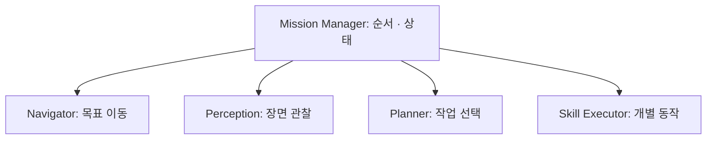

# 01. 시스템 아키텍처

> 목표: 패키지 구조, 모듈 경계와 실행 진입점을 연결하고 현재 구현의 위치를 찾습니다.

## 01.1 시스템 구성과 책임

책상 위 캔을 처리하려면 이동하고, 보고, 할 일을 고르고, 팔을 움직여야 합니다. Cleany는 이 역할을 나눕니다. 먼저 각 역할이 **어떤 질문에 답하는지**부터 보면 됩니다.



*책임을 나타낸 개념도 · 선은 현재 ROS 연결 상태를 뜻하지 않습니다.*

| 역할 | 답하는 질문 |
| --- | --- |
| Mission Manager | 지금 어떤 단계이며 다음에 무엇을 호출할까? |
| Navigator | 목표까지 이동했는가? |
| Perception | 주변에 무엇이 관측됐는가? |
| Planner | 관측한 물체로 어떤 작업을 할까? |
| Skill Executor | 지정한 개별 동작을 수행할 수 있는가? |
| Reporter | 무엇이 완료·실패·차단됐는가? |

“캔을 치우자”는 작업 수준의 판단이고, “어느 팔의 관절을 어떤 경로로 움직일까?”는 동작 수준의 문제입니다. 역할의 입력과 출력이 다르므로 읽어야 할 코드도 다릅니다.

로봇의 형태가 잘 떠오르지 않는다면 Cleany의 기반 플랫폼인 XLeRobot의 [조립 영상](https://www.youtube.com/watch?v=upB1CEFeOlk)을 함께 보세요. 이동 베이스 위에 두 팔과 카메라를 배치하는 모습을 볼 수 있습니다. XLeRobot 공식 저장소에서 소개하는 WOWROBO 영상이며, Cleany의 현재 부품 구성이나 미션 성공을 보여주는 영상은 아닙니다.

## 01.2 저장소와 패키지 구조

**패키지**는 관련 코드와 설정·의존성을 묶은 단위입니다. 이 저장소의 로봇 코드는 `ros2_ws/src/`에 있고, ESP32 펌웨어는 `esp32/`에 있습니다.

```text
ros2_ws/src/
├── cleany_interfaces/       # 공통 ROS 데이터 계약
├── cleany_mission_manager/  # 미션 core와 응답 대역
├── cleany_navigation/       # SLAM, Nav2와 안전 경로
├── cleany_description/      # 공통 로봇 모델
├── cleany_gazebo_sim/       # 주행·센서 시뮬레이션
├── cleany_mujoco_sim/       # 조작·센서 시뮬레이션
├── cleany_grasping/          # 파지 후보 생성·필터
├── cleany_skill_executor/    # 후보 평가와 조작 데모
└── cleany_handeye_calibration/ # 손목 카메라 보정
esp32/             # 모터·encoder·MCU 통신
```

이 트리는 학습에 필요한 위치만 발췌했습니다. 모든 패키지가 하나의 동작 경로에 동시에 사용되는 것은 아닙니다. Gazebo 주행과 MuJoCo 조작은 실행 경로부터 다릅니다.

파일 종류도 단서입니다. `launch/`는 프로그램 기동 구성, `config/`는 설정, `test/`·`tests/`는 기대 동작, `core/`는 외부 도구와 분리한 계산·판단을 담습니다. 생성물인 `build/`, `install/`, `log/`에서 소스를 수정하지 않습니다.

## 01.3 ROS 패키지와 실행 진입점

ROS는 `package.xml`로 패키지 이름·의존성·빌드 방식을 확인합니다. [Mission Manager package.xml](../../../ros2_ws/src/cleany_mission_manager/package.xml)의 실제 선언입니다.

```xml
<export>
  <build_type>ament_python</build_type>
</export>
```

Python 패키지의 [setup.py](../../../ros2_ws/src/cleany_mission_manager/setup.py)는 어떤 모듈과 데이터를 설치할지 정합니다. ROS 패키지로 설치할 수 있다는 사실과 실행 가능한 ROS 노드가 있다는 사실은 다릅니다. 현재 Mission Manager는 `mission_runtime = cleany_mission_manager.node:main`을 등록합니다.

반면 [grasping setup.py](../../../ros2_ws/src/cleany_grasping/setup.py)는 `grasp_server`라는 실행 이름을 `grasp_node:main`에 연결합니다. 따라서 코드를 읽을 때는 **패키지 이름 → 실행 이름 → main 함수 → 노드의 콜백 → core** 순으로 좁히면 됩니다. 3장에서 이 경로를 실제 서비스와 연결합니다.

공통 개발 명령은 [Makefile](../../../Makefile)과 [개발환경 안내](../../implementation/development-setup.md)가 관리합니다. 개별 파일의 존재만 보고 실행 명령을 추측하지 않습니다.

## 01.4 Core와 Port 경계

Mission core는 ROS Action 객체 대신 [OperationPort](../../../ros2_ws/src/cleany_mission_manager/cleany_mission_manager/core/operations.py)를 사용합니다.

| 호출 | 책임 |
|---|---|
| `start(command)` | 한 번 시작하고 operation ID 반환 |
| `poll(id)` | 진행 중 None 또는 완료 결과 |
| `cancel(id)` | 취소 요청 |
| `ready()` / `stopped()` | 준비 / 정지 확인 |

[MissionRuntime](../../../ros2_ws/src/cleany_mission_manager/cleany_mission_manager/core/runtime.py)은 `tick()`마다 상태를 확인하며 완료되지 않은 작업을 다시 시작하지 않습니다. 실제 Nav2나 Mock을 이 약속에 연결하는 코드가 adapter입니다. 입력·출력 약속이 바뀌면 양쪽을 함께 검사합니다.

## 01.5 현재 구현과 통합 경계

| 부분 | 현재 읽을 구현 |
|---|---|
| Mission | 비동기 Runtime, CleaningTree, journal, ROS 요청/결과 |
| Navigation | Nav2, slam_toolbox/Cartographer, 휴대폰 목표와 안전 경로 |
| Perception | InspectScene, snapshot cache, YOLOE/Gemini, RGB-D 복원 |
| Grasp / Skill | 후보 생성, 양팔 MoveIt 선택, Mock / MuJoCo BT / 연속 sorting |
| Calibration | 왼손목 수집 adapter, PnP, solver와 오프라인 평가 |
| MCU | `esp32/`의 micro-ROS 모터 제어와 피드백 |

제품의 목표는 [KB 기술 개요](../../cleany-docs/20_TECHNICAL/00%20-%20Technical%20Overview.md), 현재 실행 조합은 [실행 가이드](../../implementation/running.md)를 확인합니다. `requested_by="dashboard"`라는 문자열 자체는 Dashboard 네트워크 연결을 입증하지 않습니다.

## 01.6 시스템 코드 추적 실습

“캔 후보가 만들어졌지만 팔이 움직이지 않는다”는 질문의 시작점은 Mission 상태만은 아닙니다. 조작에는 여러 실행 경로가 있으므로 다음 순서로 확인합니다.

1. [조작 실행 계약](../../../ros2_ws/src/cleany_skill_executor/docs/manipulation.md)에서 사용한 실행 경로를 찾습니다.
2. 후보 **선택** action과 **실행** demo coordinator의 파일을 구분합니다.
3. 후보 생성·팔 평가·실행 각각의 출력이 무엇인지 적습니다.

**확인 질문:** 어떤 파일을 열어야 할지 모를 때 패키지 이름만 찾으면 충분할까요?

<details><summary>생각을 비교해 보기</summary>

패키지 이름에 이어 실행 진입점과 호출하는 경로까지 확인해야 합니다. 같은 패키지에도 plan-only와 controller 실행 경로가 나뉠 수 있습니다. 다음 장에서는 외부 장치를 배제하고 Mission core의 한 경로를 끝까지 따라갑니다.

</details>
