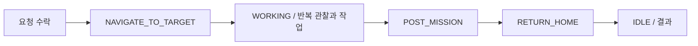
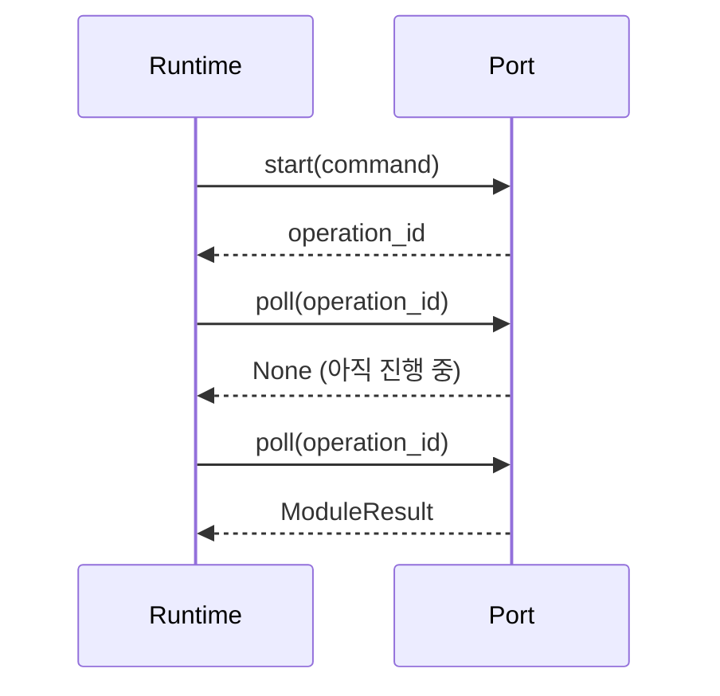

# 02. Mission Core와 Mock

> 목표: 장치 없이 실행한 결과를 보고 요청, 비동기 Port와 반복 관찰을 추적합니다.

## 02.1 Mock 기반 실행

Mock은 실제 장치 대신 정해진 응답을 돌려줍니다. 이 실습은 현재 `MissionRuntime`과 `MockDesk`를 사용하고 ROS node, simulator, 모터는 시작하지 않습니다. Python 3.10 이상과 package 의존성 `py_trees`가 필요하므로 [개발환경](../../DEVELOPMENT_SETUP.md)의 `make deps`를 마친 Humble 터미널에서 실행합니다.

```bash
source /opt/ros/humble/setup.bash
python3 docs/guide/examples/first_mission.py
```

정상 시나리오의 출력은 다음과 같습니다. 관측 UUID처럼 실행마다 바뀌는 값은 출력하지 않습니다.

```text
scenario: success
initial: IDLE
accepted: True
start: NAVIGATE_TO_TARGET
NAVIGATE_TO_TARGET -> WORKING
WORKING -> POST_MISSION
POST_MISSION -> RETURN_HOME
RETURN_HOME -> IDLE
report: SUCCESS
completed: trash-1, trash-2
observations: 4
execution requests: 2
return: OK
```



성공한 것은 Mock 응답을 받은 core입니다. 실제 위치 도착이나 물체 수거를 입증하지 않습니다.

## 02.2 요청과 결과

[RuntimeRequest](../../../ros2_ws/src/cleany_mission_manager/cleany_mission_manager/core/runtime_models.py)는 요청의 식별자와 대상을 담습니다.

| 필드 | 실습 값 / 의미 |
|---|---|
| `mission_id` | `guide_001`; 같은 ID의 중복 요청을 구분 |
| `target_id` | `seat-12`; 지원 대상에 포함되어야 함 |
| `requested_by` | `student`; 요청자 표기이며 네트워크 연결 증거는 아님 |
| `mission_type`, `target_kind` | 기본 `clean_desk`, `SEAT` |

`offer()`의 `accepted`와 최종 `last_report.outcome`을 구분합니다. 수락 직후에는 주행도 조작도 끝나지 않았습니다. 결과의 `completed_tasks`, `failed_task`, `return_result`를 함께 읽어야 부분 완료를 놓치지 않습니다.

## 02.3 Port 주입과 모의 응답

[OperationPort](../../../ros2_ws/src/cleany_mission_manager/cleany_mission_manager/core/operations.py)는 한 번 시작하고 여러 번 확인하는 비동기 약속입니다.



| 메서드 | 역할 |
|---|---|
| `start` | 작업 한 번 시작, ID 반환 |
| `poll` | 완료 결과 또는 진행 중 None |
| `cancel` | 취소 요청 |
| `ready` | 시작 준비 상태 |
| `stopped` | 실제 정지 확인 경계 |

실습의 `DeferredPort`는 지정한 poll 횟수 뒤 handler를 호출합니다. `ExecutorPort`는 여기에 `safe_to_drive`와 `maintain`을 더합니다. 조작 정지와 베이스 이동 허가는 같은 사실이 아닙니다.

## 02.4 tick과 데이터 전달

[실습 코드](../examples/first_mission.py)의 반복문은 `runtime.tick()` 뒤 모의 시간을 0.1초 늘립니다. 실제 sleep이나 ROS 시간은 쓰지 않습니다. 1000 tick 안에 끝나지 않으면 오류로 종료합니다.

[MockDesk](../../../ros2_ws/src/cleany_mission_manager/cleany_mission_manager/mocks/desk.py)의 관찰은 `SceneSnapshot`, 계획은 `TaskProposal`을 반환합니다. 제안에는 해당 `snapshot_id`가 들어가며 Runtime은 오래된 관측에 근거한 작업을 거부합니다.

## 02.5 작업 완료와 새 관찰

기본 MockDesk에는 `trash-1`, `trash-2` 두 객체가 있습니다. 모의 실행은 목록에서 하나를 제거합니다. 다음 작업은 새 관찰을 거쳐 고르고 최종 빈 장면도 확인합니다. 정상 출력의 **실행 2회, 관찰 4회**는 이 fixture의 동작이지 실제 카메라 촬영 횟수가 아닙니다.

| 시나리오 | 바꾼 입력 | 예상 결과 |
|---|---|---|
| `success` | 기본 fixture | SUCCESS, 관찰 4회, 실행 2회 |
| `retry` | 첫 집기만 retryable 실패 | SUCCESS, 관찰 5회, 실행 3회 |
| `blocked` | planner가 만료 snapshot 참조 | BLOCKED, 실행 0회 |
| `fatal` | navigator가 HARDWARE_ERROR | FAILED, ERROR 상태, 조작 0회 |

## 02.6 상태 추적 실습

실행 전에 위 표의 결과를 예상하고 다음 명령과 비교합니다.

```bash
python3 docs/guide/examples/first_mission.py --scenario retry
python3 docs/guide/examples/first_mission.py --scenario blocked
python3 docs/guide/examples/first_mission.py --scenario fatal
```

**확인 질문:** retry 시나리오에서 실행과 관찰이 각각 한 번 늘어난 이유는 무엇일까요?

<details><summary>생각을 비교해 보기</summary>

첫 실행이 실패하면 같은 과거 관측을 그대로 다시 쓰지 않고 새로 관찰합니다. 이후 두 객체를 완료하므로 실행 3회와 관찰 5회가 됩니다. 이는 이 Mock fixture의 재시도 경계를 확인하며 실제 파지 성공률을 측정하지 않습니다.

</details>
