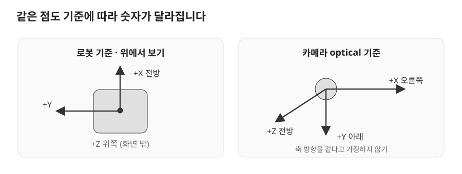
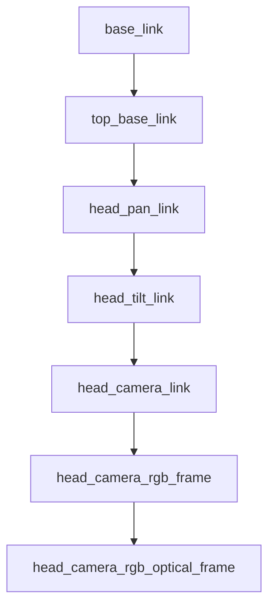
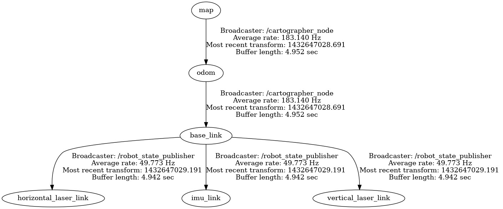

# 04. URDF와 TF

> 목표: 좌표계 개념에서 출발해 Cleany 모델의 관절과 센서 TF를 읽고, 각 변환을 누가 발행하는지 추적합니다.

## 04.1 좌표계와 ROS 축 규약

로봇이 왼쪽을 바라보면 로봇의 앞과 방의 앞은 달라집니다. 좌표에는 **어느 기준점에서, 어느 축을 따라 잰 값인지**가 필요합니다. 그 기준이 **좌표계**(frame)입니다.



*REP-103의 축 규약을 바탕으로 직접 그린 개념도*

| 좌표계 | 의미 | 축 또는 특성 |
| --- | --- | --- |
| `base_link` | 로봇 몸의 기준 | X 전방, Y 좌측, Z 위 |
| `odom` | 이동량을 누적하는 기준 | 연속적이지만 오차가 쌓일 수 있음 |
| `map` | 지도에 맞춘 전역 기준 | 위치 보정 시 좌표가 뛸 수 있음 |
| `*_optical_frame` | 카메라 영상·깊이의 기준 | X 우측, Y 아래, Z 전방 |

같은 `(0, 0, 1)`도 `base_link`에서는 위쪽 1m, optical 좌표계에서는 앞쪽 1m입니다. 좌표값을 넘길 때 좌표계을 빠뜨리면 숫자가 정상이어도 엉뚱한 목표가 됩니다.

ROS의 길이는 m, 각도는 rad입니다. 예를 들어 `linear.y=0.2`는 로봇 기준 좌측 **속도 0.2m/s**이며 이동 거리 0.2m가 아닙니다. 회전 부호는 오른손 법칙을 따르고, 위에서 본 양의 yaw는 반시계 방향입니다.

## 04.2 URDF의 Link와 Joint

**URDF**는 로봇 부품인 `link`와 부품 사이 관계인 `joint`를 설명합니다. `fixed` 관절은 고정된 장착 관계이고, `revolute` 관절은 한 축을 중심으로 회전합니다. **Xacro**는 반복되는 모델을 macro로 묶고 옵션에 따라 펼쳐 URDF를 만드는 도구입니다.

Cleany의 공통 모델 위치는 [모델 계약](../../../ros2_ws/src/cleany_description/docs/model.md)에 정리되어 있습니다.

| 파일 | 담당하는 내용 |
| --- | --- |
| [cleany_geometry.xacro](../../../ros2_ws/src/cleany_description/urdf/cleany_geometry.xacro) | `model_profile`에 따라 최신 CAD 또는 이전 모델 선택 |
| [cleany.urdf.xacro](../../../ros2_ws/src/cleany_description/urdf/cleany.urdf.xacro) | TF·MoveIt에서 쓰는 plugin-free 설명 |
| [cleany_control.urdf.xacro](../../../ros2_ws/src/cleany_description/urdf/cleany_control.urdf.xacro) | MuJoCo 제어 backend를 추가하는 진입점 |
| [cleany.urdf](../../../ros2_ws/src/cleany_description/urdf/cleany.urdf) | 실물 공통 CAD의 관절과 카메라 좌표계 |
| [legacy_20261009](../../../ros2_ws/src/cleany_description/urdf/legacy_20261009/head_camera.xacro) | 이전 장착의 헤드 모델; 이전 실물 보정과 함께 사용 |

`robot_state_publisher`는 URDF와 관절 상태를 이용해 link 사이 TF를 제공합니다. 모델 파일이 존재하는 것과 현재 관절값이 들어오는 것은 별개의 조건입니다. 움직이는 관절의 각도를 모르면서 센서 위치를 정확히 계산할 수는 없습니다.

## 04.3 Head Camera 모델 읽기

먼저 `origin`과 `axis`를 구분합니다. 아래는 **학습용 축약 예제**이며 Cleany의 관절 이름, 치수나 제한값을 옮긴 것이 아닙니다.

```xml
<joint name="example_tilt" type="revolute">
  <parent link="example_mount"/>
  <child link="example_camera"/>
  <origin xyz="0 0 0.1" rpy="0 0 0"/>
  <axis xyz="0 1 0"/>
  <limit lower="-0.5" upper="0.5" effort="1" velocity="1"/>
</joint>
```

`origin`은 부모 링크에서 관절 기준으로 가는 고정 관계입니다. 이 예제에서는 Z 방향으로 0.1 m 올라갑니다. `axis`는 관절 기준의 회전축이므로 Y축을 중심으로 회전합니다. `limit`의 각도와 속도 단위는 rad와 rad/s입니다.

실물 Cleany 모델은 [공통 CAD URDF](../../../ros2_ws/src/cleany_description/urdf/cleany.urdf)의 `head_tilt_joint`를 사용합니다. 원본에서 부모, 자식, `origin`, `axis`를 찾아 위 예제와 비교합니다. 좌표 수치와 보정 적용 조건은 [모델 계약](../../../ros2_ws/src/cleany_description/docs/model.md)이 관리합니다.



*최신 모델의 헤드 연결 요약입니다. 고정 장착과 회전 관절의 수치는 원본 Xacro에서 확인합니다.*

마지막 optical 관절은 카메라 축 규약을 적용합니다. CAD에서 정한 명목 렌즈 위치와 실물 측정으로 얻은 보정 변환은 구분해야 합니다. 이전 `jetson_20261009` 보정은 같은 이름의 이전 모델에만 적용합니다.

모델에 관절이 있다는 사실과 controller가 그 관절을 제어한다는 사실도 구분합니다. [제어 진입점](../../../ros2_ws/src/cleany_description/urdf/cleany_control.urdf.xacro)은 공통 형상을 포함하고, [제어 인터페이스](../../../ros2_ws/src/cleany_description/urdf/cleany_mujoco_ros2_control.xacro)는 팔 10관절과 그리퍼 2관절의 상태를 다룹니다. 최신 CAD의 그리퍼는 조립 형상으로 고정되어 구동 명령을 허용하지 않습니다. 모델 수정 전에는 어느 launch가 어느 Xacro와 controller를 사용하는지부터 확인합니다.

## 04.4 TF 발행 주체와 시간

TF는 좌표계 사이 위치·방향을 **시간과 함께** 다룹니다. 보통 이동 로봇에서는 `map → odom → base_link → 센서`를 사용합니다. Cleany의 Gazebo SLAM 경로에서는 역할이 다음처럼 나뉩니다.

| 변환 | 제공하는 코드 또는 노드 |
| --- | --- |
| `map → odom` | 실행 중인 SLAM backend |
| `odom → base_link` | [GazeboOdomTfPublisher](../../../ros2_ws/src/cleany_gazebo_sim/cleany_gazebo_sim/odom_tf_publisher.py) |
| `base_link → lidar_link`, `imu_link` | [GazeboSensorTfPublisher](../../../ros2_ws/src/cleany_gazebo_sim/cleany_gazebo_sim/sensor_tf_publisher.py) |
| 모델의 link·joint 관계 | 해당 모델을 실행한 `robot_state_publisher` |

Gazebo sensor publisher는 [base.yaml](../../../ros2_ws/src/cleany_gazebo_sim/config/base.yaml)의 위치·회전을 읽어 `StaticTransformBroadcaster`로 발행합니다. `lidar_translation`과 `lidar_rotation_xyzw`가 센서 장착 관계를 정합니다. 이 Gazebo 설정은 헤드 카메라 Xacro와 별도로 관리되므로 같은 좌표라고 가정하지 않습니다.

odom publisher의 실제 발행 부분은 다음과 같습니다.

```python
transform = TransformStamped()
transform.header = output.header
transform.child_frame_id = self._base_frame_id
transform.transform.translation.x = output.pose.pose.position.x
transform.transform.translation.y = output.pose.pose.position.y
transform.transform.translation.z = output.pose.pose.position.z
transform.transform.rotation = output.pose.pose.orientation
self._tf_broadcaster.sendTransform(transform)
```

`output.header`를 보존하므로 변환은 원본 odometry의 시각을 사용합니다. 입력 `/gazebo_odom`은 bridge가 연결한 ground-truth이고, 이 노드는 pose를 encoder로 다시 계산하지 않습니다.

촬영 뒤 팔이나 머리가 움직였다면 최신 TF로 예전 이미지의 점을 옮기는 것은 잘못된 조합일 수 있습니다. 영상 시각의 TF가 필요하고, 시뮬레이션에서는 관련 노드가 `/clock`을 사용해야 합니다. 같은 변환을 두 노드가 서로 다른 값으로 발행하는 것도 피해야 합니다.

TF 관계를 출력하면 다음처럼 부모·자식 좌표계과 발행 노드, 갱신 시각을 한 화면에서 읽을 수 있습니다. 선이 연결되어 있는지만 보지 말고, 각 변환을 누가 발행하는지도 확인합니다.



*외부 TF 출력 예시 · [Cartographer ROS 데모](https://google-cartographer-ros.readthedocs.io/en/latest/demos.html), The Cartographer Authors, Apache-2.0. 이 예시는 Cartographer가 odom → base_link도 발행하므로 위 Cleany 표의 발행 주체와 다릅니다.*

## 04.5 TF 오류 추적 실습

먼저 ROS 없이 파일 세 개를 비교하세요. [기존 시뮬레이션 형상](../../../ros2_ws/src/cleany_description/urdf/legacy_20261009/cleany_geometry.xacro)의 부모·자식 이름, [base.yaml](../../../ros2_ws/src/cleany_gazebo_sim/config/base.yaml)의 센서 이름, [slam_toolbox.yaml](../../../ros2_ws/src/cleany_navigation/config/slam/slam_toolbox.yaml)의 `map_frame`, `odom_frame`, `base_frame`입니다. 이름을 적고 각 관계의 발행 주체를 표시해 보세요.

06장의 독립된 Gazebo·SLAM 실습 환경을 실행한 경우 다음 읽기 전용 명령으로 확인할 수 있습니다.

```bash
ros2 run tf2_ros tf2_echo odom base_link
ros2 run tf2_ros tf2_echo base_link lidar_link
```

첫 관계가 없으면 odometry 입력과 publisher를, 두 번째가 없으면 sensor publisher와 좌표계 설정을 살펴봅니다. 토픽이 있어도 좌표계 연결이 없을 수 있습니다. `extrapolation` 오류가 나오면 이름뿐 아니라 측정 시각와 `use_sim_time`도 확인합니다. 카메라 좌표계은 그 모델·상태 publisher가 실행된 환경에서 따로 확인해야 합니다.

**확인 질문:** 카메라에서 얻은 점을 MoveIt의 계획 좌표계으로 전달할 때 좌표값 외에 무엇을 알아야 할까요?

<details><summary>생각을 비교해 보기</summary>

출발 좌표계, 도착 좌표계, 측정 시각과 그 시각의 변환 경로가 필요합니다. 모델의 명목 장착 관계와 실물 보정 정확도도 구분해야 합니다.

</details>

더 읽기: [REP-103 축·단위 규약](https://github.com/ros-infrastructure/rep/blob/master/rep-0103.rst), [REP-105 이동 로봇 좌표계](https://github.com/ros-infrastructure/rep/blob/master/rep-0105.rst).
