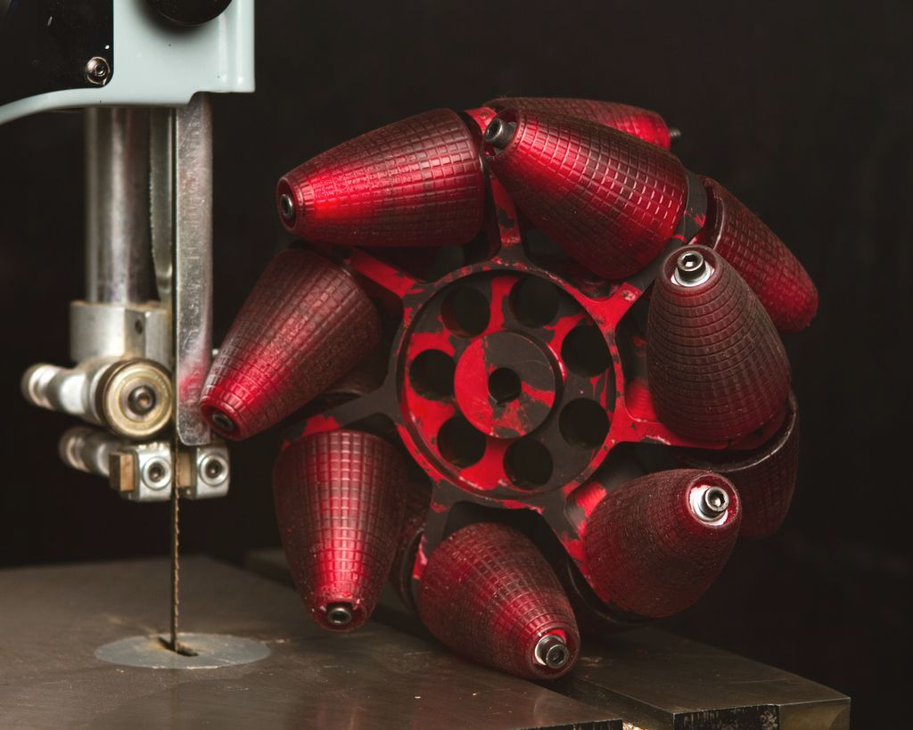
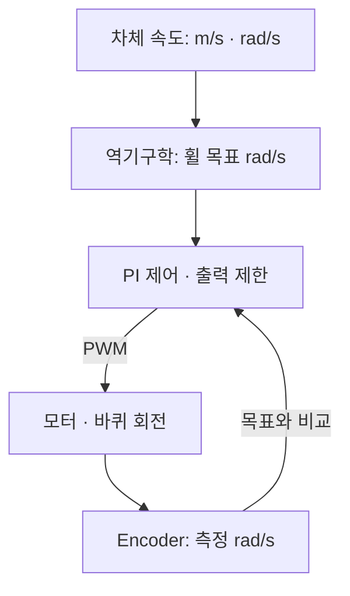
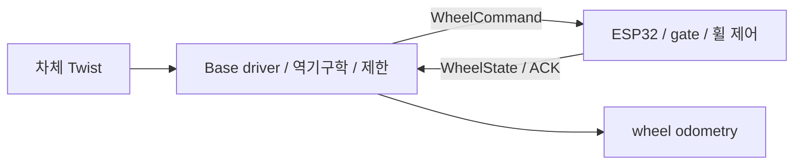

# 05. 메카넘 베이스 제어

> 목표: 차체 명령에서 바퀴 목표와 encoder feedback까지 추적하고, 시뮬레이터와 MCU 구현의 경계를 구분합니다. 실습은 계산만 하며 모터를 구동하지 않습니다.

## 05.1 Twist와 차체 속도

메카넘 바퀴에는 기울어진 롤러가 있습니다. 네 바퀴 회전의 조합으로 전후 이동, 횡이동, 회전을 만듭니다. 그래서 “왼쪽으로 이동하라”는 차체 명령을 바퀴별 속도로 바꾸는 **역기구학**이 필요합니다.



*외부 부품 사진 · [KillerGardevoir / Wikimedia Commons](https://commons.wikimedia.org/wiki/File:MG_6646.resize.jpg), [CC BY 3.0](https://creativecommons.org/licenses/by/3.0/), 원본 그대로 사용. Cleany에 장착된 바퀴 사진은 아닙니다.*

사진에서 붉은 롤러들의 축은 바퀴 회전축과 비스듬합니다. 이 구조가 바퀴별 힘의 방향을 바꾸고, 네 바퀴의 조합으로 횡이동을 가능하게 합니다. 이 움직임을 원하는 속도로 유지하려면 바퀴의 목표와 측정값을 계속 비교해야 합니다.



*속도 제어 개념도 · 현재 ROS와 MCU가 연결되었다는 배선도가 아닙니다.*

| 단계 | 값 | 단위 |
| --- | --- | --- |
| 차체 명령 | `linear.x`, `linear.y`, `angular.z` | m/s, m/s, rad/s |
| 바퀴 목표 | FL, FR, RL, RR 회전 속도 | rad/s |
| 측정 | encoder count 또는 환산 속도 | count, rad/s |
| 모터 출력 | PWM 비율 | % |

[Mobile base contract](../../../ros2_ws/src/cleany_interfaces/docs/mobile_base.md)는 `/cmd_vel`의 `Twist`를 **`base_link` 기준**으로 정의합니다. `Twist`에는 frame 필드가 없으므로 이 약속을 발행자와 수신자가 함께 지켜야 합니다. 속도 명령은 성공 응답이 없는 연속 스트림입니다. 이동 결과는 `/odom` 등의 상태로 확인합니다.

## 05.2 명령 제한과 Gazebo 경로

공통 계약은 세 지원 축의 최대 속도, 잘못된 값과 timeout 처리까지 정의합니다. 미지원 축은 무시하고 경고하며, 여섯 축 중 하나라도 `NaN`·무한대이면 메시지를 폐기하고 정지 목표를 적용합니다. timeout은 `Twist`에 시각이 없으므로 수신한 monotonic time을 사용합니다.

Gazebo에서는 `cmd_vel → command_guard → Gazebo용 명령 → bridge → 시뮬레이터`로 전달합니다. 관련 진입점은 [gazebo_fortress.launch.py](../../../ros2_ws/src/cleany_gazebo_sim/launch/gazebo_fortress.launch.py), guard는 [command_guard.py](../../../ros2_ws/src/cleany_gazebo_sim/cleany_gazebo_sim/command_guard.py), bridge 매핑은 [core_bridge.yaml](../../../ros2_ws/src/cleany_gazebo_sim/config/bridge/core_bridge.yaml)입니다.

[base.yaml](../../../ros2_ws/src/cleany_gazebo_sim/config/base.yaml)의 실제 guard 설정은 다음과 같습니다.

```yaml
gazebo_command_guard:
  ros__parameters:
    max_linear_x: 0.3
    max_linear_y: 0.3
    max_angular_z: 0.8
    cmd_vel_timeout_sec: 0.5
    timeout_check_rate_hz: 20.0
```

이 값은 이 Gazebo profile의 설정입니다. 공통 계약이 실물 최대 속도를 확정한 것은 아닙니다. timeout은 새 명령이 끊겼을 때 제어 목표를 0으로 만드는 장치이며 물리적 감속 거리와 정지 시간은 별도입니다.

## 05.3 메카넘 역기구학과 속도 제한

[wheel_speeds_from_chassis()](../../../ros2_ws/src/cleany_mujoco_sim/cleany_mujoco_sim/mecanum_kinematics.py)는 ROS에 의존하지 않는 순수 계산 함수입니다. 입력은 `ChassisCommand`, 형상은 `MecanumGeometry`, 출력은 네 이름을 가진 `WheelSpeeds`입니다.

실제 구현의 첫 부분은 다음과 같습니다. 뒤의 두 바퀴 항은 아래 설명에서 이어 봅니다.

```python
rotation_radius = (geometry.wheelbase_length + geometry.track_width) / 2.0
rotational_velocity = rotation_radius * command.angular_z
inverse_wheel_radius = 1.0 / geometry.wheel_radius

return WheelSpeeds(
    front_left=(
        command.linear_x - command.linear_y - rotational_velocity
    ) * inverse_wheel_radius,
    front_right=(
        command.linear_x + command.linear_y + rotational_velocity
    ) * inverse_wheel_radius,
    # 뒤의 rear_left, rear_right 항 생략
)
```

`r`을 바퀴 반지름, `k=(wheelbase_length+track_width)/2`, 차체 속도를 `vx, vy, wz`라 하면 네 식은 다음과 같습니다.

| 바퀴 | 목표 rad/s |
| --- | --- |
| FL | `(vx - vy - k*wz) / r` |
| FR | `(vx + vy + k*wz) / r` |
| RL | `(vx + vy - k*wz) / r` |
| RR | `(vx - vy + k*wz) / r` |

전진만 하면 모두 같은 부호이고, 좌측 횡이동은 FL·RR과 FR·RL의 부호가 갈립니다. `limited_wheel_speeds()`는 가장 큰 절댓값을 기준으로 **네 값에 같은 비율**을 곱합니다. 바퀴 하나씩 잘라내지 않아 목표 회전 조합의 비율을 보존합니다. 형상과 제한값은 양의 유한수인지 검사합니다.

## 05.4 Encoder와 PI 제어

Encoder는 회전량을 count로 측정합니다. [esp32/src/main.cpp](../../../esp32/src/main.cpp)의 수집 경로와 [wheel_velocity_controller.hpp](../../../esp32/src/wheel_velocity_controller.hpp)의 제어를 나누어 읽습니다.

| 값 | 의미 |
|---|---|
| 요청 속도 | Jetson이 보낸 목표 rad/s |
| 적용 명령 | rate limit와 상태 gate 이후 값 |
| 측정 속도 | encoder 변화와 경과 시간에서 계산 |
| PWM | feed-forward와 PI, 출력 한계를 적용한 결과 |

P는 현재 오차, I는 누적 오차에 반응합니다. Feed-forward는 목표 속도에 필요한 출력을 먼저 추정합니다. 포화 방향으로 적분이 계속 쌓이지 않게 하는 것이 anti-windup입니다. 실제 gain과 휠별 보정은 [펌웨어 설정](../../../esp32/README.md#휠-속도-제어-설정)에서 확인하며 예제 gain을 실물에 그대로 적용하지 않습니다.

## 05.5 ROS와 MCU 통신 경계

현재 경로는 micro-ROS입니다. 차체 역기구학은 Jetson에서 계산하고 MCU에는 바퀴별 목표를 전달합니다. [프로토콜 계약](../../../ros2_ws/src/cleany_base_interfaces/docs/protocol.md)이 session, sequence, 허가와 피드백 조건을 관리합니다.



ROS의 FL, FR, RL, RR 순서와 PCB 모터 대응을 같은 것으로 가정하지 않습니다. 시작 허가, STOP ACK, watchdog을 각각 확인해야 합니다. 노드가 보이는 것만으로 최신 피드백이나 물리 정지가 확인된 것은 아닙니다.

속도 문제는 요청 → 적용 명령 → 측정 → PWM 순서로 비교합니다. 요청이 0이면 gain보다 명령원부터, 적용 명령이 다르면 제한과 상태 gate부터 확인합니다.

## 05.6 역기구학 계산 실습

저장소 루트에서 계산만 실행합니다. 다음 형상은 설명용 예시이며 실제 로봇 치수가 아닙니다.

```bash
PYTHONPATH=ros2_ws/src/cleany_mujoco_sim python3 - <<'PYTHON'
from cleany_mujoco_sim.base_command import ChassisCommand
from cleany_mujoco_sim.mecanum_kinematics import MecanumGeometry, wheel_speeds_from_chassis
geometry = MecanumGeometry(0.05, 0.30, 0.30)
print(wheel_speeds_from_chassis(ChassisCommand(0.10, 0.0, 0.0), geometry))
print(wheel_speeds_from_chassis(ChassisCommand(0.0, 0.10, 0.0), geometry))
PYTHON
```

전진은 네 값 모두 `2.0`, 횡이동은 FL·RR `-2.0`, FR·RL `2.0`입니다. 세 번째 계산으로 `ChassisCommand(0.0, 0.0, 0.5)`를 추가하기 전에 부호를 예상해 보세요. 이 형상에서는 FL·RL `-3.0`, FR·RR `3.0`이 됩니다.

**확인 질문:** `/cmd_vel`이 정상인데 바퀴 측정값이 0이면 어느 단계부터 확인할까요?

<details><summary>생각을 비교해 보기</summary>

guard와 timeout, 역기구학 결과, MCU가 수락한 sequence와 목표, 적용 PWM, encoder를 순서대로 비교합니다. 토픽 존재만으로 출력·측정 경로가 정상임을 알 수는 없습니다.

</details>
