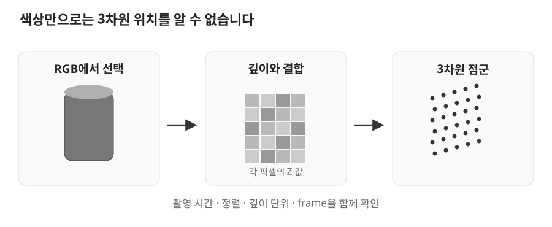
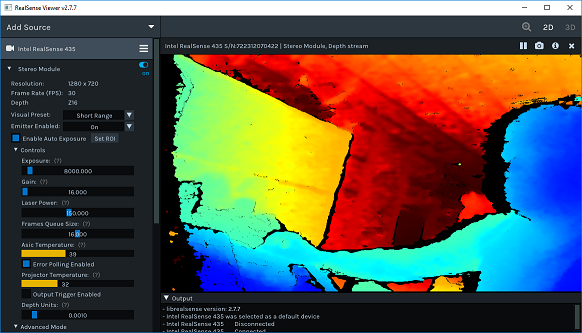
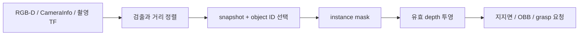
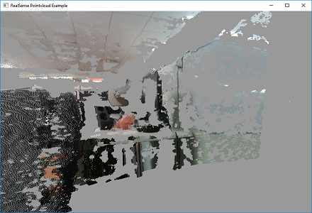

# 07. RGB-D와 점군

> 목표: RGB-D 입력부터 base 좌표계 점군과 파지 요청까지 실제 데이터가 바뀌는 과정을 추적합니다.

## 07.1 RGB-D 입력

사진에서 물체를 찾았다고 팔이 갈 위치를 바로 알 수는 없습니다. 사진의 위치는 `(가로 픽셀, 세로 픽셀)`이고 팔에는 3차원 위치가 필요합니다. **RGB-D**는 색상 영상(RGB)과 깊이(depth)를 함께 제공하는 입력입니다.



*분할과 투영의 학습용 예시 · 실제 검출 결과가 아닙니다.*

**탐지**(detection)는 물체의 위치나 종류를 찾고, **분할**(segmentation)은 그 물체에 속하는 픽셀을 고릅니다. 선택한 픽셀을 표시하는 **mask**에 깊이를 결합하면 물체 표면의 3차원 점들을 얻습니다. 이 점들의 집합이 **점군**(point cloud)입니다.

색상과 깊이 영상의 같은 픽셀이 같은 공간을 보아야 합니다. 깊이의 단위도 확인해야 합니다. 이 장의 순수 함수는 입력 이름부터 `depth_m`으로 미터 단위를 요구합니다.



*외부 깊이 화면 · [RealSense SDK](https://github.com/realsenseai/librealsense/blob/c84fe6438bd14a4cc69f46deae92c993268232c6/doc/img/windows_viewer_preview.PNG), Apache-2.0. 화면의 색은 물체의 실제 색이 아니라 깊이를 보기 쉽게 표현한 값입니다.*

깊이 영상은 이렇게 색을 입혀 볼 수도 있습니다. 팔의 목표를 계산할 때는 화면의 빨강·파랑을 사용하는 것이 아니라 원래의 깊이 수치와 단위를 읽습니다.

## 07.2 Cleany의 인식 경로

현재 `cleany_perception`은 첫 관측에서 번호와 거리를 만들고, 선택된 물체를 같은 snapshot에서 3D로 복원합니다.



| 읽을 파일 | 질문 |
|---|---|
| [pipeline.py](../../../ros2_ws/src/cleany_perception/cleany_perception/core/pipeline.py) | detect와 inspect_selected가 어떤 입력을 공유하나? |
| [geometry.py](../../../ros2_ws/src/cleany_perception/cleany_perception/core/geometry.py) | 픽셀을 점군과 OBB로 어떻게 바꾸나? |
| [nearest_pregrasp_coordinator.py](../../../ros2_ws/src/cleany_skill_executor/cleany_skill_executor/nearest_pregrasp_coordinator.py) | 복원 결과를 PlanGrasp에 어떻게 전달하나? |

모델과 실행 설정은 [인식 reference](../../../ros2_ws/src/cleany_perception/docs/runtime.md)에 있습니다. 시뮬레이터 정답 pose를 인식 입력으로 전달하지 않습니다.

## 07.3 분할과 유효 깊이

`deproject_masked_depth()`는 mask에 해당하면서 깊이가 유효한 픽셀만 투영합니다. 실제 구현의 연속된 발췌입니다.

```python
selected = np.asarray(mask, dtype=np.bool_).copy()
selected &= np.isfinite(depth_m)
selected &= depth_m >= minimum_depth_m
selected &= depth_m <= maximum_depth_m
```

Mask와 depth 해상도가 다르거나 stride가 양수가 아니면 거부합니다. 선택한 점이 없으면 빈 `(0, 3)` 배열을 반환합니다. 0/NaN/Inf를 임의 표면으로 채우지 않습니다. 물체가 색상 영상에 보여도 깊이가 없으면 유효한 3D 위치를 얻지 못할 수 있습니다.

Target 점군은 잡을 물체, context 점군은 주변 충돌 판단에 필요한 관측입니다. 선택 물체 복원과 전체 depth 장애물 지도는 서로 다른 경로입니다.

## 07.4 카메라 투영과 좌표 변환

카메라 내부 파라미터는 픽셀을 optical 좌표계 점으로 바꿉니다. `geometry.py`의 식은 다음과 같습니다.

| 값 | 계산 |
|---|---|
| optical Z | depth 영상의 m 값 |
| optical X | `(u − cx) × Z / fx` |
| optical Y | `(v − cy) × Z / fy` |
| target 좌표계의 점 | 촬영 시각 TF의 회전과 평행이동 적용 |

Depth는 optical 전방축 거리입니다. 바닥 높이나 로봇 중심까지의 거리와 같지 않습니다.

작은 계산으로 깊이의 효과를 확인합니다. 저장소 루트에서 실행할 수 있고 센서 연결은 필요 없습니다.

```bash
python3 - <<'PYTHON'
u, v = 370, 240
fx, fy, cx, cy = 500, 500, 320, 240
for z in (1.0, 2.0):
    print(((u-cx)*z/fx, (v-cy)*z/fy, z))
PYTHON
```

결과는 `(0.1, 0.0, 1.0)`, `(0.2, 0.0, 2.0)`입니다. 같은 픽셀이라도 깊이가 다르면 3차원 위치가 다릅니다. 이것은 투영 식의 예시이며 실제 측정 결과가 아닙니다.



*외부 점군 화면 · [RealSense SDK](https://github.com/realsenseai/librealsense/blob/c84fe6438bd14a4cc69f46deae92c993268232c6/doc/img/windows_pointcloud_preview.PNG), Apache-2.0. 앞의 깊이 화면과는 다른 장면이며, Cleany의 인식 결과가 아닙니다.*

점군은 물체 내부까지 채운 입체 모델이 아닙니다. 카메라가 관측한 표면의 점들이므로, 가려진 부분이나 깊이를 얻지 못한 부분은 비어 있을 수 있습니다.

## 07.5 Frame·timestamp·snapshot 계약

| 경계 | 보존할 것 |
|---|---|
| Image / CameraInfo | exact stamp, 해상도와 intrinsics |
| optical → target | 촬영 시각 TF; 요청 완료 시각으로 대체하지 않음 |
| 첫 관측 → 선택 복원 | 같은 snapshot ID와 object ID; 만료된 cache 거부 |
| 물체 배열 | header frame/stamp와 snapshot ID |
| OBB | 해당 좌표계의 방향 있는 경계 상자; 크기 단위 m |

[DetectedObject3DArray](../../../ros2_ws/src/cleany_interfaces/msg/DetectedObject3DArray.msg)의 header와 [DetectedObject3D](../../../ros2_ws/src/cleany_interfaces/msg/DetectedObject3D.msg)의 OBB를 함께 읽습니다. 같은 숫자라도 좌표계이나 시각이 다르면 같은 위치가 아닙니다.

## 07.6 점군에서 파지 요청까지 추적

`InspectionPipeline.detect()` → `inspect_selected()` → `_reconstruct()`와 coordinator의 `_plan_grasps()`를 따라갑니다.

1. depth 단위와 유효 범위가 정해지는 곳을 찾습니다.
2. snapshot cache 조회가 촬영 시각을 갱신하지 않는지 확인합니다.
3. PlanGrasp의 target와 context 점군, target OBB가 같은 관측에서 왔는지 설명합니다.

**확인 질문:** 분할은 성공했는데 파지 위치가 옆으로 어긋난다면 어디부터 확인할까요?

<details><summary>생각을 비교해 보기</summary>

먼저 RGB·depth 정렬과 단위, 카메라 내부 파라미터를 확인합니다. 그다음 optical→base 변환과 stamp를 봅니다. 분할 성공은 mask 조건의 성공이고, 그 뒤 투영과 좌표 변환까지 정확하다는 증거는 아닙니다. 파지 후보 생성은 다음 장의 별도 단계입니다.

</details>

조작 실행 전제와 범위는 [Skill Executor README](../../../ros2_ws/src/cleany_skill_executor/docs/manipulation.md)에서 확인합니다.
