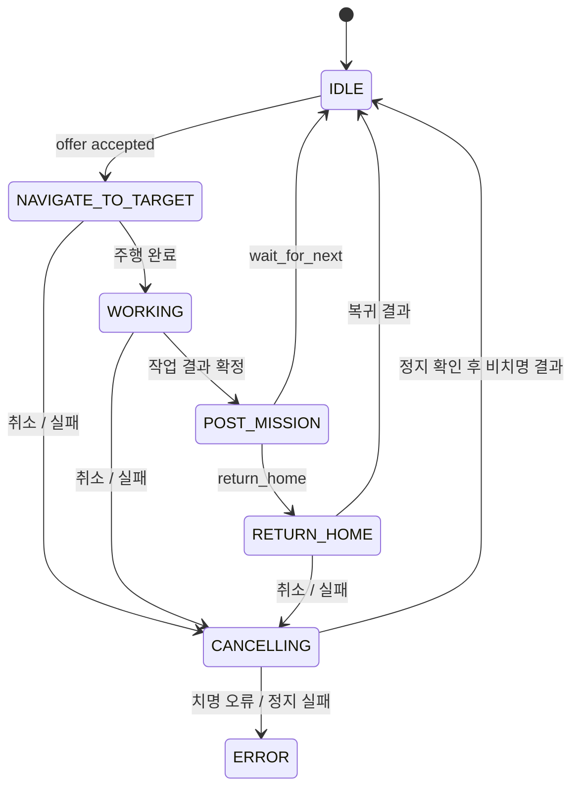
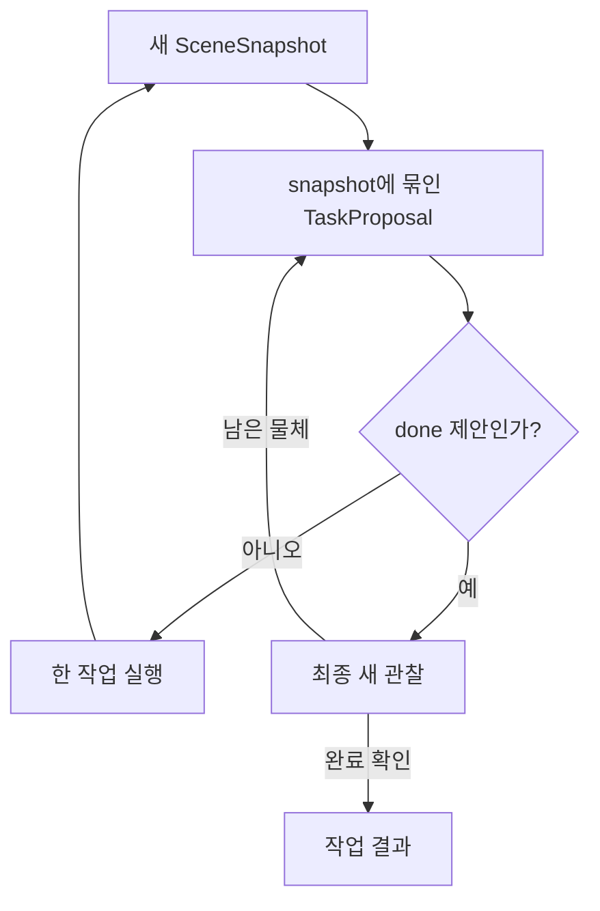

# 10. Mission FSM과 실패 처리

> 목표: 요청 수락, 작업 반복, 취소와 최종 결과를 서로 다른 경계로 읽습니다.

## 10.1 상태 전이와 책임

[MissionRuntime](../../../ros2_ws/src/cleany_mission_manager/cleany_mission_manager/core/runtime.py)은 한 스레드에서 미션 수락과 진행, 정지 확인을 소유합니다. `tick()`은 ROS Action이나 네트워크 응답을 기다리며 블로킹하지 않습니다.

도식은 주요 경로 요약입니다. 취소 뒤 복귀 가능성은 정책과 취소 시점에 따라 달라지므로 [실행 계약](../../../ros2_ws/src/cleany_interfaces/docs/mission.md)을 따릅니다. System Supervisor는 시스템 fault와 허가를 소유하고 Runtime은 자신이 시작한 작업의 정지를 확인합니다.

## 10.2 ModuleResult와 오류 분류

[ModuleResult](../../../ros2_ws/src/cleany_mission_manager/cleany_mission_manager/core/result.py)는 `ok`, `status`, `failure_code`, `retryable`, `message`, `data`를 담습니다.

| status | 읽을 질문 |
|---|---|
| OK | 어느 단계의 성공이며 data는 무엇인가? |
| BLOCKED | 어떤 전제가 충족되지 않았나? |
| FAILED | 실패 원인은 무엇이며 재시도 가능한가? |
| FATAL | 안전하게 정지했는가, 오류 해제가 필요한가? |
| CANCELLED | 취소 요청 뒤 정지가 확인됐는가? |

`retryable=true`만으로 무한 반복하지 않습니다. 정책 예산, 새 관찰과 정지 조건을 함께 검사합니다. 상태 이름을 하드웨어 성공으로 해석하지 않습니다.

## 10.3 작업 반복과 관측 연결

WORKING 안의 [CleaningTree](../../../ros2_ws/src/cleany_mission_manager/cleany_mission_manager/core/cleaning.py)는 관찰 → 제안 → 실행 → 재관찰을 수행합니다.

[RuntimePolicy](../../../ros2_ws/src/cleany_mission_manager/cleany_mission_manager/core/runtime_models.py)는 timeout, 최대 action 수와 retry 수를 관리합니다. 정책 값과 정상 fixture 소요 시간을 구분하세요. 오래된 snapshot의 제안, 반복된 관측 ID와 무효 관측은 실행을 허가하지 않습니다.

## 10.4 취소와 재시작

| 상황 | 코드에서 확인할 경계 |
|---|---|
| 같은 요청 ID / 같은 내용 | journal의 기존 결과 재사용; 작업을 중복 시작하지 않음 |
| 같은 ID / 다른 대상 | `MISSION_ID_CONFLICT` |
| 실행 중 새 미션 | `BUSY` |
| 취소 | cancel 요청 뒤 `stopped()` 확인; 요청 접수와 정지 완료 구분 |
| 조작 종료 후 주행 | `safe_to_drive()`도 확인 |
| 미완료 journal을 두고 재시작 | INTERRUPTED 결과와 검토 필요; 자동 재개 아님 |

실습은 메모리 journal을 쓰지만 ROS Runtime의 영속 DB는 재시작 계약의 일부입니다. 복구 시험에서 DB를 지우면 중복/중단 복구를 검증할 수 없습니다.

## 10.5 부분 완료와 보고서

`RuntimeReport`는 전체 `outcome` 외에 완료 목록, 실패 작업, 최초/최종 관측, 주행/복귀 결과와 실행 profile을 보존합니다.

| 사례 | 보고서 해석 |
|---|---|
| 두 작업 완료 뒤 복귀 실패 | completed_tasks는 보존하되 전체 SUCCESS로 보고하지 않음 |
| review 물체만 남음 | HUMAN_REVIEW_REQUIRED |
| skip 대상이 남음 | PARTIAL_SUCCESS |
| 최종 관찰에서 새 물체 발견 | done 제안을 그대로 완료 처리하지 않고 추가 처리 |

현재 동작은 [test_runtime.py](../../../ros2_ws/src/cleany_mission_manager/tests/test_runtime.py)에서 입력과 assertion을 대조할 수 있습니다. Mock 테스트는 카메라나 모터 결과를 대신하지 않습니다.

## 10.6 결과부터 테스트까지 추적

| 질문 | 읽을 테스트 |
|---|---|
| 반복 tick이 같은 작업을 중복 시작하나? | `test_repeated_ticks_do_not_start_a_running_operation_twice` |
| 실패 뒤 재관찰하나? | `test_failed_actions_reobserve_before_retry_or_termination` |
| done 제안을 새 관찰이 뒤집을 수 있나? | `test_final_observation_can_disprove_a_done_proposal` |
| 복귀 실패에도 완료 작업이 남나? | `test_return_failure_preserves_cleaning_success_without_reporting_overall_success` |

Humble 의존성을 준비한 저장소 루트에서 `make test-mission-core`로 검사합니다. 직접 동작을 관찰하려면 [2장 실습](02-first-mission.md)을 사용합니다.

**확인 질문:** OfferMission 수락과 두 객체 완료만 확인했다면 전체 미션 성공이라고 할 수 있을까요?

생각을 비교해 보기

최종 관찰, 종료 정책과 복귀 결과까지 확인해야 합니다. `completed_tasks`와 전체 `outcome`이 분리된 이유입니다.

