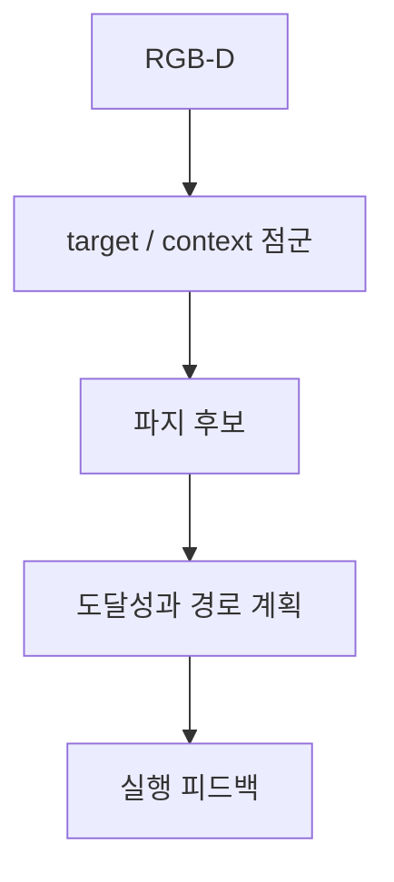
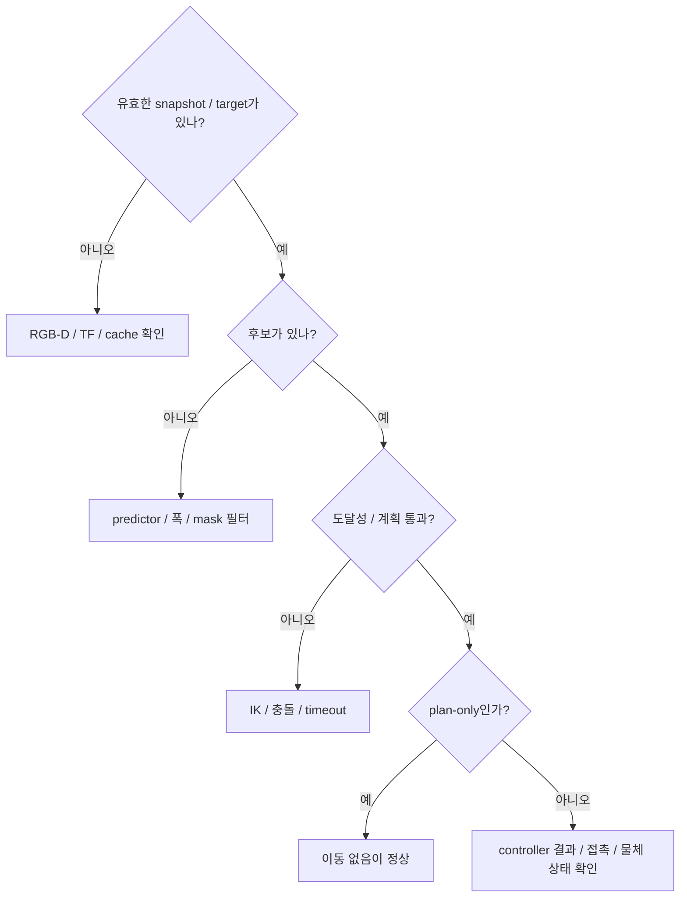

# 11. 테스트와 디버깅

> 목표: 낯선 영역에서도 입력·출력·실패를 따라가며 읽을 코드를 찾고, 테스트로 구현의 약속을 확인합니다.

## 11.1 데이터 경계와 증상 분리

“캔 점군은 있는데 팔이 움직이지 않는다”는 문제를 생각해 봅시다. 어느 파일이 원인인지 바로 알기는 어렵습니다. 대신 가장 최근에 **확인한 결과**와 그다음 **기대하는 결과**를 적어보세요.



점군 생성, 후보 생성, 계획, 실행은 다른 단계입니다. 후보가 비었는지, 모든 후보가 도달 불가인지, 계획만 수행하도록 실행했는지 나누면 읽을 파일이 좁아집니다. 성공 메시지도 어느 단계의 성공인지 확인합니다.

| 질문 | 읽을 곳 |
| --- | --- |
| 입력 필드는 무엇인가? | [PlanGrasp.srv](../../../ros2_ws/src/cleany_interfaces/srv/PlanGrasp.srv) |
| 후보가 어디서 생성되는가? | [GraspNode._plan()](../../../ros2_ws/src/cleany_grasping/cleany_grasping/grasp_node.py) |
| 어떤 후보가 탈락하는가? | [rank_grasps()](../../../ros2_ws/src/cleany_grasping/cleany_grasping/core/selector.py) |
| 실제 실행까지 담당하는가? | [Skill Executor README](../../../ros2_ws/src/cleany_skill_executor/docs/manipulation.md) |

## 11.2 RGB-D부터 후보 선택까지 추적

[nearest_pregrasp_coordinator.py](../../../ros2_ws/src/cleany_skill_executor/cleany_skill_executor/nearest_pregrasp_coordinator.py)의 `_detect_objects()`, `_inspect_selected()`, `_plan_grasps()`를 순서대로 읽습니다. RGB-D 복원은 Perception이, 후보 생성은 Grasp 서버가 담당합니다.

요청에는 `snapshot_id`, `object_id`, target/context 점군과 target OBB가 들어갑니다. `GraspNode._validate()`는 object ID 일치, 점군의 좌표계·측정 시각 일치, 유한한 OBB와 정규화된 quaternion을 확인합니다. 다음은 `_plan()`의 실제 후보 생성 부분입니다.

```python
candidates = self._predictor.predict(target, context, workspace)
ranked = rank_grasps(candidates, target, config)
grasp = ranked[0] if ranked else None
```

`predictor_type`은 geometric 또는 AnyGrasp를 선택합니다. `rank_grasps()`는 점수순 후보에서 허용 폭, 대상 접촉 범위와 중복 후보를 검사합니다. 통과 후보는 측정 시각의 TF로 `planning_frame`에 변환되어 응답에 담깁니다. `success=True`는 후보 생성 성공이며 팔 동작 성공이 아닙니다.

그 다음 `grasp/select_reachable` action은 [GraspSelector.select()](../../../ros2_ws/src/cleany_skill_executor/cleany_skill_executor/core/grasp_selection.py)를 사용합니다. 팔 순서를 정한 뒤 pre-grasp의 방향 정합, 상태와 접근 계획을 검사하고, grasp의 자세와 상태, 파지 구간 계획을 검사합니다. 실패하면 다음 해나 팔, 후보로 진행합니다. [8장의 흐름](08-grasp.md#084-양팔-선택과-moveit-호출)에서 호출 순서를 확인합니다. 여기서 생성 predictor와 도달 가능성 selector는 서로 다른 책임입니다.

## 11.3 테스트로 필터의 의도 읽기

테스트는 입력 → 호출 → `assert` 순서로 읽습니다. 함수 내부를 모두 이해하기 전에 지켜야 하는 약속을 알 수 있습니다. [test_selector.py](../../../ros2_ws/src/cleany_grasping/test/test_selector.py)의 `test_selects_highest_scoring_target_contact_after_width_filter()`에는 다음 입력이 있습니다.

```python
target = cloud(((-0.02, -0.02, 0.5), (0.02, 0.02, 0.55)))
candidates = (
    grasp((0.0, 0.0, 0.52), 0.8),
    grasp((0.0, 0.0, 0.52), 0.99, width=0.2),
    grasp((0.3, 0.0, 0.52), 0.9),
)
ranked = rank_grasps(candidates, target)

assert len(ranked) == 1
assert ranked[0].score == 0.8
```

0.99 후보의 요구 폭 0.2m는 기본 최대 폭 0.10m를 넘습니다. 0.9 후보는 target 접촉 범위를 벗어납니다. 따라서 0.8이 선택됩니다. 이 테스트가 말하는 것은 “점수가 가장 높은 후보”보다 **필터를 통과한 후보 중 최고 점수**가 중요하다는 것입니다.

이 테스트는 지정한 후보를 `rank_grasps()`에 직접 전달해 필터와 순위 로직을 검증하며, 카메라 인식 정확도나 AnyGrasp 실제 추론 품질을 측정하지 않습니다. 같은 파일의 빈 후보와 중복 억제 테스트를 이어 읽으면 반환 `None`과 NMS 동작도 확인할 수 있습니다.

## 11.4 Plan-only와 로그 판독

운영 selector의 [moveit_adapter.py](../../../ros2_ws/src/cleany_skill_executor/cleany_skill_executor/moveit_adapter.py)는 다음 설정을 사용합니다.

```python
action_goal = MoveGroup.Goal()
action_goal.planning_options.plan_only = True
action_goal.planning_options.look_around = False
action_goal.planning_options.replan = False
```

`grasp/select_reachable` 성공 후 팔이 움직이지 않는 것은 이 계약에서 정상입니다. 실행은 별도 coordinator나 BT가 담당합니다.



[grasp_selection.yaml](../../../ros2_ws/src/cleany_skill_executor/config/grasp_selection.yaml)에서 좌표계, 관절 상태의 최신성 한계, 후보 수와 접근 거리를 실행 설정과 대조합니다. `First ranked` 로그는 최종 선택 결과나 물리 파지 성공이 아닙니다.

## 11.5 Mission 실패와 검증 범위

[test_runtime.py](../../../ros2_ws/src/cleany_mission_manager/tests/test_runtime.py)의 `test_return_failure_preserves_cleaning_success_without_reporting_overall_success`는 두 작업 완료 후 복귀만 실패하는 입력을 사용합니다.

```python
assert runtime.last_report.outcome == "FAILED"
assert runtime.last_report.completed_tasks == ["trash-1", "trash-2"]
assert runtime.last_report.return_result == "FAILED"
```

전체 실패와 이미 완료한 작업 기록이 공존합니다. `test_failed_actions_reobserve_before_retry_or_termination`은 집기 실패 뒤 새 관찰을 검사합니다. Humble 의존성이 있는 환경에서 `make test-mission-core`로 확인하며, Mock 성공은 물리 시험과 구분합니다.

## 11.6 팀 코드 리뷰 실습

세 명이 역할을 바꾸어 20분 정도 읽어보는 것을 제안합니다. 한 명은 입력과 결과를 예상하고, 한 명은 호출 흐름을 추적하고, 담당자는 마지막에 구현 사실을 확인합니다.

이번 연습에서는 `test_selector.py`의 `width=0.2`를 `width=0.05`로 바꾼다고 가정하세요. **아직 코드를 수정하지 말고**, 선택 score와 영향을 받는 assertion을 적어봅니다. 0.99 후보가 폭·접촉 필터를 통과하면 0.8 후보는 가까운 중복으로 제거되므로 기대 score도 바뀝니다. 반대로 최대 폭을 0.20으로 늘리는 제품 설정 변경은 실제 gripper 폭과 충돌 영향까지 검토해야 합니다.

다음으로 담당자가 아닌 사람이 시작 파일 하나, 핵심 함수 하나, 실패 조건 하나를 설명합니다. 설명이 막힌 곳을 가이드 수정 대상으로 삼으세요. Agent에는 “수정 대신 읽을 함수와 힌트 하나”를 요청한 뒤 직접 예상과 구현을 비교해도 좋습니다.

**확인 질문:** 후보 생성 성공과 plan-only 성공만 기록된 로그로 실제 캔 파지 성공을 주장할 수 있을까요?

<details><summary>생각을 비교해 보기</summary>

후보와 계획까지만 확인했습니다. controller 실행, gripper 동작과 물체 상태 변화는 별도 증거가 필요합니다. 선택한 실행 경로의 완료 조건까지 확인해야 합니다.

</details>
