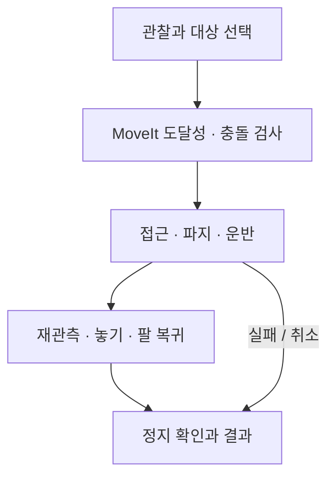

# 물체 관찰과 조작 실행하기

Plan-only 후보 선택, Mock Action과 MuJoCo 조작은 실행 범위가 다릅니다. 필요한 경로를 먼저 선택하세요.



[공통 환경 준비](../RUNNING.md#공통-준비) · [검증 선택](../TESTING.md)

## MuJoCo와 조작 데모

```bash
make sim
# viewer가 필요하면 build와 overlay source 후:
ros2 launch cleany_mujoco_sim mujoco_sim.launch.py headless:=false
ros2 launch cleany_mujoco_sim rgbd_pick_demo.launch.py
```

위 두 실행과 `handeye_backend.launch.py` 중 backend 하나만 실행합니다. RGB-D scene 출력은 grasp/skill 입력으로 사용하며, 수거 완료는 별도로 확인해야 합니다.

### 단일 물체 Manipulation Action

Mock 서버의 요청, 취소, 조회와 모니터 사용은
[Mock 실행 안내](../../ros2_ws/src/cleany_skill_executor/docs/manipulation_mock_usage.md)를 따릅니다.
실제 인식과 MoveIt을 사용하는 MuJoCo BT 스택은 다음 명령으로 실행합니다.

```bash
make sim-mujoco-manipulation
```

이 스택은 승인된 물체 하나를 실행하며, 기존 sorting coordinator와 별도 구성입니다.
입력, 세부 옵션과 검증 범위는 [MuJoCo BT 서버](../../ros2_ws/src/cleany_manipulation_bt/README.md)를 따릅니다.

### Plan-only 후보 선택

MoveIt을 준비한 뒤 같은 overlay의 별도 터미널에서 후보 선택을 실행합니다.

```bash
ros2 launch cleany_moveit_config mock_planning.launch.py
# 같은 overlay의 별도 터미널
ros2 launch cleany_skill_executor grasp_selection.launch.py
```

### MuJoCo 접근 데모

아래 데모는 MuJoCo controller까지 연결합니다. 두 launch는 각각 별도로 실행합니다.

```bash
ros2 launch cleany_skill_executor grasp_execution_demo.launch.py
ros2 launch cleany_skill_executor can_grasp_execution_demo.launch.py
```

| 데모 | 확인 범위 | 실행 조건 |
|---|---|---|
| 기본 grasp | 후보 선택, 두 trajectory 실행, 최종 joint 수렴 | MuJoCo controller 연결 |
| can grasp | RGB-D 검출, 후보 생성, 충돌 검사, 그리퍼 개방, 방향 보정 pre-grasp 접근 | Viewer/OpenGL 필요; `headless:=true` 미지원 |

두 데모 모두 gripper close, attach, lift와 실제 수거는 검증하지 않습니다. Plan-only action과 데모의 차이는 [Manipulation 계약](../../ros2_ws/src/cleany_interfaces/docs/manipulation.md)을 따릅니다.
