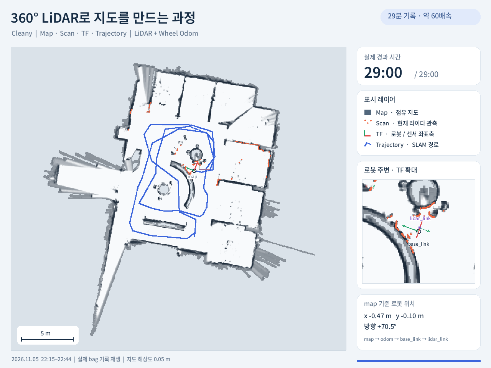
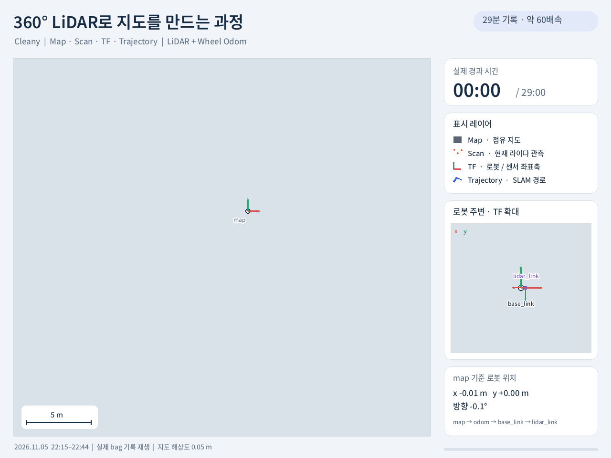
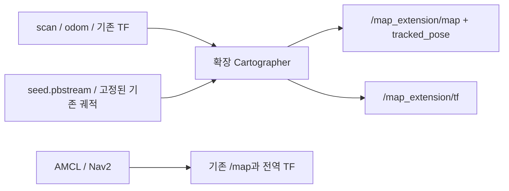

# 지도 만들기와 저장 지도 주행

LiDAR, 휠 피드백과 TF를 확인한 뒤 매핑 세션을 시작합니다. 저장된 지도와 원점을 확인하고 주행 구성에 연결합니다.

| 작업 | 입력 | 실행 / 결과 |
|---|---|---|
| 새 지도 만들기 | 현재 scan, wheel odom, TF | [실물 매핑](#실물-휠-odometry와-2d-lidar-매핑) → PGM/YAML + pbstream |
| 재처리할 센서 기록 | 연속 raw 센서 입력 | [원본 bag](#오프라인-slam-비교용-원본-bag) → rosbag2 |
| 저장 지도에서 주행 | 지도와 일치하는 현재 위치 | [Navigation](#저장-지도-navigation) |
| 기존 지도 확장 | `.pbstream` + 유효한 AMCL 위치 | [병행 확장](#기존-지도-병행-확장) → 별도 namespace와 출력 |

[공통 환경 준비](../RUNNING.md#공통-준비) · [검증 선택](../TESTING.md)

## 지도·스캔·위치를 함께 보기



실물 bag에 기록된 레이어를 같은 시각으로 표시한 예시입니다. 지도의 회색·흰색·검은색, 스캔 점과 로봇 좌표축을 구분해 봅니다. 궤적은 이동 이력이며 현재 위치는 TF로 표시합니다.

<details><summary>기록 재생 GIF 보기 · 6.7 MB</summary>

<p>기록을 6초 간격으로 표본화한 약 60배속 재생입니다. 새 SLAM 계산이나 완전한 원본 재생이 아니며, 기록 누락은 유지됩니다.</p>
</details>

## 실물 휠 odometry와 2D LiDAR 매핑

1. [개발환경](../DEVELOPMENT_SETUP.md#실물-매핑-의존성)의 외부 Agent와 LiDAR 드라이버를 준비하고 `make build-hardware-mapping`을 실행한다.
2. `make run-hardware-mapping` 또는 다음 직접 launch 중 하나로 시작한다. 기존 base, Nav2, 조종기와 중복 실행하지 않는다. 직접 launch는 빌드 overlay를 먼저 source한다.
3. 직접 실행하는 경우 현재 센서 장착과 일치하는 [프로필](../../ros2_ws/src/cleany_bringup/docs/hardware-mapping.md)을 선택한다.

   ```bash
   ros2 launch cleany_bringup hardware_mapping.launch.py \
     profile:="$(ros2 pkg prefix --share cleany_bringup)/config/mapping_legacy.yaml"
   ```

4. 로그의 조종 주소와 state_root/web-token 키로 접속한다. 주소의 127.0.0.1만 노트북 LAN 주소로 바꾼다.
   연결 후 지도 초기화를 누르고 running 상태를 확인한 뒤 휴대폰으로 조종한다. 초기화 접수는 완료를 뜻하지 않는다.
5. Ctrl+C로 종료하면 입력을 막고 STOP, 지도/pbstream 저장과 Logger flush를 확인한 뒤 장치를 종료한다.
   지도는 기본 `~/.local/state/cleany/hardware/maps/`, 녹화는 `recordings/`에 보존한다.

| 설정 / 동작 | 적용 범위 |
|---|---|
| `state_root`, `host`, `phone_port`, `mock` | launch 인자 |
| mock | 별도 ROS domain, mock MCU와 검사 도구의 합성 LiDAR |
| scan | raw 원본 보존, 0.30 m 마스킹; 새 SLAM은 IMU 미사용 |
| `scan_filter.half_angle_deg` | 90: 전방 180°, 180: 실험용 360°; 런타임 재시작 시 적용 |
| 관측 | Dev Monitor를 같은 domain에서 별도 실행 가능 |

지도 초기화만으로 scan 각도가 바뀌지 않는다.

휴대폰만 독립 실행할 때는 같은 geometry의 base driver가 먼저 실행돼 있어야 한다.

```bash
ros2 launch cleany_teleop teleop.launch.py \
  base_config:="$(ros2 pkg prefix --share cleany_base_driver)/config/base_hardware.yaml"
```

### 종료 결과와 실패 위치

기본 출력 루트는 `~/.local/state/cleany/hardware/`다. `state_root`를 바꿨다면 그 경로를 따른다.

| 확인 대상 | 출력 / 진단 |
|---|---|
| 지도 저장 | `maps/`의 지도와 pbstream; 종료 로그에서 저장 완료 확인 |
| Logger 마감 | `recordings/`; flush와 세션 종료 확인 |
| 조종 거절 | 상태 API의 `last_permission_error`, `event_log`; `teleop-events.jsonl` |
| 매핑 실패 | `status_age_ms`, `error_code`, `error_file`; `maps/errors/` |
| 오류 JSON 저장 실패 | `mapping.log`의 traceback |

Ctrl+C가 전달됐다는 사실만으로 STOP 확인이나 지도 저장을 완료로 간주하지 않는다.

## 오프라인 SLAM 비교용 원본 bag

Logger의 가공 기록과 별도로 연속적인 센서 입력을 확보하려면 Jetson에서 빌드한
ROS overlay를 source한 뒤 다음 도구를 실행한다. Python 관측기의 큐를 거치지 않고
네이티브 rosbag2가 `/scan_raw`, `/odom`, `/tf`, `/tf_static`, `/base/wheel_state`,
`/joint_states`를 저장한다. 조종 명령과 기존 지도 출력은 입력에 포함하지 않는다.
SQLite에는 `resilient` preset을 적용하며 기본 native cache는 64 MiB다.

```bash
python3 tools/validation/record_mapping_bag.py \
  --output "$HOME/.local/state/cleany/mapping-bags/trial-$(date +%Y%m%dT%H%M%S)" \
  --duration-s 180
```

180초가 지나거나 Ctrl+C를 누르면 해당 recorder만 SIGINT로 종료해 cache와 metadata를
마감한다. 기존 bag 경로는 덮어쓰지 않는다. 같은 비교 주행 중에는 지도 초기화로
odom 원점을 바꾸지 않는다. 사용한 하드웨어 프로필과 Cartographer 설정도 함께 보존한다.
원본 bag에서도 시각 공백과 메시지 수를 확인한 뒤 재처리에 사용한다.

## 저장 지도 Navigation

```bash
make build-navigation
source "$(make -s print-navigation-install-base)/setup.bash"
ros2 launch cleany_navigation navigation.launch.py --show-args
```

[Launch](../../ros2_ws/src/cleany_navigation/launch/navigation.launch.py)에서 지도, backend, sensor 옵션을 확인합니다. `map → odom`의 소유자는 하나만 선택하므로 Mapping과 AMCL을 함께 실행하지 않습니다.

주행 명령은 Mission의 Navigator/Nav2가 생성합니다. Runtime은 `/cmd_vel`을 직접 만들지 않으며, 안전 경로와 sensor 만료 규칙은 [Navigation reference](../../ros2_ws/src/cleany_navigation/docs/safety.md)를 따릅니다.

## 기존 지도 병행 확장

`.pbstream`의 기존 궤적을 고정하고 새 궤적을 추가한다. 시작 시 현재 `map → base_link`와 저장 원점을 쓰므로 AMCL 위치가 먼저 맞아 있어야 한다.



확장은 전역 TF와 속도 명령을 발행하지 않아 AMCL/Nav2와 병행할 수 있다. 확장 영역은 수동조종하며 자동주행 지도 교체는 별도 작업이다. 지도 이미지로 확장을 시작할 수는 없다.

ROS 환경과 현재 workspace overlay를 적용한 터미널에서 실행한다.
`--origin-reader`에는 `tools/validation/map_extension/read_origin.cpp`를
해당 Cartographer 개발 라이브러리로 빌드한 실행 파일을 지정해야 한다.
출력 폴더는 아직 존재하지 않는 경로를 사용한다.

```bash
python3 tools/validation/map_extension/extend.py \
  --source /path/to/seed.pbstream \
  --output /path/to/local-data/runs/mapping/YYYY-MM-DD_HHMMSS_map-extension \
  --origin-reader /path/to/read_origin
```

출력 폴더에는 입력 사본 `seed.pbstream`, 원점과 시작 자세 `session.json`,
60초 주기의 `latest.pbstream`, `map.yaml`, `map.pgm`을 저장한다.
종료할 때는 실행 터미널에서 `Ctrl-C`를 누른다. 궤적 종료와
`final.pbstream` 저장은 종료 로그와 출력 파일로 확인한다.
RViz에서는 `/map_extension/map`과 `/map_extension/tracked_pose`를 선택한다.
원본 지도와 기존 로거는 변경하지 않는다.

확장 RViz는 `/tf`를 `/map_extension/view_tf`로 remap해 실행한다.
`tools/validation/map_extension/view_tf.py`를 함께 실행하면 LiDAR와 odometry를
확장 SLAM의 자세 기준으로 표시한다. 궤적과 지도는 `/map_extension` 토픽을
선택한다. 제약선, raw scan, scan-matched point cloud는 표시 항목에서 켤 수 있다.

### 확장 중단 조건

아래 조건이면 odom 전달을 차단하고 현재 세션을 종료 저장한다. 장치 재시작이나 odom 원점 초기화 후 기존 궤적을 이어 쓰지 않는다.

| 원본 `/odom` 조건 | 기본 중단값 |
|---|---:|
| 수신 공백 | 2초 이상 |
| 샘플 간 이동 | 0.25 m 초과 |
| 샘플 간 회전 | 0.35 rad 초과 |
| 촬영 시각 | 역행 |

`extend.py --odom-max-*`로 지정한다. 문제 해결 후 원본 또는 마지막 정상 저장 상태로 새 확장을 시작한다.
