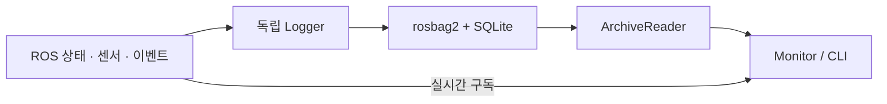
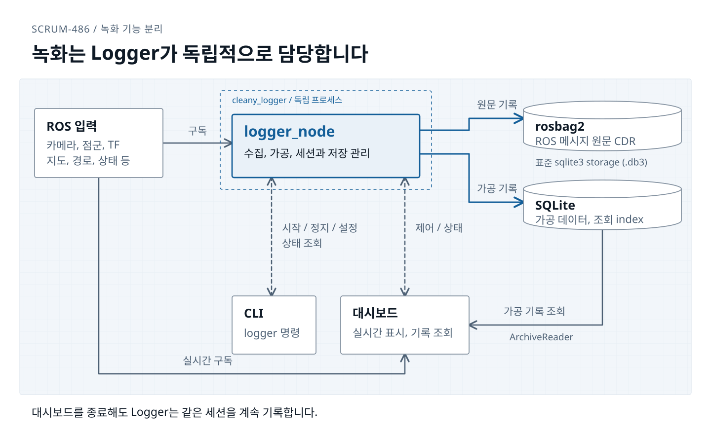

# 상태를 보고 기록하기

Monitor는 상태를 표시하고, 독립 Logger는 기록을 소유합니다. 화면을 닫는 것과 기록 종료를 구분합니다.



[공통 환경 준비](../RUNNING.md#공통-준비) · [검증 선택](../TESTING.md)

## 화면과 기록의 소유권



화면에서 보이는 카메라 preview와 원본 녹화 정책은 별개입니다. 기록 시작·종료는 Logger 상태로 확인하고, 과거 자료는 읽기 전용 조회 경로를 사용합니다.

## 개발 Monitor

```bash
make build-dev-monitor
make run-dev-monitor
```

브라우저에서 `http://127.0.0.1:8768`을 엽니다. Monitor는 관측 전용이며, 관측 대상과 같은 DDS domain과 메시지 overlay가 필요합니다. Frontend 준비는 [개발환경](../DEVELOPMENT_SETUP.md)을 따릅니다.

실시간 입력과 logger 연결은 [monitor.yaml](../../ros2_ws/src/cleany_dev_monitor/config/monitor.yaml)에서
설정합니다. `make build-dev-monitor`는 logger도 빌드하지만 Monitor 실행은 logger를
자동 시작하지 않습니다. 기록은 아래 절차로 별도 실행합니다. 웹 자산 갱신 후에는
`make build-dev-monitor-ros`로 설치 자산도 갱신합니다.

### 독립 Logger

1. 웹 없이 logger만 빌드하려면 `make build-logger`를 실행합니다.
2. 빌드 overlay를 source한 별도 터미널에서 logger를 시작합니다.
   CLI에서 토픽을 먼저 설정하려면 녹화 대기 상태로 실행합니다.

   ```bash
   ros2 launch cleany_logger logger.launch.py record_on_start:=false
   ```

   기본값인 `record_on_start:=true`는 즉시 녹화하며, 시뮬레이션에서는
   `use_sim_time:=true`를 지정합니다. `make run-logger LOGGER_LAUNCH_ARGS='record_on_start:=true'`도
   사용할 수 있습니다.
3. 같은 DDS domain과 빌드 overlay를 사용하는 다른 터미널에서 CLI로 설정하고
   녹화합니다. 설정을 먼저 바꾸려면 logger를 `record_on_start:=false`로 실행합니다.
   이미 녹화 중이면 `stop` 후 설정합니다.

   ```bash
   ros2 run cleany_logger logger status
   ros2 run cleany_logger logger topics
   ros2 run cleany_logger logger topics set camera --topic /camera/head/color/image_raw --hz 2 --enable
   ros2 run cleany_logger logger topics set path_topic --topic /plan --hz 1 --enable
   ros2 run cleany_logger logger start
   ros2 run cleany_logger logger stop
   ```

   `topics set <ID> --disable`은 해당 항목을 끕니다. ID는 `topics` 출력에서 확인합니다.
   속도 체인은 `topics set velocity_topics --topic /first --topic /second`로 전체를
   지정하거나 `velocity_topics:0`처럼 특정 항목만 변경합니다. 출처별 `--hz all`은
   수신마다 기록하며 카메라 등 센서 원본은 숫자 Hz가 필요합니다. 카메라와 점군
   원본은 대용량이므로 필요한 토픽과 주기를 선택합니다.

   루트에서 `make logger LOGGER_ARGS='status'`로도 호출할 수 있습니다.
   다른 노드는 `--node /robot/logger`, 대기 시간은 `--timeout 3`, 자동화 출력은
   `--json`으로 지정합니다. 이 옵션은 하위 명령 앞이나 뒤에 쓸 수 있습니다.
   CLI는 한 번 요청하고 종료하며 logger 프로세스와 녹화는 계속됩니다.
4. 대시보드를 사용하려면 별도 터미널에서 `make run-dev-monitor`를 실행합니다.
   기본 저장 위치는 두 프로세스 모두 `~/.local/state/cleany/recordings`입니다.
   다른 경로는 logger YAML의 `state_directory`와 Monitor의
   `MONITOR_ROS_ARGS='-p state_directory:=/absolute/path'`에 동일하게 지정합니다.
   이전 기록은 기존 디렉터리를 명시해 조회합니다. 대시보드나 브라우저를 종료해도
   logger는 같은 세션을 녹화합니다.

`mission_sim.launch.py`는 `enable_logger:=true record_on_start:=true`로 logger를
함께 실행할 수 있습니다. 기본은 비활성이며 `logger_config:=/absolute/logger.yaml`로
설정을 지정합니다. 이 launch 구성은 시뮬레이션 시계를 logger에 전달합니다.

기록 구조는 [Logger 데이터 계약](../../ros2_ws/src/cleany_logger/docs/data.md),
HTTP와 stale 처리는 [Monitor 계약](../../ros2_ws/src/cleany_dev_monitor/docs/data.md)을 따릅니다.

상세 SLAM, LiDAR, 점군과 costmap은 같은 domain의 RViz에서 확인합니다. 완료된 원본 bag ZIP을 내려받아 압축을 푼 뒤 다음과 같이 재생합니다. Bag에 기록된 토픽, TF와 CameraInfo만 사용할 수 있으며 SQLite 가공 기록은 RViz 입력이 아닙니다.

```bash
ros2 bag info "<bag-directory>"
ros2 bag play "<bag-directory>" --clock
rviz2 --ros-args -p use_sim_time:=true
```

Fixed Frame은 `map_frame`에 맞추고 Cartographer Submaps display에는 해당 plugin을 설치합니다.

진단 토픽은 `<bag-directory>/diagnostics`의 별도 bag에 있습니다. 센서와 함께
보려면 동일한 시작 시각 기준으로 두 bag을 재생합니다. 센서 bag은 `/clock`을
발행하고 진단 bag은 `--clock` 없이 재생합니다. 정밀 비교에는 각 bag의 첫 메시지
시각 차이도 맞춰야 합니다.

LiDAR 매핑의 보정 분석용 기록에서는 `/scan_raw`,
`/odom`, `/base/wheel_state`, TF를 full-rate로 남기고, 중복 `/scan`, `/wheel/odom`,
`/joint_states`는 기록에서 제외할 수 있습니다. 재생성에는 당시 필터와 휠 변환
설정도 보존해야 합니다. 궤적은 1 Hz, 제약선은 0.5 Hz로 기록하고 submap 목록,
matched points, map과 가공 관측의 주기는 기존 설정을 유지합니다.
카메라와 depth 점군은 별도로 선택합니다. 설정은 녹화가 정지된
상태에서 적용하며 실시간 RViz 표시나 센서 발행 주기는 바꾸지 않습니다.
시간당 용량은 지도와 그래프 크기에 따라 달라지므로 실제 입력으로 확인합니다.
이 분석용 주기에 이전의 0.1 Hz 절약 설정에서 측정한 0.97 GB/h를 적용하면 안 됩니다.
`limit_mib`는 시간당 속도가 아닌 세션 총량 제한입니다.

## Jetson 얼굴 디스플레이

전용 앱은 `/home/cleany/cleany-display`에 독립 설치한다. 자동 로그인 후 로컬 Chromium 키오스크를 실행하고 ROS 상태를 구독한다. 설치, 서비스 재시작과 자동 시작 해제는 [디스플레이 운영](../../ros2_ws/src/cleany_display/README.md)을 따른다. 기존 `/home/cleany/cleany` checkout과 그 실행 프로세스를 변경하지 않는다.
