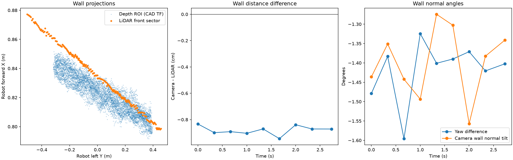
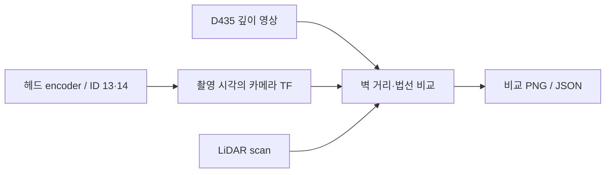
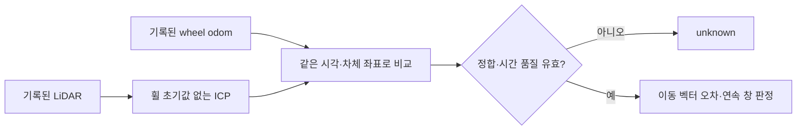

# 캘리브레이션 작업 가이드

측정할 대상을 먼저 고릅니다. **관측·분석 결과를 얻는 것과 실제 보정값을 적용하는 것은 별도 작업**입니다.

| 확인하려는 것 | 작업 | 결과 |
|---|---|---|
| D435와 LiDAR가 같은 벽을 보는가? | [벽 비교](#d435와-lidar-벽-비교-및-헤드-관절-관측) | 거리·법선 잔차 |
| 휠 odom과 실제 관측 이동이 다른가? | [bag 분석](#bag-기반-슬립-의심-구간-분석) | 의심 구간·판정 불가 구간 |
| 저장된 카메라·관절 보정값을 쓰려는가? | [기존 프로필 적용](#jetson-실물-모델과-2026-10-09-보정-프로파일) | 보정된 모델 TF |
| 새 Hand-eye 데이터를 수집하려는가? | [수집과 평가](#hand-eye-수집과-평가) | 검토용 변환과 평가 |
| ToF 장착·정지 조건을 정하려는가? | [Commissioning](#tof-근접-보호-commissioning) | 실측에 근거한 로봇 설정 |

## D435와 LiDAR 벽 비교 및 헤드 관절 관측

로봇을 **동일한 평평한 벽 앞에 정지**시킨 상태에서 비교합니다. Humble, NumPy, matplotlib, pyserial과 실제 영상·CameraInfo·`/scan_raw` 입력이 필요합니다.



왼쪽은 두 센서의 벽 투영, 가운데는 카메라−LiDAR 거리 차이, 오른쪽은 수평 방향 차이와 카메라 벽 법선 기울기입니다. **기록된 출력 예시이며, 그림의 수치를 합격 기준으로 사용하지 않습니다.**



USB by-id·모터 ID와 [헤드 설정](../../tools/validation/config/d435_pan_tilt.json)을 검토한 뒤 실행합니다. 기존 차체→카메라 고정 TF 발행자는 중복 실행하지 않습니다.

```bash
# 터미널 A: 읽기 전용 관절 관측
python3 tools/validation/head_pan_tilt_probe.py \
  --config tools/validation/config/d435_pan_tilt.json
# 터미널 B: 자료 수집 후 비교. 사용할 새 경로로 바꿉니다.
python3 tools/validation/capture_depth_lidar.py --output /path/to/new/capture
python3 tools/validation/compare_depth_lidar_wall.py \
  --capture /path/to/new/capture --mount tools/validation/config/d435_cad_mount.json
```

결과 폴더의 `index.html`, `wall-comparison.png`, `wall-comparison.json`에서 잔차와 분석 조건을 함께 확인합니다.

| 결과·모드 | 의미와 한계 |
|---|---|
| 실제 관절 TF 있음 | 카메라 시각과 150ms 이내인 TF 사용. 없으면 공칭 자세 비교로 표시 |
| 거리·법선 잔차 | 한 벽으로 높이·벽에 평행한 이동을 검증할 수 없음. 벽 기울기와 장착 오차도 분리할 수 없음 |
| 기본 실행 | 읽기 전용. `/head/joint_states`와 동적 TF 발행. 휠 `/joint_states`와 분리하며 피드백 지연·오류 시 종료 |
| `--exercise --output …` | **실제 헤드 모터 시험.** 다른 버스 소유자 종료, 차체 정지와 주변 공간 확인 후 별도 실행 |
| 시험 전 검사 | 토크 OFF, 모델 777, 위치 모드, 오류 없음과 온도 확인 |
| 시험 동작·종료 | 현재 자세 부근 축별 ±5°. EEPROM은 쓰지 않으며 종료 시 토크 OFF 확인. 복귀 실패 시 추가 이동 없이 토크 OFF |
| 남는 RAM 설정 | 가속도 5, 속도 80tick/s, 토크 한도 300과 마지막 목표값. `--poses`로 미확인 자세만 별도 시험 가능 |

이 도구는 costmap이나 보정값을 자동 변경하지 않습니다. 광학 TF는 RealSense 드라이버가 계속 소유합니다.

## bag 기반 슬립 의심 구간 분석



Humble과 기록 당시 custom message overlay를 source합니다. NumPy, SciPy와 PyYAML을 사용하며, 입력 bag에는 `/scan_raw`, `/odom`, `/tf_static`이 필요합니다. `/base/wheel_state`는 선택적인 보조 통계입니다.

```bash
python3 tools/validation/slip_detection.py \
  --bag /path/to/bag_directory \
  --start 2026-11-06T07:22:40+09:00 --end 2026-11-06T07:30:25+09:00 \
  --output /path/to/new_analysis_directory --jobs 2
```

| 확인할 것 | 위치·해석 |
|---|---|
| 사건과 창별 판정 | `summary.json`, `windows.jsonl`을 함께 확인 |
| 입력·설정 식별 | `manifest.json`. 원본은 읽기 전용 snapshot으로 열며 기존 출력은 덮어쓰지 않음 |
| 판정 기준 | [slip_detection.json](../../tools/validation/slip_detection.json). 다른 설정은 `--config`, 형상은 `--mask-file`로 지정 |
| 같은 입력 재분석 | `--bag` 대신 `--cache …/inputs.npz` 사용 |
| `unknown` / `no_evidence` | 각각 품질 부족 / 해당 기준에서 증거 없음. 정상·슬립 없음의 확정 판정이 아님 |
| 적용 한계 | 슬립과 걸림을 구별하는 진단이 아님. 느린 슬립·끌림, scan 중 움직임·가림에 한계. per-beam deskew 없음 |

겹치는 창은 독립 표본이나 정확한 사건 시작 시각으로 해석하지 않습니다. 이 도구는 명령·TF·보정값을 발행하거나 수정하지 않으며, 제어 연동에는 별도 실시간 검증이 필요합니다.

## Jetson 실물 모델과 2026-10-09 보정 프로파일

[jetson_20261009](../../ros2_ws/src/cleany_description/config/calibration/jetson_20261009)는 **잠정 보정 프로필**입니다. 실제 장착이 달라졌다면 재검증해야 합니다. CAD 마운트 변경만으로 보정이 갱신되는 것은 아닙니다.

| 자료 | 적용 범위 |
|---|---|
| `*_extrinsics.yaml` | 헤드 RGB·양손목 optical TF. `parent_T_child`는 child→parent 변환, m·rad 단위 |
| `arm_joint_calibration.yaml` | 팔 영점·방향·오프셋의 기준. `q = direction × (tick − zero) × 2π/4096 + offset` |
| `head_joint_calibration.json` | 헤드 pan/tilt 기준과 방향. 수동 영점이며 회전축 추정값은 아님 |
| `intrinsics/`, `motors/`, `reference/` | 원본·참고 자료. 아래 launch가 CameraInfo를 발행하거나 모터 영점을 적용하지 않음 |

```bash
ros2 launch cleany_description description.launch.py \
  use_sim_time:=false model_profile:=jetson_20261009 \
  calibration_profile:=jetson_20261009
```

`robot_state_publisher`만 실행하므로 `/joint_states`는 별도로 필요합니다. 기본 `calibration_profile`은 빈 문자열이며, 명목 TF를 사용합니다. 보정은 optical 좌표계에 적용하고 카메라 mesh와 헤드 depth 좌표계의 명목값을 옮기지 않습니다. EEPROM homing offset을 관절식에 이중 적용하지 않습니다.

카메라 평가는 고정 보드 가정의 일관성 검사입니다. RMS·수집 조건은 각 보정 YAML을 따르며, `absolute_calibration_verified: false`를 유지합니다. 절대 위치 정확도·노출 동기화·관절 절대각이 검증됐다는 의미는 아닙니다. [모델과 좌표 규약](../../ros2_ws/src/cleany_description/docs/model.md)도 확인하세요.

## Hand-eye 수집과 평가

[수집·오프라인 평가 도구](../../ros2_ws/src/cleany_handeye_calibration/docs/offline-tools.md)와 [좌표·저장 계약](../../ros2_ws/src/cleany_handeye_calibration/docs/frames-and-data.md)을 따릅니다. 결과는 검토용으로 저장하며 TF에 자동 적용하지 않습니다.

## ToF 근접 보호 commissioning

[ToF 기본 설정](../../ros2_ws/src/cleany_tof/config/tof.yaml)은 미실측 후보입니다. 초기 관측은 모터를 분리하거나 바퀴를 띄우고 수행합니다.

| 시험 | 측정·확인 항목 |
|---|---|
| 장착·방향 | 작은 표적을 각 native zone에 이동. flip, roll/pitch/yaw, 위치·유효 FOV |
| 거리·평면 | 알려진 평판의 거리·기울기, sigma·residual, 접근 거리·yaw 오차. 선택 ROI가 책상 전면을 보는지 확인 |
| 표면·사각 | 빈 공간·검정·유리·금속·햇빛·다리·얇은 물체의 유효율, `NO_RETURN`, 불신뢰, ROI 높이. 다른 센서와 함께 놓치는 경우 포함 |
| 시간·단절 | USB 부하·read 지연·재연결·watchdog. first-좌표계 offset 불확실성도 reaction budget에 포함 |
| 실제 제동 | 감독자·독립 E-stop이 있는 통제 공간에서 payload·바닥·배터리별 전후·횡이동·회전의 최악 제동거리와 감속도 하한 |
| 접근·취소 | 저속·비스듬한 평판·가림, Nav2 동시 goal, cancel, Mission/Supervisor/guard 재시작, lease 회수와 완료 후 정지 유지 |
| ROI 필터 | 바닥·몸체 return 구분. 15Hz에서 인접 수·cluster 거리·confirm/release·hysteresis 조정. 비상 단일 return과 일반 검출의 지연·오탐·미탐 분리 |
| 책상 품질 | 분산된 유효 row/column·최소 폭·residual. 일부 불량에서 평면 유지와 평면 소실 시 zero/abort 구분 |

실측으로 `deceleration`, `reaction_s`, footprint와 margin을 정하고 근거·설정을 보존한 뒤에만 `calibrated=true`를 적용합니다. 약 3.5m 미검출은 검출 범위·빈 공간의 보장이 아닙니다. ToF만으로 평면 좌우 중심은 관측할 수 없으므로 staging과 팔 도달성은 별도로 검증합니다. [상태·필터·제동 계약](../../ros2_ws/src/cleany_tof/docs/interfaces.md)을 따릅니다.

## D435 미리보기의 LiDAR 높이 하한

| 좌표 기준 | 값과 의미 |
|---|---|
| 카메라 CAD 공칭 높이 | CAD 원점에서 1.0218m. 바닥 z=−0.0955m를 적용한 추정 지상 높이는 약 1.1173m |
| 기존 LiDAR 평면 규약 | Z=0. 실제 장착 높이 측정값과 구분 |
| D435 필터의 `min_base_z` | `base_link` 기준 0.192m = 하우징 바닥 0.150 + 레이저 오프셋 0.042m. 추정 지상 높이는 0.2875m |

D435 점군은 촬영 시각의 실제 head encoder TF로 변환합니다. 높이 하한은 로봇 좌표에 고정되어 tilt·바닥 평면 추정에 따라 바뀌지 않습니다. **하한보다 낮은 물체도 제외**되므로 낮은 장애물 검출을 보장하지 않습니다. 측정 바닥면은 표시 grid와 상한 기준으로만 사용하며, 위 값은 CAD 기반 추정입니다.
