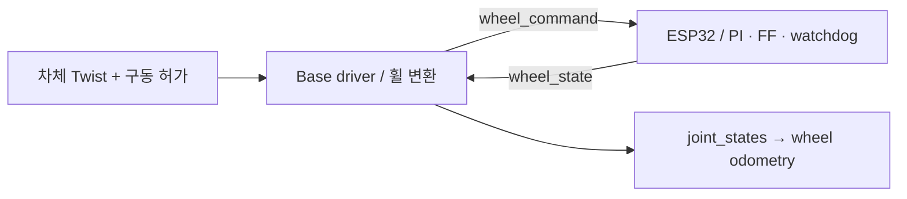

# 베이스 구동과 피드백 확인하기

Mock MCU와 실제 MCU를 구분하고, 명령·휠 피드백·오도메트리와 STOP 응답을 확인합니다.



[공통 환경 준비](../running.md#공통-준비) · [검증 선택](../testing.md)

## Base와 plot

<figure class="visual-slot" data-visual-id="base-plot">
<p><strong>시각자료 자리 · 비워 둠</strong></p>
<figcaption><strong>필요한 자료:</strong> 현재 base_monitor의 명령, encoder, PWM과 진단 상태를 같은 시간축에 담은 화면.<br><strong>빈 이유:</strong> 기존 데이터에서 이 화면과 대응하는 입력 기록을 찾지 못했습니다.</figcaption>
</figure>

### 장치 없는 mock

별도 domain에서 빌드한 mock를 실행합니다.

```bash
make build-base
export ROS_DOMAIN_ID=173
source "$(make -s print-install-base)/setup.bash"
ros2 launch cleany_base_driver base_driver.launch.py mock:=true
```

Mock domain에는 실물 MCU/Agent를 연결하지 않습니다. 고장 주입 service는 mock node와 테스트가 관리합니다.

### 실물 base와 관측 GUI

Agent와 driver 양쪽에 domain 0을 적용하고 검토한 hardware config를 선택합니다.

```bash
export ROS_DOMAIN_ID=0
ros2 launch cleany_base_driver base_driver.launch.py \
  mock:=false config:="$(ros2 pkg prefix --share cleany_base_driver)/config/base_hardware.yaml"
# 같은 overlay/domain의 별도 터미널에서 관측 GUI:
ros2 launch cleany_base_driver base_monitor.launch.py preset:=true
```

초기 hardware config는 바퀴를 띄운 시험용입니다. Launch 이후 구동 허가는 별도 절차로 수행하며, mock domain과 실제 MCU domain을 혼용하지 않습니다. 실물 시험은 [ESP32 가이드](../../../esp32/README.md)와 [base 계약](../../../ros2_ws/src/cleany_base_driver/docs/command-and-odometry.md)을 따릅니다.

Plot은 목표, slew/reversal 이후 목표, encoder 속도(rad/s), PWM(%), diagnostics를 표시합니다. `preset:=false wheel:=fl|fr|rl|rr|all`로 관측 범위를 바꿀 수 있습니다. GUI를 종료해도 별도로 실행한 driver/Agent는 계속 실행됩니다.
