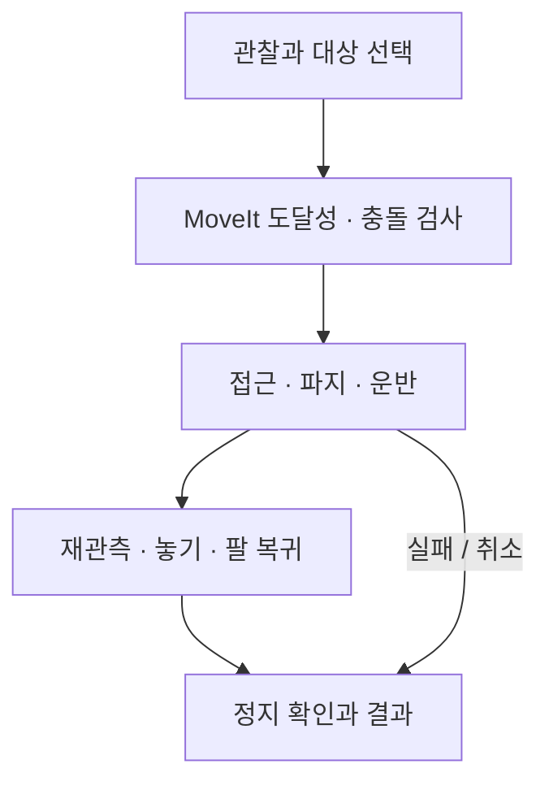

# 물체 관찰과 조작 실행하기

Plan-only 후보 선택, Mock Action과 MuJoCo 조작은 실행 범위가 다릅니다. 필요한 경로를 먼저 선택하세요.



[공통 환경 준비](../running.md#공통-준비) · [검증 선택](../testing.md)

## MuJoCo와 조작 데모

<figure class="visual-slot" data-visual-id="manipulation-run">
<p><strong>시각자료 자리 · 비워 둠</strong></p>
<figcaption><strong>필요한 자료:</strong> 본문 MuJoCo 실행의 관찰 → 접근 → 놓기와 Action 결과를 연결한 화면 또는 GIF.<br><strong>빈 이유:</strong> 기존 실물 파지 사진과 Isaac 저장 자세는 이 실행 경로를 보여주지 않습니다.</figcaption>
</figure>

실물 공통 CAD와 기존 시뮬레이션은 [모델 계약](../../../ros2_ws/src/cleany_description/docs/model.md)에서 구분합니다. 아래 실행 경로에서 사용하는 모델과 구동 설정을 먼저 확인합니다.

| 실행 범위 | 진입점 |
|---|---|
| 장면만 관찰 | `ros2 launch cleany_mujoco_sim mujoco_study_cafe.launch.py` |
| 인식과 plan-only | `ros2 launch cleany_skill_executor study_cafe_nearest_grasp_demo.launch.py` |
| 연속 수거 | `ros2 launch cleany_skill_executor study_cafe_sorting.launch.py` |
| 단일 물체 Action | 아래 Mock / BT 실행 |

직접 launch는 `make build` 후 [공통 overlay](../running.md#공통-준비)를 적용합니다. 한 domain에서 backend는 하나만 실행합니다. [모델 준비와 실제 결과 판독](../../../ros2_ws/src/cleany_skill_executor/docs/study-cafe-sorting-usage.md)을 따릅니다.

### 단일 물체 Manipulation Action

Mock 서버의 요청, 취소, 조회와 모니터 사용은
[Mock 실행 안내](../../../ros2_ws/src/cleany_skill_executor/docs/manipulation-mock-usage.md)를 따릅니다.
실제 인식과 MoveIt을 사용하는 MuJoCo BT 스택은 다음 명령으로 실행합니다.

```bash
make sim-mujoco-manipulation
```

이 스택은 승인된 물체 하나를 실행하며, 기존 sorting coordinator와 별도 구성입니다.
입력, 세부 옵션과 검증 범위는 [MuJoCo BT 서버](../../../ros2_ws/src/cleany_manipulation_bt/README.md)를 따릅니다.

### Plan-only 후보 선택

MoveIt을 준비한 뒤 같은 overlay의 별도 터미널에서 후보 선택을 실행합니다.

```bash
ros2 launch cleany_moveit_config mock_planning.launch.py
# 같은 overlay의 별도 터미널
ros2 launch cleany_skill_executor grasp_selection.launch.py
```

### MuJoCo 접근 데모

가까운 물체 하나의 pre-grasp와 선택적 lift는 `nearest_pregrasp_coordinator` 경로입니다. RGB-D, Perception, Grasp, MoveIt과 controller를 먼저 준비하고 [실행 절차](../../../ros2_ws/src/cleany_skill_executor/docs/manipulation.md#가까운-객체-자동-pre-grasp)를 따릅니다. 기본 pre-grasp 완료와 집기·lift 성공은 서로 다른 결과입니다.

## Jetson 실물 실행 경로

외부 제어 프로파일의 온도 설정은 [Feetech 온도 MACD 설정](../../../ros2_ws/src/cleany_robot_interface/docs/feetech-hardware.md#온도-macd-필터)을 따른다.
기존 `temperature_fault_confirmation_samples`를 제거하고 세 시정수를
명시해야 새 드라이버가 기동한다. 생성된 제어 모델은 표현 가능한 실측
모터 범위와 운영 위치 제한의 교집합을 사용한다.

`cleany_robot_interface`는 로봇 상태 조회와 Feetech 컨트롤러 실행을 제공합니다.
로봇별 시리얼 포트, 엔코더 보정과 운영 한계는 실행 전에 확인한 외부 프로파일로 지정합니다.
패키지의 `test/data` 파일은 합성 검사 입력이며 운영 기본값으로 사용하지 않습니다.
관절 미리보기 `arm_preview.launch.py`는 모델 경로, 상태 설정, RViz, 헤드 포함 여부와
마스트 간격을 받습니다. 기본 모델은 명목 형상이며, 저장된 보정을 적용한 실물
모델은 아래 상태 프로파일 실행 절차를 따릅니다.

1. [개발환경](../development-setup.md#jetson-실물-제어-패키지)에 따라 빌드하고 같은 install을 적용합니다.

   ```bash
   source /opt/ros/humble/setup.bash
   source "$(make -s print-install-base)/setup.bash"
   ```

2. 실물 상태와 제어기는 동일 시리얼 포트를 단독 점유합니다. 다른 상태 조회기를 종료한 뒤 읽기 전용으로 시작합니다.

   ```bash
   ros2 launch cleany_robot_interface real_control.launch.py \
     repository_root:="$PWD" \
     profile_file:=/absolute/path/to/state-profile.json \
     control_file:=/absolute/path/to/control-limits.yaml \
     read_only:=true with_moveit:=false
   ```

3. MoveIt 연결이 필요하면 `with_moveit:=true`를 사용합니다. 읽기 전용에서는 궤적 실행도 차단합니다.
   제어를 허용하는 별도 실행은 확인한 운영 한계와 프로파일을 사용해 `read_only:=false`로 시작합니다.
   외부 실행기가 궤적을 소유하는 경우에는 `allow_trajectory_execution:=false`로 MoveIt 실행 권한을 분리합니다.

상태 가드는 결측되거나 오래된 관절 상태를 차단합니다. 정지 요청은 `/real_control/stop`
서비스를 사용합니다. 토픽, 상태와 카메라 제어는 [패키지 인터페이스](../../../ros2_ws/src/cleany_robot_interface/docs/interfaces.md)를 따릅니다.


## 실물 파지 계획과 준비 자세

1. [환경 설정](../development-setup.md#실물-모션-기반)의 MoveIt overlay를 준비하고 빌드한다.

   ```bash
   make build-motion-foundation
   source tools/scene-mapping-env
   source "$(make -s print-install-base)/setup.bash"
   ```

2. 실물 상태 조회, MoveGroup과 인식을 실행한 환경에서 계획 전용 선택기를 시작한다.
   인식의 `inspect_scene.launch.py`에는 `enable_reference_observation:=true`를 지정한다.

   ```bash
   ros2 launch cleany_skill_executor physical_grasp_selection.launch.py \
     repository_root:="$PWD" motion_backend:=moveit
   ros2 launch cleany_skill_executor validate_pick.launch.py --show-args
   ```

3. 기존 실물 controller에 센서와 계획 서비스를 연결하는 설정은
   `pregrasp_hardware_support.launch.py --show-args`로 확인한다. 이 launch는
   RGB-D 카메라와 장면 처리도 시작하며 기본 후보 생성은 `geometric`이다.
   같은 카메라를 별도로 중복 실행하지 않는다. 모터 실행은 요청하지 않는다.
   `hardware_pregrasp`는 별도로 실행하는 물리 동작 도구이며 준비 자세 도달과 재관찰까지만 수행한다.
   전체 수거와 복귀는 이 경로의 기능이 아니다.

[계획과 실행 조건](../../../ros2_ws/src/cleany_skill_executor/docs/physical-pregrasp.md),
[선택적 GPU 환경](../../../containers/motion/README.md)을 함께 확인한다.


## 실물 수거와 팔 복귀

실물 준비 자세 실행 이후 수거, 복귀와 복구 명령은
[실물 수거 안내](../../../ros2_ws/src/cleany_skill_executor/docs/physical-collection.md)를 따른다.
실물 프로필을 명시적으로 입력하며 `make collection-plan`과 실제 실행 명령을 구분한다.

## Decision 의미 분류와 운영 진입점

기본 `yoloe_gemini` 구성은 YOLOE 마스크 뒤 `gemini-decision-1`을 호출한다.
`GEMINI_API_KEY`를 같은 실행 환경에 주입한다. 종류 후보, 영어 질문, 위험에 따른
최종 검토 규칙과 실패 계약은 [perception 런타임](../../../ros2_ws/src/cleany_perception/docs/runtime.md#decision-분류)을 따른다.

```bash
ros2 launch cleany_perception inspect_scene.launch.py gemini_model:=gemini-decision-1
```

기존 분류기는 `gemini_model:=gemini-3.5-flash-lite`로 명시적으로 선택한다.
native와 컨테이너의 `run-perception`은 선택한 YOLOE 프로파일의 `gemini_model`을
읽고, `GEMINI_MODEL` 설정을 우선한다. 기본 운영 프로파일은 Decision을 사용한다.
Jetson의 수동 인식은 현재 저장소의 기본 ROS 설치 경로를 사용한다. 별도 설치본은 `CLEANY_YOLOE_NATIVE_INSTALL`으로 지정한다.
헤드 카메라는 `serial_no:=261822075013`일 때 설치된 `cleany_perception/config/jetson_head_intrinsics.json`을 읽는다. 다른 일련번호 또는 미지정 장치는 SDK 보정을 사용한다. `rgb_intrinsics_file:=...`로 보정 파일을 직접 지정할 수 있다. Jetson의 기본 native 인식은 장비 프로필에 따라 참조 관측과 손목 관측을 켜고 참조를 600초 동안 보존한다.

두 실행기의 RGB-D 구독 기본값은 best-effort다. 컨테이너에서 reliable이 필요한
입력은 `CLEANY_RGBD_QOS_RELIABILITY=reliable`로 명시한다.

| 운영 진입점 | 인식 제공자와 모델 선택 |
|---|---|
| `cleany-perception.service`, Jetson의 `make perception-run` | `tools/perception-native`, 기본 real53 프로파일 |
| `tools/vision-container perception-run`, `hybrid-run` | 컨테이너 `run-perception`, 엔진에 맞는 기본 real53 또는 real32 프로파일 |
| `ros2 launch cleany_perception inspect_scene.launch.py` | 현재 source한 설치본의 프로파일; `gemini_model:=...` 명시값 우선 |

`decision_object_types`는 ROS 문자열 배열로, `decision_prompt_file`은 설치된 기본
YAML 또는 명시한 파일로 설정한다. 종류 후보와 질문은 실제 검출 이름을 힌트로 쓰지 않는다.
시작 준비는 API를 호출하지 않으며 검출이 있는 새 관측에서 실제 접근을 확인한다.
저장 이미지 검증과 실제 Jetson 배포는 구분한다.
