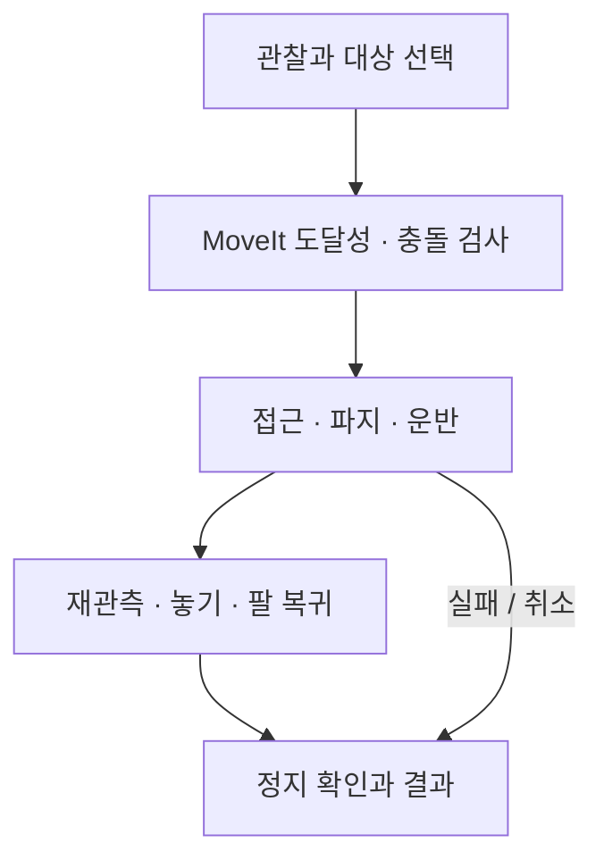

# 물체 관찰과 조작 실행하기

Plan-only 후보 선택, Mock Action과 MuJoCo 조작은 실행 범위가 다릅니다. 필요한 경로를 먼저 선택하세요.



[공통 환경 준비](../running.md#공통-준비) · [검증 선택](../testing.md)

## MuJoCo와 조작 데모

<figure class="visual-slot" data-visual-id="manipulation-run">
<p><strong>시각자료 자리 · 비워 둠</strong></p>
<figcaption><strong>필요한 자료:</strong> 본문 MuJoCo 실행의 관찰 → 접근 → 놓기와 Action 결과를 연결한 화면 또는 GIF.<br><strong>빈 이유:</strong> 기존 실물 파지 사진과 Isaac 저장 자세는 이 실행 경로를 보여주지 않습니다.</figcaption>
</figure>

| 실행 범위 | 진입점 |
|---|---|
| 장면만 관찰 | `ros2 launch cleany_mujoco_sim mujoco_study_cafe.launch.py` |
| 인식과 plan-only | `ros2 launch cleany_skill_executor study_cafe_nearest_grasp_demo.launch.py` |
| 연속 수거 | `ros2 launch cleany_skill_executor study_cafe_sorting.launch.py` |
| 단일 물체 Action | 아래 Mock / BT 실행 |

직접 launch는 `make build` 후 [공통 overlay](../running.md#공통-준비)를 적용한다. 한 domain에서 backend는 하나만 실행한다. [모델 준비와 실제 결과 판독](../../../ros2_ws/src/cleany_skill_executor/docs/study_cafe_sorting_usage.md)을 따른다.

### 단일 물체 Manipulation Action

Mock 서버의 요청, 취소, 조회와 모니터 사용은
[Mock 실행 안내](../../../ros2_ws/src/cleany_skill_executor/docs/manipulation_mock_usage.md)를 따릅니다.
실제 인식과 MoveIt을 사용하는 MuJoCo BT 스택은 다음 명령으로 실행합니다.

```bash
make sim-mujoco-manipulation
```

이 스택은 승인된 물체 하나를 실행하며, 기존 sorting coordinator와 별도 구성입니다.
입력, 세부 옵션과 검증 범위는 [MuJoCo BT 서버](../../../ros2_ws/src/cleany_manipulation_bt/README.md)를 따릅니다.

### Plan-only 후보 선택

MoveIt을 준비한 뒤 같은 overlay의 별도 터미널에서 후보 선택을 실행합니다.

```bash
ros2 launch cleany_moveit_config mock_planning.launch.py
# 같은 overlay의 별도 터미널
ros2 launch cleany_skill_executor grasp_selection.launch.py
```

### MuJoCo 접근 데모

가까운 물체 하나의 pre-grasp와 선택적 lift는 `nearest_pregrasp_coordinator` 경로다. RGB-D, Perception, Grasp, MoveIt과 controller를 먼저 준비하고 [실행 절차](../../../ros2_ws/src/cleany_skill_executor/docs/manipulation.md#가까운-객체-자동-pre-grasp)를 따른다. 기본 pre-grasp 완료와 집기·lift 성공은 서로 다른 결과다.
