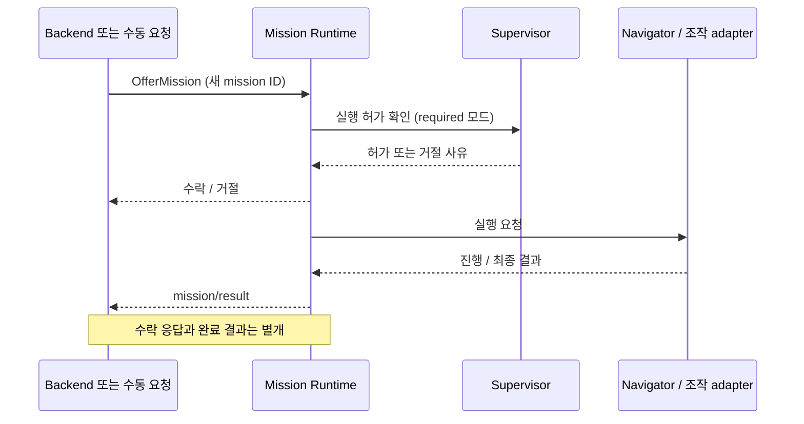

# Mission Runtime 연결하기

외부 요청을 Runtime과 연결하고, 실행 허가와 완료·취소 결과를 확인합니다.

| 현재 준비된 것 | 선택할 실행 | 주행 / 조작 |
|---|---|---|
| Jetson의 현장 주행 서버와 실제 팔 | [현장 좌석 정리](#현장-좌석-정리) | 실측 좌석 / 실물 수거 |
| 새 Gazebo 환경과 Backend | [통합 실행](#주행-구성을-함께-실행) | Gazebo/Nav2 / 기본 mock |
| 이미 실행 중인 AMCL/Nav2 | [Runtime만 연결](#기존-주행-구성에-runtime-연결) | 기존 Nav2 / 설정한 adapter |
| Backend 없이 연동 시험 | [Gazebo + Mock Action](#gazebo-주행과-mock-조작) | Gazebo/Nav2 / Action mock |
| 장치와 시뮬레이터 없는 시험 | [모두 Mock](#주행도-mock으로-action-연결-확인) | mock / Action mock |

[공통 환경](../running.md#공통-준비)을 모든 터미널에 적용합니다. 같은 robot의 Runtime, bridge, canonical odometry producer는 하나씩만 실행합니다.



## Mission Runtime과 Backend

### 현장 좌석 정리

대시보드에서 좌석을 선택하면 Gateway가 좌석별 미션을 보냅니다. 로봇은 Home 위치와 팔 수납을 확인한 뒤, 현장 검증을 마친 좌석으로 이동합니다. 책상에 도착해 정지를 확인하면 촬영, 수거, 재촬영 순으로 작업하고 Home으로 돌아갑니다. 수거 대상과 완료 판정 조건은 [실물 미션 계약](../../../ros2_ws/src/cleany_mission_manager/docs/interfaces.md#jetson-좌석-정리)에 있습니다.

| 구성 요소 | 현장에서 일치시킬 값 |
|---|---|
| 주행 서버 | `CLEANY_MISSION_TARGETS_FILE`에 승인된 좌석·Home JSON 경로를, `CLEANY_MISSION_GRID_REVISION`에 로드한 점유 격자 revision을 지정합니다. |
| Mission Runtime | `runtime_jetson_desk.yaml`, `navigation_backend:=mission_drive`, `use_sim_time:=false`를 선택합니다. `targets_file`은 주행 서버와 같은 파일을 가리켜야 합니다. |
| 팔 실행기와 Backend | `collection_config`는 팔의 실측 설정, `observation_directory`는 Backend에서 읽을 수 있는 관측 디렉터리, `device_token_file`은 해당 로봇의 Gateway 토큰 파일입니다. |

### 주행 구성을 함께 실행

빌드와 overlay 적용 후 Gazebo, Nav2, Runtime, Gateway를 함께 실행합니다.

```bash
make build-mission-sim
source "$(make -s print-install-base)/setup.bash"
ros2 launch cleany_bringup mission_sim.launch.py \
  gateway_url:=ws://127.0.0.1:8080/api/robots/cleany-01/gateway/ws \
  post_mission:=wait_for_next
```

Backend는 별도 `cleany-control-plane` 저장소에서 실행합니다. 같은 robot에 Runtime, bridge, canonical odometry producer를 중복 실행하지 않습니다. 책상 작업은 기본 mock이며 관측 ID에는 실제 사진이 포함되지 않습니다.

### 기존 주행 구성에 Runtime 연결

AMCL/Nav2가 이미 실행 중이면 아래 명령으로 Runtime을 연결합니다.

```bash
make build-mission-runtime
source "$(make -s print-install-base)/setup.bash"
ros2 launch cleany_mission_manager mission_runtime.launch.py \
  gateway_url:=ws://127.0.0.1:8080/api/robots/cleany-01/gateway/ws \
  post_mission:=wait_for_next
```

`mission_runtime.launch.py`의 기본 `supervision_mode:=required`는 아래 System Supervisor 감독 stack이 함께 실행 중이어야 미션을 받습니다. 감독 없이 실행하면 `SUPERVISOR_UNAVAILABLE` 사유로 거절합니다.

| 실행 조건 | 설정과 동작 |
|---|---|
| 감독 없이 단독 실험 | `supervision_mode:=disabled`; snapshot의 `supervision`에 기록. 시스템 Fault와 E-stop 증거를 확인하지 않음 |
| Nav2 없이 구조 확인 | `navigation_backend:=mock` 추가 |
| 완료 후 동작 선택 | `post_mission:=return_home\|wait_for_next`; 제품 복귀 정책은 별도 결정 |
| 독립 실험 | 별도 `journal_path`, `bridge_journal_path` 사용 |
| 동일 미션 복구 | 기존 journal DB 유지 |

재연결, 중복, 취소, 재시작 동작은 [Mission 계약](../../../ros2_ws/src/cleany_interfaces/docs/mission.md)을 따릅니다.

### System Supervisor 감독 stack

Supervisor, safety adapter, Nav2 lifecycle 복구 owner를 Runtime 옆에 실행합니다. 센서, Nav2와 Runtime은 각자의 launch가 소유합니다.

```bash
make build-supervision
source "$(make -s print-navigation-install-base)/setup.bash"
source "$(make -s print-install-base)/setup.bash"
ros2 launch cleany_system_supervisor supervision.launch.py \
  "estop_released_topic:=<하드웨어 해제 Bool>" "protection_ready_topic:=<보호 계층 Bool>"

# 별도 터미널: 활성 Fault 확인
ros2 run cleany_system_supervisor supervisor_operator
ros2 run cleany_system_supervisor supervisor_operator ESTOP --operator "<name>"
```

| 실행 조건 | 설정과 동작 |
|---|---|
| 안전 증거 topic 미지정 | 의도된 `FAULT_LOCKED`; Runtime은 `SYSTEM_FAULT_LOCKED`로 거절 |
| 팔 controller가 있는 구성 | `arm_health:=true`로 `arm_health_monitor` 추가 |
| Gazebo 통합 실행 | `mission_sim.launch.py supervision:=true`; 시뮬레이션에는 안전 하드웨어가 없어 evidence topic을 주지 않으면 잠김 |
| 상태 파일 | 기본 `~/.ros/cleany/system_supervisor_state.json`; latched Fault가 재시작 뒤에도 유지 |

Fault, 복구와 운영자 절차는 [System Supervisor](../../../ros2_ws/src/cleany_system_supervisor/docs/supervision.md)를 따릅니다. 영구 기록이 필요하면 `cleany_logger` 기록 대상에 `/system/events`, `/system/state`, `/system/faults`, `/safety/status`를 추가합니다.

### Gazebo 주행과 Mock 조작

베이스 주행은 Gazebo/Nav2, 인식과 계획 및 팔 조작은 Mock입니다. 모든 터미널에 같은 overlay와 DDS domain을 적용합니다. 기본 로컬 Mock 실행과 별도로 사용합니다.

1. 통합 package를 빌드하고 환경을 적용합니다.

```bash
make build-mission-sim
source "$(make -s print-install-base)/setup.bash"
export ROS_DOMAIN_ID=186
```

2. 터미널 1에서 Gateway 없이 시작합니다. 세 DB 경로는 분리하고 재시작 시험에서는 보존합니다.

```bash
ros2 launch cleany_bringup mission_sim.launch.py \
  profile:=fortress headless:=true \
  runtime_config:=$PWD/ros2_ws/src/cleany_mission_manager/config/runtime_gazebo_manipulation_mock.yaml \
  start_manipulation_mock:=true manipulation_scenario:=success \
  post_mission:=wait_for_next enable_bridge:=false enable_telemetry:=false \
  journal_path:=$HOME/.local/state/cleany/mission-mock/missions.db \
  bridge_journal_path:=$HOME/.local/state/cleany/mission-mock/bridge.db \
  manipulation_database_path:=$HOME/.local/state/cleany/mission-mock/manipulation.sqlite3
```

3. 터미널 2에서 `ros2 topic echo /mission/status`로 `ready: true`를 확인한 뒤 요청합니다. 새 미션에는 새 ID를 사용합니다. `NAV2_NOT_READY`이면 Nav2 lifecycle, odom과 TF를 먼저 확인합니다.

```bash
ros2 service call /mission/offer cleany_interfaces/srv/OfferMission \
  "{mission_id: gazebo-mock-demo-001, mission_type: clean_desk, target_kind: SEAT, target_id: seat-12, requested_by: manual-test}"
ros2 topic echo /mission/result
```

수락 응답은 완료 결과가 아닙니다. 정상 실행은 두 물체를 서로 다른 execution ID로 처리한 뒤 추가 빈 관측을 확인합니다. 물체당 정상 조작 시간은 약 40초입니다. [개발 Monitor](monitoring.md#개발-monitor)의 실행 → BT에서 ExecuteOne을 선택하거나 매니퓰레이션 화면을 엽니다. 같은 domain과 overlay를 사용합니다.

Backend 조합과 주행 설정은 [Mock 연결 reference](../../../ros2_ws/src/cleany_mission_manager/docs/manipulation-mock-integration.md)를 따릅니다. 기본 종료 정책은 `return_home`이며 위 명령의 첫 시험은 `wait_for_next`를 명시합니다.

### 주행도 Mock으로 Action 연결 확인

두 터미널에서 같은 overlay와 `ROS_DOMAIN_ID=186`을 사용합니다. 첫 터미널에서 서버를 시작합니다.

```bash
make build-mission-mock
source "$(make -s print-install-base)/setup.bash"
export ROS_DOMAIN_ID=186
ros2 launch cleany_skill_executor manipulation_mock.launch.py \
  mock_config:=$PWD/ros2_ws/src/cleany_mission_manager/config/manipulation_server_fixture.yaml \
  database_path:=$HOME/.local/state/cleany/mission-mock/manipulation.sqlite3
```

두 번째 터미널에서 Runtime을 시작한 뒤 위의 준비 확인과 미션 요청을 수행합니다. 이 구성의 주행 성공은 Gazebo 주행 증거가 아닙니다.

```bash
ros2 run cleany_mission_manager mission_runtime --ros-args \
  --params-file ros2_ws/src/cleany_mission_manager/config/runtime_manipulation_mock.yaml \
  -p targets_file:=$PWD/ros2_ws/src/cleany_mission_manager/config/study_cafe_targets.yaml \
  -p post_mission:=wait_for_next \
  -p journal_path:=$HOME/.local/state/cleany/mission-mock/missions.db
```

## 요청 결과를 해석하기

| 관측 | 의미 / 다음 확인 |
|---|---|
| `/mission/status`의 `ready: true` | 요청을 받을 준비. 새 요청에는 새 mission ID 사용 |
| `SUPERVISOR_UNAVAILABLE` | required 모드에 Supervisor 없음 |
| `SYSTEM_FAULT_LOCKED` | 안전 증거 또는 latched Fault 확인; 재시작만으로 해제되지 않음 |
| `NAV2_NOT_READY` | Nav2 lifecycle, 새 odom과 TF 확인 |
| OfferMission 수락 | 실행 접수. `/mission/result`를 기다림 |
| Mock 조작 완료 | fixture의 진행·결과; 실제 사진이나 물리 수거 근거는 아님 |

재시작 시험은 journal을 보존하고 독립 실험은 DB 경로를 분리합니다. 종료·재전송·취소의 상세 의미는 [Mission 계약](../../../ros2_ws/src/cleany_interfaces/docs/mission.md)을 따릅니다.
