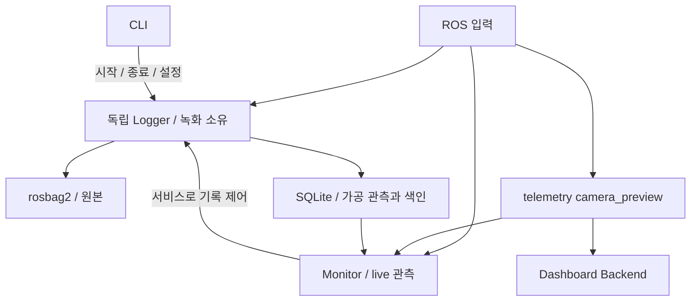

# 상태를 보고 기록하기

Monitor는 상태를 표시하고, 독립 Logger는 기록을 소유합니다. 화면을 닫는 것과 기록 종료를 구분합니다.

[공통 환경 준비](../running.md#공통-준비) · [검증 선택](../testing.md)

| 작업 | 도구 | 시작 위치 |
|---|---|---|
| 현재 상태 보기 | Dev Monitor / RViz | [화면 실행](#개발-monitor) |
| 원본 저장 | 독립 Logger + CLI | [녹화 시작·종료](#독립-logger) |
| 완료된 기록 다시 보기 | ArchiveReader / rosbag2 / RViz | [기록 재생](#완료된-bag-재생) |
| 로봇 얼굴 표시 | Jetson 독립 앱 | [얼굴 디스플레이](#jetson-얼굴-디스플레이) |

## 화면과 기록의 소유권



화면에서 보이는 카메라 preview와 원본 녹화 정책은 별개입니다. 기록 시작·종료는 Logger 상태로 확인하고, 과거 자료는 읽기 전용 조회 경로를 사용합니다.

## 카메라 미리보기

카메라 드라이버가 영상을 발행하는 ROS 환경에서 별도 터미널로 실행합니다.
Backend와 위치 relay는 필요하지 않습니다.

```bash
make build-telemetry
make run-camera-preview
```

미리보기 노드는 `127.0.0.1:8769`에서 요청된 영상 토픽만 구독합니다. 예를 들어
`curl 'http://127.0.0.1:8769/api/cameras'`로 목록을 확인하고
`curl 'http://127.0.0.1:8769/api/camera?topic=/camera/color/image_raw/compressed' -o /tmp/head.jpg`로
조회합니다. 첫 응답은 구독 준비 중인 202일 수 있으므로 상태와 Content-Type을 확인합니다.
화면을 닫으면 조회 lease가 만료되어 구독을 해제합니다. 녹화는 시작하지 않습니다.

Monitor는 같은 주소를 기본으로 사용합니다. 변경 시 `camera_preview_url`을 지정합니다.
드라이버와 camera_preview의 DDS domain과 네트워크 설정이 같아야 합니다.
해상도, 처리 빈도, 상태 코드는 [카메라 계약](../../../ros2_ws/src/cleany_telemetry/docs/interfaces.md#camera_preview)을 따릅니다.

## 개발 Monitor

<figure class="visual-slot" data-visual-id="monitor-ui">
<p><strong>시각자료 자리 · 비워 둠</strong></p>
<figcaption><strong>필요한 자료:</strong> 현재 Monitor의 연결 상태, live/replay 모드, Logger 기록 상태가 함께 보이는 화면.<br><strong>빈 이유:</strong> 기존 캡처는 이전 UI이며 현재 UI와 대응하는 기록 입력이 없습니다.</figcaption>
</figure>

```bash
make build-dev-monitor
make run-dev-monitor
```

브라우저에서 `http://127.0.0.1:8768`을 엽니다. Monitor는 관측 전용이며, 관측 대상과 같은 DDS domain과 메시지 overlay가 필요합니다. Frontend 준비는 [개발환경](../development-setup.md)을 따릅니다.

실시간 입력과 logger 연결은 [monitor.yaml](../../../ros2_ws/src/cleany_dev_monitor/config/monitor.yaml)에서
설정합니다. `make build-dev-monitor`는 logger도 빌드하지만 Monitor 실행은 logger를
자동 시작하지 않습니다. 기록은 아래 절차로 별도 실행합니다. 웹 자산 갱신 후에는
`make build-dev-monitor-ros`로 설치 자산도 갱신합니다.

## 독립 Logger

1. 웹 없이 logger만 빌드하려면 `make build-logger`를 실행합니다.
2. 빌드 overlay를 source한 별도 터미널에서 logger를 시작합니다.
   CLI에서 토픽을 먼저 설정하려면 녹화 대기 상태로 실행합니다.

   ```bash
   ros2 launch cleany_logger logger.launch.py record_on_start:=false
   ```

   기본값인 `record_on_start:=true`는 즉시 녹화하며, 시뮬레이션에서는
   `use_sim_time:=true`를 지정합니다. `make run-logger LOGGER_LAUNCH_ARGS='record_on_start:=true'`도
   사용할 수 있습니다.
3. 같은 DDS domain과 빌드 overlay를 사용하는 다른 터미널에서 CLI로 설정하고
   녹화합니다. 설정을 먼저 바꾸려면 logger를 `record_on_start:=false`로 실행합니다.
   이미 녹화 중이면 `stop` 후 설정합니다.

   ```bash
   ros2 run cleany_logger logger status
   ros2 run cleany_logger logger topics
   ros2 run cleany_logger logger topics set camera --topic /camera/head/color/image_raw --hz 2 --enable
   ros2 run cleany_logger logger topics set path_topic --topic /plan --hz 1 --enable
   ros2 run cleany_logger logger start
   ros2 run cleany_logger logger stop
   ```

   녹화 중에는 설정을 변경할 수 없습니다. 먼저 `stop`하고 아래 옵션을 적용합니다.

   | CLI 옵션 | 의미 |
   |---|---|
   | `topics set <ID> --disable` | `topics`에서 확인한 항목 끄기 |
   | `velocity_topics --topic /first --topic /second` | 속도 체인 전체 설정; `velocity_topics:0`은 한 항목 |
   | `--hz all` | 출처별 수신마다 기록; 카메라와 점군 원본에는 숫자 Hz 지정 |
   | `--node /robot/logger`, `--timeout 3`, `--json` | 대상, 요청 대기, 자동화 출력; 하위 명령 앞/뒤 모두 허용 |

   루트의 `make logger LOGGER_ARGS='status'`도 같은 CLI입니다. CLI 종료 후에도 Logger는 계속 실행됩니다.

4. 대시보드를 사용하려면 별도 터미널에서 `make run-dev-monitor`를 실행합니다.
   기본 저장 위치는 두 프로세스 모두 `~/.local/state/cleany/recordings`입니다.
   다른 경로는 logger YAML의 `state_directory`와 Monitor의
   `MONITOR_ROS_ARGS='-p state_directory:=/absolute/path'`에 동일하게 지정합니다.
   이전 기록은 기존 디렉터리를 명시해 조회합니다. 대시보드나 브라우저를 종료해도
   logger는 같은 세션을 녹화합니다.

`mission_sim.launch.py`는 `enable_logger:=true record_on_start:=true`로 logger를
함께 실행할 수 있습니다. 기본은 비활성이며 `logger_config:=/absolute/logger.yaml`로
설정을 지정합니다. 이 launch 구성은 시뮬레이션 시계를 logger에 전달합니다.

기록 구조는 [Logger 데이터 계약](../../../ros2_ws/src/cleany_logger/docs/data.md),
HTTP와 stale 처리는 [Monitor 계약](../../../ros2_ws/src/cleany_dev_monitor/docs/data.md)을 따릅니다.

## 완료된 bag 재생

상세 SLAM, LiDAR, 점군과 costmap은 같은 domain의 RViz에서 확인합니다. 완료된 원본 bag ZIP을 내려받아 압축을 푼 뒤 다음과 같이 재생합니다. Bag에 기록된 토픽, TF와 CameraInfo만 사용할 수 있으며 SQLite 가공 기록은 RViz 입력이 아닙니다.

```bash
ros2 bag info "<bag-directory>"
ros2 bag play "<bag-directory>" --clock
rviz2 --ros-args -p use_sim_time:=true
```

Fixed Frame은 `map_frame`에 맞추고 Cartographer Submaps display에는 해당 plugin을 설치합니다.

진단 토픽은 `<bag-directory>/diagnostics`의 별도 bag에 있습니다. 센서와 함께
보려면 동일한 시작 시각 기준으로 두 bag을 재생합니다. 센서 bag은 `/clock`을
발행하고 진단 bag은 `--clock` 없이 재생합니다. 정밀 비교에는 각 bag의 첫 메시지
시각 차이도 맞춰야 합니다.

## 매핑 분석용 기록 선택

| 데이터 | 권장 선택과 이유 |
|---|---|
| `/scan_raw`, `/odom`, `/base/wheel_state`, TF | full-rate 원본; 당시 scan 필터와 휠 변환 설정도 보존 |
| `/scan`, `/wheel/odom`, `/joint_states` | 중복이면 생략 가능; 필요한 원본이 있는지 먼저 확인 |
| 궤적 / 제약선 | 각각 1 Hz / 0.5 Hz |
| submap, matched points, map, 가공 관측 | 기존 정책 유지 |
| 카메라 / depth 점군 | 필요한 토픽과 주기를 별도 선택 |

정지 상태에서 정책을 바꿉니다. 기록 주기는 실시간 RViz나 센서 발행 빈도를 바꾸지 않습니다. 용량은 실제 입력으로 측정하며 `limit_mib`는 시간당 속도가 아닌 **세션 총량**입니다.

| 남은 결과 | 읽는 방법 |
|---|---|
| SQLite 가공 기록 | Monitor / ArchiveReader; RViz 입력은 아님 |
| 센서 rosbag2 | `ros2 bag info`로 토픽·메시지 수 확인 후 재생 |
| `diagnostics/` bag | 센서 bag과 첫 메시지 시각 차이를 맞춰 재생 |
| 종료된 세션 | Logger stop/flush와 파일을 확인; 화면 종료만으로 녹화가 끝나지 않음 |

## Jetson 얼굴 디스플레이

전용 앱은 `/home/cleany/cleany-display`에 독립 설치합니다. 자동 로그인 후 로컬 Chromium 키오스크를 실행하고 ROS 상태를 구독합니다. 설치, 서비스 재시작과 자동 시작 해제는 [디스플레이 운영](../../../ros2_ws/src/cleany_display/README.md)을 따릅니다. 기존 `/home/cleany/cleany` checkout과 그 실행 프로세스를 변경하지 않습니다.

## 읽기 전용 위치 관측과 Backend 전송

SLAM 지도 위치를 관측할 때는 localization이 제공하는 `map -> base_link` TF를 사용합니다.
아래 관측 노드는 Nav2나 센서 드라이버를 시작하지 않습니다.

```bash
ros2 run cleany_telemetry pose_observer --ros-args -p source:=tf
ros2 topic echo /telemetry/pose --qos-reliability best_effort
```

Backend에 연결할 때만 별도 터미널에서 adapter를 실행합니다. 지도 ID와 토큰 파일은
현재 Backend에 등록한 값을 지정합니다.

```bash
ros2 run cleany_control_bridge pose_backend_bridge --ros-args \
  -p map_id:="$CLEANY_MAP_ID" -p device_token_file:="$CLEANY_DEVICE_TOKEN_FILE"
```

로컬 odometry만 확인하려면 관측 노드의 `source:=odom`과 `odom_topic:=/odom`을
사용합니다. 이 좌표는 map 위치로 표시하지 않습니다. 시뮬레이션은 두 노드에 모두
`use_sim_time:=true`를 설정합니다. 위치가 멈추면 원본 TF/odom의 좌표계와 시각을 먼저
확인하고, ROS 위치는 정상인데 Dashboard만 끊기면 bridge의 장치 인증과 URL을 확인합니다.
자세한 계약은 [관측 제공자](../../../ros2_ws/src/cleany_telemetry/docs/interfaces.md#pose_observer)와
[Backend adapter](../../../ros2_ws/src/cleany_control_bridge/docs/interfaces.md#pose_backend_bridge)를 따릅니다.

두 노드는 다음 launch로 함께 실행할 수도 있습니다. 기본 `enable_backend=false`는
관측만 실행합니다. 이 launch는 주행이나 localization을 시작하지 않습니다.

```bash
ros2 launch cleany_bringup pose_observation.launch.py enable_backend:=true \
  map_id:="$CLEANY_MAP_ID" device_token_file:="$CLEANY_DEVICE_TOKEN_FILE"
```

### Jetson 운영 UI와 작업 승인

1. `make build-dev-monitor`로 웹과 ROS 패키지를 빌드한다. 처음 구성할 때는
   [개발환경](../development-setup.md)의 의존성과 실물 런타임 빌드를 먼저 준비한다.
2. `make dev-monitor-start`로 사용자 systemd 서비스를 시작한다.
   `http://<Jetson 주소>:8768/#manipulation`에서 관측한다.
   `make dev-monitor-status`, `make dev-monitor-stop`으로 상태 조회와 종료를 수행한다.
   로그는 `journalctl --user -u cleany-dev-monitor.service`에서 확인한다.
   시작만으로 로봇 런타임이나 조작 Goal을 실행하지 않는다.
3. 실물 동작을 사용할 때는 실행 중인 작업이 없는 상태에서 로봇별
   `CLEANY_MANIPULATION_COLLECTION_CONFIG`, `CLEANY_FEETECH_CONTROL_CONFIG`,
   `CLEANY_HARDWARE_MONITOR_CONFIG`를 지정하고 웹 제어를 켠다.

   ```bash
   make dev-monitor-control-on
   make dev-monitor-control-key
   ```

4. 웹에서 운영자 이름과 조작키로 연결한다. `로봇 준비`의 토크 활성화를 확인한 뒤
   `다음 작업 제안받기`를 선택한다. 이미지, 대상과 행동을 검토하고
   `승인하여 1회 실행` 또는 `이 물체 건너뛰기`를 선택한다.
   다음 제안도 승인 전에는 실행하지 않는다. `물체 1개 실행`은 기존
   `make manipulation-run`의 자동 대상 선택과 즉시 실행을 호출한다.
5. 중단 요청 후에는 실행 기록의 실제 정지와 물체 상태를 확인한다.
   복귀 시 그리퍼가 먼저 열리는 점을 확인하고, 차단 해제는 정지, 빈 그리퍼와
   검토한 실행 기록의 revision을 확인한 뒤 요청한다.
6. 유휴 상태에서 `make dev-monitor-control-off`로 관측 전용으로 되돌린다.
   전환은 모니터만 재시작하며 로봇을 종료하거나 작업을 자동 재개하지 않는다.
   로봇 종료는 웹의 `로봇 종료·토크 해제` 또는 기존 CLI에서 별도로 요청한다.

기본 ROS domain은 `CLEANY_COLLECTION_ROS_DOMAIN_ID=0`이다. Loopback 접속은
`ssh -N -L 8768:127.0.0.1:8768 cleany@<Jetson 주소>`로 터널을 연결한다.
포그라운드 Jetson 실행은 `tools/dev-monitor run`을 사용한다.

제어 활성화 시 허용된 터미널 옵션을 0600 `runtime-settings.json`에 저장한다.
다시 활성화하면 명시한 옵션만 덮어쓰고 나머지 저장값을 유지한다. 저장값을 제거하려면
유휴 상태에서 해당 항목을 삭제한다. 저장 경로, 인증, 중복 실행 방지와 결과 해석은
[운영 제어 계약](../../../ros2_ws/src/cleany_dev_monitor/docs/interfaces.md#운영-제어와-상태)을 따른다.
