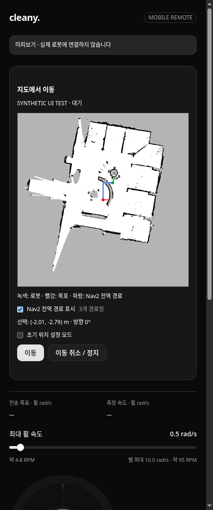

# 휴대폰으로 지도 위 목표까지 이동하기

저장 지도를 불러오고, 휴대폰에서 현재 위치와 목적지를 지정합니다. 이 안내는 **LiDAR 전용 시연 프로필**을 다룹니다.


## 1. 준비하기

| 준비물 | 확인 |
|---|---|
| ROS 환경 | Ubuntu 22.04 / ROS 2 Humble. 호스트 실행 도구는 `ros2-humble` Distrobox 사용 |
| 빌드 | 저장소 루트에서 `make build-hardware-mapping` 완료 |
| 하드웨어 프로필 | 현재 장치와 포트에 맞춘 YAML. [매핑 프로필 안내](../../../ros2_ws/src/cleany_bringup/docs/hardware-mapping.md) |
| 저장 지도 | `map.yaml`과 그 파일이 참조하는 이미지 |
| DDS 설정 | 현재 네트워크에 맞는 Fast DDS XML |
| 작업 공간 | 실제 로봇 주변을 확인하고 정지 수단 확보 |

이 프로필은 LiDAR 평면 장애물을 감시합니다. 높이가 다른 장애물, 팔과 카메라의 전신 충돌, 물리 E-stop의 동작을 보장하지 않습니다. [감시 범위](../../../ros2_ws/src/cleany_navigation/docs/safety.md)를 확인하세요.

## 2. 실행하고 접속하기

저장소 루트에서 아래 경로를 현재 환경에 맞게 바꿉니다. 출력 폴더는 이번 실행의 저장 위치입니다.

```bash
python3 tools/ros2/run-phone-navigation \
  --run-root /path/to/local-data/runs/navigation/traction/YYYY-MM-DD_HHMMSS_phone-navigation \
  --profile /path/to/hardware-profile.yaml \
  --map /path/to/map.yaml \
  --dds-profile /path/to/fastdds.xml
```

기본 프로필은 전후·횡이동을 허용하는 `omni`입니다. 횡이동을 차단하려면 `--motion-profile longitudinal`을 추가합니다. 이 도구는 초기 위치나 이동 목표를 자동 전송하지 않습니다.

휴대폰을 접속 가능한 네트워크에 연결하고 **실행 로그에 표시된 URL**을 엽니다. 주소의 `127.0.0.1`은 로봇 서버가 실행 중인 PC의 접속 가능한 IP로 바꾸고, `#token=...`은 유지하세요. 기본 포트는 `8766`입니다. 화면에서 지도가 보이는지 확인하고 STOP으로 정지 상태를 확인합니다.

## 3. 현재 위치 지정하기

1. **초기 위치 설정 모드**를 켭니다.
2. 지도에서 로봇의 실제 위치를 누르고, 로봇이 바라보는 방향으로 드래그합니다.
3. **현재 위치 지정**을 누릅니다.
4. 위치 정합과 주행 준비 상태가 정상인지 확인합니다.

초기 위치는 정지 상태에서만 설정합니다. 위치가 틀리거나 준비되지 않았다면 목표를 보내기 전에 다시 확인하세요.

## 4. 목표와 경로 확인하기

<div class="screen-example">
<figure><figcaption>합성 입력을 사용하는 UI 캡처. 이 화면은 실물 이동의 검증 결과가 아닙니다.</figcaption></figure>
<div>
<h3>화면 읽기</h3>
<p><strong>녹색</strong>은 로봇 위치, <strong>빨강</strong>은 이동 목표, <strong>파랑</strong>은 Nav2 전역 경로입니다.</p>
<p>초기 위치 설정 모드를 끄고 목적지에서 드래그하면 방향을 지정할 수 있습니다.</p>
<p>미리보기가 완료되면 빨간 목표가 계획 경로의 끝점으로 조정됩니다. 표시된 좌표와 방향을 확인하세요.</p>
<p>현재 UI는 캡처와 일부 문구가 다를 수 있습니다. 버튼과 상태는 현재 실행 화면을 기준으로 확인합니다.</p>
</div>
</div>

지도 클릭은 `ComputePathToPose` 미리보기만 요청합니다. 구동 허가를 얻거나 속도를 발행하지 않습니다. 계획이 준비되고 주행 조건을 만족해야 **이동** 버튼이 활성화됩니다.

## 5. 이동하고 멈추기

| 조작 | 동작 |
|---|---|
| **이동** | 표시된 목표를 실행. 로봇 주변과 주행 상태 관찰 |
| **이동 취소 / 정지** 또는 **STOP** | 자동 목표 취소와 정지 요청. 정지 완료 확인 후 수동 조종 재개 |
| 휴대폰 화면 끄기·다른 앱으로 전환 | 수락된 자동 목표는 로봇 측 감시 아래 계속 실행 |
| 수동 조종에서 입력 해제·화면 이탈 | 입력 만료에 따라 정지 |

자동주행 중 화면을 닫는 것으로 정지를 대신하지 마세요. 위치 복구 뒤에도 이전 목표는 자동 재개하지 않습니다.

## 문제가 생겼을 때

| 화면·증상 | 먼저 확인할 것 |
|---|---|
| 지도 수신 대기 | 저장 지도 경로와 이미지, 로봇 서버와 네트워크 연결 |
| 파란 경로가 나오지 않음 | 초기 위치, 지도 안의 목표, 장애물. 경로 오류 확인 후 목표 재선택 |
| 이동 버튼 비활성 | 경로 미리보기 완료 여부와 위치·센서·Supervisor 준비 사유 |
| 위치 정합 회복 중 · 감속 주행 | 위치와 지도 일치 여부. 회복되지 않으면 정지·복구하며 새 목표 필요 |
| 자동 목표가 취소됨 | `/api/navigation/status`의 `last_input_failure`와 실행 로그 |
| 재기동 뒤 잠금 유지 | `supervisor_operator`로 원인 확인. 원인 미상·실제 고장은 자동 해제 대상이 아님 |

## 실행 옵션과 상세 규약

| 바꾸려는 것 | 위치 |
|---|---|
| Omni / longitudinal, 슬립 재시도 | `--motion-profile`, `--slip-recovery true/false` |
| 지도·입력·출력 경로 | `tools/ros2/run-phone-navigation --help` |
| 속도·footprint·계획 비용 | [경로 계획과 주행 설정](../../../ros2_ws/src/cleany_navigation/docs/planning.md#휴대폰-시연-프로필) |
| 위치 정합과 복구 조건 | [위치 정합 정책](../../../ros2_ws/src/cleany_navigation/docs/localization.md) |
| 버튼·API·취소 계약 | [휴대폰 인터페이스](../../../ros2_ws/src/cleany_teleop/docs/interfaces.md#지도-클릭-주행-명시적-선택) |
| Nav2·안전·구동 연결 | [Navigation 구성](../../../ros2_ws/src/cleany_navigation/README.md) |

실행 파일은 지정한 run의 `runtime/`과 `ros-log/`에 저장됩니다. 팀에 결과를 공유할 때는 팀이 접근할 수 있는 위치를 사용합니다.


## 휴대폰 Omni 주행의 슬립 복구

LiDAR 전용 `phone_navigation.launch.py`의 Omni 프로필은 `slip_recovery:=true`가
기본이다. `config/phone_slip_recovery.yaml`에서 감지와 복구 시간을 조정한다.
`slip_recovery:=false`는 기존 기본 BT와 명령 경로를 사용한다. 기본 종방향
프로필과 다른 launch에는 이 복구가 자동 적용되지 않는다.

약 1초의 LiDAR/휠 이동 비교가 2개 연속 의심이면 BT가 현재 추종을 취소하고
감속 정지한다. fresh odom과 감속 게이트의 0 출력으로 0.5초 연속 정지를 확인한 뒤 `Longitudinal`
플래너와 컨트롤러로 같은 목표를 한 번 재시도한다. 해당 목표가 종료될 때까지
종방향 모드를 유지하며, 정지 중 신호가 사라져도 Omni로 복귀하지 않는다.
재시도 이후 새 비교 창에서 슬립이 다시 확인되거나 재시도가 실패하면 정지 후
목표를 실패 처리한다. 슬립 분기에는 costmap 초기화나 무조건적인 회전, 후진
복구가 없다. 일반 탐색 실패에는 기존 기본 BT 복구를 유지한다.

재시도 플래너는 `/traction_retry/compute_path_to_pose`를 제공하는 별도
프로세스로 실행한다. 두 Lattice 모델이 내부 static motion table을 공유하는
간섭을 피하고, 동일한 지도와 안전 footprint를 쓰는 별도 global costmap을 갖는다.
종방향 MPPI 컨트롤러는 기존 controller server의 `Longitudinal` plugin이다.

감지의 `unknown`은 정상 판정이 아니다. 유효한 측정이 3초 이상 없으면 정지 후
실패한다. 첫 측정 전에는 명령을 허용하지 않는다. 정지 확인은 5초 제한이며,
확인 실패도 목표 실패로 끝난다. 센서 비교와 BT tick 주기로 인해 즉시 감지나
물리 정지 거리를 보장하지 않는다.

명령 흐름은 `motion/cmd_vel → traction_brake → motion/traction_cmd_vel →
collision_monitor → navigation/safe_cmd_vel → 기존 최종 구동 소유자`다.
BT 요청에 따른 감속은 충돌 검사 전에 수행한다. 충돌 STOP과 기존 Supervisor,
MCU 허가 및 정지 확인은 계속 우선한다. BT heartbeat가 0.5초 또는 명령이
0.3초 이상 끊기면 게이트는 0을 출력한다. 수동 조종 경로에는 게이트를 삽입하지 않는다.
