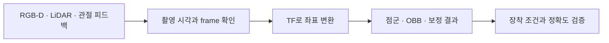

# 센서 입력과 장애물 관측 확인하기

카메라, LiDAR, IMU와 ToF의 입력, 좌표계와 유효 시간을 확인합니다. 장착 보정은 캘리브레이션 가이드로 이어집니다.



[공통 환경 준비](../running.md#공통-준비) · [검증 선택](../testing.md)

## 깊이 영상 읽기


색은 카메라 optical depth의 거리(m)를 나타냅니다. 이 그림만으로 바닥 위 높이나 작은 장애물 검출 성공을 판단하지 않습니다. 차체 좌표의 높이 필터를 확인하려면 TF를 적용한 점군과 비교하세요.

## 실물 IMU

MCU 부팅 보정과 gyro 수신 실행은 [IMU 안내](../../../ros2_ws/src/cleany_base_driver/docs/imu.md)를 따른다.

## ToF 근접 보호와 책상 접근

[ToF 계약](../../../ros2_ws/src/cleany_tof/docs/interfaces.md)의 명령 경로와 보정 항목을 먼저
확인한다. 기본 프로파일은 주행을 차단한다. 이 절차는 물리 시험 통과를 의미하지 않는다.

1. `make build-tof`를 실행한다. 공통 navigation은 Ubuntu/Humble 환경에서
   `make build-navigation`으로 빌드한다. 호스트에서는 `distrobox enter --name ros2-humble
   --no-tty --clean-path -- make build-navigation`을 사용할 수 있다.
2. navigation overlay와 `make print-install-base`의 overlay를 순서대로 source한다.
   기존 로봇 센서, localization, base와 독립 safety evidence를 구성한다.
3. 공통 `cleany_navigation navigation.launch.py`에 기존 map/robot profile 인자와 함께
   `tof_enabled:=true tof_params_file:=/absolute/path/to/commissioned-tof.yaml`을 전달한다.
4. `cleany_system_supervisor supervision.launch.py`는 `tof_required:=true`로 실행한다.
   실제 estop/protection evidence 인자는 기존 절차를 따른다. ToF 가용성만으로 하드웨어
   estop 해제나 arm 가용성을 만들어내지 않는다.
5. Mission launch에 `desk_approach_enabled:=true desk_distance_m:=0.75`를 전달한다.
   목표는 base 원점 기준 거리이며 현장 좌석과 guard envelope에 맞게 조정한다.
   Mission, 두 ToF 제어 노드와 기존 안전 경로가 동일한 canonical odom을 보도록 remap한다.
6. 좌석 pose는 책상 전면을 바라보는 staging pose로 설정한다. Mission이 Nav2 도착과
   정지를 확인한 뒤 접근을 요청하며, home 복귀에는 접근을 수행하지 않는다.

`tof_driver`의 serial port는 기본적으로 공급 펌웨어 보드의 by-id 경로다. 다른 보드는
해당 노드의 `port`를 별도 설정한다. 재연결 시 64 zone, 15Hz로 재설정한다. 별도
teleop도 `nav2/cmd_vel` 입력을 사용하며 ToF 활성 상태에서 `cmd_vel`에 직접 발행하지 않는다.

정상 NO_RETURN은 장애물 미검출로 처리하며 RGB-D proof 없이 주행 입력을 허용한다.
ToF 전용 coverage observer 설정과 no_return_max_*, min_valid/required_zones는 제거한다.
기존 head-pan depth coverage는 기존 설정에 따른다. 감시 ROI, 인접 검출 수, 확인/해제
시간과 비상 거리는 ToF YAML의 조정 가능한 후보다. sensor_ready=false나 오래된 frame은
계속 정지하며, 정상 미검출을 센서 fault로 보고하지 않는다. 미검출이 빈 공간을 보장하지
않으므로 기존 독립 안전 계층을 활성 상태로 유지한다.

voxel guard의 충돌 검사와 속도 출력 기본은 `update_period_s: 0.10`(10Hz)다.
이 값은 voxel 지도 갱신 주기와 별개이며 명시적 robot profile override가 있으면 그 값을
사용한다. 주기를 조정할 때 상류 출력과 ToF의 command_timeout_s를 함께 확인한다.

## D435 장애물 미리보기

실제 head TF와 카메라가 실행된 ROS 환경에서 다음 명령을 사용한다.
`FILTER_JSON`은 실행 폴더의 `obstacle-filter.json`, `BODY_JSON`은
`ros2_ws/src/cleany_navigation/config/d435_fixed_body_boxes.json` 경로다.

```bash
ros2 run cleany_navigation depth_obstacles_preview --ros-args -p filter_file:="$FILTER_JSON" -p body_boxes_file:="$BODY_JSON"
ros2 run rviz2 rviz2 -d tools/validation/config/d435_obstacles.rviz
```

LiDAR 아래를 제외하려면 filter JSON에 `min_base_z: 0.192`를 지정하고 미리보기 노드만 재시작한다.
초록 점이 장애물 후보, 주황 점이 CAD 높이의 LiDAR다. 원본 점군은 별도 토픽에 보존한다.
현재 미리보기는 Nav2 costmap과 Collision Monitor에 연결하지 않는다.

## 실물 depth local costmap 연결

`tools/ros2/run-phone-navigation`에 `--depth-params ros2_ws/src/cleany_navigation/config/phone_depth_local.yaml`을 추가한다. 기존 map, profile, DDS와 slip-recovery 선택은 유지한다. 하위 launch의 `depth_params_file`과 hardware runtime의 `--depth-params`로 전달된다. 생략하면 LiDAR 전용이다. D435 카메라와 실제 head encoder TF는 별도로 실행돼 있어야 한다.

이 overlay는 local VoxelLayer, depth 투영 노드와 기존 Collision Monitor의 depth 입력만 추가한다. global costmap과 3D 누적 장애물 지도, voxel guard는 추가하지 않는다. 원본 유효 광선은 제거용, LiDAR 높이 이상의 필터 점은 표시용이다.

적용 전 조종을 pause하고 MCU 정지 확인, 현재 지도와 pose를 보존한다. 실행 관리자를 정상 종료해 logger를 마무리한 뒤 같은 설정에 overlay를 추가하여 재시작한다. 저장한 pose는 로봇이 움직이지 않은 경우에만 초기 추정으로 복원하고 지도 정합을 확인한다. `tools/validation/check_depth_navigation.py --output /path/to/run/state.json`으로 점군 및 costmap 상태를 기록할 수 있다. 실물 적용 후 위치 복원은 이 도구의 `--restore-pose /path/to/before/state.json`을 명시적으로 사용한다.

롤백은 `--depth-params`를 제거한 뒤 같은 절차로 재시작한다. systemd 실행에서는 해당 인자를 추가한 drop-in만 제거 또는 비활성 이름으로 바꾸고 daemon-reload한다. 카메라가 꺼진 채 depth 프로파일을 유지하면 자동주행 속도 출력은 0으로 제한된다.
