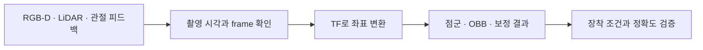
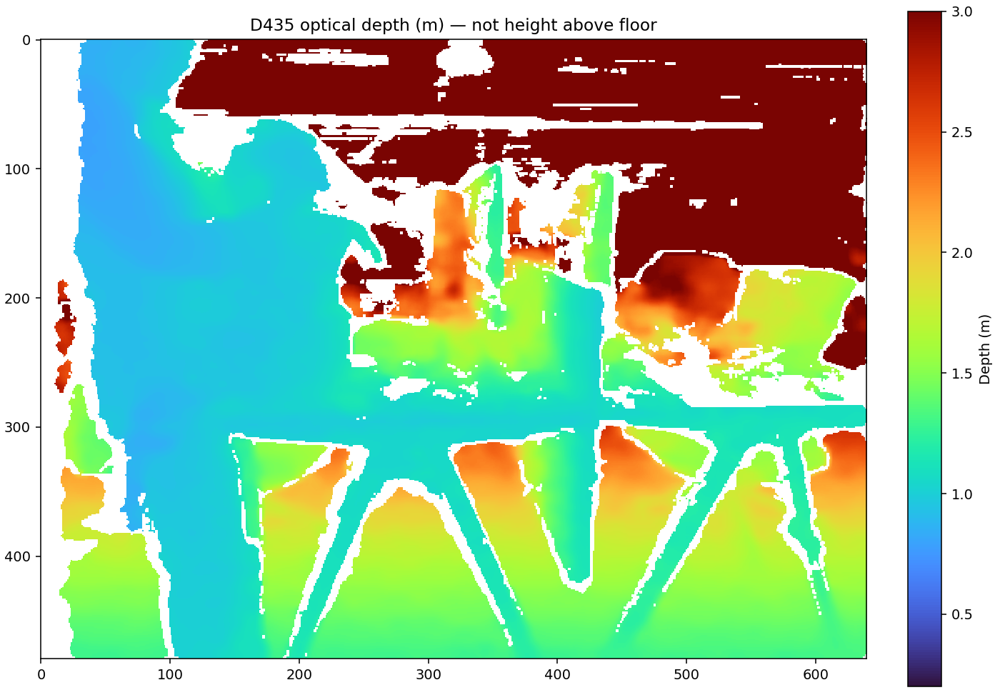

# 센서 입력과 장애물 관측 확인하기

카메라, LiDAR, IMU와 ToF의 입력, 좌표계와 유효 시간을 확인합니다. 장착 보정은 캘리브레이션 가이드로 이어집니다.



[공통 환경 준비](../running.md#공통-준비) · [검증 선택](../testing.md)

## 깊이 영상 읽기



색은 카메라 optical depth의 거리(m)를 나타냅니다. 이 그림만으로 바닥 위 높이나 작은 장애물 검출 성공을 판단하지 않습니다. 차체 좌표의 높이 필터를 확인하려면 TF를 적용한 점군과 비교하세요.

## 실물 IMU

MCU 부팅 보정과 gyro 수신 실행은 [IMU 안내](../../../ros2_ws/src/cleany_base_driver/docs/imu.md)를 따릅니다.

## ToF 근접 보호와 책상 접근

[ToF 계약](../../../ros2_ws/src/cleany_tof/docs/interfaces.md)의 명령 경로와 보정 항목을 먼저
확인합니다. 기본 프로파일은 주행을 차단합니다. 이 절차는 물리 시험 통과를 의미하지 않습니다.

1. `make build-tof`를 실행합니다. 공통 navigation은 Ubuntu/Humble 환경에서
   `make build-navigation`으로 빌드합니다. 호스트에서는 `distrobox enter --name ros2-humble
   --no-tty --clean-path -- make build-navigation`을 사용할 수 있습니다.
2. navigation overlay와 `make print-install-base`의 overlay를 순서대로 source합니다.
   기존 로봇 센서, localization, base와 독립 safety evidence를 구성합니다.
3. 공통 `cleany_navigation navigation.launch.py`에 기존 map/robot 프로필 인자와 함께
   `tof_enabled:=true tof_params_file:=/absolute/path/to/commissioned-tof.yaml`을 전달합니다.
4. `cleany_system_supervisor supervision.launch.py`는 `tof_required:=true`로 실행합니다.
   실제 estop/protection evidence 인자는 기존 절차를 따릅니다. ToF 가용성만으로 하드웨어
   estop 해제나 arm 가용성을 만들어내지 않습니다.
5. Mission launch에 `desk_approach_enabled:=true desk_distance_m:=0.75`를 전달합니다.
   목표는 base 원점 기준 거리이며 현장 좌석과 guard envelope에 맞게 조정합니다.
   Mission, 두 ToF 제어 노드와 기존 안전 경로가 동일한 canonical odom을 보도록 remap합니다.
6. 좌석 pose는 책상 전면을 바라보는 staging pose로 설정합니다. Mission이 Nav2 도착과
   정지를 확인한 뒤 접근을 요청하며, home 복귀에는 접근을 수행하지 않습니다.

`tof_driver`의 serial port는 기본적으로 공급 펌웨어 보드의 by-id 경로입니다. 다른 보드는
해당 노드의 `port`를 별도 설정합니다. 재연결 시 64 zone, 15Hz로 재설정합니다. 별도
teleop도 `nav2/cmd_vel` 입력을 사용하며 ToF 활성 상태에서 `cmd_vel`에 직접 발행하지 않습니다.

정상 NO_RETURN은 장애물 미검출로 처리하며 RGB-D proof 없이 주행 입력을 허용합니다.
ToF 전용 coverage observer 설정과 no_return_max_*, min_valid/required_zones는 제거합니다.
기존 head-pan depth coverage는 기존 설정에 따릅니다. 감시 ROI, 인접 검출 수, 확인/해제
시간과 비상 거리는 ToF YAML의 조정 가능한 후보입니다. sensor_ready=false나 오래된 좌표계은
계속 정지하며, 정상 미검출을 센서 fault로 보고하지 않습니다. 미검출이 빈 공간을 보장하지
않으므로 기존 독립 안전 계층을 활성 상태로 유지합니다.

voxel guard의 충돌 검사와 속도 출력 기본은 `update_period_s: 0.10`(10Hz)입니다.
이 값은 voxel 지도 갱신 주기와 별개이며 명시적 robot 프로필 override가 있으면 그 값을
사용합니다. 주기를 조정할 때 상류 출력과 ToF의 command_timeout_s를 함께 확인합니다.

## D435 장애물 미리보기

실제 head TF와 카메라가 실행된 ROS 환경에서 다음 명령을 사용합니다.
`FILTER_JSON`은 실행 폴더의 `obstacle-filter.json`, `BODY_JSON`은
`ros2_ws/src/cleany_navigation/config/d435_fixed_body_boxes.json` 경로입니다.

```bash
ros2 run cleany_navigation depth_obstacles_preview --ros-args -p filter_file:="$FILTER_JSON" -p body_boxes_file:="$BODY_JSON"
ros2 run rviz2 rviz2 -d tools/validation/config/d435_obstacles.rviz
```

LiDAR 아래를 제외하려면 filter JSON에 `min_base_z: 0.192`를 지정하고 미리보기 노드만 재시작합니다.
초록 점이 장애물 후보, 주황 점이 CAD 높이의 LiDAR입니다. 원본 점군은 별도 토픽에 보존합니다.
현재 미리보기는 Nav2 costmap과 Collision Monitor에 연결하지 않습니다.

## 실물 depth local costmap 연결

`tools/ros2/run-navigation`에 `--depth-params ros2_ws/src/cleany_navigation/config/depth_local.yaml`을 추가합니다. 기존 map, 프로필, DDS와 slip-recovery 선택은 유지합니다. 하위 launch의 `depth_params_file`과 hardware runtime의 `--depth-params`로 전달됩니다. 생략하면 LiDAR 전용입니다. D435 카메라와 실제 head encoder TF는 별도로 실행돼 있어야 합니다.

이 overlay는 local VoxelLayer, depth 투영 노드와 기존 Collision Monitor의 depth 입력만 추가합니다. global costmap과 3D 누적 장애물 지도, voxel guard는 추가하지 않습니다. 원본 유효 광선은 제거용, LiDAR 높이 이상의 필터 점은 표시용입니다.

적용 전 조종을 pause하고 MCU 정지 확인, 현재 지도와 pose를 보존합니다. 실행 관리자를 정상 종료해 logger를 마무리한 뒤 같은 설정에 overlay를 추가하여 재시작합니다. 저장한 pose는 로봇이 움직이지 않은 경우에만 초기 추정으로 복원하고 지도 정합을 확인합니다. `tools/validation/check_depth_navigation.py --output /path/to/run/state.json`으로 점군 및 costmap 상태를 기록할 수 있습니다. 실물 적용 후 위치 복원은 이 도구의 `--restore-pose /path/to/before/state.json`을 명시적으로 사용합니다.

롤백은 `--depth-params`를 제거한 뒤 같은 절차로 재시작합니다. systemd 실행에서는 해당 인자를 추가한 drop-in만 제거 또는 비활성 이름으로 바꾸고 daemon-reload합니다. 카메라가 꺼진 채 depth 프로파일을 유지하면 자동주행 속도 출력은 0으로 제한됩니다.

## Jetson USB 카메라 회전

[호스트 설정](../development-setup.md#jetson-orin-usb-카메라-회전)을 설치하면
DECXIN `0bda:5844` 연결마다 카메라의 UVC Roll을 `3`으로 설정합니다. 이 모듈에서 `3`은
180도 회전이며 각도가 아닙니다. 영상 변환 프로세스를 상시 실행하지 않습니다.

초기화는 USB 부모 장치의 연결 이벤트로 실행합니다. helper가 `uvcvideo`를 잠시
분리하고 복구하면서 생기는 video node 이벤트는 다시 초기화를 요청하지 않습니다.
`/dev/video0` 같은 번호 대신 해당 연결의 USB 장치를 지정하므로 다른 카메라로
대체하지 않습니다.

1. 캡처 프로그램을 닫고 카메라를 연결합니다.
2. 초기화 결과를 확인한 뒤 ROS 카메라 노드나 캡처 프로그램을 시작합니다.

```bash
journalctl -b -u 'cleany-camera-orientation@*.service' --no-pager
```

정상 완료된 oneshot unit은 `inactive (dead)`로 돌아갑니다. 상시 `active` 상태인지를
성공 조건으로 사용하지 않습니다. 장치 준비는 최대 10초 기다리고 USB 요청에도
timeout을 적용합니다. 실패한 unit은 자동 반복하지 않습니다. 원인을 해결한 뒤 수동으로
다시 시작하거나 USB를 재연결합니다. 잦은 재연결이 start-rate 제한에 걸리지 않도록
unit의 시작 횟수 제한은 사용하지 않습니다.

연결된 모듈의 USB 이름을 조회할 수 있습니다.

```bash
for device in /sys/bus/usb/devices/*; do
  if grep -qx 0bda "$device/idVendor" 2>/dev/null &&
     grep -qx 5844 "$device/idProduct" 2>/dev/null; then
    printf '%s\n' "${device##*/}"
  fi
done
```

캡처를 닫은 상태에서 위 출력 중 대상 이름을 지정해 조회하거나 다시 적용합니다.
예시의 `1-2.3`은 실제 출력으로 바꿉니다.

```bash
USB_DEVICE=1-2.3
sudo /usr/bin/python3 -I /usr/local/libexec/cleany/camera-orientation.py \
  --usb-device "$USB_DEVICE"
sudo systemctl reset-failed "cleany-camera-orientation@${USB_DEVICE}.service"
sudo systemctl start "cleany-camera-orientation@${USB_DEVICE}.service"
```

helper는 이미 사용 중인 video node를 발견하면 드라이버를 분리하지 않고 일시 실패로
종료합니다. 수동 조회도 USB 인터페이스 확보가 필요하므로 캡처를 먼저 닫습니다.
초기화 중 카메라를 여는 경쟁을 피하도록 캡처 시작을 초기화 완료 뒤로 배치합니다.
자동 시작하는 캡처 서비스에는 실제 USB 이름에 대한 다음 의존성을 함께 둡니다.

```ini
[Unit]
Requires=cleany-camera-orientation@1-2.3.service
After=cleany-camera-orientation@1-2.3.service
```

| 실패 | 확인과 조치 |
|---|---|
| 장치 준비 timeout | USB 연결과 `uvcvideo` probe 로그 확인 후 재시도 |
| 사용 중인 video node 또는 접근 확인 실패 | 캡처 종료와 native host 실행 여부 확인 후 재시도 |
| 지원하지 않는 Roll 범위 또는 장치 ID | 다른 기종에 적용하지 말고 해당 카메라의 제어 규약 확인 |
| USB 분리 또는 readback 실패 | 연결을 확인하고 journal의 드라이버 복구 결과 확인 |
