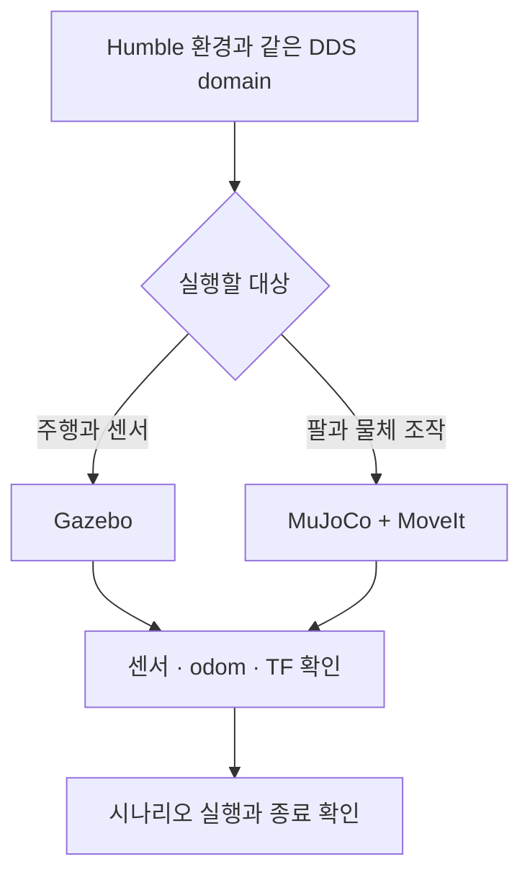

# 시뮬레이터 실행하기

Gazebo에서 센서와 주행을 확인하고, 시설 도구로 시험 환경을 준비합니다. MuJoCo 조작은 별도 작업 가이드를 따릅니다.



[공통 환경 준비](../running.md#공통-준비) · [검증 선택](../testing.md)

## Gazebo

<figure class="visual-slot" data-visual-id="gazebo-run">
<p><strong>시각자료 자리 · 비워 둠</strong></p>
<figcaption><strong>필요한 자료:</strong> 본문 launch의 현재 Gazebo 월드와 로봇, RViz 센서 화면.<br><strong>빈 이유:</strong> 과거 Gazebo 캡처의 모델과 실행 옵션이 현재 구성과 일치하는지 확인되지 않았습니다.</figcaption>
</figure>

1. 의존성과 실행 환경을 확인합니다.
2. Headless base, study-cafe GUI, 전체 시설 GUI 중 하나를 실행합니다.

```bash
make deps-gazebo
make check-gazebo-env
make sim-gazebo                 # headless base
make sim-gazebo-study-cafe      # study-cafe GUI; 위 실행과 별도로 사용
make sim-gazebo-facility        # 전체 시설 GUI; 위 실행과 별도로 사용
```

GUI renderer는 `GAZEBO_GUI_RENDER_ENGINE=ogre|ogre2`로 선택합니다. 센서 서버는 OGRE2를 사용하므로 GPU LiDAR와 camera는 headless에서도 OpenGL context가 필요합니다. 지원 환경은 Fortress/Humble입니다.

3. 같은 overlay/domain의 별도 터미널에서 sensor와 odometry를 확인합니다.

```bash
ros2 topic hz /clock
ros2 topic hz /scan
ros2 topic echo /odom --once
ros2 run tf2_ros tf2_echo odom base_link
```

Topic 등록 이후 실제 발행, 이동, 정지를 각각 확인합니다. 실행별 sensor와 odometry 소유권은 [연동 가이드](../integration.md)를 따릅니다.

## 시설 생성 도구와 종료

`ros2 run cleany_gazebo_sim <스크립트명> --help`로 각 도구의 입력을 확인합니다.

| CLI | 출력 |
|---|---|
| `generate_mission_targets.py` | 접근 목표 YAML과 검증 JSON |
| `render_layout_overlay.py` | 명시한 layout, reference image로 배치 SVG |
| `generate_felt_texture.py` | 명시한 PNG 경로에 펠트 질감 |
| `generate_roly_textures.py` | 명시한 폴더에 seat/back PNG |

시설 reference 이미지와 입력 fixture는 실행 전에 준비하고 각 도구의 입력 경로로 지정합니다. Clone에 포함되지 않은 자료를 팀에서 사용할 경우 공유 위치와 파일 식별자를 함께 안내합니다. 목표 생성은 정적 footprint 여유를 검사하며, 전체 경로와 팔 도달성은 별도 검증이 필요합니다.

Launch는 `Ctrl-C`로 종료한 뒤 센서와 명령의 발행 중단과 해당 실행의 자식 종료를 확인합니다. 시나리오 runner의 실패, cleanup 판정은 [테스트 가이드](../testing.md)를 따릅니다.
