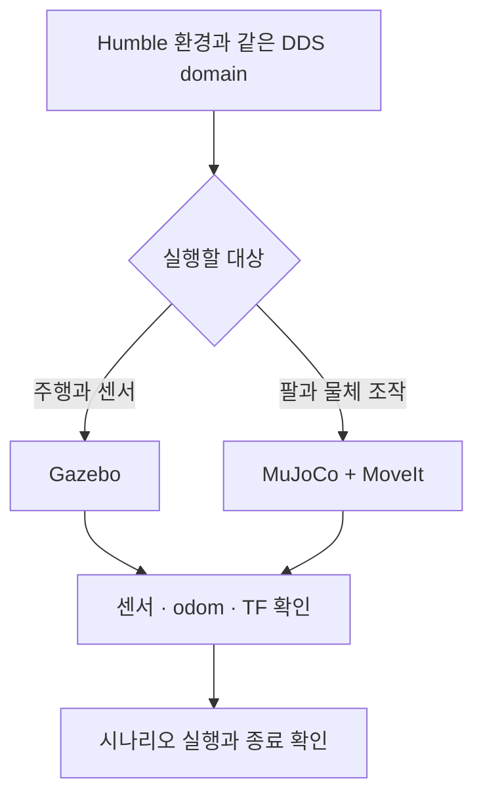

# 시뮬레이터 실행하기

Gazebo에서 센서와 주행을 확인하고, 시설 도구로 시험 환경을 준비합니다. MuJoCo 조작은 별도 작업 가이드를 따릅니다.



[공통 환경 준비](../running.md#공통-준비) · [검증 선택](../testing.md)

## Gazebo

<figure class="visual-slot" data-visual-id="gazebo-run">
<p><strong>시각자료 자리 · 비워 둠</strong></p>
<figcaption><strong>필요한 자료:</strong> 본문 launch의 현재 Gazebo 월드와 로봇, RViz 센서 화면.<br><strong>빈 이유:</strong> 과거 Gazebo 캡처의 모델과 실행 옵션이 현재 구성과 일치하는지 확인되지 않았습니다.</figcaption>
</figure>

1. 의존성과 실행 환경을 확인합니다.
2. Headless base, study-cafe GUI, 전체 시설 GUI 중 하나를 실행합니다.

```bash
make deps-gazebo
make check-gazebo-env
make sim-gazebo                 # headless base
make sim-gazebo-study-cafe      # study-cafe GUI; 위 실행과 별도로 사용
make sim-gazebo-facility        # 전체 시설 GUI; 위 실행과 별도로 사용
```

GUI renderer는 `GAZEBO_GUI_RENDER_ENGINE=ogre|ogre2`로 선택합니다. 센서 서버는 OGRE2를 사용하므로 GPU LiDAR와 camera는 headless에서도 OpenGL context가 필요합니다. 지원 환경은 Fortress/Humble입니다.

3. 같은 overlay/domain의 별도 터미널에서 sensor와 odometry를 확인합니다.

```bash
ros2 topic hz /clock
ros2 topic hz /scan
ros2 topic echo /odom --once
ros2 run tf2_ros tf2_echo odom base_link
```

저장 지도 주행을 연결할 때는 [Gazebo 주행 연동](../../../ros2_ws/src/cleany_gazebo_sim/docs/navigation.md)의 진입점과 설정 계약을 따릅니다.

Topic 등록 이후 실제 발행, 이동, 정지를 각각 확인합니다. 실행별 sensor와 odometry 소유권은 [연동 가이드](../integration.md)를 따릅니다.

## 시설 생성 도구와 종료

`ros2 run cleany_gazebo_sim <스크립트명> --help`로 각 도구의 입력을 확인합니다.

| CLI | 출력 |
|---|---|
| `generate_mission_targets.py` | 접근 목표 YAML과 검증 JSON |
| `render_layout_overlay.py` | 명시한 layout, reference image로 배치 SVG |
| `generate_felt_texture.py` | 명시한 PNG 경로에 펠트 질감 |
| `generate_roly_textures.py` | 명시한 폴더에 seat/back PNG |

시설 reference 이미지와 입력 fixture는 실행 전에 준비하고 각 도구의 입력 경로로 지정합니다. Clone에 포함되지 않은 자료를 팀에서 사용할 경우 공유 위치와 파일 식별자를 함께 안내합니다. 목표 생성은 정적 footprint 여유를 검사하며, 전체 경로와 팔 도달성은 별도 검증이 필요합니다.

Launch는 `Ctrl-C`로 종료한 뒤 센서와 명령의 발행 중단과 해당 실행의 자식 종료를 확인합니다. 시나리오 runner의 실패, cleanup 판정은 [테스트 가이드](../testing.md)를 따릅니다.

## FreeCAD 형상 미리보기

`model_variant:=freecad_final`은 새 FreeCAD 파일에 저장된 정적 조립 형상입니다.
관절이나 모터를 명령하지 않으며, RViz의 Fixed Frame은 `base_link`로 지정합니다.
기존 동작 모델과 [미확정 값의 범위](../../../ros2_ws/src/cleany_description/docs/freecad-model.md)를
구분합니다. 실행 중인 로봇의 `/robot_description`과 섞이지 않도록 별도 터미널과
DDS domain에서 확인합니다.

```bash
make build COLCON_BUILD_ARGS='--packages-select cleany_description'
source "$(make -s print-install-base)/setup.bash"
ROS_DOMAIN_ID=173 ros2 launch cleany_description description.launch.py model_variant:=freecad_final use_sim_time:=false
```

실물 ROS graph와 함께 형상을 확인하려면 `namespace:=cad_reference`와
`frame_prefix:=cad_reference/`를 지정합니다. 모델과 관절 상태, TF 토픽은
`/cad_reference/` 아래에 생성됩니다. RViz도 `/tf`와 `/tf_static`을 각각
`/cad_reference/tf`, `/cad_reference/tf_static`으로 remap하고 Fixed Frame을
`cad_reference/base_link`로 설정합니다. 실물 base와의 위치 관계는 별도 보정이
필요하며, `freecad_final`의 팔 자세는 CAD에 저장된 기준 자세입니다.

```bash
ros2 launch cleany_description description.launch.py use_sim_time:=false \
  model_variant:=freecad_final namespace:=cad_reference frame_prefix:=cad_reference/
```

기존 관절 모델을 표시하려면 `model_variant:=legacy_runtime`을 지정합니다.
기존 카메라 보정 비교에는 이 선택과 `calibration_profile:=jetson_20261009`를
함께 사용합니다. `freecad_final`에는 이전 조립체의 보정 프로파일을 적용할 수
없습니다. 별도 MuJoCo 뷰어의 정적 기준 모델은 다음 경로입니다.

```bash
python3 -m mujoco.viewer --mjcf=ros2_ws/src/cleany_description/mjcf/cleany_freecad_final.xml
```

관절축을 확인하려면 `model_variant:=freecad_kinematic`을 선택합니다. 관절 상태의
이름은 `cad_delta_*`이며 값은 저장된 자세에서의 변화량입니다. 별도 터미널의
`joint_state_publisher`로 초기 변화량 0 상태를 표시할 수 있습니다.

```bash
ROS_DOMAIN_ID=173 ros2 launch cleany_description description.launch.py model_variant:=freecad_kinematic use_sim_time:=false
ROS_DOMAIN_ID=173 ros2 run joint_state_publisher joint_state_publisher
```

ROS와 모터 없이 동작을 확인하는 예시는 아래와 같습니다. 지정한 각도는 표시용
입력이며 가동 한계나 실제 안전한 동작 각도가 아닙니다. Python 환경에는 기존
CAD 도구의 NumPy, VTK와 Pillow가 필요합니다.

```bash
python3 tools/validation/preview_freecad_kinematics.py \
  --delta cad_delta_right_shoulder_yaw=-15 \
  --delta cad_delta_left_shoulder_yaw=15 \
  --delta cad_delta_head_pan=15 \
  --output /tmp/cleany-cad-motion.gif
```

GIF, 최대 변화량의 PNG와 입력·출처 JSON을 생성합니다.
집게의 명목 연동은 `--delta cad_delta_right_gripper_cam=-25 --focus-gripper right`로
확인할 수 있습니다. 집게 종속 관절은 해석기가 계산하며 개별 입력을 받지 않습니다.
실물 보정과 접촉은 [집게 미확정 항목](../../../ros2_ws/src/cleany_description/docs/freecad-gripper.md)에
따라 별도로 연결합니다. MuJoCo의 운동학 미리보기는 `cleany_freecad_kinematic.xml`의
mocap body를 같은 FK로 배치하며 물리 actuator를 사용하지 않습니다.


## FreeCAD MoveIt와 OctoMap 검사

Humble 환경에서 `cleany_description`과 `cleany_moveit_config`를 빌드한 overlay를
사용합니다. Jetson 기본 MoveIt의 OctoMap 플러그인과 라이브러리 버전이 다르면
Jetson에 설치된 `moveit-scene-runtime`과 `moveit-octomap-lock`의
`local_setup.bash`를 overlay 뒤에 읽습니다.

```bash
export ROS_LOCALHOST_ONLY=1 ROS_DOMAIN_ID=177
ros2 launch cleany_moveit_config freecad_inspection.launch.py
```

같은 환경의 별도 터미널에서 [검사 명령](../reference/testing.md#freecad-moveit와-octomap-curobo-검사)을
실행합니다. 실물 운영 전 필요한 값은
[FreeCAD 형상 검사 계약](../../../ros2_ws/src/cleany_moveit_config/docs/planning.md#freecad-형상-검사)에 둡니다.

인덱싱한 충돌 메시를 쓰려면 NumPy, SciPy와 trimesh가 있는 Python으로
저장소 밖의 새 디렉터리에 캐시를 생성합니다. Jetson의 cuRobo 환경도 사용할
수 있습니다. 생성한 디렉터리를 검사 launch의 `collision_cache`에 지정합니다.

```bash
collision_cache="$HOME/cleany-data/freecad-collision-indexed"
"$HOME/cleany/runtime/curobo-venv/bin/python" tools/prepare_freecad_collision_cache.py \
  ros2_ws/src/cleany_description "$collision_cache"
ros2 launch cleany_moveit_config freecad_inspection.launch.py collision_cache:="$collision_cache"
```

삼각형도 줄이려면 VTK가 있는 오프라인 도구 환경에서 허용할 표면 차이를
명시합니다. 아래 값은 검사 캐시의 수치 오차 한도이며 실물 보정값이나
충돌 여유가 아닙니다. 경계와 비다양체 edge, Euler characteristic을 보존하고,
원본과 결과 표면의 양방향 거리 상한을 검사합니다. 실패한 후보는 더 엄격하게
다시 만들며, 끝까지 확인되지 않으면 해당 원본 메시를 유지합니다.

```bash
python3 tools/prepare_freecad_collision_cache.py ros2_ws/src/cleany_description \
  "$HOME/cleany-data/freecad-collision-reduced" --max-surface-error-m 0.0001 \
  --preserve-link cad_snapshot_LeftCameraComponents --jobs 4
```

GPU 대조에서 내부와 외부 판정이 달라지는 링크는 `--preserve-link`로 원본을
유지합니다. 위 예시는 왼팔 카메라 묶음을 보존하며 두 URDF에 함께 적용됩니다.

MoveIt 검사에서 몸통, 마스트와 마운트를 단순 입체로 바꾸고 팔과 헤드 메시를
추가 감면하려면 기존 캐시로부터 새 캐시를 만듭니다. 생성 Python에는 NumPy,
SciPy, trimesh와 VTK가 필요합니다. 부품 선택과 표면 상한은
`configs/robot/freecad_moveit_collision.json`으로 관리합니다. 몸통은 채우되
뒤쪽 상판 투입구와 그 아래 공간을 남깁니다. 원본 시각 모델과 관절 좌표는
입력과 같으며, MoveIt에서는 `freecad_kinematic`으로 읽습니다.
팔은 기존 분할 외피 방식으로, 마스트는 높이별 8개 외피로 생성합니다.
카메라 하우징, 집게 구동 로드와 외측 링크도 닫힌 외피로 줄이고, 팁의
쉘과 삽입부는 같은 링크 안에서 묶습니다. 손목 본체, 서보, 집게 상하판과
캠 조립부는 구멍과 틈을 유지하는 표면 감면 대상으로 지정합니다.
`preserve_collision_parts`의 접촉 패드, 운반 링크, 내측 링크와 광학 부품은
입력 캐시 메시를 유지합니다. 결합부의 구멍과 포크 틈을 채우지 않습니다.
외피 상한과 입구 보존 조건은
[형상 검사 계약](../../../ros2_ws/src/cleany_moveit_config/docs/planning.md#freecad-형상-검사)을 따릅니다.
검사 launch는 이 외피를 내부가 찬 형상으로 읽기 위해
`cleany/CADInspectionFCL`과 detector 확인 capability를 자동 선택합니다.
변경된 `cleany_moveit_collision`, `cleany_moveit_config`를 빌드한 overlay를
읽은 뒤 실행합니다.

```bash
moveit_cache="$HOME/cleany-data/freecad-moveit-primitives"
PYTHONPATH=ros2_ws/src/cleany_moveit_config python3 tools/prepare_freecad_moveit_cache.py \
  ros2_ws/src/cleany_description "$HOME/cleany-data/freecad-collision-reduced" "$moveit_cache" --jobs 4
ros2 launch cleany_moveit_config freecad_inspection.launch.py collision_cache:="$moveit_cache"
```

cuRobo의 정적 mesh world는 링크별 합치기를 미리 수행할 수 있습니다.
같은 overlay를 읽고 cuRobo 환경에서 아래 명령으로 별도 캐시를 만듭니다.
이 캐시에는 현재 CAD 저장 자세가 들어가며 관절 움직임을 표현하지 않습니다.
단순 입체와 추가 감면을 함께 반영하려면 위에서 만든 `moveit_cache`를 입력합니다.
박스는 기본 cuboid로 저장합니다. 박스를 삼각형으로 변환한 성능 대조 캐시가
필요하면 `--write-world-cache`와 함께 `--mesh-boxes`를 지정합니다.

```bash
python3 tools/validation/check_freecad_curobo.py ros2_ws/src/cleany_description \
  --collision-cache "$moveit_cache" \
  --write-world-cache "$HOME/cleany-data/freecad-curobo-world"
python3 tools/validation/check_freecad_curobo.py ros2_ws/src/cleany_description \
  --world-cache "$HOME/cleany-data/freecad-curobo-world"
```

cuRobo 검사 도구는 캐시 형상에서 거리 검색 범위를 계산합니다. 외부 solver에
연결할 때도 manifest의 `required_mesh_query_distance_m`을 적용하는
[검사 계약](../../../ros2_ws/src/cleany_moveit_config/docs/planning.md#freecad-형상-검사)을 따릅니다.

## 공통 CAD 미리보기와 파지 프로파일

`tools/robot-model check`는 설치된 CAD와 manifest의 일치 여부를 검사한다.
`tools/robot-model preview`는 CAD 표시와 피드백 모니터링을 시작하며,
`tools/robot-model moveit`은 궤적 실행을 끈 상태에서 MoveIt을 시작한다.
[공통 CAD 런타임](../../../ros2_ws/src/cleany_description/docs/runtime-model.md)에 모델 갱신과 상태 토픽을 설명한다.

실물 파지의 CAD 바인딩은 `CLEANY_ROBOT_STATE_PROFILE`에
`configs/robot/cad_grasp.json`을 명시하거나 `tools/left-grasp`로 선택한다.
로봇별 보정 파일과 수거, Feetech 제어, 모션 감시 설정은 운영자가 제공한다.
`configs/robot/collection_cad.json`은 시운전 승인 전의 설정 예시다.
이미 실행 중인 RGB-D와 인식을 쓰는 경우에는
`CLEANY_COLLECTION_USE_EXISTING_PERCEPTION=true`와 운영 DDS 설정을 사용한다.
자세한 조건은 [공유 인식과 CAD 파지](../../../ros2_ws/src/cleany_skill_executor/docs/shared-grasp-policy.md)를 따른다.
