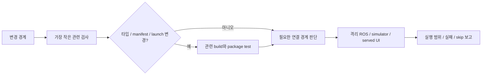
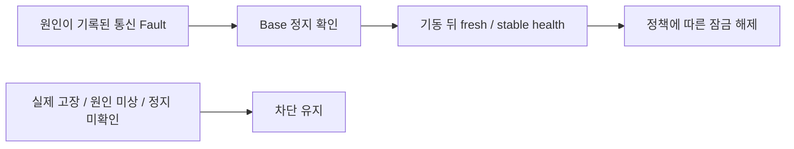
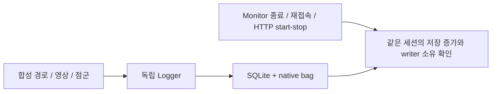
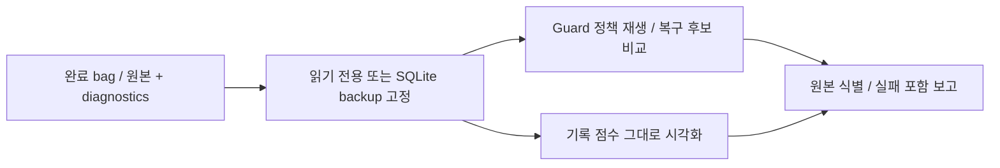

# 테스트 상세 참조

명령은 저장소 루트의 Humble/Fortress 환경에서 실행합니다. 변경 범위를 확인한 뒤 가장 작은 관련 검사부터 선택합니다. Make target의 실제 동작은 [Makefile](../../../Makefile)을 기준으로 확인합니다.

## 검사 선택



| 수정한 경계 | 순서 |
|---|---|
| core / 도구 | 해당 단위 검사 → 필요할 때 연결 검사 |
| 타입 / manifest / launch | 관련 build → package test → 연결 runtime |
| 여러 package | 관련 검사 → 격리 ROS graph → 필요한 simulator |
| UI | frontend 검사 → served app 새로고침 / 재연결 / replay |
| 문서 | 링크 / 명령 구문 / 생성 HTML → 브라우저 |


아래 표에서 변경 범위에 맞는 명령을 선택합니다. Simulator, mock 통과는 해당 입력과 backend의 증거이며, 실물 검증은 별도로 수행합니다.

| 변경 범위 | 명령 | 확인 범위 |
|---|---|---|
| 전체 ROS workspace | `make test` | build, colcon package test와 결과 집계 |
| Mission, Gateway core | `make test-mission-core` | ROS 없는 lifecycle, 영속성, 중복, 재전송 |
| Mock 조작 core | `make test-manipulation-core` | 서버 실행, 취소, 영속 기록과 모니터 |
| Mission과 Mock Action | `make test-mission-mock BASE_TEST_ROS_DOMAIN_ID=186` | 공통 타입, Action, 조회, 취소와 재시작; 주행은 Mock |
| Gazebo와 Mock Action | `make test-gazebo-manipulation BASE_TEST_ROS_DOMAIN_ID=186` | Nav2 도착과 정지, 두 수거, 추가 빈 관측과 보고 |
| Mission ROS 설치, 연동 | `make test-mission-runtime` | 관련 package build/test |
| Supervisor core | `make test-supervision-core` | ROS 없는 Fault, 허가, 복구, 영속성, Runtime 감독 port, 안전 증거 |
| Supervisor와 Runtime 연동 | `make test-supervision` | Supervisor ROS graph와 실제 Runtime, base driver, safety adapter, lifecycle 복구의 E2E; 센서, Nav2와 안전 하드웨어는 합성. 장애→정지 지연을 `SUPERVISION_LATENCY_REPORT` 경로에 기록 |
| 슬립 분석 / BT 복구 | `make test-slip-detection`, `make test-slip-recovery` | 오프라인 비교와 격리 BT 경계; 아래 상세 조건 |
| Navigation core, plugin | `make test-navigation` | Python core와 C++ plugin |
| 합성 Navigation runtime | `make test-navigation-runtime` | ROS lifecycle, goal, 취소, sensor 단절 |
| Gazebo, Navigation | `make test-gazebo` | package 검사와 C++ plugin; 선택 runtime은 제외 |
| Gazebo sensor runtime | `make test-gazebo-nav-runtime` | 실제 simulator의 sensor, odom, TF |
| 시설 목표 생성 | `make test-gazebo-facility-tools` | simulator 없는 ID, 여유, 제거 의자 처리 |
| MuJoCo | `make test-mujoco` | scene loader; 모든 조작 runtime을 뜻하지 않음 |
| Mock Manipulation Action | `make test-manipulation` | ROS Action, 취소, 조회와 재시작 복구 |
| MuJoCo BT 경계 | `make test-manipulation-bt` | native BT, Action, 관련 인식과 수거 회귀; 실제 물리 수거 성공은 별도 |
| Hand-eye 경계 | `make test-handeye` | description, MuJoCo, MoveIt, calibration |
| Base ROS | `make test-base` | interface, driver, odometry; mock MCU |
| ESP32 준비, motor core | `make test-micro-ros-setup test-motor-core` | Python 준비 도구와 장치 없는 C++ |
| Logger | `make test-logger` | CLI 정책 편집과 종료 코드, 기록 정책, 읽기 전용 archive, 디렉터리 독점, 세션과 복구 경계 |
| 매핑 원본 bag 도구 | `python3 -m pytest tests/tools/test_mapping_bag_recorder.py` | 센서 토픽 선택, 기존 bag 보존, native recorder 종료와 flush |
| Monitor와 Logger | `make test-dev-monitor` | Logger 검사와 ROS 수집, 저장, HTTP와 UI 데이터 경계 |
| Telemetry | `make test-telemetry` | odom relay |
| CI 준비 도구 | `make test-ci-tools` | 의존성 이미지 무효화, build context와 명령 전달 |

| 실행 환경 | 규칙 |
|---|---|
| Fedora hardware-mapping-core | 호스트 Make 호출; Python은 Humble Distrobox, 버튼 입력은 호스트 Node.js |
| Python ROS graph | 설치 ROS와 BASE_TEST_ROS_DOMAIN_ID 사용 |
| Navigation CTest | Lifecycle / 센서 신선도 묶음 한도 300 s; 내부 판정 시간과 임계값은 별도 유지 |

Fedora에서는 native ROS target을 Humble Distrobox에서 실행합니다. `test-micro-ros-setup`, `test-motor-core`는 Makefile의 `BASE_EXEC`가 환경을 선택합니다.

CI는 `PYTEST_DISABLE_PLUGIN_AUTOLOAD=1`로 runtime 의존성이 설치한 외부 pytest plugin의 자동 로드를 끕니다. 프로젝트의 `conftest.py`와 pytest 기본 plugin은 유지하며, 로컬에서는 `PYTEST_DISABLE_PLUGIN_AUTOLOAD=1 make test`로 같은 설정을 적용합니다.

`make test`는 package test가 실패해도 `colcon test-result --verbose`로 실패 상세를 출력하고 실패 상태를 반환합니다.

### 실행 결과 읽기

| 예시 상황 | 판정 |
|---|---|
| `make test`가 0으로 끝나고 결과 집계 통과 | 실행된 workspace 검사 통과 |
| optional ROS 검사 `skipped` | 해당 경로 미검증; 통과 수에 합산하지 않음 |
| build 성공, runtime timeout | 설치는 확인, runtime은 실패 |
| CTest wrapper와 내부 pytest에 같은 검사 표시 | 중복 합산하지 않음 |
| simulator 센서 수신 성공 | 그 backend 입력만 확인; 실물 장치 성능은 별도 |

### Supervisor와 위치 정합 회귀



| 검사 | 확인할 분기 | 입력 한계 |
|---|---|---|
| Supervisor 재기동 | 통신 Fault만 해제; stale / 실제 고장 / 원인 미상 / 미확인 목표 정지 / 기본 수동 정책은 차단 | 실제 base driver + 합성 MCU; 물리 USB / 정지 성능 아님 |
| Base test_stop_retry.py | STOP 3회 유실 뒤 동일 sequence ACK, watchdog과 미상 Fault 구분, 복구 ENABLE 없음 | 자동 검사 |
| test_localization_alignment.py | 잘못된 pose / 작은 공분산, 지도 회전, degraded 감속과 lease 유지, 회복 / 개선 중단 / 최대 대기 | Core 입력 |
| test_localization_guard_ros.py | 높은 공분산 탐색 / 재검증, 제한 탐색, 모호한 통로, 정지 미확인, 동시 복구, 수동 initialpose 선점 | 격리 domain의 실제 Guard / Supervisor + 합성 LiDAR / AMCL; 물리 정확도 아님 |

### 슬립 분석과 복구

| 검사 / 도구 | 입력과 확인 범위 |
|---|---|
| `make test-slip-detection` | 시간 보간 / 좌표 변환 / 합성 scan / 단일 벽 퇴화 / 품질 실패 / odom 단절 / 연속 조건; ROS node나 모터 명령 없음 |
| `make test-slip-recovery` | 빌드한 실제 BT의 child halt / 정지 / 목표별 latch / 이전 비교 무시 / 반복 실패; BASE_TEST_ROS_DOMAIN_ID 격리 |
| Gate 단위 검사 | 병진 방향 유지, 휠별 감속 상한, heartbeat 단절 |
| tools/validation/slip_recovery_smoke.py | 별도 domain에 빈 지도와 phone_navigation.launch.py phone_motion_profile:=omni를 먼저 실행; 합성 입력으로 추종 시작 / 취소 뒤 0 출력 |

Smoke 도구는 하드웨어 domain 0을 거부한다. 기록 분석과 한계는 [슬립 분석](../calibration.md#bag-기반-슬립-의심-구간-분석)을 따른다.

## CI 실행과 재사용

CI는 Ubuntu 22.04 amd64에서 모든 PR의 전체 workspace 검사, ESP32 motor core, 합성 Navigation runtime과 Gazebo sensor runtime을 실행합니다. 베이스의 pytest는 colcon에 직접 등록하며 전체 workspace 검사에서 한 번 실행합니다. Navigation과 Gazebo runtime은 같은 실행에서 이미 빌드한 workspace를 사용합니다.

| 재사용 대상 | 갱신 조건 | 검증 경계 |
|---|---|---|
| GHCR 의존성 이미지 | 모든 `package.xml`, rosdep YAML, `containers/ci/`, 이미지 준비 도구, platform 변경 | ROS, apt, pip 의존성만 포함하며 응용 소스와 빌드 결과는 포함하지 않음 |
| ccache | compiler 내용, 소스, header와 옵션에 따라 hit/miss 결정 | 빌드 명령은 매번 실행하며 CTest/pytest 결과는 캐시하지 않음 |
| 같은 실행의 workspace | 전체 빌드 완료 후 runtime 검사에서 재사용 | 다른 실행의 `build/`, `install/`, test result는 복원하지 않음 |

| 항목 | 기준 |
|---|---|
| 버전 | [APT snapshot](../../../containers/ci/repository-snapshots.env), [Python constraints](../../../containers/ci/pip-constraints.txt); Jetson에서 기록한 upstream ROS 버전 기준 |
| 버전 확인 | [verify-versions.py](../../../containers/ci/verify-versions.py)를 설치 후와 검사 전에 실행; JetPack/GPU/물리 동작 제외 |
| 이미지 없는 경우 | 고정 snapshot/constraints로 생성 후 전체 검사 |
| 게시 / 재사용 | 동일 저장소는 환경 확인 뒤 게시, fork PR은 미게시. 응용 검사 실패 시에도 의존성/ccache 보존; 테스트 결과는 재사용하지 않음 |
| 갱신 | snapshot/constraints/ROS 기준을 명시 변경하고 전체 CI. `DEPENDENCY_REVISION`만 올리면 같은 버전 재빌드 |
| 빌드 병렬화 | package 최대 2, 내부 컴파일 runner CPU 절반; `MAKEFLAGS`도 지정. `RelWithDebInfo` 유지 |
| xacro cache | 동일 인자 출력 bytes만 재사용; 검사마다 독립 XML tree |
| BT.CPP | amd64 4.9.1의 CMake 경로 호환 링크는 같은 설치 바이너리를 가리킴 |
| 결과 | XML, 실패 로그, apt/pip 버전, ccache 통계. 이미지 pull/cache 복원을 포함한 job 시간 비교 |

다운로드 실패와 테스트 실패의 재시도 정책은 다르다.

| 의존성 다운로드 | 제한 |
|---|---|
| 버전 / 무결성 | 서명된 snapshot index의 경로·SHA256·크기. 최신 index나 다른 버전으로 대체 금지 |
| 파일 경로 | 같은 pool 경로의 archive 미러 우선, 실패/불일치 시 원래 snapshot |
| 동시 다운로드 | 4개; 검증한 파일만 cache에 보관하고 APT가 설치 시 재검증 |
| timeout | 연결 15초, 파일 60초, 설치 명령 준비 5분 |
| retry | APT 1회; 준비 명령은 10초 후 최대 2회. 계속 실패하면 CI 실패 |
| 전체 제한 | 이미지 생성 15분, job 40분 |

빌드와 테스트는 위 retry에 포함하지 않는다. 의존성 변경은 [ROS snapshot](https://github.com/ros2/ros2_documentation/blob/rolling/source/Get-Started/Installation/Snapshot-Repository.rst)과 [Ubuntu snapshot](https://snapshot.ubuntu.com/)의 서명·배포 규칙을 따른다.

## 선택 runtime과 UI

### 카메라 영상 수집

현재 workspace를 빌드한 뒤 `tools/validation/capture_cameras.py`로 실제 ROS
카메라 영상을 수집합니다. 각 출력 경로는 아직 없는 새 디렉터리여야 합니다.

```bash
source /opt/ros/humble/setup.bash
source "$(make -s print-install-base)/local_setup.bash"
python3 tools/validation/capture_cameras.py --backend mujoco \
  --output /absolute/new-camera-run/mujoco
python3 tools/validation/capture_cameras.py --backend gazebo --gazebo-model cad-with-arms \
  --output /absolute/new-camera-run/gazebo
PYTEST_DISABLE_PLUGIN_AUTOLOAD=1 python3 -m pytest -q tests/tools/test_capture_cameras.py
```

GUI가 없는 환경에서는 촬영 명령 앞에 `xvfb-run --auto-servernum`을 붙입니다.
VM에서 GPU 렌더링이 불안정하면 `LIBGL_ALWAYS_SOFTWARE=1`을 지정합니다.
Gazebo의 `--gazebo-model legacy`로 레거시 모델도 선택할 수 있습니다.

| 카메라 수집 결과 | 해석 |
|---|---|
| 검사 | Head / 양손목 크기, encoding, frame, buffer, simulation clock와 상태 |
| 출력 | PNG, report.json, launch.log |
| 누락 / timeout / 조기 종료 | 실패 코드, 도구가 시작한 process group 종료 |
| 모델 | CAD 주행 기본은 팔 제외; cad-with-arms는 촬영 검사에만 팔 포함 |
| 한계 | 촬영 성공은 전체 집기 미션 성공 아님 |

### 선택 실행 조건

Gazebo package의 `--run-sim-runtime`, `--run-evaluation-tests`와 Mission core의 `CLEANY_RUN_ROS_TESTS=1`은 별도로 활성화하는 검사입니다. 실행 결과에서 통과와 skip을 구분합니다.

Logger의 `CLEANY_RUN_ROS_TESTS=1 make test-logger`는 native rosbag2의 활성 읽기,
센서와 진단 bag 분리, CDR 조회, 합산 용량과 ZIP 내보내기도 검사합니다.
실물 ROS domain과 분리해서 실행하며, 이 검사는 실물 주행의 누락률이나
시간당 저장 용량을 보장하지 않습니다.

```bash
source /opt/ros/humble/setup.bash
source "$(make -s print-install-base)/setup.bash"
ROS_DOMAIN_ID=82 CLEANY_RUN_ROS_TESTS=1 make test-mission-core
```

### 독립 Logger



| 준비 / 확인 | 조건 |
|---|---|
| 준비 | Build overlay, 빈 출력 경로, Logger와 Monitor 별도 프로세스 |
| 검사 | SQLite 증가, 원문 CDR / stamp, 재접속, HTTP 시작 / 정지, Logger 단절, writer 대체 금지 |
| 제외 | 실제 로봇 구동과 센서 성능 |

```bash
ROS_DOMAIN_ID=218 ROS_LOCALHOST_ONLY=1 make test-logger-independence \
  LOGGER_TEST_OUTPUT=/absolute/new-logger-run LOGGER_BASE_COMMIT='<base-commit>'
CLEANY_RUN_ROS_TESTS=1 ROS_DOMAIN_ID=217 ROS_LOCALHOST_ONLY=1 make test-dev-monitor
```

### Logger CLI

| CLI 연결 검사 | 확인 |
|---|---|
| 실행 | 별도 Logger에 설치된 logger CLI로 조회 / 토픽 설정 / 시작 / 정지 |
| 저장 | 합성 경로와 이미지를 native bag에서 다시 읽기 |
| 경계 | CLI 종료 뒤 녹화 유지, 활성 설정 거부, 세션 보호, 연결 실패 |

```bash
ROS_DOMAIN_ID=219 ROS_LOCALHOST_ONLY=1 make test-logger-cli \
  LOGGER_TEST_OUTPUT=/absolute/new-cli-run LOGGER_BASE_COMMIT='<base-commit>'
```

### Monitor와 웹

Monitor smoke는 같은 domain에서 Monitor를 먼저 실행한 뒤 호출합니다.

```bash
ROS_DOMAIN_ID=187 python3 ros2_ws/src/cleany_dev_monitor/runtime_test/smoke.py --output /absolute/new-run
# frontend의 현재 Playwright 설정과 package scripts:
cat ros2_ws/src/cleany_dev_monitor/web/package.json
```

Frontend 검사는 `ros2_ws/src/cleany_dev_monitor/web`에서 `pnpm exec tsc --noEmit`과 `pnpm exec playwright test`를 실행한다. 실제 Monitor가 필요한 검사는 `MONITOR_URL`을 지정하고 해당 ROS 입력도 준비한다. 기본 fixture 검사는 로컬 Vite를 시작한다.

UI 변경은 실제 served app에서 새로고침, 재연결, 기록 재생까지 확인합니다. Playwright browser가 없으면 configured browser를 설치한 뒤 다시 실행합니다.

Mission Gateway smoke는 `tests/integration/mission_runtime/`, Monitor smoke는 `ros2_ws/src/cleany_dev_monitor/runtime_test/`에 있습니다. 실제 Backend, ROS, Gazebo 입력 조건을 준비한 경우에 명시적으로 실행합니다.

## 결과와 증거

| 증거 | 의미 |
|---|---|
| 소스, manifest, 단위 검사 | 구현과 검사된 입력의 계약 |
| mock / 합성 ROS | 합성 backend의 lifecycle과 메시지 경계 |
| Gazebo, MuJoCo runtime | 해당 simulator, 입력, 버전의 동작 |
| 장치 통신 | 실제 USB, UART, DDS 등 확인한 계층 |
| 물리 시험 | 실제 sensor, actuator, 정지, 시나리오 결과 |

결과에는 다음 항목을 남깁니다.

- Code commit와 dirty 상태, 환경, overlay
- 입력, config, asset hash
- 요청 범위와 실제 완료 범위, 실패, skip, 중단
- 로그와 출력 위치

CTest wrapper와 pytest 집계가 겹치면 중복 합산하지 않습니다. 변경별 검증 결과는 PR과 CI 결과에 남깁니다. 별도 보고서나 대용량 원본을 공유할 때는 팀이 합의한 위치와 접근 방법을 함께 안내합니다. 개인 로컬 출력 경로만으로 팀이 결과를 재현할 수 있다고 가정하지 않습니다.

## 문서 변경 검사

내부 파일 링크, anchor, 코드, 설정, launch 경로, Make target의 존재와 native dry-run을 확인합니다. 문서 검증만을 위해 실제 로봇을 움직이거나 새 calibration을 수행하지 않습니다.

KB를 변경한 경우에는 KB의 `kb-quality-checks`도 실행합니다. 검사 통과와 내용 승인은 별도로 기록합니다.

## 실물 매핑 패키지 경계

| 명령 | 경계 |
|---|---|
| make test-hardware-mapping-core | Lease / ordered permission의 MCU 확인 / scan filter / config / map origin yaw / 원자적 저장 |
| 같은 core 묶음 | 초기화 직렬화, 저장 실패, heartbeat 만료·복귀, RPC 원인, 실패 로그·traceback, 이벤트 회전·재시작, 큐 포화·디스크 장애 |
| make test-base BASE_TEST_ROS_DOMAIN_ID=174 | Base 회귀와 구동 허가 계약 |

같은 domain에서 ROS graph 검사를 동시에 실행하지 않는다.

설치된 패키지의 모의 통합은 다음 명령으로 실행한다. 새 출력 디렉터리를 지정한다.

```bash
make build-hardware-mapping
make test-hardware-mapping-runtime MAPPING_TEST_OUTPUT=/absolute/path/to/new-artifact-dir
```

| 설치 패키지 통합 검사 | 범위 |
|---|---|
| 환경 | Domain 173, synthetic MCU / LiDAR, 저장소 밖 /tmp에서 설치 launch |
| 제어 | 단일 휠 publisher, 휴대폰 명령과 해제, 초기화와 중복 요청 |
| 저장 / 종료 | 두 세션 map / pbstream / Logger bag, 최종 저장 후 종료 |
| 종료 뒤 | 관리자 heartbeat 만료, 조종 이벤트 저장 |
| 실물 제외 | USB를 열지 않음; 정지 거리 / 장착 TF / 지도 품질은 별도 |

`make test-hardware-mapping`은 관련 ROS 패키지를 domain 174에서 순서대로 검사한다.
Base graph fixture는 BASE_TEST_ROS_DOMAIN_ID도 따르므로 두 domain 변수를 함께 설정한다.
위 통합 결과의 bag은 domain 175에서 실제 ROS 재생으로 확인할 수 있다.

```bash
make test-hardware-mapping-replay \
  MAPPING_BAG=/absolute/path/to/recordings/bags/session-id \
  MAPPING_TEST_OUTPUT=/absolute/path/to/replay-verification.json
```

## ToF와 Supervisor 통합

| 명령 | 확인 범위 |
|---|---|
| make test-tof-core | 거리 투영, 평면 fit, 제동 envelope, timeout, navigation 경로 |
| make test-tof | Interface / ToF / Mission / safety adapter / Supervisor build와 package 검사 |
| ToF ROS | 격리 DDS domain의 합성 frame / odom / lease와 pseudo-terminal; 실제 센서 / 모터 미사용 |

기존 navigation C++/Python 회귀 검사는 Humble 환경에서 `make test-navigation`으로
실행한다. Mission의 선택 ROS 시나리오는 `CLEANY_RUN_ROS_TESTS=1`과 독립
`ROS_DOMAIN_ID`에서 별도 실행한다. colcon의 선택 시나리오 skip은 성공으로 해석하지 않는다.
실물 검증 항목은 [CALIBRATION](../calibration.md#tof-근접-보호-commissioning)을 따른다.

| 회귀 입력 / 단계 | 확인 항목 |
|---|---|
| 단독 보드 로그 3 frame + 합성 입력 | 정상 미검출 허용, 부분 불량 제외, 전부 불량 정지 |
| 필터 | 인접 / 물리 cluster, 15 Hz 지속, flash / 고립 noise, 비상 단일 검출, 해제 hysteresis, reset |
| ROS | 센서 fault / stale 정지, 일부 불량 Zone 접근, 평면 소실, lease / cancel |
| Navigation | ToF on/off와 독립 head-pan observer 조합 |
| 검증 한계 | 합성 graph는 기존 안전 chain을 identity로 대체; 실제 Nav2 / 모터 주행 아님 |

원본 측정 로그를 ROS 개발환경에서 오프라인 감사하려면 다음을 사용한다. 장치를 열지 않는다.

```bash
PYTHONPATH="$PWD/ros2_ws/src/cleany_tof" python3 tools/validation/tof/replay.py \
  /absolute/path/to/range-15hz-2min.jsonl --output /absolute/path/to/audit.json
```


## 얼굴 디스플레이

상태 로직은 Jetson의 독립 설치 폴더에서 `make test`로 검사한다. 저장소의 `make test`가 실행하는 colcon 검사에도 같은 pytest가 등록된다.

ROS→HTTP 전환, 결과 수량과 연결 복구는 구현 레포 루트에서 다음 명령으로 검사한다. `/cleany_display_validation/` 토픽과 domain 173을 사용하며 로봇 제어기는 실행하지 않는다.

```bash
source /opt/ros/humble/setup.bash
source /home/cleany/cleany-display/ros2_ws/install/local_setup.bash
ROS_DOMAIN_ID=173 python3 tools/validation/verify_cleany_display_ros.py \
  --config /home/cleany/cleany-display/config/display.json \
  --output output/cleany-display-jetson/ros-verification.json
```

| 얼굴 UI 검사 | 명령 / 항목 |
|---|---|
| 환경 | [웹 의존성](../development_setup.md#monitor-웹)과 로컬 Chrome |
| 명령 | node tools/validation/verify_cleany_display_web.cjs |
| 렌더링 | 7개 표정 60 fps, Zzz 주기, 화면 비율 / 720p 상한 |
| 갱신 | 설정 변경, 60.01 Hz 입력의 균등 30 fps, 같은 상태 DOM 변경 없음 |
| 접근성 / 복구 | 모션 감소, HTTP 복구 |
| 출력 | Git 제외 output/cleany-display-jetson/ |

| 얼굴 전환 검사 | 내용 |
|---|---|
| 명령 | node tools/validation/verify_cleany_display_transitions.cjs |
| 입력 | HTTP 상태 변경 + 제어된 60 Hz 프레임 |
| 확인 | 깜빡임 연속성, 눈 / 입 중간 모양, 얼굴 위치, 땀방울 / Zzz 소멸 |
| 경합 | 안내 교체 중 새 상태, 도움과 일반 안내 겹침, 모션 감소 |
| 출력 / 한계 | output/cleany-display-jetson/transitions/; 실제 장치 fps 측정 아님 |

실물 성능 측정은 Jetson에서 다음 순서로 실행한다.

1. `systemctl --user set-environment CLEANY_DISPLAY_DEBUG_PORT=9223`과 `systemctl --user restart cleany-display-kiosk`로 전용 브라우저의 로컬 디버깅 포트를 연다.
2. 설치 폴더의 `browser-tools/bin/python`으로 `tools/validation/measure_cleany_display.py --output <결과.json>`을 실행한다. `--modes idle moving checking collecting complete charging help`를 추가하면 브라우저 응답만 임시로 바꿔 표정별로 측정하고 실제 ROS 상태 화면으로 복구한다.
3. 측정 종료 후 `systemctl --user unset-environment CLEANY_DISPLAY_DEBUG_PORT`와 키오스크 재시작으로 디버깅 포트를 닫는다.

결과의 `frames.canvas.fps`는 실제 캔버스 렌더링 빈도이고 `frames.raf.fps`는 브라우저 콜백 빈도다. CPU 수치는 단일 코어 기준이며 GPU 사용률이 아니다. 실물 화면, 장시간 동시 운용과 재부팅 후 자동 시작은 별도 검증한다.
## MoveIt 충돌 형상과 MuJoCo 동등성 검사

| 모델 검사 | 조건 |
|---|---|
| 명령 | make test-description-models |
| 환경 | ROS 2, MuJoCo, NumPy, SciPy |
| 원본 URDF / MJCF 비교 | optimized_arm_collision_meshes:=false head_collision_meshes:=false |
| 기본 최적화 모델 | 시각 형상 / 관성 / 관절 보존, motor collision mesh 배치 |
| 물리와 계획 | MuJoCo 접촉은 기존 MJCF, MoveIt 계획은 최적화 URDF |
| 추가 인수 | COLLISION_TEST_ARGS로 -k, --junitxml 등 전달 |

## 충돌 메시와 내부 장애물 검사

```bash
make build COLCON_BUILD_ARGS="--packages-up-to cleany_moveit_config"
make test-moveit-collision
```

첫 명령은 description, 충돌 플러그인과 기존 scene mapping 의존성을 함께
빌드합니다. Jetson의 MoveIt 2.5.9 전용 환경을 사용하는 경우 해당 overlay를
먼저 source합니다. 검사 시 불러오는 설치 경로는 `INSTALL_BASE`를 따릅니다.

| 충돌 검사 | 확인 |
|---|---|
| 묶음 | 형상, SolidFCL 단위, 계획 설정, 실제 MoveIt service |
| Service | 기본 detector가 내부 장애물 36개 검출, 표면 FCL은 같은 입력 누락 |
| 오류 | 없는 detector 선택 시 프로세스 종료 |
| 구동 경계 | 가상 장애물만, trajectory execution OFF, motor driver 미실행 |

## 지도 확장 검증

병행 지도 확장 도구의 원점 변환과 지도 저장 형식은 ROS Python 환경에서
`PYTEST_DISABLE_PLUGIN_AUTOLOAD=1 python3 -m pytest -q tests/tools/test_map_extension.py`로 검사한다.
실행 시 `/map`과 `/tf` 발행자에 확장 Cartographer가 없는지, `/map_extension/map`
및 `/map_extension/tracked_pose`가 수신되는지 확인한다. 실물 확장 품질은
연결 통로 왕복 관측과 복귀 시 벽 정합으로 별도 평가한다.

### 순정 Lattice와 Phone Omni MPPI 비교

`tools/validation/native_lattice_mppi`는 설치된 Smac Lattice와 통합 MPPI를 격리 실행한다. 실제 로봇에 속도를 발행하지 않는다. 입력 폴더에는 `map.txt`(크기, 해상도, 원점), `map.bin`(Nav2 cost byte 배열), `poses.txt`(시작/목표 x y yaw)가 필요하다. 설정은 controller_server, planner_server와 local_costmap의 합성 YAML이다.

```bash
cmake -S tools/validation/native_lattice_mppi -B /tmp/cleany-lattice-validation
cmake --build /tmp/cleany-lattice-validation -j2
python3 tools/validation/native_lattice_mppi/compare.py \
  /tmp/cleany-lattice-validation/closed_loop '<artifact-root>' '<config-stem>' '<case>'
```

| 격리 Lattice / MPPI 비교 | 기준 |
|---|---|
| 입력 / 출력 | case 폴더 + config-stem.yaml; 결과, 초기 경로, 20 Hz 명령 저장 |
| --preview-goal | 최초 미리보기 끝점을 실제 목표로 사용 |
| Domain | 188, 운영 domain과 같으면 거부 |
| 운동 모사 | 1 Hz 재계획, 1.5 m 지역 경로, 이상적 평면 적분 |
| 완료 | 120 s simulation 안에 반환 끝점 3 cm / 0.1 rad 이내 + footprint 충돌 검사 |
| 별도 출력 | 클릭한 목표와 오차 |
| 미재현 | 실제 PathHandler TF / 지역 지도 갱신, AMCL 오차, 통신, 모터 응답, 슬립 |

실물 주행 성공 근거로 사용하지 않는다.

`balance_primitives.py SOURCE DESTINATION`은 직선 primitive의 좌표를 변경하지 않고 길이 metadata를 재계산한다. `test_phone_profile.py`는 번들 원본과의 차이가 오른쪽 횡이동 16개의 길이 필드뿐인지, 모든 직선 길이가 기하와 일치하는지 검사한다.


| 자동 검사 | 범위 |
|---|---|
| mppi_critics_tests의 Directional*, mppi_critic_manager_test | 부호 대칭, 거리당 각도 비용 / 봉우리, 시간 적분, DiffDrive 비활성, plugin 로딩 |
| test_slip_context.py | 과거 TF / 명령, stale / null, bounded history, 지도 식별 |
| cleany_logger/tests/test_logger_policy.py | 문맥 토픽 기록 / 제외 / remap |
| 격리 compare.py | 실제 planner/controller + 이상적 운동학의 도착 / 명령 한계; 실물 슬립 개선 아님 |


`tools/validation/slip_context_recording.py --output <새 결과 폴더>`는 설치된 logger에
합성 String 메시지를 보내고 저장된 CDR을 다시 읽어 문맥을 비교한다. hardware domain 0에서는
실행을 거부한다. runner 환경 설정 뒤 별도 `ROS_DOMAIN_ID`를 지정해 실행한다.


### 기록된 Nav2 조건과 MPPI reset 검사

| Bag fixture 추출 | 계약 |
|---|---|
| 도구 | tools/validation/native_lattice_mppi/extract_bag_fixture.py |
| 시각 선택 | 지정 시각 이전 수신 global costmap / odom / plan / map→odom TF |
| 거부 | 수신 / header 미래 값, stale, frame 불일치 |
| 비용 역변환 | OccupancyGrid 비용 구간 상한, lethal / unknown 보존 |
| 검사 | tests/tools/test_bag_navigation_fixture.py의 비용 변환 / SE(2) 합성 |

`compare.py`의 폐루프는 정적 비용 지도에서 정지 출발하는 이상적 운동 모사다.
실제 scan의 시간 변화, SLAM/AMCL 오차, BT 복구, 마찰과 슬립을 재현하지 않는다.
`--preview-goal` 사용 시 반환된 Lattice 끝점을 도착 기준으로 사용하고 요청 좌표와의
오차를 별도로 기록한다. 실패한 과제도 결과에 보존해야 한다.

`noise_reset_probe`는 1000×60 후보의 reset 직후 잡음과 실행 시간을 100회 측정한다.
`mppi_noise_generator_test`는 비동기 생성 요청과 reset이 겹칠 때의 완전한 첫 묶음,
운동 모델 전환, 독립 controller 난수열과 종료를 검사한다. ROS domain은 실제 로봇과
분리한다. 헤더의 객체 배치가 바뀌면 비교용 바이너리도 해당 라이브러리와 함께 재빌드한다.

메모리 사용을 제한하는 격리 빌드는 패키지 수와 C++ 컴파일 작업 수를 모두 제한한다.
`CMAKE_BUILD_PARALLEL_LEVEL`은 CMake `-D` 인수가 아니라 환경 변수다.

```bash
CMAKE_BUILD_PARALLEL_LEVEL=2 MAKEFLAGS=-j2 make build \
  CLEANY_BUILD_ROOT=/path/to/isolated-build \
  COLCON_BUILD_ARGS='--packages-select cleany_navigation --parallel-workers 1'
```


## D435 높이 필터 검증

```bash
python3 -m pytest -q   ros2_ws/src/cleany_navigation/test/test_depth_obstacles.py   ros2_ws/src/cleany_navigation/test/test_depth_obstacle_preview_transport.py
# 실물 미리보기가 이미 실행 중인 경우의 읽기 전용 확인
python3 tools/validation/probe_depth_obstacle_cutoff.py   --min-z .192 --output /path/to/run/live-check.json
```

| 검사 | 근거 |
|---|---|
| 자동 | 높이 경계, 기울어진 바닥과 독립 고정 하한, TF 소실 시 오래된 점군 제거 |
| 실행 중 probe | Fresh 비어 있지 않은 출력의 frame / 최소 높이 |
| 한계 | 물체 검출률이나 주행 안전 입증 아님 |

## 실물 depth costmap과 Monitor 격리 회귀

| Depth 회귀 | 격리 범위 |
|---|---|
| test_depth_local_costmap.py | Domain 192, 실제 VoxelLayer의 marking / 미관측 유지 / 재관측 clearing |
| test_phone_collision_monitor.py | Domain 191, LiDAR / depth 정지 우선순위, 절대 상한, required depth 단절 / 복구 |
| test_depth_transport.py | 실제 형식의 depth, capture TF, 무효 영상 차단, floor clearing |
| test_phone_slip_launch.py | Depth 옵션이 global costmap / slip 설정을 바꾸지 않음 |

로봇 domain 0에 속도를 보내지 않는다.

```bash
python3 -m pytest -q ros2_ws/src/cleany_navigation/test/test_depth_local_costmap.py ros2_ws/src/cleany_navigation/test/test_phone_collision_monitor.py ros2_ws/src/cleany_navigation/test/test_depth_transport.py ros2_ws/src/cleany_navigation/test/test_phone_slip_launch.py
```

격리 합성 입력 검사는 실물 의자 이동이나 실제 제동 거리의 검증과 구분한다. 실물에서는 조종 pause 상태에서 의자를 놓고 치운 관측과 costmap을 기록한 후 별도 주행 시험으로 진행한다.


## 기록 분석 도구

| 목적 | 도구 | 결과 해석 |
|---|---|---|
| 과거 정책 재생 비교 | `validate_recorded_localization.py` | 고정된 AMCL/TF 입력의 정책 차이 |
| 기록 점수 시각화 | `plot_localization_history.py` | 점수 재계산 없이 PNG/PDF/CSV/HTML |
| 복구 하한과 흐름 비교 | `localization_policy_experiment.py` | 기록 기반 비교; 물리 복구율 아님 |



### 기존 정책 재생

```bash
python3 tools/validation/validate_recorded_localization.py --help
```

| 인수 / 실행 | 의미 |
|---|---|
| --bag 반복 | 원본과 diagnostics DB가 있는 완료 bag |
| --settings | 비교 localization 설정 |
| --old-source-tar / --draft-source | 이전 정지 정책 snapshot / 비교할 수정 전 감속 정책 Python |
| --output | 해당 실행 결과 폴더 |
| 보존 | 원본 DB read-only, 전후 hash 확인 |
| 재생 | DDS domain 196의 실제 Guard; 기록 AMCL / TF 고정 |
| 누락 | 없는 initialpose는 AMCL 수신 로그로 보수적 신뢰 초기화; 저장 주기 / 입력 누락 유지 |

변경 속도로 실제 이동했을 때의 위치 정확도나 최적 감속 비율은 입증하지 않는다.

### 기록된 점수 시각화

```bash
python3 tools/validation/plot_localization_history.py   --bag BAG --end ISO_TIME --minutes 10 --output RUN_DIR
```

| 항목 | 처리 |
|---|---|
| 종료 시각 | 시간대 포함 |
| 입력 | Read-only transaction으로 정합 / 출력 속도 / 목표 취소 추출 |
| 출력 | PNG, PDF, CSV, HTML |
| 그래프 | 점수 재계산 안 함, 수신 공백 / 오래된 점수 연결 안 함 |

### 복구 정책 비교

```bash
python3 tools/validation/localization_policy_experiment.py --bag BAG --output RUN_DIR
python3 tools/validation/report_localization_policy_experiment.py RUN_DIR
```

| 항목 | 계약 |
|---|---|
| 복수 입력 / 시각 | --bag 반복, 필요 시 --end UNIX_SECONDS |
| 기록 중 DB | SQLite backup으로 먼저 고정 |
| 관측 창 | 원본 지도와 인과적 TF의 정지 구간 |
| 비교 | 전체 참조 스트림에 위치 / 방향 오차를 유지한 채 기존 하한과 구조 후보 비교 |
| 출력 / 검사 | HTML / CSV / 그래프, tests/tools/test_localization_policy_experiment.py |
| 한계 | 기록 AMCL은 실측 정답 아님; 재초기화 뒤 AMCL / 물리 복구율 입증 안 함 |
| 설정 영향 | 실행 프로필 자동 변경 없음 |

## 테스트와 도구 위치

테스트는 검사 대상을 소유한 위치에 둡니다. 루트 `tests/`에는 저장소 도구의 자동 검사와 패키지를 연결하는 통합 검사만 둡니다. 실행, 관찰과 보고 코드는 검증 도구로 분리합니다.

| 위치 | 책임 |
|---|---|
| `ros2_ws/src/<package>/test/`, `tests/` | 패키지 기능과 계약의 자동 검사 |
| `ros2_ws/src/<package>/runtime_test/` | 해당 패키지의 명시 실행 smoke와 runtime 검사 |
| `tests/integration/` | Backend, Mission 등 여러 구성 요소의 연동 검사 |
| `tests/tools/` | 저장소 검증 도구의 자동 검사 |
| `tools/validation/` | Simulator 실행과 영상·로그 수집 |

패키지 내부에도 통합 검사가 있을 수 있습니다. 파일의 책임과 실행 조건으로 위치를 정하며, runtime CLI를 `tests/`에 넣었다고 pytest가 자동 실행하는 것은 아닙니다.
