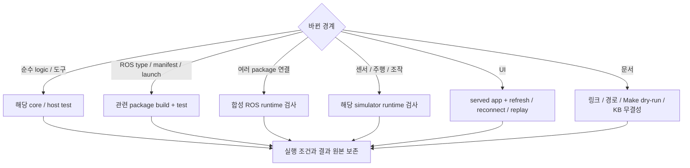
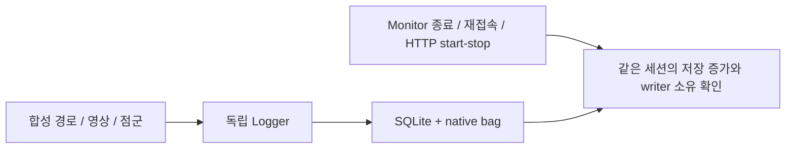
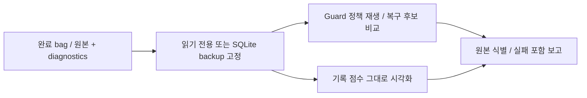

# 테스트 상세 참조

명령은 저장소 루트의 Humble/Fortress 환경에서 실행합니다. 변경 범위를 확인한 뒤 가장 작은 관련 검사부터 선택합니다. Make target의 실제 동작은 [Makefile](../../../Makefile)을 기준으로 확인합니다.

## 검사 선택



아래 표에서 변경 범위에 맞는 명령을 선택합니다. Simulator, mock 통과는 해당 입력과 backend의 증거이며, 실물 검증은 별도로 수행합니다.

| 변경 범위 | 명령 | 확인 범위 |
|---|---|---|
| 전체 ROS workspace | `make test` | build, colcon package test와 결과 집계 |
| Mission, Gateway core | `make test-mission-core` | ROS 없는 lifecycle, 영속성, 중복, 재전송 |
| Mock 조작 core | `make test-manipulation-core` | 서버 실행, 취소, 영속 기록과 모니터 |
| Mission과 Mock Action | `make test-mission-mock BASE_TEST_ROS_DOMAIN_ID=186` | 공통 타입, Action, 조회, 취소와 재시작; 주행은 Mock |
| Gazebo와 Mock Action | `make test-gazebo-manipulation BASE_TEST_ROS_DOMAIN_ID=186` | Nav2 도착과 정지, 두 수거, 추가 빈 관측과 보고 |
| Mission ROS 설치, 연동 | `make test-mission-runtime` | 관련 package build/test |
| Supervisor core | `make test-supervision-core` | ROS 없는 Fault, 허가, 복구, 영속성, Runtime 감독 port, 안전 증거 |
| Supervisor와 Runtime 연동 | `make test-supervision` | Supervisor ROS graph와 실제 Runtime, base driver, safety adapter, lifecycle 복구의 E2E; 센서, Nav2와 안전 하드웨어는 합성. 장애→정지 지연을 `$(CLEANY_DATA_ROOT)/runs/supervision/latency.json`에 기록 |
| Navigation core, plugin | `make test-navigation` | Python core와 C++ plugin |
| 합성 Navigation runtime | `make test-navigation-runtime` | ROS lifecycle, goal, 취소, sensor 단절과 보정 CAD/시뮬레이션 모델 선택 경계 |
| Gazebo, Navigation | `make test-gazebo` | package 검사와 C++ plugin; 선택 runtime은 제외 |
| Gazebo sensor runtime | `make test-gazebo-nav-runtime` | 실제 simulator의 sensor, odom, TF |
| 시설 목표 생성 | `make test-gazebo-facility-tools` | simulator 없는 ID, 여유, 제거 의자 처리 |
| MuJoCo | `make test-mujoco` | scene loader; 모든 조작 runtime을 뜻하지 않음 |
| Mock Manipulation Action | `make test-manipulation` | ROS Action, 취소, 조회와 재시작 복구 |
| MuJoCo BT 경계 | `make test-manipulation-bt` | native BT, Action, 관련 인식과 수거 회귀; 실제 물리 수거 성공은 별도 |
| Hand-eye 경계 | `make test-handeye` | description, MuJoCo, MoveIt, calibration |
| Base ROS | `make test-base` | interface, driver, odometry; mock MCU |
| IMU 고정 보정 | `make test-imu-runtime` | 기존 계수 적용 core, 합성 IMU 각속도와 가속도 전달, 오류와 수신 회복 |
| Wheel/IMU EKF | `make test-base-ekf` | mock wheel, 합성 IMU, covariance에 따른 융합, 장착 회전 변환과 실제 TF 발행자 |
| 통합 및 기존 모터 펌웨어 | `make firmware-build`, `make firmware-build FIRMWARE_ENV=esp32-s3-microros` | 같은 micro-ROS 캐시를 사용하므로 순차 실행합니다. |
| ESP32 준비, motor core | `make test-micro-ros-setup test-motor-core` | Python 준비 도구와 장치 없는 C++ |
| Logger | `make test-logger` | CLI 정책 편집과 종료 코드, 기록 정책, 읽기 전용 archive, 디렉터리 독점, 세션과 복구 경계 |
| Monitor와 Logger | `make test-dev-monitor` | Logger 검사와 ROS 수집, 저장, HTTP와 UI 데이터 경계 |
| Telemetry | `make test-telemetry` | odom relay |
| CI 준비 도구 | `make test-ci-tools` | 의존성 이미지 무효화, build context와 명령 전달 |
| Jetson USB 카메라 초기화 | `make test-camera-orientation` | 장치 식별, USB 제어와 복구, 설치 경로, unit과 udev 규칙; 실제 장치는 열지 않음 |

Fedora에서는 native ROS target을 Humble Distrobox에서 실행합니다. `test-micro-ros-setup`, `test-motor-core`는 Makefile의 `BASE_EXEC`가 환경을 선택합니다.

CI는 `PYTEST_DISABLE_PLUGIN_AUTOLOAD=1`로 runtime 의존성이 설치한 외부 pytest plugin의 자동 로드를 끕니다. 프로젝트의 `conftest.py`와 pytest 기본 plugin은 유지하며, 로컬에서는 `PYTEST_DISABLE_PLUGIN_AUTOLOAD=1 make test`로 같은 설정을 적용합니다.

`make test`는 package test가 실패해도 `colcon test-result --verbose`로 실패 상세를 출력하고 실패 상태를 반환합니다.

## CI 실행과 재사용

CI는 Ubuntu 22.04 amd64에서 전체 workspace 검사, ESP32 motor core와 합성 Navigation runtime을 실행합니다. 베이스의 pytest는 colcon에 직접 등록하며 전체 workspace 검사에서 한 번 실행합니다. Navigation runtime은 같은 실행에서 이미 빌드한 workspace를 사용합니다. Gazebo 환경 점검과 `cleany_gazebo_sim` 패키지 검사를 포함하며, 실제 시뮬레이터를 실행하는 Gazebo runtime은 별도 명시 검사입니다.

전체 빌드 이후 검사를 아래 단계로 분리합니다. 한 검사 단계가 실패해도 빌드가 성공했다면 나머지 독립 검사를 실행합니다. 주요 패키지와 runtime 검사는 실패 표시를 유지하면서 후속 검사를 계속 실행합니다. UI와 카메라 검사에 사용하는 `continue-on-error`도 마지막 집계에서 실제 실패로 반영합니다. 마지막 집계는 실패, 중단과 결과 누락을 모두 실패로 처리합니다.

CI는 실시간 mock MCU watchdog을 사용하는 `cleany_base_driver` 검사를 단독으로 먼저 실행합니다. 이후 시간이 오래 걸리는 패키지부터 runner CPU 수에 따라 최대 4개를 배정합니다. 합성 Navigation 런타임 검사는 대기열 끝에서 같은 실행 한도를 사용하며 별도 결과를 기록합니다. 패키지 내부의 CTest는 순차 실행하고 BLAS와 OpenMP 스레드는 하나로 제한합니다.

각 검사는 ROS 도메인, ROS 로그와 임시 디렉터리, Gazebo 전송 파티션을 분리합니다. 패키지 기본 도메인은 40–99를 사용합니다. 사례별 도메인은 ToF에 10–25, 베이스 EKF에 26–28, 합성 Navigation 런타임에 30, 32, 34, Supervisor에 190–224를 배정합니다. 패키지 테스트가 고정값이나 무작위 도메인을 선택하던 경우에는 `CLEANY_TEST_ROS_DOMAIN_ID`를 우선 사용합니다. TCP 서버 검사는 운영체제가 선택한 빈 포트를 사용합니다.

| 단계 | 범위 |
|---|---|
| ui / camera | 조작 UI 빌드와 입력 처리, 장치 없는 USB 카메라 초기화 검사 |
| environment | 도구, Pillow 이미지 API, 의존성 버전과 시뮬레이터 환경 |
| build | 전체 workspace 컴파일과 설치 |
| workspace | 전체 패키지와 합성 Navigation 런타임 병렬 실행 및 실패 집계 |
| navigation | Navigation 패키지 결과 묶음 |
| manipulation | Skill executor와 manipulation BT 결과 묶음 |
| workspace-rest | 위 그룹에 없는 모든 패키지 결과; 새 패키지도 자동 포함 |
| motor | ESP32 motor core |
| ros-runtime | 합성 ROS 통합 검사 |

[workspace_tests.py](../../../tools/ci/workspace_tests.py)는 전체 패키지, 그룹별 선택 목록과 명시적 제외 목록을 보존합니다. 제외 사유는 [workspace_test_exclusions.json](../../../tools/ci/workspace_test_exclusions.json)에서 관리합니다. `checks/workspace/schedule.json`에 동시 실행 수, 패키지별 시작과 종료 시각, 격리 환경을 기록하며 상세 로그와 진단은 `checks/<그룹>/packages/`에 둡니다. 그룹별 시간은 병렬 실행 기간이 겹치므로 합산하지 않습니다. 마지막 집계에서 세 그룹의 합집합이 명시적 제외 목록을 뺀 전체 패키지와 같은지 확인하고, 중복이나 추가 누락을 실패로 처리합니다. `cleany_manipulation_bt`는 `test/test_*.py`를 파일별 CTest 검사로 등록합니다. DDS Action runtime은 MuJoCo/Jetson 서버별로 분리하며 각 실행에 60초 제한을 적용합니다. 개별 Action 응답과 종료 대기 조건은 기존 테스트가 검사합니다.

[check.py](../../../tools/ci/check.py)는 검사별 명령, 커밋과 미커밋 변경 여부, 경과 시간, 로그와 종료 상태를 `checks/<단계>/`에 저장합니다. Python 검사가 40초 동안 끝나지 않으면 pytest faulthandler가 스택을 출력합니다. 자식 프로세스가 45초 이상 유지되면 해당 프로세스 상태와 C++ 스레드 스택을 수집합니다. GDB 수집 자체는 5초로 제한하고, 실패 정보도 보존합니다. 전체 단계 제한을 넘기면 해당 검사 process group과 관찰한 자식 프로세스를 종료합니다. ROS launch가 별도 session을 만든 경우도 PID와 시작 시각을 대조해 정리합니다.

MPPI 단위 검사는 실제 costmap executor의 시작을 확인한 뒤 진행합니다. 이는 짧은 검사 종료 시 Humble `NodeThread`의 시작과 취소가 엇갈리는 상황을 막으며 비용 계산이나 기대값을 변경하지 않습니다.

로컬에서 특정 검사를 같은 방식으로 실행할 수 있습니다.

```bash
python3 tools/ci/check.py --root /path/to/ci-results run navigation \
  --kind contract --timeout 600 -- make test-navigation
```

동시 실행 수를 지정해 전체 패키지를 검증하려면 빌드한 workspace를 source한 뒤 실행합니다. `--workers 1`로 같은 검사를 순차 실행할 수 있습니다.

```bash
source "$CLEANY_BUILD_ROOT/install/setup.bash"
cd ros2_ws
python3 ../tools/ci/workspace_tests.py all --workers 4
```

CI 환경에는 스택 수집용 GDB와 컨테이너 내부 프로세스 추적 권한이 필요합니다. Runner의 GDB와 전용 라이브러리를 읽기 전용으로 연결하며 고정 ROS 이미지의 라이브러리는 교체하지 않습니다. 진단 도구의 버전은 `debugger-version.txt`에 남깁니다. 테스트 결과는 캐시하지 않으며, 재시도로 첫 실패를 성공으로 바꾸지 않습니다.

| 재사용 대상 | 갱신 조건 | 검증 경계 |
|---|---|---|
| GHCR 의존성 이미지 | 모든 `package.xml`, rosdep YAML, `containers/ci/`, 이미지 준비 도구, platform 변경 | ROS, apt, pip 의존성만 포함하며 응용 소스와 빌드 결과는 포함하지 않음 |
| 격리 GDB 번들 | Runner 이미지 버전, 아키텍처, GDB 준비 스크립트 변경 | 복원한 GDB의 버전 명령 실행을 확인하고 실패하면 번들을 다시 준비 |
| ccache | compiler 내용, 소스, header와 옵션에 따라 hit/miss 결정 | 빌드 명령은 매번 실행하며 CTest/pytest 결과는 캐시하지 않음 |
| 같은 실행의 workspace | 전체 빌드 완료 후 runtime 검사에서 재사용 | 다른 실행의 `build/`, `install/`, test result는 복원하지 않음 |

이미지 key가 없으면 digest로 고정한 [기존 이미지 후보](../../../containers/ci/compatible-image.json)를 검사합니다.
설치 스크립트, 저장소 시점, Python 버전, rosdep 규칙과 platform이 같아야 후보로 선택합니다.
후보 컨테이너에서 현재 manifest의 `rosdep check`와 현재 버전 검사를 모두 통과한 경우에만
새 의존성 key로 등록합니다. 필요한 패키지가 없으면 고정된 ROS 저장소의 index만 갱신해
추가 설치하고 다시 검사합니다. Ubuntu 기본 패키지는 기존 이미지의 버전을 유지합니다.
의존성을 만족시키지 못하거나 버전이 다르면 후보를 사용하지 않습니다.
후보가 없거나 검사에 실패하면 고정한 저장소 snapshot과 Python 버전으로 이미지를 만듭니다.
이 재사용은 응용 소스나 빌드 결과를 포함하지 않으며 전체 빌드와 테스트는 매번 실행합니다.
기하 검사의 Python 패키지는 [검증용 버전 목록](../../../tests/requirements-geometry.txt)으로
실행 컨테이너에 설치합니다. NumPy와 ROS Python 버전은 변경하지 않습니다.
같은 저장소의 실행은 환경 확인을 통과한 새 의존성 이미지를 빌드와 테스트가 진행되는 동안 게시합니다. 검사 뒤 게시 결과를 기록하며, 게시 실패는 경고로 표시합니다. 의존성 이미지와 compiler cache는 응용 테스트가 실패한 경우에도 재사용할 수 있습니다. Fork PR은 이미지를 게시하지 않습니다. 매주 월요일 실행도 동일한 의존성 이미지를 재사용합니다.

기준은 2026-11-02에 조회한 Jetson의 system Python과 설치된 ROS 패키지입니다.
[repository-snapshots.env](../../../containers/ci/repository-snapshots.env)는 Ubuntu와 ROS 저장소의 시점을,
[pip-constraints.txt](../../../containers/ci/pip-constraints.txt)는 MuJoCo와 google-genai 및 전이 의존성 버전을 고정합니다.
베이스에 이미 설치된 ROS 패키지도 선택한 snapshot으로 갱신한 뒤 workspace 의존성을 설치합니다.
CI는 설치 후와 검사 시작 전에 [버전 검사](../../../containers/ci/verify-versions.py)를 실행합니다.
공통 ROS 패키지는 아키텍처별 빌드 시각을 제외한 upstream 버전을 비교하며,
Jetson에만 설치된 패키지를 CI에 추가로 설치하지 않습니다. JetPack, GPU 라이브러리와 실물 동작은 이 검사 범위가 아닙니다.
BT.CPP `4.9.1`의 amd64 패키지는 라이브러리 설치 위치와 CMake 검색 경로가 달라, CI 이미지에서 같은 바이너리를 가리키는 호환 링크를 추가합니다.

외부 의존성 갱신은 snapshot, Python constraints와 Jetson ROS 버전 기준을 명시적으로 변경하고 전체 CI로 검증합니다.
Dockerfile의 `DEPENDENCY_REVISION`만 올리면 같은 버전으로 이미지를 다시 만들며 패키지 버전은 갱신하지 않습니다.
저장소와 서명 키 갱신은 [ROS snapshot 안내](https://github.com/ros2/ros2_documentation/blob/rolling/source/Get-Started/Installation/Snapshot-Repository.rst)와 [Ubuntu snapshot 안내](https://snapshot.ubuntu.com/)를 따릅니다.

패키지 빌드는 최대 2개, 패키지 내부 컴파일은 runner CPU 수의 절반으로 제한해 두 병렬화 계층의 경합을 줄입니다. 최적화 수준은 기존 `RelWithDebInfo`를 유지합니다. 모델 검사에서는 같은 인자의 xacro 출력 bytes만 재사용하고 각 검사는 독립 XML tree를 받습니다.

`MAKEFLAGS`도 함께 지정해 colcon이 전체 CPU 수의 `-j` 옵션으로 CMake의 병렬 제한을 덮어쓰지 않도록 합니다.

MPPI는 CPU별 allocator ABI가 달라지는 `-march=native`와 xsimd SSE2 수학 결과를
손상시키는 `-ffast-math`를 사용하지 않습니다. `-O3`와 SIMD는 유지합니다.
amd64 CI는 `CLEANY_MPPI_PORTABLE_BUILD=ON`으로 MPPI 라이브러리와 이를 링크하는 대상에 같은 `-march=x86-64-v2`를 적용합니다.
`mppi_simd_math_test`는 라이브러리와 동일한 최적화 옵션에서 반올림, critic 비용의
거듭제곱과 optimizer 가중치의 지수 함수를 scalar 결과와 비교합니다.

CI artifact에는 test XML, CTest 기록, 단계별 로그와 스택, 재현 명령, 설치된 apt/pip 버전과 ccache 통계를 남깁니다. 속도는 이미지 생성과 compiler cache miss가 있는 최초 실행, 이미지와 cache를 재사용하는 실행으로 구분해 비교합니다. 이미지 pull과 cache 복원 시간도 포함한 GitHub job 전체 시간을 기준으로 판단합니다.

전체 job 제한은 40분이며 이미지 생성은 별도로 15분 안에 완료해야 합니다.
APT는 서명을 검증한 snapshot index에서 버전, 파일 경로와 SHA256을 결정합니다.
Ubuntu 패키지 파일은 동일한 pool 경로의 archive 미러, Launchpad의 동일 파일, 원래 snapshot 순서로 받습니다.
일반 archive에서 제거된 과거 버전도 snapshot의 크기와 SHA256에 일치하는 경우에만 사용합니다.
다운로드는 최대 8개씩 수행하고 SHA256과 크기가 일치하는 파일만 APT cache에 보관하며 설치 시 APT가 다시 검증합니다.
`rosdep` 설치 계획의 일반 APT 요구사항은 16개씩 먼저 설치해 패키지별 반복 호출을 줄입니다.
이후 기존 `rosdep install`과 `rosdep check`로 pip, 대체 패키지와 전체 의존성 충족 여부를 확인합니다.
미러의 최신 index나 다른 버전으로 대체하지 않습니다.
연결 timeout은 15초, 파일 다운로드는 60초, 한 설치 명령의 다운로드 준비는 5분으로 제한합니다.
APT 자체 재시도는 1회, 의존성 준비 명령은 10초 대기 후 최대 2회 실행합니다.
계속 실패하면 CI를 실패 처리합니다. 빌드와 테스트는 이 재시도 대상에 포함하지 않습니다.

## 선택 runtime과 UI

### 카메라 영상 수집

현재 workspace를 빌드한 뒤 `tools/validation/capture_cameras.py`로 실제 ROS
카메라 영상을 수집합니다. 각 출력 경로는 아직 없는 새 디렉터리여야 합니다.

```bash
source /opt/ros/humble/setup.bash
source "$(make -s print-install-base)/local_setup.bash"
python3 tools/validation/capture_cameras.py --backend mujoco \
  --output /absolute/new-camera-run/mujoco
python3 tools/validation/capture_cameras.py --backend gazebo --gazebo-model cad-with-arms \
  --output /absolute/new-camera-run/gazebo
PYTEST_DISABLE_PLUGIN_AUTOLOAD=1 python3 -m pytest -q tests/tools/test_capture_cameras.py
```

GUI가 없는 환경에서는 촬영 명령 앞에 `xvfb-run --auto-servernum`을 붙입니다.
VM에서 GPU 렌더링이 불안정하면 `LIBGL_ALWAYS_SOFTWARE=1`을 지정합니다.
Gazebo의 `--gazebo-model legacy`로 레거시 모델도 선택할 수 있습니다.

| 카메라 수집 결과 | 해석 |
|---|---|
| 검사 | Head / 양손목 크기, encoding, 좌표계, buffer, simulation clock와 상태 |
| 출력 | PNG, report.json, launch.log |
| 누락 / timeout / 조기 종료 | 실패 코드, 도구가 시작한 process group 종료 |
| 모델 | CAD 주행 기본은 팔 제외; cad-with-arms는 촬영 검사에만 팔 포함 |
| 한계 | 촬영 성공은 전체 집기 미션 성공 아님 |

### 선택 실행 조건

Gazebo package의 `--run-sim-runtime`, `--run-evaluation-tests`와 Mission core의 `CLEANY_RUN_ROS_TESTS=1`은 별도로 활성화하는 검사입니다. 실행 결과에서 통과와 skip을 구분합니다.

Logger의 `CLEANY_RUN_ROS_TESTS=1 make test-logger`는 native rosbag2의 활성 읽기,
센서와 진단 bag 분리, CDR 조회, 합산 용량과 ZIP 내보내기도 검사합니다.
실물 ROS domain과 분리해서 실행하며, 이 검사는 실물 주행의 누락률이나
시간당 저장 용량을 보장하지 않습니다.

```bash
source /opt/ros/humble/setup.bash
source "$(make -s print-install-base)/setup.bash"
ROS_DOMAIN_ID=82 CLEANY_RUN_ROS_TESTS=1 make test-mission-core
```

### 독립 Logger



| 준비 / 확인 | 조건 |
|---|---|
| 준비 | Build overlay, 빈 출력 경로, Logger와 Monitor 별도 프로세스 |
| 검사 | SQLite 증가, 원문 CDR / stamp, 재접속, HTTP 시작 / 정지, Logger 단절, writer 대체 금지 |
| 제외 | 실제 로봇 구동과 센서 성능 |

```bash
ROS_DOMAIN_ID=218 ROS_LOCALHOST_ONLY=1 make test-logger-independence \
  LOGGER_TEST_OUTPUT=/absolute/new-logger-run LOGGER_BASE_COMMIT='<base-commit>'
CLEANY_RUN_ROS_TESTS=1 ROS_DOMAIN_ID=217 ROS_LOCALHOST_ONLY=1 make test-dev-monitor
```

### Logger CLI

| CLI 연결 검사 | 확인 |
|---|---|
| 실행 | 별도 Logger에 설치된 logger CLI로 조회 / 토픽 설정 / 시작 / 정지 |
| 저장 | 합성 경로와 이미지를 native bag에서 다시 읽기 |
| 경계 | CLI 종료 뒤 녹화 유지, 활성 설정 거부, 세션 보호, 연결 실패 |

```bash
ROS_DOMAIN_ID=219 ROS_LOCALHOST_ONLY=1 make test-logger-cli \
  LOGGER_TEST_OUTPUT=/absolute/new-cli-run LOGGER_BASE_COMMIT='<base-commit>'
```

### Monitor와 웹

Monitor smoke는 같은 domain에서 Monitor를 먼저 실행한 뒤 호출합니다.

```bash
ROS_DOMAIN_ID=187 python3 ros2_ws/src/cleany_dev_monitor/runtime_test/smoke.py --output /absolute/new-run
# frontend의 현재 Playwright 설정과 package scripts:
cat ros2_ws/src/cleany_dev_monitor/web/package.json
```

Frontend 검사는 `ros2_ws/src/cleany_dev_monitor/web`에서 `pnpm exec tsc --noEmit`과 `pnpm exec playwright test`를 실행합니다. 실제 Monitor가 필요한 검사는 `MONITOR_URL`을 지정하고 해당 ROS 입력도 준비합니다. 기본 fixture 검사는 로컬 Vite를 시작합니다.

UI 변경은 실제 served app에서 새로고침, 재연결, 기록 재생까지 확인합니다. Playwright browser가 없으면 configured browser를 설치한 뒤 다시 실행합니다.

Mission Gateway smoke는 `tests/integration/mission_runtime/`, Monitor smoke는 `ros2_ws/src/cleany_dev_monitor/runtime_test/`에 있습니다. 실제 Backend, ROS, Gazebo 입력 조건을 준비한 경우에 명시적으로 실행합니다.

## 결과와 증거

| 증거 | 의미 |
|---|---|
| 소스, manifest, 단위 검사 | 구현과 검사된 입력의 계약 |
| mock / 합성 ROS | 합성 backend의 lifecycle과 메시지 경계 |
| Gazebo, MuJoCo runtime | 해당 시뮬레이터, 입력, 버전의 동작 |
| 장치 통신 | 실제 USB, UART, DDS 등 확인한 계층 |
| 물리 시험 | 실제 sensor, actuator, 정지, 시나리오 결과 |

결과에는 다음 항목을 남깁니다.

- Code commit와 dirty 상태, 환경, overlay
- 입력, config, asset hash
- 요청 범위와 실제 완료 범위, 실패, skip, 중단
- 로그와 출력 위치

CTest wrapper와 pytest 집계가 겹치면 중복 합산하지 않습니다. 변경별 검증 결과는 PR과 CI 결과에 남깁니다. 별도 보고서나 대용량 원본을 공유할 때는 팀이 합의한 위치와 접근 방법을 함께 안내합니다. 개인 로컬 출력 경로만으로 팀이 결과를 재현할 수 있다고 가정하지 않습니다.

## 문서 변경 검사

내부 파일 링크, anchor, 코드, 설정, launch 경로, Make target의 존재와 native dry-run을 확인합니다. 문서 검증만을 위해 실제 로봇을 움직이거나 새 calibration을 수행하지 않습니다.

KB를 변경한 경우에는 KB의 `kb-quality-checks`도 실행합니다. 검사 통과와 내용 승인은 별도로 기록합니다.

## 실물 매핑 패키지 경계

| 명령 | 경계 |
|---|---|
| make test-hardware-mapping-core | Lease / ordered permission의 MCU 확인 / scan filter / config / map origin yaw / 원자적 저장 |
| 같은 core 묶음 | 초기화 직렬화, 저장 실패, heartbeat 만료·복귀, RPC 원인, 실패 로그·traceback, 이벤트 회전·재시작, 큐 포화·디스크 장애 |
| make test-base BASE_TEST_ROS_DOMAIN_ID=174 | Base 회귀와 구동 허가 계약 |

같은 domain에서 ROS graph 검사를 동시에 실행하지 않습니다.

설치된 패키지의 모의 통합은 다음 명령으로 실행합니다. 새 출력 디렉터리를 지정합니다.

```bash
make build-hardware-mapping
make test-hardware-mapping-runtime MAPPING_TEST_OUTPUT=/absolute/path/to/new-artifact-dir
```

| 설치 패키지 통합 검사 | 범위 |
|---|---|
| 환경 | Domain 173, synthetic MCU / LiDAR, 저장소 밖 /tmp에서 설치 launch |
| 제어 | 단일 휠 publisher, 휴대폰 명령과 해제, 초기화와 중복 요청 |
| 저장 / 종료 | 두 세션 map / pbstream / Logger bag, 최종 저장 후 종료 |
| 종료 뒤 | 관리자 heartbeat 만료, 조종 이벤트 저장 |
| 실물 제외 | USB를 열지 않음; 정지 거리 / 장착 TF / 지도 품질은 별도 |

`make test-hardware-mapping`은 관련 ROS 패키지를 domain 174에서 순서대로 검사합니다.
Base graph fixture는 BASE_TEST_ROS_DOMAIN_ID도 따르므로 두 domain 변수를 함께 설정합니다.
위 통합 결과의 bag은 domain 175에서 실제 ROS 재생으로 확인할 수 있습니다.

```bash
make test-hardware-mapping-replay \
  MAPPING_BAG=/absolute/path/to/recordings/bags/session-id \
  MAPPING_TEST_OUTPUT=/absolute/path/to/replay-verification.json
```

## ToF와 Supervisor 통합

| 명령 | 확인 범위 |
|---|---|
| make test-tof-core | 거리 투영, 평면 fit, 제동 envelope, timeout, navigation 경로 |
| make test-tof | Interface / ToF / Mission / safety adapter / Supervisor build와 package 검사 |
| ToF ROS | 격리 DDS domain의 합성 좌표계 / odom / lease와 pseudo-terminal; 실제 센서 / 모터 미사용 |

기존 navigation C++/Python 회귀 검사는 Humble 환경에서 `make test-navigation`으로
실행합니다. Mission의 선택 ROS 시나리오는 `CLEANY_RUN_ROS_TESTS=1`과 독립
`ROS_DOMAIN_ID`에서 별도 실행합니다. colcon의 선택 시나리오 skip은 성공으로 해석하지 않습니다.
실물 검증 항목은 [CALIBRATION](../calibration.md#tof-근접-보호-commissioning)을 따릅니다.

| 회귀 입력 / 단계 | 확인 항목 |
|---|---|
| 단독 보드 로그 3 좌표계 + 합성 입력 | 정상 미검출 허용, 부분 불량 제외, 전부 불량 정지 |
| 필터 | 인접 / 물리 cluster, 15 Hz 지속, flash / 고립 noise, 비상 단일 검출, 해제 hysteresis, reset |
| ROS | 센서 fault / stale 정지, 일부 불량 Zone 접근, 평면 소실, lease / cancel |
| Navigation | ToF on/off와 독립 head-pan observer 조합 |
| 검증 한계 | 합성 graph는 기존 안전 chain을 identity로 대체; 실제 Nav2 / 모터 주행 아님 |

원본 측정 로그를 ROS 개발환경에서 오프라인 감사하려면 다음을 사용합니다. 장치를 열지 않습니다.

```bash
PYTHONPATH="$PWD/ros2_ws/src/cleany_tof" python3 tools/validation/tof/replay.py \
  /absolute/path/to/range-15hz-2min.jsonl --output /absolute/path/to/audit.json
```


## 얼굴 디스플레이

상태 로직은 Jetson의 독립 설치 폴더에서 `make test`로 검사합니다. 저장소의 `make test`가 실행하는 colcon 검사에도 같은 pytest가 등록됩니다.

ROS→HTTP 전환, 결과 수량과 연결 복구는 구현 레포 루트에서 다음 명령으로 검사합니다. `/cleany_display_validation/` 토픽과 domain 173을 사용하며 로봇 제어기는 실행하지 않습니다.

```bash
source /opt/ros/humble/setup.bash
source /home/cleany/cleany-display/ros2_ws/install/local_setup.bash
ROS_DOMAIN_ID=173 python3 tools/validation/verify_cleany_display_ros.py \
  --config /home/cleany/cleany-display/config/display.json \
  --output output/cleany-display-jetson/ros-verification.json
```

| 얼굴 UI 검사 | 명령 / 항목 |
|---|---|
| 환경 | [웹 의존성](../development-setup.md#monitor-웹)과 로컬 Chrome |
| 명령 | 노드 tools/validation/verify_cleany_display_web.cjs |
| 렌더링 | 7개 표정 60 fps, Zzz 주기, 화면 비율 / 720p 상한 |
| 갱신 | 설정 변경, 60.01 Hz 입력의 균등 30 fps, 같은 상태 DOM 변경 없음 |
| 접근성 / 복구 | 모션 감소, HTTP 복구 |
| 출력 | Git 제외 output/cleany-display-jetson/ |

| 얼굴 전환 검사 | 내용 |
|---|---|
| 명령 | 노드 tools/validation/verify_cleany_display_transitions.cjs |
| 입력 | HTTP 상태 변경 + 제어된 60 Hz 프레임 |
| 확인 | 깜빡임 연속성, 눈 / 입 중간 모양, 얼굴 위치, 땀방울 / Zzz 소멸 |
| 경합 | 안내 교체 중 새 상태, 도움과 일반 안내 겹침, 모션 감소 |
| 출력 / 한계 | output/cleany-display-jetson/transitions/; 실제 장치 fps 측정 아님 |

실물 성능 측정은 Jetson에서 다음 순서로 실행합니다.

1. `systemctl --user set-environment CLEANY_DISPLAY_DEBUG_PORT=9223`과 `systemctl --user restart cleany-display-kiosk`로 전용 브라우저의 로컬 디버깅 포트를 엽니다.
2. 설치 폴더의 `browser-tools/bin/python`으로 `tools/validation/measure_cleany_display.py --output <결과.json>`을 실행합니다. `--modes idle moving checking collecting complete charging help`를 추가하면 브라우저 응답만 임시로 바꿔 표정별로 측정하고 실제 ROS 상태 화면으로 복구합니다.
3. 측정 종료 후 `systemctl --user unset-environment CLEANY_DISPLAY_DEBUG_PORT`와 키오스크 재시작으로 디버깅 포트를 닫습니다.

결과의 `frames.canvas.fps`는 실제 캔버스 렌더링 빈도이고 `frames.raf.fps`는 브라우저 콜백 빈도입니다. CPU 수치는 단일 코어 기준이며 GPU 사용률이 아닙니다. 실물 화면, 장시간 동시 운용과 재부팅 후 자동 시작은 별도 검증합니다.
## MoveIt 충돌 형상과 MuJoCo 동등성 검사

| 모델 검사 | 조건 |
|---|---|
| 명령 | make test-description-models |
| 환경 | ROS 2, MuJoCo, NumPy, SciPy |
| 원본 URDF / MJCF 비교 | optimized_arm_collision_meshes:=false head_collision_meshes:=false |
| 기본 최적화 모델 | 시각 형상 / 관성 / 관절 보존, motor collision mesh 배치 |
| 물리와 계획 | MuJoCo 접촉은 기존 MJCF, MoveIt 계획은 최적화 URDF |
| 추가 인수 | COLLISION_TEST_ARGS로 -k, --junitxml 등 전달 |

## 충돌 메시와 내부 장애물 검사

```bash
make build COLCON_BUILD_ARGS="--packages-up-to cleany_moveit_config"
make test-moveit-collision
```

첫 명령은 description, 충돌 플러그인과 기존 scene mapping 의존성을 함께
빌드합니다. Jetson의 MoveIt 2.5.9 전용 환경을 사용하는 경우 해당 overlay를
먼저 source합니다. 검사 시 불러오는 설치 경로는 `INSTALL_BASE`를 따릅니다.

| 충돌 검사 | 확인 |
|---|---|
| 묶음 | 형상, SolidFCL 단위, 계획 설정, 실제 MoveIt service |
| Service | 기본 detector가 내부 장애물 36개 검출, 표면 FCL은 같은 입력 누락 |
| 오류 | 없는 detector 선택 시 프로세스 종료 |
| 구동 경계 | 가상 장애물만, trajectory execution OFF, motor driver 미실행 |

## 지도 확장 검증

병행 지도 확장 도구의 원점 변환과 지도 저장 형식은 ROS Python 환경에서
`PYTEST_DISABLE_PLUGIN_AUTOLOAD=1 python3 -m pytest -q tests/tools/test_map_extension.py`로 검사합니다.
실행 시 `/map`과 `/tf` 발행자에 확장 Cartographer가 없는지, `/map_extension/map`
및 `/map_extension/tracked_pose`가 수신되는지 확인합니다. 실물 확장 품질은
연결 통로 왕복 관측과 복귀 시 벽 정합으로 별도 평가합니다.

### 순정 Lattice와 Omni 기본 튜닝 비교

`tools/validation/native_lattice_mppi`는 설치된 Smac Lattice와 통합 MPPI를 격리 실행합니다. 실제 로봇에 속도를 발행하지 않습니다. 입력 폴더에는 `map.txt`(크기, 해상도, 원점), `map.bin`(Nav2 cost byte 배열), `poses.txt`(시작/목표 x y yaw)가 필요합니다. 설정은 controller_server, planner_server와 local_costmap의 합성 YAML입니다.

```bash
cmake -S tools/validation/native_lattice_mppi -B /tmp/cleany-lattice-validation
cmake --build /tmp/cleany-lattice-validation -j2
python3 tools/validation/native_lattice_mppi/compare.py \
  /tmp/cleany-lattice-validation/closed_loop '<artifact-root>' '<config-stem>' '<case>'
```

| 격리 Lattice / MPPI 비교 | 기준 |
|---|---|
| 입력 / 출력 | case 폴더 + config-stem.yaml; 결과, 초기 경로, 20 Hz 명령 저장 |
| --preview-goal | 최초 미리보기 끝점을 실제 목표로 사용 |
| Domain | 188, 운영 domain과 같으면 거부 |
| 운동 모사 | 1 Hz 재계획, 1.5 m 지역 경로, 이상적 평면 적분 |
| 완료 | 120 s simulation 안에 반환 끝점 3 cm / 0.1 rad 이내 + footprint 충돌 검사 |
| 별도 출력 | 클릭한 목표와 오차 |
| 미재현 | 실제 PathHandler TF / 지역 지도 갱신, AMCL 오차, 통신, 모터 응답, 슬립 |

실물 주행 성공 근거로 사용하지 않습니다.

`balance_primitives.py SOURCE DESTINATION`은 직선 primitive의 좌표를 변경하지 않고 길이 metadata를 재계산합니다. `test_motion_profile.py`는 번들 원본과의 차이가 오른쪽 횡이동 16개의 길이 필드뿐인지, 모든 직선 길이가 기하와 일치하는지 검사합니다.


| 자동 검사 | 범위 |
|---|---|
| mppi_critics_tests의 Directional*, mppi_critic_manager_test | 부호 대칭, 거리당 각도 비용 / 봉우리, 시간 적분, DiffDrive 비활성, plugin 로딩 |
| test_slip_context.py | 과거 TF / 명령, stale / null, bounded history, 지도 식별 |
| cleany_logger/tests/test_logger_policy.py | 문맥 토픽 기록 / 제외 / remap |
| 격리 compare.py | 실제 planner/controller + 이상적 운동학의 도착 / 명령 한계; 실물 슬립 개선 아님 |


`tools/validation/slip_context_recording.py --output <새 결과 폴더>`는 설치된 logger에
합성 String 메시지를 보내고 저장된 CDR을 다시 읽어 문맥을 비교합니다. hardware domain 0에서는
실행을 거부합니다. runner 환경 설정 뒤 별도 `ROS_DOMAIN_ID`를 지정해 실행합니다.


### 기록된 Nav2 조건과 MPPI reset 검사

| Bag fixture 추출 | 계약 |
|---|---|
| 도구 | tools/validation/native_lattice_mppi/extract_bag_fixture.py |
| 시각 선택 | 지정 시각 이전 수신 global costmap / odom / plan / map→odom TF |
| 거부 | 수신 / header 미래 값, stale, 좌표계 불일치 |
| 비용 역변환 | OccupancyGrid 비용 구간 상한, lethal / unknown 보존 |
| 검사 | tests/tools/test_bag_navigation_fixture.py의 비용 변환 / SE(2) 합성 |

`compare.py`의 폐루프는 정적 비용 지도에서 정지 출발하는 이상적 운동 모사입니다.
실제 scan의 시간 변화, SLAM/AMCL 오차, BT 복구, 마찰과 슬립을 재현하지 않습니다.
`--preview-goal` 사용 시 반환된 Lattice 끝점을 도착 기준으로 사용하고 요청 좌표와의
오차를 별도로 기록합니다. 실패한 과제도 결과에 보존해야 합니다.

`noise_reset_probe`는 1000×60 후보의 reset 직후 잡음과 실행 시간을 100회 측정합니다.
`mppi_noise_generator_test`는 비동기 생성 요청과 reset이 겹칠 때의 완전한 첫 묶음,
운동 모델 전환, 독립 controller 난수열과 종료를 검사합니다. ROS domain은 실제 로봇과
분리합니다. 헤더의 객체 배치가 바뀌면 비교용 바이너리도 해당 라이브러리와 함께 재빌드합니다.

메모리 사용을 제한하는 격리 빌드는 패키지 수와 C++ 컴파일 작업 수를 모두 제한합니다.
`CMAKE_BUILD_PARALLEL_LEVEL`은 CMake `-D` 인수가 아니라 환경 변수입니다.

```bash
CMAKE_BUILD_PARALLEL_LEVEL=2 MAKEFLAGS=-j2 make build \
  CLEANY_BUILD_ROOT=/path/to/isolated-build \
  COLCON_BUILD_ARGS='--packages-select cleany_navigation --parallel-workers 1'
```


## D435 높이 필터 검증

```bash
python3 -m pytest -q   ros2_ws/src/cleany_navigation/test/test_depth_obstacles.py   ros2_ws/src/cleany_navigation/test/test_depth_obstacle_preview_transport.py
# 실물 미리보기가 이미 실행 중인 경우의 읽기 전용 확인
python3 tools/validation/probe_depth_obstacle_cutoff.py   --min-z .192 --output /path/to/run/live-check.json
```

| 검사 | 근거 |
|---|---|
| 자동 | 높이 경계, 기울어진 바닥과 독립 고정 하한, TF 소실 시 오래된 점군 제거 |
| 실행 중 probe | Fresh 비어 있지 않은 출력의 좌표계 / 최소 높이 |
| 한계 | 물체 검출률이나 주행 안전 입증 아님 |

## 실물 depth costmap과 Monitor 격리 회귀

| Depth 회귀 | 격리 범위 |
|---|---|
| test_depth_local_costmap.py | Domain 192, 실제 VoxelLayer의 marking / 미관측 유지 / 재관측 clearing |
| test_collision_monitor.py | Domain 191, LiDAR / depth 정지 우선순위, 절대 상한, required depth 단절 / 복구 |
| test_depth_transport.py | 실제 형식의 depth, capture TF, 무효 영상 차단, floor clearing |
| test_lidar_navigation_launch.py | Depth 옵션이 global costmap / slip 설정을 바꾸지 않음 |

로봇 domain 0에 속도를 보내지 않습니다.

```bash
python3 -m pytest -q ros2_ws/src/cleany_navigation/test/test_depth_local_costmap.py ros2_ws/src/cleany_navigation/test/test_collision_monitor.py ros2_ws/src/cleany_navigation/test/test_depth_transport.py ros2_ws/src/cleany_navigation/test/test_lidar_navigation_launch.py
```

격리 합성 입력 검사는 실물 의자 이동이나 실제 제동 거리의 검증과 구분합니다. 실물에서는 조종 pause 상태에서 의자를 놓고 치운 관측과 costmap을 기록한 후 별도 주행 시험으로 진행합니다.


## 기록 분석 도구

| 목적 | 도구 | 결과 해석 |
|---|---|---|
| 과거 정책 재생 비교 | `validate_recorded_localization.py` | 고정된 AMCL/TF 입력의 정책 차이 |
| 기록 점수 시각화 | `plot_localization_history.py` | 점수 재계산 없이 PNG/PDF/CSV/HTML |
| 복구 하한과 흐름 비교 | `localization_policy_experiment.py` | 기록 기반 비교; 물리 복구율 아님 |



### 기존 정책 재생

```bash
python3 tools/validation/validate_recorded_localization.py --help
```

| 인수 / 실행 | 의미 |
|---|---|
| --bag 반복 | 원본과 diagnostics DB가 있는 완료 bag |
| --settings | 비교 localization 설정 |
| --old-source-tar / --draft-source | 이전 정지 정책 snapshot / 비교할 수정 전 감속 정책 Python |
| --output | 해당 실행 결과 폴더 |
| 보존 | 원본 DB read-only, 전후 hash 확인 |
| 재생 | DDS domain 196의 실제 Guard; 기록 AMCL / TF 고정 |
| 누락 | 없는 initialpose는 AMCL 수신 로그로 보수적 신뢰 초기화; 저장 주기 / 입력 누락 유지 |

변경 속도로 실제 이동했을 때의 위치 정확도나 최적 감속 비율은 입증하지 않습니다.

### 기록된 점수 시각화

```bash
python3 tools/validation/plot_localization_history.py   --bag BAG --end ISO_TIME --minutes 10 --output RUN_DIR
```

| 항목 | 처리 |
|---|---|
| 종료 시각 | 시간대 포함 |
| 입력 | Read-only transaction으로 정합 / 출력 속도 / 목표 취소 추출 |
| 출력 | PNG, PDF, CSV, HTML |
| 그래프 | 점수 재계산 안 함, 수신 공백 / 오래된 점수 연결 안 함 |

### 복구 정책 비교

```bash
python3 tools/validation/localization_policy_experiment.py --bag BAG --output RUN_DIR
python3 tools/validation/report_localization_policy_experiment.py RUN_DIR
```

| 항목 | 계약 |
|---|---|
| 복수 입력 / 시각 | --bag 반복, 필요 시 --end UNIX_SECONDS |
| 기록 중 DB | SQLite backup으로 먼저 고정 |
| 관측 창 | 원본 지도와 인과적 TF의 정지 구간 |
| 비교 | 전체 참조 스트림에 위치 / 방향 오차를 유지한 채 기존 하한과 구조 후보 비교 |
| 출력 / 검사 | HTML / CSV / 그래프, tests/tools/test_localization_policy_experiment.py |
| 한계 | 기록 AMCL은 실측 정답 아님; 재초기화 뒤 AMCL / 물리 복구율 입증 안 함 |
| 설정 영향 | 실행 프로필 자동 변경 없음 |

## 테스트와 도구 위치

테스트는 검사 대상을 소유한 위치에 둡니다. 루트 `tests/`에는 저장소 도구의 자동 검사와 패키지를 연결하는 통합 검사만 둡니다. 실행, 관찰과 보고 코드는 검증 도구로 분리합니다.

| 위치 | 책임 |
|---|---|
| `ros2_ws/src/<package>/test/`, `tests/` | 패키지 기능과 계약의 자동 검사 |
| `ros2_ws/src/<package>/runtime_test/` | 해당 패키지의 명시 실행 smoke와 runtime 검사 |
| `tests/integration/` | Backend, Mission 등 여러 구성 요소의 연동 검사 |
| `tests/tools/` | 저장소 검증 도구의 자동 검사 |
| `tools/validation/` | Simulator 실행과 영상·로그 수집 |

패키지 내부에도 통합 검사가 있을 수 있습니다. 파일의 책임과 실행 조건으로 위치를 정하며, runtime CLI를 `tests/`에 넣었다고 pytest가 자동 실행하는 것은 아닙니다.

## FreeCAD 정적 기준 모델

`make test-freecad-model`은 부품 해시, URDF의 시각·충돌 표면 일치, 단위와
원점 변환, 560 mm 기둥, 화면 텍스처, 잘못된 보정 선택의 거부를 확인합니다.
MuJoCo 로드 후 관절과 actuator가 없고 주요 부품 경계가 URDF 메시와 같은지도
검사합니다. 기존 Make 변수 `GEOMETRY_PYTHON`으로 NumPy, pytest와 MuJoCo가 있는
Python을 선택할 수 있으며 이 검사는 ROS나 모터를 실행하지 않습니다.
내보내기 도구 검사는 메시 분할 경계의 삼각형 보존, 이전 manifest의 호환과
재실행 시 중복 제거를 확인합니다. 출력 실패 후 재시도와 사용자 파일 보존도 검사합니다.

`make test-description-models`와 패키지의 colcon test에도 새 모델 검사가
포함됩니다. 기존 실행 모델의 FK와 관절 검사 통과는 새 CAD의 운동학이나
실물 정확도를 검증한 결과가 아닙니다.

`test_freecad_kinematics.py`는 서보·구동 혼·지지 혼의 공통 축 근거, 부품의 단일
링크 소유, 저장 자세 재현과 임의 변화량의 독립 URDF FK 일치를 검사합니다.
MuJoCo mocap 배치도 FK와 대조하며 질량이나 actuator가 생성되지 않는지 확인합니다.
`test_freecad_gripper_linkage.py`는 양쪽 집게의 핀 거리, 폐쇄 링크 잔차,
URDF FK에서 연결된 두 부품의 핀 일치와 해가 모호한 자세의 거부를 검사합니다.
종속 관절을 독립 입력으로 지정하면 거부하며 물리 영점·운용 한계는 null로 유지합니다.
`test_freecad_tip_mounts.py`는 네 팁의 공통 체결축, 양방향 간섭 근거와 고정
자식 링크를 검사합니다. 캠을 움직여도 운반 링크와 팁의 상대 배치가 유지되고
URDF FK와 MuJoCo의 고정 자식 배치가 일치하는지 확인합니다. 체결력과 재질의
탄성은 이 검사에서 확정하지 않습니다.
변화량 표본은 수치 검사 입력이며 운용 제한이나 실물 정확도를 증명하지 않습니다.


## FreeCAD MoveIt와 OctoMap, cuRobo 검사

[검사 launch](../../RUNNING.md#freecad-moveit와-octomap-검사)를 실행하고 같은 ROS
domain에서 아래 명령으로 CAD 저장 자세와 합성 점군을 보냅니다. MoveIt의 모델
이름, 관절 상태, OctoMap과 동작 인터페이스 비활성화를 확인합니다.

```bash
python3 ros2_ws/src/cleany_moveit_config/runtime_test/check_freecad_scene.py
```

Jetson의 cuRobo CUDA 환경에서는 아래 명령으로 CAD 저장 자세의 메시 충돌을
확인합니다. LiDAR 표면과 차체에서 떨어진 지점에 시험 구를 배치합니다.

```bash
"${CLEANY_CUROBO_VENV:-$HOME/.local/opt/cleany/curobo078/venv}/bin/python" tools/validation/check_freecad_curobo.py \
  ros2_ws/src/cleany_description
```

인덱스 캐시는 같은 overlay를 읽은 상태에서 cuRobo 검사에
`--collision-cache "$collision_cache"`를 추가해 검증합니다. MoveIt과 OctoMap은
동일한 점군으로 STL과 GLB를 각각 검사하고 결과 지도 해시를 대조합니다.
캐시 생성기의 좌표, 모델 해시와 손상 검사에는 아래 명령을 사용합니다.

```bash
python3 -m pytest -q tests/tools/test_freecad_collision_cache.py \
  tests/tools/test_freecad_mesh_reduction.py tests/tools/test_freecad_moveit_cache.py
```

표면 감면 검사는 정점 일치만으로 판정하지 않습니다. 삼각형 내부까지 거리를
확인하고, 검사량 제한에 도달하면 후보를 거부합니다. 테스트는 좁은 구멍,
삼각형 내부 누락, 다른 대각선 분할, 오차 입력과 캐시 손상을 포함합니다.
`manifest.json`에는 파일별 감면 수와 양방향 표면 거리 상한을 기록합니다.
이 상한은 표본의 최대 거리나 실물 오차가 아니며, 감면 메시가 원본 입체를
완전히 감싼다는 보증도 아닙니다. cuRobo 링크 캐시는 저장 전후 삼각형 배열의
완전 일치를 확인합니다.

MoveIt 하부 캐시 검사는 직렬화한 박스와 원통의 원본 포함, 바퀴축 보존,
서로 움직이는 링크의 병합 거부와 비충돌 XML 보존을 확인합니다. 하부 primitive는
작은 구멍과 홈을 채우므로 이 부분에 표면 감면의 거리 상한을 적용하지 않습니다.
몸통 검사는 상판 투입구 추출, 기존 횡대 높이의 유지와 투입구를 가로지르는
삼각형의 거부를 포함합니다. 모든 꼭짓점이 구멍 밖에 있어도 내부를 가로지르는
삼각형은 거부합니다. cuRobo 검사는 CAD 저장 자세의 FK, 단순 입체별 객체 분리,
저장 후 삼각형 일치와 관절 URDF 변경의 거부를 확인합니다. GPU 실행 시에는
몸통의 깊은 내부와 투입구의 양쪽 경계도 검사해야 합니다.

분할 외피 검사는 조각 사이 틈, 링크와 시각 모델 보존, GLB의 닫힘과 원본
포함 관계를 확인합니다. 확장 상한은 원본 조각의 볼록 외피 기준입니다.
`cleany_moveit_collision`의 native 테스트는 검사 전용 detector가 미선언
CAD 표면을 유지하면서, 선언한 외피의 내부 장애물을 scene 복사 후에도
검출하는지 확인합니다. 잘못된 외피는 거부해야 합니다. 실제 캐시에서는
기둥 허리 바깥의 빈 공간과 각 외피 조각 내부를 자체 필터, MoveIt 접촉과
GPU 구 쿼리로 대조합니다.
추가 외장 감면에서는 보호 부품의 메시 해시, 동일 링크 안의 강체 묶음과
다른 링크 병합의 거부도 검사합니다. cuRobo native cuboid는 관절 변환 후의
위치와 quaternion, 미리보기 삼각형 일치와 박스 데이터 변조 거부를 확인합니다.
실제 GPU에서는 같은 쿼리로 메시 박스와 native cuboid의 판정 및 시간을
비교합니다. 삼각형 감소만으로 실행 시간이 개선됐다고 판단하지 않습니다.
캠과 가동 링크 감면에서는 원본 삼각형 포함 외에 접촉 패드의 삼각형과 관절
변환 일치를 검사합니다. CAD 비교 자세별로 패드 사이 입구 공간과 새 볼록
외피의 교차 여부를 확인하고, 열린 자세의 점군과 접촉 쿼리를 전후 대조합니다.
결합부 수정은 감면 전 표면 모델, 수정 전 외피와 수정 후 모델의 자기 접촉
쌍을 같은 CAD 자세에서 비교합니다. 실제 MoveIt의 충돌 허용 행렬이 같은지
확인하고, 대상 링크 사이의 최소 거리도 별도로 측정합니다. 접촉 허용 쌍
추가나 접촉 조회 결과의 제외로 형상 수정 검사를 통과시키지 않습니다.
원본 메시와 판정이 다른 쌍은 FreeCAD 원본 솔리드의 최소 거리와 교집합
부피를 대조합니다. 표면 감면 후보는 구멍과 접촉 패드를 보존하면서 검증
자세의 원본 체적 겹침과 조립 접촉 판정을 유지하는지 확인합니다.

별도 inspection domain에서는 아래 검사로 합성 점군 자체 필터와 장애물 접촉을
확인합니다. 입력 JSON의 `cloud`에는 `name`, CAD base frame의 `point`(m),
필터 통과 여부 `keep`을 넣습니다. `contacts`에는 `name`, `point`, 박스의
`size`(m), 예상 `collision`을 넣습니다. 검사는 저장 자세를 발행하고, 시험 박스를
추가해 접촉을 조회한 뒤 제거합니다. 기존 CAD 자기 접촉은 시험 박스 접촉과
구분합니다. 실행 프로필에는 사용하지 않습니다.
선택적 `joint_positions_rad`는 CAD 관절 이름에서 rad 값으로의 매핑입니다.
생략한 좌표는 0이며, 미등록 좌표와 비유한 값은 거부합니다. 집게의 열린 자세를
검사할 때는 기존 명목 링크 해석기로 종속 관절까지 계산해서 넣습니다.
이 입력은 실물 보정값이나 허용 가동 범위를 설정하지 않습니다.

```bash
python3 ros2_ws/src/cleany_moveit_config/runtime_test/check_freecad_lower_body.py \
  /path/to/lower-body-probes.json
```

| 준비할 입력 | 용도 | 생성 근거 |
|---|---|---|
| `lower-body-probes.json` | 하부 외피의 점군과 장애물 접촉 검사 | [생성 스크립트와 입력 목록](https://github.com/asm17-moving-agent/cleany/blob/11fbb1f6aeeaf6acd920927425f9a6141ad4d56f/docs/EVIDENCE.md?plain=1#L1822) |
| `body-probes.json`, `curobo-probes.json` | 몸통과 분할 외피의 점유·충돌 비교 | [입력과 생성 스크립트](https://github.com/asm17-moving-agent/cleany/blob/11fbb1f6aeeaf6acd920927425f9a6141ad4d56f/docs/EVIDENCE.md?plain=1#L1928) |
| `open-probes-final.json`, `aperture-geometry-final.json` | 열린 집게의 입구 보존 검사 | [자세와 입력 목록](https://github.com/asm17-moving-agent/cleany/blob/11fbb1f6aeeaf6acd920927425f9a6141ad4d56f/docs/EVIDENCE.md?plain=1#L1991) |

저장 자세의 검사 통과는 모든 관절 자세나 실물 계획 검증을 대신하지 않습니다.

## 인식과 파지 후보 검증

```bash
make build-perception-candidates
make test-perception-candidates
```

인터페이스 직렬화, RGB-D 검사, 모델 어댑터, 파지 후보와 GPU 작업 잠금,
비전 컨테이너 설정 및 모델 도구를 검사합니다. 모델 호출은 가짜 추론기로
검증하며 실제 Gemini API나 AnyGrasp SDK 성능을 측정하지 않습니다.
RealSense 실물 검사는 명시적으로 활성화할 때만 실행합니다.
검사 경로와 옵션은 `PERCEPTION_TEST_PATHS`, `PERCEPTION_PYTEST_ARGS`,
ROS domain은 `PERCEPTION_TEST_DOMAIN_ID`로 바꿀 수 있습니다.
운영 노드와 분리한 빌드 경로와 domain을 사용합니다.


## Jetson 실물 변경 검증

제어 패키지는 운영 install과 분리된 빌드 경로에서 검사합니다.

```bash
make build-jetson-control
make test-jetson-control
make test-jetson-control-native
make test-jetson-controller
```

`test-jetson-control`은 상태 매핑, 제어 프로파일, 카메라,
MoveIt의 실물 관절 한계 및 호스트 도구를 검사합니다.
범위는 `JETSON_CONTROL_TEST_PATHS`, pytest 옵션은
`JETSON_CONTROL_PYTEST_ARGS`로 지정합니다.

`test-jetson-control-native`는 `cleany_robot_interface`의 C++ Feetech 드라이버와
Python 검사, 모델과 MoveIt 패키지의 colcon 검사를 실행합니다.

`test-jetson-controller`는 PTY 가상 시리얼과 실제 C++ 드라이버, ROS 컨트롤러를 연결합니다.
실물 USB 포트를 열지 않으며 읽기 전용, 쓰기 제한, 정지와 통신 장애를 검증합니다.
`JETSON_CONTROLLER_TEST_ARGS`로 검사 범위를 지정할 수 있습니다.
이 검사는 실물 보정 정확도나 수거 성공의 근거가 아닙니다.


## 배포한 소스와 설정 확인

배포 receipt의 `files` 항목에 있는 `path`와 `after_sha256`을 현재 Python import
경로와 ament share에 대조합니다. Python 소스, config, launch, URDF와 mesh가 검사 대상입니다.

```bash
python3 tools/validation/verify_installed_sources.py \
  --deployment /absolute/path/to/deployment.json --packages cleany_robot_interface
```

검사하지 않은 항목은 `skipped`로 표시하며, 요청한 패키지 기록이 없거나 파일이
누락되거나 hash가 다르면 실패합니다. 복사 설치는 `--resolved-root`로 설치 루트를
제한할 수 있습니다. Native symlink 설치에서는 생략합니다. ROS 노드나 모터를 시작하지 않습니다.


## Jetson USB 카메라 인수검사

`make test-camera-orientation`은 가짜 sysfs, 프로세스 정보와 USB ioctl을 사용합니다.
Python 3.10에서 helper의 요청 형식, 대상 장치 제한, 사용 중인 장치 보호, readback과
오류 시 드라이버 복구를 검사합니다. 설치 검사는 임시 디렉터리만 사용하며
`systemd-analyze`가 있으면 unit 문법도 확인합니다. CI는 Ubuntu 22.04 환경에서 같은
target을 실행합니다.

실제 Jetson Orin에서는 [설치](../development-setup.md#jetson-orin-usb-카메라-회전) 후
다음을 별도로 확인합니다.

1. 캡처를 닫고 DECXIN 모듈을 연결해 journal의 설정값과 readback이 `3`인지 확인합니다.
2. 영상을 열어 180도 방향을 확인하고 캡처를 종료합니다.
3. USB를 분리하고 다시 연결한 뒤 같은 확인을 반복합니다.
4. 카메라가 연결된 상태로 재부팅하고 초기화 완료 후 캡처 방향을 확인합니다.
5. 다른 VID/PID 카메라에 unit이 요청되지 않는지 확인합니다. 같은 모델 여러 대는 각 USB
   이름의 unit과 영상 방향을 따로 확인합니다.
6. 캡처 중 수동 초기화를 요청하면 드라이버 분리 없이 실패하는지 확인합니다. 캡처를 닫고
   `reset-failed`와 수동 시작으로 복구합니다.

각 실행의 JetPack, kernel, Python 버전, USB 이름과 VID/PID, journal, 영상 방향 확인
결과를 남깁니다. 장치 없는 자동 검사 통과는 Orin의 USB 재연결과 재부팅 검증을 대신하지
않습니다.


## 실물 계획과 실행 기반 검증

운영 install과 다른 `CLEANY_BUILD_ROOT`를 지정한다. 모든 결과는 그 경로나 외부 보고서 디렉터리에 보관한다.

```bash
export CLEANY_BUILD_ROOT="$CLEANY_DATA_ROOT/builds/motion-review"
make build-motion-foundation
make test-motion-foundation MOTION_TEST_PYTHON="$CLEANY_BUILD_ROOT/test-env/bin/python3"
make test-motion-native
make test-motion-runtime
make test-jetson-controller
```

| 명령 | 범위 |
|---|---|
| `test-motion-foundation` | Python 계획, 실행 core, 인식, 파지, 제어 호환성과 도구 검사. 합성 입력과 가짜 서비스 사용 |
| `test-motion-native` | C++ 장면 필터, 배치 검사, 시간 배정, SolidFCL과 드라이버 |
| `test-motion-runtime` | 별도 ROS domain의 MoveIt, 합성 장면, 머리 충돌, 배치, OctoMap 조회. 장치 드라이버를 시작하지 않음 |
| `test-motion-gpu` | 모션 컨테이너의 CUDA FK/IK, 경로, mast 충돌과 양팔 예열 버퍼 재사용. 장치와 외부 ROS 서버 불필요 |
| `test-jetson-controller` | PTY 가상 시리얼 controller. 실제 모터를 구동하지 않음 |

테스트 Python은 [개발환경 안내](../development-setup.md#실물-모션-기반)에 따라 준비한다.
`MOTION_TEST_PYTHON`, `MOTION_TEST_PATHS`, `MOTION_PYTEST_ARGS`, `MOTION_TEST_DOMAIN_ID`로
실행 환경, 범위와 결과 파일을 지정한다.
GPU 검사는 `cleany_skill_executor/runtime_test/`에 두며 고정 CUDA 환경에서
`CLEANY_RUN_CUROBO=1` 등 각 파일의 실행 조건을 명시해야 한다. 일반 검사 통과는 GPU 성능,
실물 동작이나 전체 수거 시나리오의 검증을 뜻하지 않는다.

컨테이너 준비 후 `make test-motion-gpu`로 독립 실행 가능한 GPU 검사를 실행한다.
`MOTION_GPU_PYTEST_ARGS`로 pytest 옵션을 전달하며 컨테이너 결과 파일은
쓰기 가능한 `/opt/cleany-motion/cache/` 아래에 둔다. 나머지 GPU 런타임 검사는
별도로 시작한 MoveIt과 GenericSystem mock controller가 필요하다.


## 실물 수거 실행과 복귀 검사

`make build-collection-execution`은 BT와 실물 실행 의존 패키지를 빌드한다.
`make test-collection-execution`은 수거, 복귀, 복구와 직접 연결된 모션 및 안전 검사를 실행한다.
`make test-collection-regression`은 인식, 파지 후보 생성과 저장소 도구를 포함한
기존 모션 회귀 검사까지 함께 실행한다. 수거 코드를 수정할 때는 전자를 먼저 실행하고,
여러 패키지를 함께 변경하거나 병합을 준비할 때는 후자로 범위를 넓힌다.
`CLEANY_BUILD_ROOT`로 운영 install과 분리하고 `MOTION_TEST_PYTHON`,
`COLLECTION_TEST_PATHS`, `MOTION_PYTEST_ARGS`로 Python, 검사 범위와 pytest 인자를 지정한다.

실측 FK 재사용 검사는 `cleany_skill_executor/test/test_measured_fk_reuse.py`에 모은다.
실제 `CollectionPipeline.pose`에 합성 관절 상태와 가짜 FK 응답을 넣어 재사용, 무효화,
실시간 감시 실패와 서비스 오류 처리를 검증하며 `test-collection-execution`에 포함한다.

검사는 합성 센서, 가상 모션 포트, 임시 SQLite와 독립 ROS domain을 사용한다.
실물 시리얼 포트를 열거나 모터를 움직이지 않으며, 종료, 취소, 늦은 응답,
복구 차단과 기존 MuJoCo BT 계약을 함께 확인한다.


## 운영 UI와 승인 흐름 검증

기존 실물 실행 기반을 빌드한 overlay에서 변경 패키지를 빌드하고 확인한다.
웹 빌드 의존성과 Playwright browser는 [개발환경](../development-setup.md)을 따른다.

```bash
make build-dev-monitor-web
make build-operator-workflow
CLEANY_RUN_ROS_TESTS=1 make test-operator-workflow
make test-dev-monitor-web
```

`test-operator-workflow`는 localhost 독립 domain에서 Monitor, Logger와 대상 재확인을
검사한다. `CLEANY_RUN_ROS_TESTS=1`은 합성 ROS 연결 검사를 활성화하며 장치를 구동하지 않는다.
`MONITOR_TEST_PYTHON`으로 테스트 Python, `OPERATOR_TEST_DOMAIN_ID`로 domain을 지정한다.
중복 실행, 인증, 불변 제안의 일회 소비, 오래된 관측과 이동 대상 거절, 취소 ACK와
실물 정지 구분, 분류 사유 보존을 확인한다. 실물 모터와 실제 인식 모델 검증은 별도다.

정지 물체 시험은 원본 번호와 추적 ID, 만료, 캐시 소실 및 취소를 검사합니다.
ROS fixture는 정지 물체 승인에서 새 관측을 요청하지 않는 경우와, 재관찰을 켠 승인에서
새 관측을 확인한 뒤 원본 대상의 Goal을 한 번 전달하는 경우를 검사합니다.

Playwright는 기본 로컬 fixture 서버를 사용한다. `MONITOR_URL`이 필요한 실제 서버 검사는
서버와 합성 입력을 준비한 경우에만 실행한다. `OPERATOR_VISUAL_DIR`을 저장소 밖 경로로
지정하면 운영 UI의 라이트, 다크와 좁은 화면 근거 이미지를 저장한다.

## Decision 실행 경로 검증

`test_perception_container_model.py`는 실제 컨테이너 실행 스크립트의 ROS 명령을
대체해 기본 real32/real53, 사용자 프로파일, 모델 override와 RGB-D QoS를 확인한다.
Docker, 카메라, 모터와 실제 API를 사용하지 않는다. Docker Compose가 설치되어 있으면 구성 계약도 확인한다.

```bash
python3 -m pytest -q tests/tools/test_perception_container_model.py containers/vision/test/test_compose_contract.py
```

`tools/vision-container build-perception-workspace`는 인식 노드를 시작하지 않고
설치본을 준비한다. 컨테이너 시작 검증은 별도 ROS domain, 외부 네트워크 차단,
가짜 API 키와 USB 미전달 상태에서 수행하고 파라미터 RPC만 조회한다.
이 검사는 실제 API 접근, 카메라 TF와 물리 집기 검증을 대신하지 않는다.

명령은 저장소 루트의 Humble/Fortress 환경에서 실행합니다. 변경 범위를 확인한 뒤 가장 작은 관련 검사부터 선택합니다. Make target의 실제 동작은 [Makefile](../../../Makefile)을 기준으로 확인합니다.


## 이벤트 결과 전달 검증

[`benchmark_action_notifications.py`](../../../tools/validation/benchmark_action_notifications.py)는
가상 모터 `mock_components/GenericSystem`과 실제 궤적 제어기를 연결한다.
모터 드라이버는 로드하지 않으며, localhost ROS domain 219를 사용한다.

1. Humble과 기존 의존 패키지의 overlay를 읽고 관련 패키지를 빌드한다.

   ```bash
   source /opt/ros/humble/setup.bash
   # 별도 설치한 의존 패키지가 있으면 해당 setup.bash도 읽는다.
   make build COLCON_BUILD_ARGS='--packages-select cleany_trajectory_controller cleany_robot_interface --parallel-workers 2'
   source "$(make -s print-install-base)/setup.bash"
   ```

2. 프로파일의 제어기 선택과 종료 동작을 확인한다. `--functional-only`는
   성능 비교를 생략하고 진행 상태를 1Hz로 낮춰 결과 전달을 검사한다.

   ```bash
   make test-jetson-control JETSON_CONTROL_TEST_PATHS='ros2_ws/src/cleany_robot_interface/test/test_control_profile.py'
   export ROS_DOMAIN_ID=219 ROS_LOCALHOST_ONLY=1
   python3 tools/validation/benchmark_action_notifications.py \
     --output /tmp/cleany-action-events-functional --functional-only
   ```

   정상 완료, 허용 오차 실패, 취소와 완료 경쟁, 명령 교체, 잘못된 목표 거부,
   비활성화와 재활성화를 확인한다. 종료 결과가 1초 피드백 주기를 기다리거나
   예상 상태와 다르게 도착하면 실패한다.

3. 성능 비교가 필요하면 같은 도구를 전체 모드로 실행한다.

   ```bash
   python3 tools/validation/benchmark_action_notifications.py \
     --output /tmp/cleany-action-events-comparison --blocks 3 --trials 24
   ```

| 측정 항목 | 기준 |
|---|---|
| 비교 방식 | 기존 20Hz, 기존 100Hz, 이벤트 방식 20Hz; 블록별 실행 순서 변경 |
| 입력 | 50Hz 제어 주기, 가상 제어기 4개 중 1개에 동일 난수 궤적 입력 |
| 결과 전달 지연 | 제어기 성공 로그 시각부터 client 결과 callback까지 |
| CPU | 제어기 프로세스 사용량; 논리 코어 하나가 100% |
| 원본 | 출력 폴더의 `results.json`, 제어기 설정 YAML과 로그 |

이 측정은 실물 이동 시간이나 전체 수거 주기 검증을 대신하지 않는다.


## 공통 CAD 검증

`tools/robot-model check`로 설치 CAD의 해시와 관절 구성을 확인한다.
`cleany_description`의 `runtime_model`, `runtime_state`, `cad_coordinates`와
`cleany_moveit_collision`의 `test_cad_linkage`는 모터 없이 실행한다.
카메라 투영, 피드백 신선도와 소비자 간 모델 일치도도 Python 테스트로 확인한다.
실제 카메라 정합, GPU를 사용하는 계획과 모터 구동은 별도 검증이다.


## 통합 컨트롤러 PCB 검증

PCB 검사는 [KiCad 호스트 환경](../development-setup.md#kicad-pcb-검증-환경)에서 실행합니다.
PCB 검사는 로컬 전용이며 GitHub Actions CI에 포함하지 않습니다.
`CI=true` 또는 `CI=1`이면 `make test-pcb`는 KiCad 검사와 보드 테스트를 실행하지 않고
skip 메시지로 종료합니다. CI 컨테이너에도 `CI=true`를 전달합니다.

```bash
make test-pcb
```

`esp32/pcb/integrated_controller/tests/`의 보드 전용 검사는 BOM, 핀맵, 회로도와 PCB의 일치,
제조 규칙의 경계값, 패드와 비아 간격, 3D 모델의 출처와 배치를 확인합니다.
이어서 저장된 설계의 ERC와 회로도 일치 검사를 포함한 DRC를 실행합니다.
오류, 경고와 제외 항목을 모두 보고하며 KiCad가 위반 종료 코드를 반환하면 target도 실패합니다.
KiCad 실행 파일이나 `pcbnew`가 없으면 테스트 전에 실패합니다.

`PCB_PYTHON`으로 KiCad Python 실행 파일을 선택합니다. `PCB_TEST_OUTPUT`의 기본값은
`CLEANY_BUILD_ROOT/pcb-validation`이며 `erc.json`, `drc.json`을 기록합니다.
별도 실행의 근거를 보존할 때는 `make test-pcb PCB_TEST_OUTPUT=/path/to/run`으로 경로를 지정합니다.
[Molex 모델](../../../esp32/pcb/integrated_controller/libraries/3dmodels/README.md)은 로컬 설치 항목이므로
새 checkout에서는 원본 해시 검사 1건만 건너뛰며 메타데이터와 PCB 배치 검사는 수행합니다.

이 검사는 통합 보드의 저장된 설계를 대상으로 합니다. 별도 `sensor_controller`는 배치와 배선이
없는 초안입니다. 제조사 DFM, 실물 전원 부하, USB 신호 품질과 펌웨어 이식 검증은 포함하지 않습니다.
