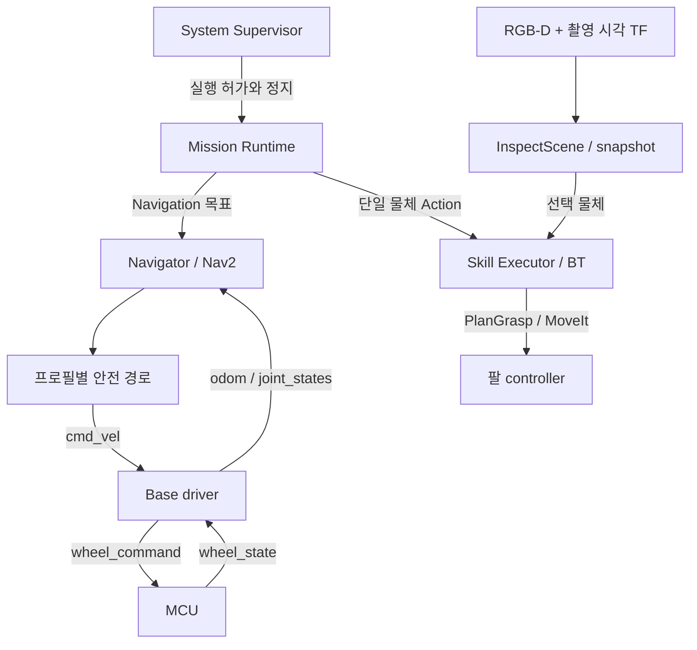

# ROS 인터페이스 색인

## 기능 사이의 연결

아래는 기능 경계 요약입니다. 실행별 안전 체인의 정확한 토픽과 QoS는 아래 색인 및 패키지 reference에서 확인합니다.



| 확인 질문 | 찾을 표 |
|---|---|
| 누가 이 값을 발행/구독하나? | [Topic](#topic-목록) |
| 목표를 보내고 취소하려면? | [Action](#action-목록) |
| 한 번 요청하고 응답받으려면? | [Service](#service-목록) |
| 기본 통신 신뢰성 / 이름 해석은? | [표 읽기](#표-읽기) |

| 찾을 기능 | 패키지 표 |
|---|---|
| 구동과 피드백 | [Base driver](../../ros2_ws/src/cleany_base_driver/docs/interfaces.md) |
| 주행·SLAM·안전 노드 | [Navigation](../../ros2_ws/src/cleany_navigation/docs/interfaces.md) |
| 인식과 조작 | [Perception](../../ros2_ws/src/cleany_perception/docs/runtime.md), [Manipulation](../../ros2_ws/src/cleany_skill_executor/docs/interfaces.md) |
| 미션과 허가 | [Mission](../../ros2_ws/src/cleany_mission_manager/docs/interfaces.md), [Supervisor](../../ros2_ws/src/cleany_system_supervisor/docs/interfaces.md) |
| 기록과 관측 | [Logger](../../ros2_ws/src/cleany_logger/docs/interfaces.md), [Monitor](../../ros2_ws/src/cleany_dev_monitor/docs/interfaces.md) |

아래 표는 전체 이름 색인입니다. HTML 문서에서는 긴 표의 검색칸으로 이름·타입·노드를 좁혀 볼 수 있습니다.

### 조건부 실행 경로

| 경로 | 조건 / 참조 |
|---|---|
| `d435_head_encoder_tf` | 명시 진단 도구. `/head/joint_states` (JointState, R10)와 D435 TF; 제품 bringup 자동 포함 아님. [읽기 전용과 모터 시험](calibration.md#d435와-lidar-벽-비교-및-헤드-관절-관측) |
| `slip_monitor`, `traction_brake`, `SlipRecovery` | [슬립 복구](../../ros2_ws/src/cleany_navigation/docs/interfaces.md#slip_monitor-traction_brake와-sliprecovery-bt) |
| `localization_guard` | [상세 계약][ros-localization-guard]. `/initialpose` 발행과 `/request_nomotion_update` 호출은 검증된 정지 복구에서만 수행 |

각 노드의 발행, 구독, 서비스 제공/호출, 액션 제공/호출을 찾는 색인입니다. 상세 표는 코드 옆 `docs/interfaces.md`가 관리하고, 동작과 안전 규칙은 [INTEGRATION](integration.md)의 계약 reference를 따릅니다.

표는 현재 소스와 launch의 기본 이름을 기록합니다. 실행별 namespace, 노드 name, parameter와 remap에 따라 실제 graph는 달라집니다. 조건부 endpoint, 외부 server, 미구현 타입을 구분하며 모든 노드가 동시에 실행되는 것으로 해석하지 않습니다.


## 인식과 파지 후보 준비

| 실행 파일 | 변경 인터페이스 |
|---|---|
| `camera_privacy` | [헤드캠 비식별 영상과 QoS](../../ros2_ws/src/cleany_perception/docs/interfaces.md#헤드캠-비식별-영상) |
| `inspection_node` | [새 RGB-D 입력 검사와 검출 결과 필드](../../ros2_ws/src/cleany_perception/docs/interfaces.md) |
| `grasp_server` | [후보 요청의 OBB 좌표계와 AnyGrasp 준비 서비스](../../ros2_ws/src/cleany_grasping/docs/interfaces.md) |

실행 파일 이름은 유지됩니다. `grasp_server` 진입점은 NumPy import 전에
CPU 연산 스레드 설정을 적용하는 `cleany_grasping.runtime`을 거칩니다.

## 표 읽기

| 표기 | 뜻 |
|---|---|
| 토픽 발행 / 구독 | 해당 노드에서 나가는 데이터 / 들어오는 데이터 |
| 서비스 제공 / 호출 | Server / client |
| 액션 제공 / 호출 | Action server / client |
| R10, R20, R1 | Reliable, volatile, keep-last depth 10 / 20 / 1 |
| B1 | Best-effort, volatile, keep-last depth 1 |
| Sensor | Humble `qos_profile_sensor_data`: best-effort, volatile, keep-last depth 5 |
| R/T1, R/T2048 | Reliable, transient-local, keep-last depth 1 / 2048 |
| Service 기본값 | Humble service QoS: reliable, volatile, keep-last depth 10 |
| Action 기본값 | rclpy 기본 request/result/cancel service와 feedback/status QoS. Status는 reliable, transient-local, depth 1 |
| TF 기본 QoS | tf2_ros broadcaster/listener 기본값. 응용 코드가 별도 QoS를 지정하지 않음 |
| 상대 이름 / `/절대 이름` / `~/private` | Node namespace 적용 / root 이름 / 노드 namespace와 노드 name 적용 |
| 주기 | 소스의 기본 timer 또는 콜백 조건. 실제 수신 빈도와 동일하지 않을 수 있음 |

## 종류별 통합 목록

[Topic](#topic-목록), [Action](#action-목록), [Service](#service-목록)에서 이름으로 찾습니다. 노드 링크는 패키지의 상세 표로 연결하며, 아직 표에 없는 runtime endpoint는 구현 소스로 연결합니다. QoS와 호출 조건은 연결된 문서와 소스를 따릅니다.

아래 이름은 **root namespace에서 기본 이름을 해석한 값**입니다. 상대 이름을 절대 이름으로 고정하는 설정이 아니며, namespace, remap과 parameter override가 있으면 달라집니다. `cleany_dev_monitor`의 `runtime_namespace`는 기본 빈 값으로 표시했습니다. `<...>`는 실행 시 결정되는 이름 패턴입니다.

| 색인 읽기 | 의미 |
|---|---|
| 여러 발행자 | 실행 대안 또는 같은 토픽의 다른 데이터 생산자; 동시 실행 지시 아님 |
| mock_*, Gazebo, MuJoCo, sorting_cameras | Mock / simulation 경로 |
| 외부 Nav2 / MoveIt / controller | 별도 실행 필요 |
| — | 이 색인에서 상대 노드를 지정하지 않음; endpoint 부재 / 미구현 의미 아님 |
| sorting_observer | ObservedMujocoSystem이 사용하는 publisher 노드; 독립 구동 controller 아님 |
| Monitor 동적 구독 | Discovery와 사용자 선택으로 생성 |

ROS 자동 인터페이스는 [별도 표](#ros가-자동-생성하는-인터페이스)에 둡니다. 응용 코드가 직접 호출하거나 관찰하는 action cancel/status와 카메라 parameter 서비스는 통합 목록에도 표시합니다. 외부 패키지 전체 API와 실행 중 동적으로 발견되는 모든 이름을 열거하지는 않습니다.

### Topic 목록

| 기본 이름 (root namespace) | ROS 타입 | 발행 노드 | 구독 노드 | 조건 / 연결 |
|---|---|---|---|---|
| `/amcl_pose` | `geometry_msgs/msg/PoseWithCovarianceStamped` | — | [`cleany_dev_monitor`][ros-cleany-dev-monitor], [`system_supervisor`][ros-system-supervisor] | — |
| `/base/battery_voltage` | `std_msgs/msg/Float32` | [`cleany_motor_controller`][ros-cleany-motor-controller] | — | 통합 보드의 배터리 입력 전압(V) |
| `/base/wheel_drive_state` | `cleany_base_interfaces/msg/WheelDriveState` | [`cleany_motor_controller`][ros-cleany-motor-controller] | — | 휠별 적용 듀티와 기동 시각 |
| `/base/wheel_command` | `cleany_base_interfaces/msg/WheelCommand` | [`cleany_base_driver`][ros-cleany-base-driver] | [`mock_base_mcu`][ros-mock-base-mcu], [`cleany_motor_controller`][ros-cleany-motor-controller] | — |
| `/base/wheel_state` | `cleany_base_interfaces/msg/WheelState` | [`mock_base_mcu`][ros-mock-base-mcu], [`cleany_motor_controller`][ros-cleany-motor-controller] | [`cleany_base_driver`][ros-cleany-base-driver] | — |
| `/behavior_tree_log` | `nav2_msgs/msg/BehaviorTreeLog` | — | [`cleany_dev_monitor`][ros-cleany-dev-monitor], [`nav2_bt_trace`][ros-nav2-bt-trace] | — |
| `/body_guard_3d/risk_voxels` | `sensor_msgs/msg/PointCloud2` | [`voxel_guard`][ros-voxel-guard] | [`cleany_dev_monitor`][ros-cleany-dev-monitor] | — |
| `/body_guard_3d/state` | `std_msgs/msg/String` | [`voxel_guard`][ros-voxel-guard] | [`cleany_dev_monitor`][ros-cleany-dev-monitor] | — |
| `/bt_navigator/transition_event` | `lifecycle_msgs/msg/TransitionEvent` | — | [`nav2_bt_trace`][ros-nav2-bt-trace] | — |
| `/camera/aligned_depth_to_color/image_raw` | `sensor_msgs/msg/Image` | [`sorting_cameras`][ros-sorting-cameras] | — | 발행자는 MuJoCo 전용; 실물 camera 제공자는 별도 |
| `/camera/color/camera_info` | `sensor_msgs/msg/CameraInfo` | [`sorting_cameras`][ros-sorting-cameras] | [`perception_inspector`][ros-perception-inspector] | 발행자는 MuJoCo 전용; 실물 camera 제공자는 별도 |
| `/camera/color/image_raw` | `sensor_msgs/msg/Image` | [`sorting_cameras`][ros-sorting-cameras] | [`perception_inspector`][ros-perception-inspector] | 발행자는 MuJoCo 전용; 실물 camera 제공자는 별도 |
| `/camera/depth/camera_info` | `sensor_msgs/msg/CameraInfo` | — | [`perception_inspector`][ros-perception-inspector], [`depth_scene_node`][ros-depth-scene-노드] | — |
| `/camera/depth/image_raw` | `sensor_msgs/msg/Image` | — | [`perception_inspector`][ros-perception-inspector] | — |
| `/camera/depth/image_rect_raw` | `sensor_msgs/msg/Image` | — | [`depth_scene_node`][ros-depth-scene-노드] | — |
| `/camera/head/color/image_raw` | `sensor_msgs/msg/Image` | [`ros_gz_bridge`][ros-ros-gz-bridge] | [`system_supervisor`][ros-system-supervisor] | — |
| `/camera/head/depth/camera_info` | `sensor_msgs/msg/CameraInfo` | [`ros_gz_bridge`][ros-ros-gz-bridge] | [`depth_clearance`][ros-depth-clearance], [`depth_coverage`][ros-depth-coverage] | — |
| `/camera/head/depth/image_raw` | `sensor_msgs/msg/Image` | [`ros_gz_bridge`][ros-ros-gz-bridge] | [`depth_clearance`][ros-depth-clearance], [`depth_coverage`][ros-depth-coverage] | — |
| `/camera/head/depth/obstacle_points` | `sensor_msgs/msg/PointCloud2` | [`depth_clearance`][ros-depth-clearance] | [`cleany_dev_monitor`][ros-cleany-dev-monitor] | — |
| `/camera/head/depth/points` | `sensor_msgs/msg/PointCloud2` | [`depth_clearance`][ros-depth-clearance] | [`pan_motion_gate`][ros-pan-motion-gate], [`reactive_guard`][ros-reactive-guard], [`obstacle_memory`][ros-obstacle-memory] | — |
| `/camera/left_wrist/color/image_raw` | `sensor_msgs/msg/Image` | [`ros_gz_bridge`][ros-ros-gz-bridge] | — | — |
| `/camera/right_wrist/color/image_raw` | `sensor_msgs/msg/Image` | [`ros_gz_bridge`][ros-ros-gz-bridge] | — | — |
| `/cleany/internal/mujoco/left_wrist_camera/camera_info` | `sensor_msgs/msg/CameraInfo` | — | [`left_wrist_camera_contract_adapter`][ros-left-wrist-camera-contract-adapter], [`nearest_pregrasp_coordinator`][ros-nearest-pregrasp-coordinator], [`sorting_coordinator`][ros-sorting-coordinator] | — |
| `/cleany/internal/mujoco/left_wrist_camera/image_raw` | `sensor_msgs/msg/Image` | — | [`left_wrist_camera_contract_adapter`][ros-left-wrist-camera-contract-adapter] | — |
| `/clock` | `rosgraph_msgs/msg/Clock` | [`gazebo_feedback_sampler`][ros-gazebo-feedback-sampler], [`ros_gz_bridge`][ros-ros-gz-bridge] | [`cleany_dev_monitor`][ros-cleany-dev-monitor] | Bridge 직접 발행은 override 구성; 프로필은 sampler 경유 |
| `/cmd_vel` | `geometry_msgs/msg/Twist` | [`proximity_guard`][ros-tof], [`ground_truth_route_follower`][ros-ground-truth-route-follower], [`reactive_guard`][ros-reactive-guard], [`voxel_guard`][ros-voxel-guard] | [`cleany_base_driver`][ros-cleany-base-driver], [`cleany_dev_monitor`][ros-cleany-dev-monitor], [`gazebo_command_guard`][ros-gazebo-command-guard], [`mujoco_sim`][ros-mujoco-sim] | — |
| `/collision_monitor_state` | `discovery 타입` | — | [`cleany_dev_monitor`][ros-cleany-dev-monitor] | 실행 graph에서 타입 확인 |
| `/constraint_list` | `visualization_msgs/msg/MarkerArray` | — | [`cleany_dev_monitor`][ros-cleany-dev-monitor] | — |
| `/diagnostics` | `diagnostic_msgs/msg/DiagnosticArray` | [`cleany_base_driver`][ros-cleany-base-driver], [`cleany_imu`][ros-cleany-imu], [`system_supervisor`][ros-system-supervisor], [`ekf_filter_node`][ros-ekf-filter-node] | [`system_supervisor`][ros-system-supervisor] | — |
| `/evaluation` | `discovery 타입` | — | [`cleany_dev_monitor`][ros-cleany-dev-monitor] | 실행 graph에서 타입 확인; 발행자 존재는 실행 구성에서 확인 |
| `/gazebo/raw_clock` | `rosgraph_msgs/msg/Clock` | [`ros_gz_bridge`][ros-ros-gz-bridge] | [`gazebo_feedback_sampler`][ros-gazebo-feedback-sampler] | Gazebo 프로필에서 raw 이름으로 remap |
| `/gazebo/raw_joint_states` | `sensor_msgs/msg/JointState` | [`ros_gz_bridge`][ros-ros-gz-bridge] | [`gazebo_feedback_sampler`][ros-gazebo-feedback-sampler] | Gazebo 프로필에서 raw 이름으로 remap |
| `/gazebo_cmd_vel` | `geometry_msgs/msg/Twist` | [`gazebo_command_guard`][ros-gazebo-command-guard] | [`ros_gz_bridge`][ros-ros-gz-bridge] | — |
| `/gazebo_odom` | `nav_msgs/msg/Odometry` | [`ros_gz_bridge`][ros-ros-gz-bridge] | [`gazebo_odom_tf_publisher`][ros-gazebo-odom-tf-publisher] | — |
| `/global_costmap/costmap` | `nav_msgs/msg/OccupancyGrid` | — | [`cleany_dev_monitor`][ros-cleany-dev-monitor] | — |
| `/grasp/collision_geometry` | `cleany_interfaces/msg/ObservedObjectGeometry` | [`grasp_server`][ros-grasp-server] | [`nearest_pregrasp_coordinator`][ros-nearest-pregrasp-coordinator], [`sorting_coordinator`][ros-sorting-coordinator], [`grasp_selection_server`][ros-grasp-selection-server] | use_observed_collision_geometry=true; publish_collision_geometry=true |
| `/grasp/debug_image_latched` | `sensor_msgs/msg/Image` | [`nearest_pregrasp_coordinator`][ros-nearest-pregrasp-coordinator], [`sorting_coordinator`][ros-sorting-coordinator] | — | — |
| `/grasp/debug_image` | `sensor_msgs/msg/Image` | [`grasp_server`][ros-grasp-server] | — | — |
| `/ground_truth/odom` | `nav_msgs/msg/Odometry` | [`ros_gz_bridge`][ros-ros-gz-bridge] | [`cleany_dev_monitor`][ros-cleany-dev-monitor], [`ground_truth_route_follower`][ros-ground-truth-route-follower] | — |
| `/head_pan/command` | `std_msgs/msg/Float64` | [`pan_motion_gate`][ros-pan-motion-gate] | [`head_pan_bridge`][ros-head-pan-bridge] | Gazebo dynamic pan 구성 |
| `/head_pan/coverage` | `std_msgs/msg/String` | [`depth_coverage`][ros-depth-coverage] | [`cleany_dev_monitor`][ros-cleany-dev-monitor] | — |
| `/head_pan/state` | `std_msgs/msg/String` | [`pan_motion_gate`][ros-pan-motion-gate] | [`cleany_dev_monitor`][ros-cleany-dev-monitor] | — |
| `/imu/data_raw` | `sensor_msgs/msg/Imu` | [`cleany_imu`][ros-cleany-imu] | [`ekf_filter_node`][ros-ekf-filter-node] | Host 고정 factory gyro bias 적용 |
| `/imu/data` | `sensor_msgs/msg/Imu` | [`ros_gz_bridge`][ros-ros-gz-bridge] | — | Gazebo IMU |
| `/imu/status` | `diagnostic_msgs/msg/DiagnosticArray` | [`cleany_imu`][ros-cleany-imu] | — | — |
| `/imu_uncalibrated/data_raw` | `sensor_msgs/msg/Imu` | [`cleany_motor_controller`][ros-cleany-motor-controller] | [`cleany_imu`][ros-cleany-imu] | 기존 모터 보드 또는 BNO055를 활성화한 통합 보드의 각속도와 가속도 |
| `/joint_states` | `sensor_msgs/msg/JointState` | [`cleany_base_driver`][ros-cleany-base-driver], [`gazebo_feedback_sampler`][ros-gazebo-feedback-sampler], [`ros_gz_bridge`][ros-ros-gz-bridge], [`mujoco_sim`][ros-mujoco-sim] | [`wheel_odometry`][ros-wheel-odometry], [`gazebo_pan_tf_publisher`][ros-gazebo-pan-tf-publisher], [`simulated_encoder`][ros-simulated-encoder], [`single_pose_handeye_orchestrator`][ros-single-pose-handeye-orchestrator], [`multi_pose_handeye_orchestrator`][ros-multi-pose-handeye-orchestrator], [`pan_motion_gate`][ros-pan-motion-gate], [`reactive_guard`][ros-reactive-guard], [`grasp_selection_server`][ros-grasp-selection-server], [`nearest_pregrasp_coordinator`][ros-nearest-pregrasp-coordinator], [`sorting_coordinator`][ros-sorting-coordinator], [`robot_state_publisher`][ros-robot-state-publisher], [`safety_adapter`][ros-safety-adapter], [`arm_health_monitor`][ros-arm-health-monitor] | Bridge 직접 발행은 override 구성; profile은 sampler 경유 |
| `/left_arm_controller/controller_state` | `control_msgs/msg/JointTrajectoryControllerState` | [`left_arm_controller`][ros-left-arm-controller] | [`nearest_pregrasp_coordinator`][ros-nearest-pregrasp-coordinator], [`sorting_coordinator`][ros-sorting-coordinator] | — |
| `/left_wrist_camera/camera_info` | `sensor_msgs/msg/CameraInfo` | [`left_wrist_camera_contract_adapter`][ros-left-wrist-camera-contract-adapter], [`sorting_cameras`][ros-sorting-cameras] | [`single_pose_handeye_orchestrator`][ros-single-pose-handeye-orchestrator], [`multi_pose_handeye_orchestrator`][ros-multi-pose-handeye-orchestrator], [`perception_inspector`][ros-perception-inspector] | 손목 구독은 enable_wrist_observation=true; MuJoCo camera 또는 adapter 경로 선택; 실물 camera 제공자는 별도 |
| `/left_wrist_camera/image_raw` | `sensor_msgs/msg/Image` | [`left_wrist_camera_contract_adapter`][ros-left-wrist-camera-contract-adapter], [`sorting_cameras`][ros-sorting-cameras] | [`single_pose_handeye_orchestrator`][ros-single-pose-handeye-orchestrator], [`multi_pose_handeye_orchestrator`][ros-multi-pose-handeye-orchestrator], [`perception_inspector`][ros-perception-inspector] | 손목 구독은 enable_wrist_observation=true; MuJoCo camera 또는 adapter 경로 선택; 실물 camera 제공자는 별도 |
| `/local_costmap/costmap` | `nav_msgs/msg/OccupancyGrid` | — | [`cleany_dev_monitor`][ros-cleany-dev-monitor] | — |
| `/local_costmap/published_footprint` | `geometry_msgs/msg/PolygonStamped` | — | [`cleany_dev_monitor`][ros-cleany-dev-monitor] | — |
| `/local_plan` | `nav_msgs/msg/Path` | — | [`cleany_dev_monitor`][ros-cleany-dev-monitor] | — |
| `/map` | `nav_msgs/msg/OccupancyGrid` | — | [`cleany_dev_monitor`][ros-cleany-dev-monitor], [`obstacle_memory`][ros-obstacle-memory] | — |
| `/mission/debug_snapshot` | `cleany_interfaces/msg/RuntimeDebugSnapshot` | [`mission_runtime`][ros-mission-runtime] | [`cleany_dev_monitor`][ros-cleany-dev-monitor] | — |
| `/mission/result` | `cleany_interfaces/msg/MissionResult` | [`mission_runtime`][ros-mission-runtime] | [`cleany_dev_monitor`][ros-cleany-dev-monitor] | — |
| `/mission/runtime_events` | `cleany_interfaces/msg/RuntimeEvent` | [`mission_runtime`][ros-mission-runtime] | [`cleany_dev_monitor`][ros-cleany-dev-monitor] | — |
| `/mission/status` | `cleany_interfaces/msg/MissionStatus` | [`mission_runtime`][ros-mission-runtime] | — | — |
| `/mock/manipulation/execution_events` | `discovery 타입` | — | [`cleany_dev_monitor`][ros-cleany-dev-monitor] | 실행 graph에서 타입 확인; 발행자 존재는 실행 구성에서 확인 |
| `/monitored_planning_scene` | `moveit_msgs/msg/PlanningScene` | [`move_group`][ros-move-group] | [`nearest_pregrasp_coordinator`][ros-nearest-pregrasp-coordinator], [`sorting_coordinator`][ros-sorting-coordinator] | — |
| `/mujoco_sim/joint_cmd` | `sensor_msgs/msg/JointState` | — | [`mujoco_sim`][ros-mujoco-sim] | — |
| `/nav2/cmd_vel` | `geometry_msgs/msg/Twist` | — | [`cleany_dev_monitor`][ros-cleany-dev-monitor], [`depth_coverage`][ros-depth-coverage], [`pan_motion_gate`][ros-pan-motion-gate], [`reactive_guard`][ros-reactive-guard] | — |
| `/navigate_to_pose/_action/status` | `action_msgs/msg/GoalStatusArray` | [`bt_navigator`][ros-bt-navigator] | [`mission_runtime`][ros-mission-runtime], [`nav2_bt_trace`][ros-nav2-bt-trace] | — |
| `/navigation/bt_trace` | `std_msgs/msg/String` | [`nav2_bt_trace`][ros-nav2-bt-trace] | [`cleany_dev_monitor`][ros-cleany-dev-monitor] | — |
| `/navigation/localization_speed_limit` | `nav2_msgs/msg/SpeedLimit` | [`localization_guard`][ros-localization-guard] | Nav2 controller_server, cleany_collision_monitor | percentage 제한; 신선도 상실 시 정지 |
| `/obstacle_memory/depth` | `nav_msgs/msg/OccupancyGrid` | [`obstacle_memory`][ros-obstacle-memory] | [`cleany_dev_monitor`][ros-cleany-dev-monitor] | — |
| `/obstacle_memory/grid` | `nav_msgs/msg/OccupancyGrid` | [`obstacle_memory`][ros-obstacle-memory] | [`cleany_dev_monitor`][ros-cleany-dev-monitor] | — |
| `/obstacle_memory/lidar` | `nav_msgs/msg/OccupancyGrid` | [`obstacle_memory`][ros-obstacle-memory] | [`cleany_dev_monitor`][ros-cleany-dev-monitor] | — |
| `/obstacle_memory/local_voxels` | `sensor_msgs/msg/PointCloud2` | [`obstacle_memory`][ros-obstacle-memory] | — | — |
| `/obstacle_memory/navigation_grid` | `nav_msgs/msg/OccupancyGrid` | [`obstacle_memory`][ros-obstacle-memory] | — | — |
| `/obstacle_memory/voxel_status` | `std_msgs/msg/String` | [`obstacle_memory`][ros-obstacle-memory] | [`voxel_guard`][ros-voxel-guard] | — |
| `/obstacle_memory/voxels` | `sensor_msgs/msg/PointCloud2` | [`obstacle_memory`][ros-obstacle-memory] | [`voxel_guard`][ros-voxel-guard] | — |
| `/telemetry/pose` | `geometry_msgs/msg/PoseStamped` | [`pose_observer`][ros-pose-observer] | [`pose_backend_bridge`][ros-pose-backend-bridge] | — |
| `/odom` | `nav_msgs/msg/Odometry` | [`base_odom_relay`][ros-base-odom-relay], [`gazebo_odom_tf_publisher`][ros-gazebo-odom-tf-publisher], [`mujoco_sim`][ros-mujoco-sim], [`ekf_filter_node`][ros-ekf-filter-node] | [`mission_runtime`][ros-mission-runtime], [`depth_coverage`][ros-depth-coverage], [`pan_motion_gate`][ros-pan-motion-gate], [`reactive_guard`][ros-reactive-guard], [`voxel_guard`][ros-voxel-guard], [`pose_observer`][ros-pose-observer], [`safety_adapter`][ros-safety-adapter] | — |
| `/odometry/filtered` | `nav_msgs/msg/Odometry` | [`ekf_filter_node`][ros-ekf-filter-node] | — | Wheel/IMU shadow mode |
| `/pan_ready/cmd_vel` | `geometry_msgs/msg/Twist` | [`pan_motion_gate`][ros-pan-motion-gate] | — | — |
| `/perception/debug_image_latched` | `sensor_msgs/msg/Image` | [`perception_inspector`][ros-perception-inspector] | [`nearest_pregrasp_coordinator`][ros-nearest-pregrasp-coordinator], [`sorting_coordinator`][ros-sorting-coordinator] | — |
| `/perception/debug_image` | `sensor_msgs/msg/Image` | [`perception_inspector`][ros-perception-inspector] | — | — |
| `/perception/detections_2d` | `cleany_interfaces/msg/DetectedObject2DArray` | [`perception_inspector`][ros-perception-inspector] | — | — |
| `/perception/objects` | `cleany_interfaces/msg/DetectedObject3DArray` | [`perception_inspector`][ros-perception-inspector] | — | — |
| `/perception/scene_cloud_filtered` | `sensor_msgs/msg/PointCloud2` | [`move_group`][ros-move-group] | [`scene_cloud_receipt`][ros-scene-cloud-receipt], [`nearest_pregrasp_coordinator`][ros-nearest-pregrasp-coordinator], [`sorting_coordinator`][ros-sorting-coordinator] | occupancy updater 설정 시 |
| `/perception/scene_cloud_receipt` | `std_msgs/msg/Header` | [`scene_cloud_receipt`][ros-scene-cloud-receipt] | [`nearest_pregrasp_coordinator`][ros-nearest-pregrasp-coordinator], [`sorting_coordinator`][ros-sorting-coordinator] | sensor_scene_receipt_topic 지정 시 cloud 구독 대체 |
| `/perception/scene_cloud` | `sensor_msgs/msg/PointCloud2` | [`depth_scene_node`][ros-depth-scene-노드] | [`move_group`][ros-move-group] | occupancy updater 설정 시 |
| `/plan` | `nav_msgs/msg/Path` | — | [`cleany_dev_monitor`][ros-cleany-dev-monitor] | — |
| `/reactive_guard/state` | `std_msgs/msg/String` | [`reactive_guard`][ros-reactive-guard] | [`cleany_dev_monitor`][ros-cleany-dev-monitor] | — |
| `/right_arm_controller/controller_state` | `control_msgs/msg/JointTrajectoryControllerState` | [`right_arm_controller`][ros-right-arm-controller] | [`nearest_pregrasp_coordinator`][ros-nearest-pregrasp-coordinator], [`sorting_coordinator`][ros-sorting-coordinator] | — |
| `/right_wrist_camera/camera_info` | `sensor_msgs/msg/CameraInfo` | [`sorting_cameras`][ros-sorting-cameras] | [`perception_inspector`][ros-perception-inspector] | 손목 구독은 enable_wrist_observation=true; MuJoCo camera 또는 adapter 경로 선택; 실물 camera 제공자는 별도 |
| `/right_wrist_camera/image_raw` | `sensor_msgs/msg/Image` | [`sorting_cameras`][ros-sorting-cameras] | [`perception_inspector`][ros-perception-inspector] | 손목 구독은 enable_wrist_observation=true; MuJoCo camera 또는 adapter 경로 선택; 실물 camera 제공자는 별도 |
| `/robot/safety_fault` | `std_msgs/msg/String` | — | [`mission_runtime`][ros-mission-runtime] | — |
| `/robot/safety_released` | `std_msgs/msg/String` | — | [`mission_runtime`][ros-mission-runtime] | — |
| `/robot_description` | `std_msgs/msg/String` | [`robot_state_publisher`][ros-robot-state-publisher] | [`nearest_pregrasp_coordinator`][ros-nearest-pregrasp-coordinator], [`sorting_coordinator`][ros-sorting-coordinator], [`grasp_selection_server`][ros-grasp-selection-server] | — |
| `/rosout` | `rcl_interfaces/msg/Log` | — | [`cleany_dev_monitor`][ros-cleany-dev-monitor] | — |
| `/safety/slow_zone` | `geometry_msgs/msg/PolygonStamped` | — | [`cleany_dev_monitor`][ros-cleany-dev-monitor] | — |
| `/safety/status` | `cleany_interfaces/msg/SafetyStatus` | [`safety_adapter`][ros-safety-adapter] | [`system_supervisor`][ros-system-supervisor] | `trusted_publishers` allowlist |
| `/safety/stop_zone` | `geometry_msgs/msg/PolygonStamped` | — | [`cleany_dev_monitor`][ros-cleany-dev-monitor] | — |
| `/safety_2d/cmd_vel` | `geometry_msgs/msg/Twist` | — | [`cleany_dev_monitor`][ros-cleany-dev-monitor], [`reactive_guard`][ros-reactive-guard], [`voxel_guard`][ros-voxel-guard] | — |
| `/scan_matched_points2` | `sensor_msgs/msg/PointCloud2` | — | [`cleany_dev_monitor`][ros-cleany-dev-monitor] | — |
| `/scan` | `sensor_msgs/msg/LaserScan` | [`ros_gz_bridge`][ros-ros-gz-bridge], [`mujoco_sim`][ros-mujoco-sim] | [`cleany_dev_monitor`][ros-cleany-dev-monitor], [`reactive_guard`][ros-reactive-guard], [`obstacle_memory`][ros-obstacle-memory], [`system_supervisor`][ros-system-supervisor] | — |
| `/simulation/contact_diagnostics` | `diagnostic_msgs/msg/DiagnosticArray` | [`sorting_observer`][ros-sortingobserver] | — | MuJoCo 전용; publish_contacts=true |
| `/simulation/sorting_ground_truth` | `visualization_msgs/msg/MarkerArray` | [`sorting_observer`][ros-sortingobserver] | [`simulation_placement_verifier`][ros-simulation-placement-verifier] | MuJoCo 전용 |
| `/sorting/status` | `std_msgs/msg/String` | [`sorting_coordinator`][ros-sorting-coordinator] | — | — |
| `/submap_list` | `cartographer_ros_msgs/msg/SubmapList` | — | [`cleany_dev_monitor`][ros-cleany-dev-monitor] | — |
| `/system/capabilities` | `cleany_interfaces/msg/SystemCapabilities` | [`system_supervisor`][ros-system-supervisor] | [`mission_runtime`][ros-mission-runtime] | Runtime: supervision_mode=required |
| `/system/component_health` | `cleany_interfaces/msg/ComponentHealth` | [`arm_health_monitor`][ros-arm-health-monitor], [`perception_inspector`][ros-perception-inspector] | [`system_supervisor`][ros-system-supervisor] | `component_sources`, `trusted_publishers` |
| `/system/events` | `cleany_interfaces/msg/SystemEvent` | [`system_supervisor`][ros-system-supervisor] | — | 영구 기록은 cleany_logger 대상 |
| `/system/faults` | `cleany_interfaces/msg/SystemFaults` | [`system_supervisor`][ros-system-supervisor] | [`supervisor_operator`][ros-supervisor-operator] | — |
| `/system/heartbeat` | `cleany_interfaces/msg/SystemHeartbeat` | [`system_supervisor`][ros-system-supervisor] | [`mission_runtime`][ros-mission-runtime], [`supervisor_operator`][ros-supervisor-operator] | Runtime: supervision_mode=required |
| `/system/recoveries` | `cleany_interfaces/msg/SystemRecoveries` | [`system_supervisor`][ros-system-supervisor] | — | — |
| `/system/state` | `cleany_interfaces/msg/SystemState` | [`system_supervisor`][ros-system-supervisor] | [`mission_runtime`][ros-mission-runtime] | Runtime: supervision_mode=required |
| `/tf_static` | `tf2_msgs/msg/TFMessage` | [`gazebo_sensor_tf_publisher`][ros-gazebo-sensor-tf-publisher], [`mujoco_sim`][ros-mujoco-sim], [`robot_state_publisher`][ros-robot-state-publisher] | [`cleany_dev_monitor`][ros-cleany-dev-monitor], [`grasp_server`][ros-grasp-server], [`mission_runtime`][ros-mission-runtime], [`depth_clearance`][ros-depth-clearance], [`depth_coverage`][ros-depth-coverage], [`reactive_guard`][ros-reactive-guard], [`obstacle_memory`][ros-obstacle-memory], [`voxel_guard`][ros-voxel-guard], [`nearest_pregrasp_coordinator`][ros-nearest-pregrasp-coordinator], [`sorting_coordinator`][ros-sorting-coordinator] | — |
| `/tf` | `tf2_msgs/msg/TFMessage` | [`base_odom_relay`][ros-base-odom-relay], [`gazebo_odom_tf_publisher`][ros-gazebo-odom-tf-publisher], [`gazebo_pan_tf_publisher`][ros-gazebo-pan-tf-publisher], [`mujoco_sim`][ros-mujoco-sim], [`robot_state_publisher`][ros-robot-state-publisher], [`ekf_filter_node`][ros-ekf-filter-node] | [`cleany_dev_monitor`][ros-cleany-dev-monitor], [`grasp_server`][ros-grasp-server], [`mission_runtime`][ros-mission-runtime], [`depth_clearance`][ros-depth-clearance], [`depth_coverage`][ros-depth-coverage], [`reactive_guard`][ros-reactive-guard], [`obstacle_memory`][ros-obstacle-memory], [`voxel_guard`][ros-voxel-guard], [`nearest_pregrasp_coordinator`][ros-nearest-pregrasp-coordinator], [`sorting_coordinator`][ros-sorting-coordinator] | — |
| `/trajectory_node_list` | `visualization_msgs/msg/MarkerArray` | — | [`cleany_dev_monitor`][ros-cleany-dev-monitor] | — |
| `/wheel/odom_raw` | `nav_msgs/msg/Odometry` | — | [`simulated_odometry_error`][ros-simulated-odometry-error] | — |
| `/wheel/odom` | `nav_msgs/msg/Odometry` | [`wheel_odometry`][ros-wheel-odometry], [`simulated_odometry_error`][ros-simulated-odometry-error] | [`base_odom_relay`][ros-base-odom-relay], [`cleany_dev_monitor`][ros-cleany-dev-monitor], [`ekf_filter_node`][ros-ekf-filter-node] | — |
| `/wheel_encoder/joint_states` | `sensor_msgs/msg/JointState` | [`simulated_encoder`][ros-simulated-encoder] | — | — |
| `<사용자 선택 / camera / recording 토픽>` | `discovery 타입` | — | [`cleany_dev_monitor`][ros-cleany-dev-monitor] | 실행 graph에서 타입 확인 |

### Action 목록

| 기본 이름 (root namespace) | ROS 타입 | Server | Client | 조건 / 연결 |
|---|---|---|---|---|
| `/execute_trajectory` | `moveit_msgs/action/ExecuteTrajectory` | [`move_group`][ros-move-group] | [`single_pose_handeye_orchestrator`][ros-single-pose-handeye-orchestrator], [`multi_pose_handeye_orchestrator`][ros-multi-pose-handeye-orchestrator], [`nearest_pregrasp_coordinator`][ros-nearest-pregrasp-coordinator], [`sorting_coordinator`][ros-sorting-coordinator] | — |
| `/grasp/select_reachable` | `cleany_interfaces/action/SelectReachableGrasp` | [`grasp_selection_server`][ros-grasp-selection-server] | [`nearest_pregrasp_coordinator`][ros-nearest-pregrasp-coordinator], [`sorting_coordinator`][ros-sorting-coordinator] | 도달성 검사; controller 실행 없음 |
| `/left_arm_controller/follow_joint_trajectory` | `control_msgs/action/FollowJointTrajectory` | [`left_arm_controller`][ros-left-arm-controller] | [`move_group`][ros-move-group] | MoveIt이 호출하는 외부 controller |
| `/left_gripper_controller/follow_joint_trajectory` | `control_msgs/action/FollowJointTrajectory` | [`left_gripper_controller`][ros-left-gripper-controller] | [`nearest_pregrasp_coordinator`][ros-nearest-pregrasp-coordinator], [`sorting_coordinator`][ros-sorting-coordinator] | ros2_control backend 구성 필요 |
| `/localization/recover` | `cleany_interfaces/action/RecoverComponent` | 일반: [`nav2_lifecycle_recovery`][ros-nav2-lifecycle-recovery], LiDAR 주행: [`localization_guard`][ros-localization-guard] | [`system_supervisor`][ros-system-supervisor] | 두 owner 동시 실행 금지; LiDAR 주행은 정지 후 자동 정합 복구 |
| `/mission/stop` | `cleany_interfaces/action/StopMission` | [`mission_runtime`][ros-mission-runtime] | [`system_supervisor`][ros-system-supervisor] | supervision_mode=required |
| `/mock/manipulation/execute_skill` | `cleany_interfaces/action/ExecuteManipulationSkill` | — | [`mission_runtime`][ros-mission-runtime] | action_mock 전용; 외부 server 별도 필요 |
| `/move_action` | `moveit_msgs/action/MoveGroup` | [`move_group`][ros-move-group] | [`single_pose_handeye_orchestrator`][ros-single-pose-handeye-orchestrator], [`multi_pose_handeye_orchestrator`][ros-multi-pose-handeye-orchestrator], [`grasp_selection_server`][ros-grasp-selection-server], [`nearest_pregrasp_coordinator`][ros-nearest-pregrasp-coordinator], [`sorting_coordinator`][ros-sorting-coordinator] | grasp_selection_server는 plan-only |
| `/navigate_to_pose` | `nav2_msgs/action/NavigateToPose` | [`bt_navigator`][ros-bt-navigator] | [`mission_runtime`][ros-mission-runtime] | 외부 Nav2; navigation_backend=nav2 |
| `/navigation/recover` | `cleany_interfaces/action/RecoverComponent` | [`nav2_lifecycle_recovery`][ros-nav2-lifecycle-recovery] | [`system_supervisor`][ros-system-supervisor] | `recovery_policies`; 자동 dispatch 기본 off |
| `/perception/inspect_scene` | `cleany_interfaces/action/InspectScene` | [`perception_inspector`][ros-perception-inspector] | [`nearest_pregrasp_coordinator`][ros-nearest-pregrasp-coordinator], [`sorting_coordinator`][ros-sorting-coordinator] | — |
| `/right_arm_controller/follow_joint_trajectory` | `control_msgs/action/FollowJointTrajectory` | [`right_arm_controller`][ros-right-arm-controller] | [`move_group`][ros-move-group] | MoveIt이 호출하는 외부 controller |
| `/right_gripper_controller/follow_joint_trajectory` | `control_msgs/action/FollowJointTrajectory` | [`right_gripper_controller`][ros-right-gripper-controller] | [`nearest_pregrasp_coordinator`][ros-nearest-pregrasp-coordinator], [`sorting_coordinator`][ros-sorting-coordinator] | ros2_control backend 구성 필요 |
| `/system/request_recovery` | `cleany_interfaces/action/RequestRecovery` | [`system_supervisor`][ros-system-supervisor] | — | 운영자 또는 도구 |

### Service 목록

| 기본 이름 (root namespace) | ROS 타입 | Server | Client | 조건 / 연결 |
|---|---|---|---|---|
| `/apply_planning_scene` | `moveit_msgs/srv/ApplyPlanningScene` | [`move_group`][ros-move-group] | [`collision_scene_applier`][ros-collision-scene-applier], [`grasp_selection_server`][ros-grasp-selection-server], [`nearest_pregrasp_coordinator`][ros-nearest-pregrasp-coordinator], [`sorting_coordinator`][ros-sorting-coordinator] | — |
| `/base/enable` | `std_srvs/srv/SetBool` | [`cleany_base_driver`][ros-cleany-base-driver] | — | — |
| `/check_grasp_octomap` | `cleany_interfaces/srv/CheckStateValidityBatch` | [`move_group`][ros-move-group] | [`grasp_selection_server`][ros-grasp-selection-server] | [Jetson CUDA 후보 검사](../../ros2_ws/src/cleany_moveit_collision/docs/calibrated-cad.md#jetson-파지-후보의-octomap-검사) |
| `/check_state_validity` | `moveit_msgs/srv/GetStateValidity` | [`move_group`][ros-move-group] | [`single_pose_handeye_orchestrator`][ros-single-pose-handeye-orchestrator], [`multi_pose_handeye_orchestrator`][ros-multi-pose-handeye-orchestrator], [`grasp_selection_server`][ros-grasp-selection-server], [`nearest_pregrasp_coordinator`][ros-nearest-pregrasp-coordinator], [`sorting_coordinator`][ros-sorting-coordinator] | — |
| `/compute_fk` | `moveit_msgs/srv/GetPositionFK` | [`move_group`][ros-move-group] | [`single_pose_handeye_orchestrator`][ros-single-pose-handeye-orchestrator], [`multi_pose_handeye_orchestrator`][ros-multi-pose-handeye-orchestrator], [`nearest_pregrasp_coordinator`][ros-nearest-pregrasp-coordinator], [`sorting_coordinator`][ros-sorting-coordinator], [`grasp_selection_server`][ros-grasp-selection-server] | — |
| `/compute_ik` | `moveit_msgs/srv/GetPositionIK` | [`move_group`][ros-move-group] | [`single_pose_handeye_orchestrator`][ros-single-pose-handeye-orchestrator], [`multi_pose_handeye_orchestrator`][ros-multi-pose-handeye-orchestrator], [`grasp_selection_server`][ros-grasp-selection-server], [`nearest_pregrasp_coordinator`][ros-nearest-pregrasp-coordinator], [`sorting_coordinator`][ros-sorting-coordinator] | — |
| `/controller_manager/list_controllers` | `controller_manager_msgs/srv/ListControllers` | 외부 ros2_control | [`arm_health_monitor`][ros-arm-health-monitor] | arm_health:=true |
| `/get_planning_scene` | `moveit_msgs/srv/GetPlanningScene` | [`move_group`][ros-move-group] | [`single_pose_handeye_orchestrator`][ros-single-pose-handeye-orchestrator], [`multi_pose_handeye_orchestrator`][ros-multi-pose-handeye-orchestrator], [`grasp_selection_server`][ros-grasp-selection-server], [`nearest_pregrasp_coordinator`][ros-nearest-pregrasp-coordinator], [`sorting_coordinator`][ros-sorting-coordinator] | — |
| `/grasp/plan` | `cleany_interfaces/srv/PlanGrasp` | [`grasp_server`][ros-grasp-server] | [`nearest_pregrasp_coordinator`][ros-nearest-pregrasp-coordinator], [`sorting_coordinator`][ros-sorting-coordinator] | — |
| `/handeye/cancel_run` | `std_srvs/srv/Trigger` | [`multi_pose_handeye_orchestrator`][ros-multi-pose-handeye-orchestrator] | — | — |
| `/lifecycle_manager_localization/manage_nodes` | `nav2_msgs/srv/ManageLifecycleNodes` | 외부 Nav2 lifecycle manager | [`nav2_lifecycle_recovery`][ros-nav2-lifecycle-recovery] | — |
| `/lifecycle_manager_navigation/manage_nodes` | `nav2_msgs/srv/ManageLifecycleNodes` | 외부 Nav2 lifecycle manager | [`nav2_lifecycle_recovery`][ros-nav2-lifecycle-recovery] | — |
| `/mission/cancel` | `cleany_interfaces/srv/CancelMission` | [`mission_runtime`][ros-mission-runtime] | [`control_bridge`][ros-control-bridge] | — |
| `/mission/offer` | `cleany_interfaces/srv/OfferMission` | [`mission_runtime`][ros-mission-runtime] | [`control_bridge`][ros-control-bridge] | — |
| `/mission/reset_error` | `std_srvs/srv/Trigger` | [`mission_runtime`][ros-mission-runtime] | — | — |
| `/mission/snapshot` | `cleany_interfaces/srv/GetRuntimeSnapshot` | [`mission_runtime`][ros-mission-runtime] | [`control_bridge`][ros-control-bridge] | — |
| `/mock/drop_next_enable` | `std_srvs/srv/Trigger` | [`mock_base_mcu`][ros-mock-base-mcu] | — | — |
| `/mock/force_disarm` | `std_srvs/srv/Trigger` | [`mock_base_mcu`][ros-mock-base-mcu] | — | — |
| `/mock/manipulation/execute_skill/_action/cancel_goal` | `action_msgs/srv/CancelGoal` | — | [`mission_runtime`][ros-mission-runtime] | action_mock 전용; 외부 server 별도 필요 |
| `/mock/manipulation/get_execution` | `cleany_interfaces/srv/GetManipulationExecution` | — | [`mission_runtime`][ros-mission-runtime] | action_mock 전용; 외부 server 별도 필요 |
| `/mock/reboot` | `std_srvs/srv/Trigger` | [`mock_base_mcu`][ros-mock-base-mcu] | — | — |
| `/mock/transport` | `std_srvs/srv/SetBool` | [`mock_base_mcu`][ros-mock-base-mcu] | — | — |
| `/navigate_to_pose/_action/cancel_goal` | `action_msgs/srv/CancelGoal` | [`bt_navigator`][ros-bt-navigator] | [`mission_runtime`][ros-mission-runtime] | — |
| `/obstacle_memory/save` | `std_srvs/srv/Trigger` | [`obstacle_memory`][ros-obstacle-memory] | — | — |
| `/obstacle_memory/set_enabled` | `std_srvs/srv/SetBool` | [`obstacle_memory`][ros-obstacle-memory] | — | — |
| `/perception/observe_wrist_target` | `cleany_interfaces/srv/ObserveWristTarget` | [`perception_inspector`][ros-perception-inspector] | [`sorting_coordinator`][ros-sorting-coordinator] | enable_wrist_observation=true |
| `/sorting/verify_placement` | `cleany_interfaces/srv/VerifyPlacement` | [`simulation_placement_verifier`][ros-simulation-placement-verifier] | [`sorting_coordinator`][ros-sorting-coordinator] | 현재 server는 시뮬레이션 전용; 실물은 독립 센서 제공자 필요 |
| `/sorting_cameras/set_parameters` | `rcl_interfaces/srv/SetParameters` | [`sorting_cameras`][ros-sorting-cameras] | [`sorting_coordinator`][ros-sorting-coordinator] | MuJoCo 카메라 선택; 명시적으로 호출하는 parameter 서비스 |
| `/submap_query` | `cartographer_ros_msgs/srv/SubmapQuery` | — | [`cleany_dev_monitor`][ros-cleany-dev-monitor] | — |
| `/system/check_permission` | `cleany_interfaces/srv/CheckPermission` | [`system_supervisor`][ros-system-supervisor] | [`mission_runtime`][ros-mission-runtime] | Runtime: supervision_mode=required |
| `/system/request_fault_reset` | `cleany_interfaces/srv/RequestFaultReset` | [`system_supervisor`][ros-system-supervisor] | [`supervisor_operator`][ros-supervisor-operator] | `operator_id` 필수 |
| `<lifecycle_node>/get_state` | `lifecycle_msgs/srv/GetState` | [`<lifecycle_node>`][ros-lifecycle-노드] | [`mission_runtime`][ros-mission-runtime], [`system_supervisor`][ros-system-supervisor] | Runtime: navigation_backend=nav2, supervision_mode=disabled; Supervisor: navigation_nodes, localization_nodes |

[ros-arm-health-monitor]: ../../ros2_ws/src/cleany_skill_executor/docs/interfaces.md#arm_health_monitor
[ros-base-odom-relay]: ../../ros2_ws/src/cleany_base_driver/docs/interfaces.md#base_odom_relay
[ros-bt-navigator]: ../../ros2_ws/src/cleany_navigation/launch/navigation.launch.py
[ros-cleany-base-driver]: ../../ros2_ws/src/cleany_base_driver/docs/interfaces.md#cleany_base_driver
[ros-cleany-dev-monitor]: ../../ros2_ws/src/cleany_dev_monitor/docs/interfaces.md#cleany_dev_monitor
[ros-cleany-imu]: ../../ros2_ws/src/cleany_base_driver/docs/interfaces.md#cleany_imu
[ros-cleany-motor-controller]: ../../esp32/README.md#ros-인터페이스
[ros-pose-observer]: ../../ros2_ws/src/cleany_telemetry/docs/interfaces.md#pose_observer
[ros-pose-backend-bridge]: ../../ros2_ws/src/cleany_control_bridge/docs/interfaces.md#pose_backend_bridge
[ros-collision-scene-applier]: ../../ros2_ws/src/cleany_moveit_config/cleany_moveit_config/apply_collision_scene.py
[ros-control-bridge]: ../../ros2_ws/src/cleany_control_bridge/docs/interfaces.md#control_bridge
[ros-depth-clearance]: ../../ros2_ws/src/cleany_navigation/docs/interfaces.md#depth_clearance
[ros-depth-coverage]: ../../ros2_ws/src/cleany_navigation/docs/interfaces.md#depth_coverage
[ros-depth-scene-노드]: ../../ros2_ws/src/cleany_perception/cleany_perception/depth_scene_node.py
[ros-gazebo-command-guard]: ../../ros2_ws/src/cleany_gazebo_sim/docs/interfaces.md#gazebo_command_guard
[ros-gazebo-feedback-sampler]: ../../ros2_ws/src/cleany_gazebo_sim/docs/interfaces.md#gazebo_feedback_sampler
[ros-gazebo-odom-tf-publisher]: ../../ros2_ws/src/cleany_gazebo_sim/docs/interfaces.md#gazebo_odom_tf_publisher
[ros-gazebo-pan-tf-publisher]: ../../ros2_ws/src/cleany_gazebo_sim/docs/interfaces.md#gazebo_pan_tf_publisher
[ros-gazebo-sensor-tf-publisher]: ../../ros2_ws/src/cleany_gazebo_sim/docs/interfaces.md#gazebo_sensor_tf_publisher
[ros-grasp-selection-server]: ../../ros2_ws/src/cleany_skill_executor/docs/interfaces.md#grasp_selection_server
[ros-grasp-server]: ../../ros2_ws/src/cleany_grasping/docs/interfaces.md#grasp_server
[ros-ground-truth-route-follower]: ../../ros2_ws/src/cleany_gazebo_sim/docs/interfaces.md#ground_truth_route_follower
[ros-head-pan-bridge]: ../../ros2_ws/src/cleany_gazebo_sim/launch/amcl_nav2_safety.launch.py
[ros-left-arm-controller]: ../../ros2_ws/src/cleany_mujoco_sim/launch/study_cafe_backend.launch.py
[ros-left-gripper-controller]: ../../ros2_ws/src/cleany_mujoco_sim/launch/study_cafe_backend.launch.py
[ros-left-wrist-camera-contract-adapter]: ../../ros2_ws/src/cleany_mujoco_sim/docs/interfaces.md#left_wrist_camera_contract_adapter
[ros-lifecycle-노드]: ../../ros2_ws/src/cleany_mission_manager/cleany_mission_manager/adapters/nav2.py
[ros-mission-runtime]: ../../ros2_ws/src/cleany_mission_manager/docs/interfaces.md#mission_runtime
[ros-mock-base-mcu]: ../../ros2_ws/src/cleany_base_driver/docs/interfaces.md#mock_base_mcu
[ros-move-group]: ../../ros2_ws/src/cleany_moveit_config/docs/planning.md
[ros-mujoco-sim]: ../../ros2_ws/src/cleany_mujoco_sim/docs/interfaces.md#mujoco_sim
[ros-multi-pose-handeye-orchestrator]: ../../ros2_ws/src/cleany_handeye_calibration/docs/interfaces.md#multi_pose_handeye_orchestrator
[ros-nav2-bt-trace]: ../../ros2_ws/src/cleany_navigation/docs/interfaces.md#nav2_bt_trace
[ros-nav2-lifecycle-recovery]: ../../ros2_ws/src/cleany_navigation/docs/interfaces.md#nav2_lifecycle_recovery
[ros-localization-guard]: ../../ros2_ws/src/cleany_navigation/docs/interfaces.md#localization_guard
[ros-nearest-pregrasp-coordinator]: ../../ros2_ws/src/cleany_skill_executor/cleany_skill_executor/nearest_pregrasp_coordinator.py
[ros-obstacle-memory]: ../../ros2_ws/src/cleany_navigation/docs/interfaces.md#obstacle_memory
[ros-pan-motion-gate]: ../../ros2_ws/src/cleany_navigation/docs/interfaces.md#pan_motion_gate
[ros-perception-inspector]: ../../ros2_ws/src/cleany_perception/cleany_perception/inspection_node.py
[ros-reactive-guard]: ../../ros2_ws/src/cleany_navigation/docs/interfaces.md#reactive_guard
[ros-right-arm-controller]: ../../ros2_ws/src/cleany_mujoco_sim/launch/study_cafe_backend.launch.py
[ros-right-gripper-controller]: ../../ros2_ws/src/cleany_mujoco_sim/launch/study_cafe_backend.launch.py
[ros-robot-state-publisher]: ../../ros2_ws/src/cleany_description/docs/model.md
[ros-ros-gz-bridge]: ../../ros2_ws/src/cleany_gazebo_sim/docs/interfaces.md#ros_gz_bridge
[ros-safety-adapter]: ../../ros2_ws/src/cleany_safety_adapter/docs/interfaces.md#safety_adapter
[ros-scene-cloud-receipt]: ../../ros2_ws/src/cleany_perception/cleany_perception/scene_cloud_receipt_node.py
[ros-simulated-encoder]: ../../ros2_ws/src/cleany_gazebo_sim/docs/interfaces.md#simulated_encoder
[ros-simulated-odometry-error]: ../../ros2_ws/src/cleany_gazebo_sim/docs/interfaces.md#simulated_odometry_error
[ros-simulation-placement-verifier]: ../../ros2_ws/src/cleany_mujoco_sim/docs/interfaces.md#simulation_placement_verifier
[ros-single-pose-handeye-orchestrator]: ../../ros2_ws/src/cleany_handeye_calibration/docs/interfaces.md#single_pose_handeye_orchestrator
[ros-sorting-cameras]: ../../ros2_ws/src/cleany_mujoco_observer/src/scheduled_cameras.cpp
[ros-sorting-coordinator]: ../../ros2_ws/src/cleany_skill_executor/cleany_skill_executor/sorting_coordinator.py
[ros-sortingobserver]: ../../ros2_ws/src/cleany_mujoco_observer/src/sorting_observer.cpp
[ros-supervisor-operator]: ../../ros2_ws/src/cleany_system_supervisor/docs/interfaces.md#supervisor_operator
[ros-system-supervisor]: ../../ros2_ws/src/cleany_system_supervisor/docs/interfaces.md#system_supervisor
[ros-voxel-guard]: ../../ros2_ws/src/cleany_navigation/docs/interfaces.md#voxel_guard
[ros-wheel-odometry]: ../../ros2_ws/src/cleany_base_odometry/docs/interfaces.md#wheel_odometry

## 구현 노드

| 노드 이름 | 패키지 | 실행 파일 | 인터페이스 표 |
|---|---|---|---|
| `cleany_base_driver` | `cleany_base_driver` | `base_driver_node` | [표](../../ros2_ws/src/cleany_base_driver/docs/interfaces.md#cleany_base_driver) |
| `cleany_imu` | `cleany_base_driver` | `imu_driver_node` | [표](../../ros2_ws/src/cleany_base_driver/docs/interfaces.md#cleany_imu) |
| `mock_base_mcu` | `cleany_base_driver` | `mock_mcu_node` | [표](../../ros2_ws/src/cleany_base_driver/docs/interfaces.md#mock_base_mcu) |
| `base_odom_relay` | `cleany_base_driver` | `odom_relay_node` | [표](../../ros2_ws/src/cleany_base_driver/docs/interfaces.md#base_odom_relay) |
| `wheel_odometry` | `cleany_base_odometry` | `wheel_odometry_node` | [표](../../ros2_ws/src/cleany_base_odometry/docs/interfaces.md#wheel_odometry) |
| `control_bridge` | `cleany_control_bridge` | `control_bridge` | [표](../../ros2_ws/src/cleany_control_bridge/docs/interfaces.md#control_bridge) |
| `mission_runtime` | `cleany_mission_manager` | `mission_runtime` | [표](../../ros2_ws/src/cleany_mission_manager/docs/interfaces.md#mission_runtime) |
| `system_supervisor` | `cleany_system_supervisor` | `system_supervisor` | [표](../../ros2_ws/src/cleany_system_supervisor/docs/interfaces.md#system_supervisor) |
| `supervisor_operator` | `cleany_system_supervisor` | `supervisor_operator` | [표](../../ros2_ws/src/cleany_system_supervisor/docs/interfaces.md#supervisor_operator) |
| `safety_adapter` | `cleany_safety_adapter` | `safety_adapter` | [표](../../ros2_ws/src/cleany_safety_adapter/docs/interfaces.md#safety_adapter) |
| `nav2_lifecycle_recovery` | `cleany_navigation` | `nav2_lifecycle_recovery` | [표](../../ros2_ws/src/cleany_navigation/docs/interfaces.md#nav2_lifecycle_recovery) |
| `localization_guard` | `cleany_navigation` | `localization_guard` | [표](../../ros2_ws/src/cleany_navigation/docs/interfaces.md#localization_guard) |
| `collision_monitor` (LiDAR 주행) | `cleany_navigation` | `cleany_collision_monitor` | [표](../../ros2_ws/src/cleany_navigation/docs/interfaces.md#cleany_collision_monitor) |
| `arm_health_monitor` | `cleany_skill_executor` | `arm_health_monitor` | [표](../../ros2_ws/src/cleany_skill_executor/docs/interfaces.md#arm_health_monitor) |
| `manipulation_server` | `cleany_skill_executor` | `manipulation_server` | [표](../../ros2_ws/src/cleany_skill_executor/docs/interfaces.md#manipulation_server) |
| `grasp_server` | `cleany_grasping` | `grasp_server` | [표](../../ros2_ws/src/cleany_grasping/docs/interfaces.md#grasp_server) |
| `grasp_selection_server` | `cleany_skill_executor` | `grasp_selection_server` | [표](../../ros2_ws/src/cleany_skill_executor/docs/interfaces.md#grasp_selection_server) |
| `collision_scene_applier` | `cleany_moveit_config` | `apply_collision_scene` | [구현](../../ros2_ws/src/cleany_moveit_config/cleany_moveit_config/apply_collision_scene.py) |
| `camera_preview` | `cleany_telemetry` | `camera_preview` | [표](../../ros2_ws/src/cleany_telemetry/docs/interfaces.md#camera_preview) |
| `pose_observer` | `cleany_telemetry` | `pose_observer` | [표](../../ros2_ws/src/cleany_telemetry/docs/interfaces.md#pose_observer) |
| `pose_backend_bridge` | `cleany_control_bridge` | `pose_backend_bridge` | [표](../../ros2_ws/src/cleany_control_bridge/docs/interfaces.md#pose_backend_bridge) |
| `depth_clearance` | `cleany_navigation` | `depth_clearance` | [표](../../ros2_ws/src/cleany_navigation/docs/interfaces.md#depth_clearance) |
| `depth_coverage` | `cleany_navigation` | `depth_coverage` | [표](../../ros2_ws/src/cleany_navigation/docs/interfaces.md#depth_coverage) |
| `pan_motion_gate` | `cleany_navigation` | `pan_motion_gate` | [표](../../ros2_ws/src/cleany_navigation/docs/interfaces.md#pan_motion_gate) |
| `reactive_guard` | `cleany_navigation` | `reactive_guard` | [표](../../ros2_ws/src/cleany_navigation/docs/interfaces.md#reactive_guard) |
| `obstacle_memory` | `cleany_navigation` | `obstacle_memory` | [표](../../ros2_ws/src/cleany_navigation/docs/interfaces.md#obstacle_memory) |
| `voxel_guard` | `cleany_navigation` | `voxel_guard` | [표](../../ros2_ws/src/cleany_navigation/docs/interfaces.md#voxel_guard) |
| `nav2_bt_trace` | `cleany_navigation` | `nav2_bt_trace` | [표](../../ros2_ws/src/cleany_navigation/docs/interfaces.md#nav2_bt_trace) |
| `gazebo_command_guard` | `cleany_gazebo_sim` | `gazebo_command_guard` | [표](../../ros2_ws/src/cleany_gazebo_sim/docs/interfaces.md#gazebo_command_guard) |
| `gazebo_feedback_sampler` | `cleany_gazebo_sim` | `gazebo_feedback_sampler` | [표](../../ros2_ws/src/cleany_gazebo_sim/docs/interfaces.md#gazebo_feedback_sampler) |
| `gazebo_odom_tf_publisher` | `cleany_gazebo_sim` | `gazebo_odom_tf_publisher` | [표](../../ros2_ws/src/cleany_gazebo_sim/docs/interfaces.md#gazebo_odom_tf_publisher) |
| `gazebo_pan_tf_publisher` | `cleany_gazebo_sim` | `gazebo_pan_tf_publisher` | [표](../../ros2_ws/src/cleany_gazebo_sim/docs/interfaces.md#gazebo_pan_tf_publisher) |
| `gazebo_sensor_tf_publisher` | `cleany_gazebo_sim` | `gazebo_sensor_tf_publisher` | [표](../../ros2_ws/src/cleany_gazebo_sim/docs/interfaces.md#gazebo_sensor_tf_publisher) |
| `simulated_encoder` | `cleany_gazebo_sim` | `simulated_encoder_node` | [표](../../ros2_ws/src/cleany_gazebo_sim/docs/interfaces.md#simulated_encoder) |
| `simulated_odometry_error` | `cleany_gazebo_sim` | `simulated_odometry_error_node` | [표](../../ros2_ws/src/cleany_gazebo_sim/docs/interfaces.md#simulated_odometry_error) |
| `ground_truth_route_follower` | `cleany_gazebo_sim` | `ground_truth_route_follower` | [표](../../ros2_ws/src/cleany_gazebo_sim/docs/interfaces.md#ground_truth_route_follower) |
| `mujoco_sim` | `cleany_mujoco_sim` | `mujoco_sim_node` | [표](../../ros2_ws/src/cleany_mujoco_sim/docs/interfaces.md#mujoco_sim) |
| `left_wrist_camera_contract_adapter` | `cleany_mujoco_sim` | `camera_contract_adapter` | [표](../../ros2_ws/src/cleany_mujoco_sim/docs/interfaces.md#left_wrist_camera_contract_adapter) |
| `single_pose_handeye_orchestrator` | `cleany_handeye_calibration` | `single_pose_calibration` | [표](../../ros2_ws/src/cleany_handeye_calibration/docs/interfaces.md#single_pose_handeye_orchestrator) |
| `multi_pose_handeye_orchestrator` | `cleany_handeye_calibration` | `multi_pose_calibration` | [표](../../ros2_ws/src/cleany_handeye_calibration/docs/interfaces.md#multi_pose_handeye_orchestrator) |
| `cleany_logger` | `cleany_logger` | `logger_node` | [표](../../ros2_ws/src/cleany_logger/docs/interfaces.md#cleany_logger) |
| `cleany_logger` | `cleany_logger_cli_<suffix>` | `logger` | [CLI](../../ros2_ws/src/cleany_logger/docs/interfaces.md#cli) |
| `cleany_dev_monitor` | `cleany_dev_monitor` | `dev_monitor` | [표](../../ros2_ws/src/cleany_dev_monitor/docs/interfaces.md#cleany_dev_monitor) |
| `cleany_motor_controller` | ESP32 micro-ROS | `esp32/src/main.cpp` | [MCU 표](../../esp32/README.md#ros-인터페이스) |
| `ekf_filter_node` | 외부 `robot_localization` | `ekf_node` | [Bringup 표](../../ros2_ws/src/cleany_base_driver/docs/interfaces.md#ekf_filter_node) |

| 패키지 / bootstrap | 역할 |
|---|---|
| single_pose_handeye_config / multi_pose_handeye_config | 실행 전 설정만 읽는 임시 노드; 응용 endpoint 없음 |
| cleany_description / cleany_bringup | Model / launch |
| cleany_interfaces / cleany_base_interfaces | ROS 타입 |
| cleany_planner | 등록된 자체 ROS 노드 없음 |
| cleany_logger | [독립 기록 노드](../../ros2_ws/src/cleany_logger/docs/data.md) |

Perception과 sorting의 현재 진입점은 아래 패키지 문서를 따릅니다.

## Runtime integration에서 추가된 실행

| 노드 이름 | 실행 파일 | 구현과 API 안내 |
|---|---|---|
| `perception_inspector` | `inspection_node` | [Perception](../../ros2_ws/src/cleany_perception/docs/runtime.md#ros-api) |
| `depth_scene_node` | `depth_scene_node` | [Depth 점군](../../ros2_ws/src/cleany_perception/docs/runtime.md#전체-depth-환경-포인트클라우드) |
| `scene_cloud_receipt` | `scene_cloud_receipt_node` | [점군 수신 확인](../../ros2_ws/src/cleany_perception/docs/runtime.md#필터링-점군-수신-확인) |
| `nearest_pregrasp_coordinator` | `nearest_pregrasp_coordinator` | [조작 경로](../../ros2_ws/src/cleany_skill_executor/docs/manipulation.md#가까운-객체-자동-pre-grasp) |
| 공통 연산의 기본 `nearest_pregrasp_coordinator` 이름 | `sorting_coordinator` | [분류와 수거](../../ros2_ws/src/cleany_skill_executor/docs/study-cafe-sorting-usage.md#시뮬레이션-분리-수거-통합-검증-진행-중); launch remap 적용 여부 확인 |
| `simulation_placement_verifier` | `placement_verifier` | [MuJoCo 표](../../ros2_ws/src/cleany_mujoco_sim/docs/interfaces.md#simulation_placement_verifier) |
| `manipulation_server` | `manipulation_server` | [Mock Action 서버](../../ros2_ws/src/cleany_skill_executor/docs/interfaces.md#manipulation_server) |
| `manipulation_monitor` | `manipulation_monitor` | [읽기 전용 트리 모니터](../../ros2_ws/src/cleany_skill_executor/docs/interfaces.md#manipulation_monitor) |
| `manipulation_test_client` | `manipulation_test_client` | [요청·취소·조회 CLI](../../ros2_ws/src/cleany_skill_executor/docs/interfaces.md#manipulation_test_client) |
| `manipulation_mujoco_server` | `manipulation_mujoco_server` | [MuJoCo BT Action 서버](../../ros2_ws/src/cleany_manipulation_bt/README.md#계약과-증거) |

`perception_inspector`는 `GetSceneSnapshot` 타입의 `/perception/get_scene_snapshot`을
제공해 기존 cache를 조회합니다. `simulation_placement_verifier`의
`/sorting/register_placement_target`은 `RegisterPlacementTarget`으로 개체를 고정하며,
`VerifyPlacement.verification_id`로 해당 개체만 검증합니다.
상세 필드는 [관측 계약](../../ros2_ws/src/cleany_interfaces/docs/observation-contracts.md)을 따릅니다.

## 외부 노드와 타입만 있는 계약

| 경계 | 연결 위치와 현재 상태 |
|---|---|
| Gazebo `ros_gz_bridge` | [Bridge 표](../../ros2_ws/src/cleany_gazebo_sim/docs/interfaces.md#ros_gz_bridge). ROS/Gazebo sensor와 명령 변환 |
| Nav2 / AMCL / Collision Monitor | [Navigation launch](../../ros2_ws/src/cleany_navigation/launch/navigation.launch.py)와 [설정](../../ros2_ws/src/cleany_navigation/config)이 조합을 선택. Mission이 호출하는 action/lifecycle 서비스는 Mission 노드 표에 포함 |
| MoveIt `move_group` | `/compute_ik`, `/compute_fk`, `/check_state_validity`, `/get_planning_scene`, `/apply_planning_scene`, `/move_action`, `/execute_trajectory`를 이용. 자체 호출 노드 표와 [Planning 계약](../../ros2_ws/src/cleany_moveit_config/docs/planning.md)에서 연결 확인 |
| FreeCAD 검사 `move_group` | `freecad_inspection.launch.py`에서 CAD 상태 검사와 OctoMap 제공. `runtime_test/check_freecad_lower_body.py`는 자체 필터와 시험 장애물 접촉을 조회하는 보조 노드. [검사 인터페이스](../../ros2_ws/src/cleany_moveit_config/docs/interfaces.md#freecad-검사) |
| ros2_control | Arm/gripper의 FollowJointTrajectory와 joint_state_broadcaster. [Controller 설정](../../ros2_ws/src/cleany_moveit_config/config/mock_ros2_controllers.yaml)과 [MuJoCo backend launch](../../ros2_ws/src/cleany_mujoco_sim/launch/study_cafe_backend.launch.py)이 선택 |
| `robot_state_publisher` | `joint_states` 구독, `/tf`, `/tf_static` 발행. `description.launch.py`의 선택형 `freecad_final`은 정적 프레임, `freecad_kinematic`은 `cad_delta_*` 입력과 CAD 링크 프레임, 기본 `freecad_calibrated`는 공통 `cleany.urdf`의 보정된 CAD 프레임, 선택형 `legacy_runtime`은 기존 `jetson_20261009` xacro 관절 프레임 제공. 선택형 namespace는 description, joint state, TF 토픽에, frame_prefix는 TF frame ID에 적용. [모델 계약](../../ros2_ws/src/cleany_description/docs/model.md)이 frame 의미를 관리 |
| `InspectScene` | `perception_inspector`가 `perception/inspect_scene`을 제공. [Perception API](../../ros2_ws/src/cleany_perception/docs/runtime.md#ros-api) |
| `ExecuteManipulationSkill` | Runtime의 action client와 [타입](../../ros2_ws/src/cleany_interfaces/action/ExecuteManipulationSkill.action)은 존재. 기본 mock는 process 내부 구현이며 `action_mock`은 선택형 Python Mock 서버에 연결 |

위 표는 외부 패키지의 연결 경계입니다. 외부 패키지의 전체 API 목록은 해당 패키지 문서와 실행 graph를 기준으로 확인합니다. RViz, rqt, controller spawner와 검증용 probe 노드는 실행 보조 도구이며 자체 제품 endpoint 목록에 포함하지 않습니다.

## ROS가 자동 생성하는 인터페이스

Parameter 서비스와 이벤트, rosout, sim clock 구독, action 내부 전송은 응용 표에서 반복하지 않습니다. 아래 패턴이 노드 옵션과 실행 상태에 따라 추가됩니다.

| 항목 | 기본 패턴 / 타입 |
|---|---|
| Parameter 서비스 | `<node>/{describe_parameters,get_parameter_types,get_parameters,list_parameters,set_parameters,set_parameters_atomically}`; `rcl_interfaces/srv/*` |
| Parameter 변경 이벤트 | `/parameter_events`; `rcl_interfaces/msg/ParameterEvent` |
| 로그 | `/rosout`; `rcl_interfaces/msg/Log`, rosout 활성화 시 |
| Simulation clock | `/clock`; `rosgraph_msgs/msg/Clock`, ROS time source 연결 시; `use_sim_time`으로 시간 적용 선택 |
| Action 요청 / 결과 / 취소 | `<action>/_action/{send_goal,get_result,cancel_goal}` 서비스 |
| Action feedback / status | `<action>/_action/{feedback,status}` 토픽 |

명시적으로 만든 cancel client와 status subscription은 호출 노드의 표에도 표시합니다. ESP32 rclc 노드는 표에 적힌 wheel interface만 초기화하며 rclpy의 자동 parameter 서비스가 동일하게 생긴다고 가정하지 않습니다.

## 실행 중 확인

실행한 구성과 같은 DDS domain, 같은 overlay의 터미널에서 확인합니다.

```bash
ros2 node list
ros2 node info /mission_runtime
ros2 topic list -t
ros2 topic info /cmd_vel --verbose
ros2 service list -t
ros2 action list -t
ros2 action info /grasp/select_reachable
```

실행 graph는 해당 실행의 증거입니다. 조건부 노드를 실행하지 않은 결과를 전체 소스의 인터페이스 목록으로 대체하지 않습니다. 코드를 변경할 때 해당 노드 표와 이 색인을 함께 갱신합니다.

## Jetson 실물 상태와 제어

| 실행 파일 | 역할과 인터페이스 |
|---|---|
| `arm_state_reader`, `robot_state_reader` | [실측 관절 상태 조회](../../ros2_ws/src/cleany_robot_interface/docs/interfaces.md) |
| `runtime_model_state` | [공통 CAD 관절 미리보기](../../ros2_ws/src/cleany_description/docs/runtime-model.md) |
| `calibrated_camera_pose` | [보정된 카메라 TF](../../ros2_ws/src/cleany_robot_interface/docs/interfaces.md#보정된-카메라-tf) |
| `control_state_guard` | [관절 상태 검증과 컨트롤러 정지](../../ros2_ws/src/cleany_robot_interface/docs/interfaces.md) |
| `wrist_rgb_camera`, `rgbd_frame_bridge` | [손목 영상과 헤드 RGB-D 좌표계](../../ros2_ws/src/cleany_robot_interface/docs/interfaces.md) |
| `motor_telemetry_recorder` | [모터 상태 수동 기록](../../ros2_ws/src/cleany_robot_interface/docs/interfaces.md) |


## 실물 계획과 준비 자세 실행

| 실행 파일 | 패키지 | 계약 |
|---|---|---|
| `physical_grasp_selection_server` | `cleany_skill_executor` | [선택기](../../ros2_ws/src/cleany_skill_executor/docs/interfaces.md#physical_grasp_selection_server) |
| `validate_pick_server` | `cleany_skill_executor` | [Plan-only 검증](../../ros2_ws/src/cleany_skill_executor/docs/interfaces.md#validate_pick_server) |
| `pregrasp_pipeline`, `hardware_pregrasp`, `pregrasp_sim_ready` | `cleany_skill_executor` | [준비 자세 도구](../../ros2_ws/src/cleany_skill_executor/docs/interfaces.md#준비-자세-실행-도구) |

인식 노드의 추가 관찰 서비스, 상태 토픽은 [인식 인터페이스](../../ros2_ws/src/cleany_perception/docs/interfaces.md#기준-물체-재관찰과-예열-알림),
MoveGroup 배치 서비스는 [계획 capability](../../ros2_ws/src/cleany_moveit_capabilities/README.md)를 따른다.

## 실물 매핑과 휴대폰 조종

| 패키지 | 실행 파일 | 인터페이스 |
|---|---|---|
| cleany_teleop | phone_remote | [조종과 웹 계약](../../ros2_ws/src/cleany_teleop/docs/interfaces.md) |
| cleany_teleop | gamepad_input / gamepad_teleop / gamepad_head | [Jetson 패드 입력 및 조종](how-to/gamepad.md) |
| cleany_teleop | commission_wheels | 같은 문서의 독립 시험 CLI |
| cleany_navigation | mapping_scan_filter, mapping_session | [매핑 계약](../../ros2_ws/src/cleany_navigation/docs/mapping.md) |
| cleany_bringup | hardware_runtime | [프로세스 수명](../../ros2_ws/src/cleany_bringup/docs/hardware-mapping.md) |

Base driver의 `base/set_enabled`와 wheel odometry의 `~/reset`은 해당 패키지 reference에 설명합니다.

## ToF 활성 구성

[ToF reference][ros-tof]는 `tof_driver`, `proximity_guard`, `desk_approach` 실행 파일과
조건부 Mission Action client를 관리합니다. `tof_enabled=false`인 구성에는 생성하지 않습니다.

| Endpoint | 타입 | 발행 또는 제공 | 구독 또는 호출 |
|---|---|---|---|
| `/tof/frame` | `cleany_interfaces/msg/TofFrame` | tof_driver 또는 통합 컨트롤러 CH0 | proximity_guard, desk_approach |
| `/tof/left/frame`, `/tof/right/frame`, `/tof/rear/frame` | `cleany_interfaces/msg/TofFrame` | 통합 컨트롤러 CH1, CH2, CH3 | — |
| `/motion/cmd_vel` | `geometry_msgs/msg/Twist` | desk_approach | 기존 navigation 안전 계층 |
| `/proximity/input` | `geometry_msgs/msg/Twist` | 기존 최종 안전 계층 | proximity_guard |
| `/proximity/status` | `std_msgs/msg/String` | proximity_guard | 관측 도구 |
| `/system/component_health` | `cleany_interfaces/msg/ComponentHealth` | proximity_guard (추가 source) | system_supervisor |
| `/desk/approach` | `cleany_interfaces/action/DeskApproach` | desk_approach | mission_runtime |

[ros-tof]: ../../ros2_ws/src/cleany_tof/docs/interfaces.md

## 로컬 얼굴 디스플레이

`cleany_display` 패키지의 `cleany_display` 실행 파일은 같은 이름의 노드로 미션 상태, 미션 결과, 수거 실행 기록, 오도메트리, 배터리와 화면 지정 입력을 구독한다. 로봇 명령을 발행하지 않는다. 토픽 타입, QoS와 로컬 HTTP 규약은 [디스플레이 인터페이스](../../ros2_ws/src/cleany_display/docs/interfaces.md)를 따른다.

## 실물 수거 실행과 복구

| 실행 파일 | 패키지 | 참조 |
|---|---|---|
| `manipulation_jetson_server` | `cleany_manipulation_bt` | [BT Action, 복귀와 복구](../../ros2_ws/src/cleany_manipulation_bt/docs/interfaces.md) |
| `arm_return`, `manipulation_recovery` | `cleany_manipulation_bt` | [명시 요청 client](../../ros2_ws/src/cleany_manipulation_bt/docs/interfaces.md) |
| `collection_pipeline` | `cleany_skill_executor` | [설정 검사와 명시 실행](../../ros2_ws/src/cleany_skill_executor/docs/interfaces.md#collection_pipeline) |
| `manipulation_evidence` | `cleany_skill_executor` | [읽기 전용 실행 근거](../../ros2_ws/src/cleany_skill_executor/docs/interfaces.md#manipulation_evidence) |

## 운영 UI와 승인 대상 재확인

| 실행 또는 노드 | 계약 |
|---|---|
| `dev_monitor`와 `cleany_dev_monitor_operator_<pid>_<id>` | [관측, 인증과 작업 제안](../../ros2_ws/src/cleany_dev_monitor/docs/interfaces.md) |
| `inspection_node`의 `perception/revalidate_target` | [승인 대상의 최신 기하와 원본 분류](../../ros2_ws/src/cleany_perception/docs/interfaces.md#승인-대상-재확인) |

운영 adapter는 Monitor와 작업 worker에서 생성한다. 별도 ROS console 실행 파일을 추가하지 않는다.

휴대폰 지도 주행 옵션(`phone_remote --navigation`): `/map`, `/plan`, `/scan`, `/odom`, `/nav2/cmd_vel` 구독, `/initialpose` 발행, `navigate_to_pose` Action client, `navigation/stop` Action server. 상세 계약은 [teleop interfaces](../../ros2_ws/src/cleany_teleop/docs/interfaces.md)를 따릅니다.

- `tools/validation/map_extension/extend.py`: 독립 실험 실행 도구. 외부 Cartographer와
  occupancy grid 노드를 `/map_extension`에서 실행하며 `/scan`, `/odom`, TF를 읽습니다.
  `/map_extension/map` (`nav_msgs/OccupancyGrid`)과 `/map_extension/tracked_pose`
  (`geometry_msgs/PoseStamped`), Cartographer 표준 서비스를 사용합니다. TF와 모터 명령은 발행하지 않습니다.
- `tools/validation/map_extension/view_tf.py`: RViz 전용 `/map_extension/view_tf`
  (`tf2_msgs/TFMessage`)를 발행합니다. 기존 odometry TF와 Cartographer
  `/map_extension/tracked_pose`를 같은 시각에 결합하며 전역 `/tf`는 변경하지 않습니다.
  같은 표시 도구의 `/map_extension/view_trajectory` (`visualization_msgs/MarkerArray`)는
  원본 궤적 메시지를 복사해 기존 궤적은 파랑, 추가 궤적은 불투명 노랑으로 표시합니다.
  원본 Cartographer marker의 투명도와 연결 상태 정보는 수정하지 않습니다.


- `cleany_navigation/depth_obstacles_preview`: 촬영 시각 head TF 기반 D435 장애물 미리보기.
  센서 구독, 점군 및 상태 발행, 별도 preview TF는
  [미리보기 인터페이스](../../ros2_ws/src/cleany_navigation/docs/interfaces.md#depth_obstacles_preview)를 따릅니다.

- 실물 depth overlay: 기존 `depth_clearance`가 `/perception/depth/nav_points`, `/perception/depth/nav_obstacle_points`를 발행하고 local costmap 및 `collision_monitor`가 소비합니다. 별도 실행 파일이나 3D 정지 가드는 추가하지 않습니다. [실물 depth 계약](../../ros2_ws/src/cleany_navigation/docs/interfaces.md#depth_clearance)을 따릅니다.

[ros-ekf-filter-node]: ../../ros2_ws/src/cleany_base_driver/docs/interfaces.md#ekf_filter_node

## 이벤트 궤적 제어기

`cleany_trajectory_controller/JointTrajectoryController`는 팔과 그리퍼의 기존
`FollowJointTrajectory` Action을 유지하면서 완료 결과를 이벤트로 전달한다.
별도 노드 실행 파일은 추가하지 않는다. 설정과 취소 및 명령 교체 규약은
[제어기 인터페이스](../../ros2_ws/src/cleany_trajectory_controller/docs/interfaces.md)를 따른다.
