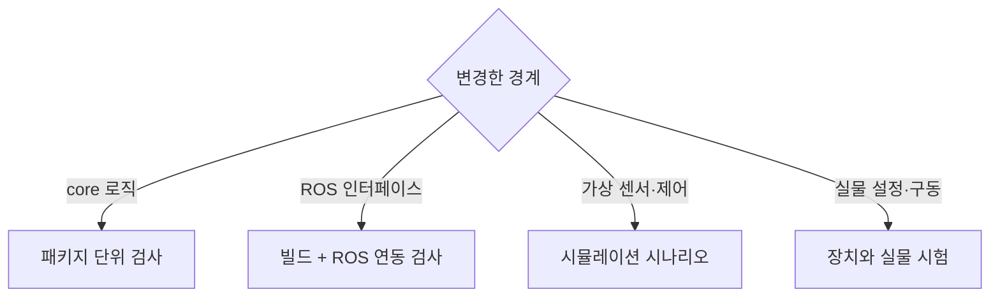

# 변경을 검증하기

수정한 경계에 맞는 검사를 고르고, 자동 검사와 시뮬레이션, 실물 결과를 구분합니다.



## 먼저 고를 검사

| 바꾼 것 | 첫 검사 | 추가로 확인할 것 |
|---|---|---|
| 순수 Python 로직 | 해당 패키지 pytest | 입력 오류, 상태 전이와 실패 경로 |
| ROS 타입·launch·설치 데이터 | 관련 package build/test | 실제 topic·service 연결 |
| 여러 패키지 연결 | 합성 ROS runtime | lifecycle, 취소, 재연결 |
| 주행·인식·조작 | 관련 시뮬레이터 runtime | 실제 장치와 주행·정지는 별도 시험 |
| UI | 실제 제공 페이지의 브라우저 검사 | 갱신, 재접속, 모바일 레이아웃 |
| 문서 | 링크·명령 구문·생성 파일 검사 | 아래 문서 검증 명령 |

## 자주 쓰는 명령

| 범위 | 명령 |
|---|---|
| 전체 ROS workspace | `make test` |
| Mission core / Supervisor core | `make test-mission-core`, `make test-supervision-core` |
| Navigation / Gazebo | `make test-navigation`, `make test-gazebo` |
| ROS Navigation runtime | `make test-navigation-runtime` |
| 조작 Mock / MuJoCo BT | `make test-manipulation`, `make test-manipulation-bt` |
| Base / ESP32 | `make test-base`, `make test-motor-core` |
| 매핑 / 슬립 분석 | `make test-hardware-mapping-core`, `make test-slip-detection` |
| Logger / Monitor | `make test-logger`, `make test-dev-monitor` |
| Telemetry 카메라 | `make test-camera-preview-core`, ROS 환경의 `make test-telemetry` |

환경과 선택 실행 조건, 전체 명령표는 [상세 참조](reference/testing.md#검사-선택)를 따릅니다. 장치가 없는 검사와 실물 실행 검사는 같은 성공으로 합산하지 않습니다.

## Dashboard에서 좌석 미션 왕복 확인

ROS overlay와 control-plane Backend의 가상환경을 준비한 뒤, 사용하지 않는 ROS domain에서 실행합니다. 이 검사는 임시 DB에 운영자와 로봇을 만들고 loopback Gateway로 좌석 두 개를 순서대로 요청합니다. 주행, 인식과 수거는 모두 mock입니다.

```bash
export CONTROL_PLANE=/path/to/cleany-control-plane
"$CONTROL_PLANE/apps/backend/.venv/bin/python" tools/validation/jetson_gateway_roundtrip.py \
  --release "$CONTROL_PLANE" --domain 187 --output /tmp/cleany-gateway-result.json
```

## 문서 사이트 검사

```bash
python3 tools/docs/build_site.py
python3 tools/docs/build_site.py --check
python3 docs/guide/build_standalone.py --check
git diff --check
```

브라우저에서는 데스크톱과 모바일에서 메뉴, 검색, 도표 확대와 내부 링크를 확인합니다.
설정 기반 그림은 [재생성 검사](../../tools/README.md#문서-그림-재생성)로 입력 해시와 PNG 일치를 확인합니다.
Chromium의 로컬 CDP 포트가 열려 있고 `websockets`가 설치돼 있다면 다음 검사는 구현 문서와 학습 가이드의 모든 페이지를 1440 px / 390 px로 엽니다. 보고서와 그림별 화면은 사용자 캐시에 저장합니다.

```bash
python3 tools/docs/check_reader.py --endpoint http://localhost:9228
```

이 검사는 도식 렌더링, 이미지 로드, 문서 가로 넘침과 확대 동작을 확인합니다. 이미지가 본문의 질문에 맞는지는 별도로 검토합니다.

## 상세 조건 찾기

| 확인할 것 | 참조 |
|---|---|
| 전체 Make target와 준비 환경 | [검사 선택](reference/testing.md#검사-선택) |
| CI 이미지와 캐시 | [CI 실행](reference/testing.md#ci-실행과-재사용) |
| 명시 실행이 필요한 ROS / UI | [선택 runtime](reference/testing.md#선택-runtime과-ui) |
| 실물 매핑 / ToF / 화면 / 모델 | [기능별 조건](reference/testing.md#실물-매핑-패키지-경계) |
| 기록 분석과 주행 모델 비교 | [오프라인 분석](reference/testing.md#기록-분석-도구) |
| 결과의 해석 | [결과와 증거](reference/testing.md#결과와-증거) |

### 위치 관측과 Backend adapter 분리 검증

`make build-pose-observation`으로 telemetry, control bridge와 bringup을 빌드한 뒤 해당
install의 `setup.bash`를 적용합니다. `make test-pose-observation`은 원본 시각과 좌표계,
오래된 입력, TF와 odom 관측, Backend payload와 인증 파일 갱신을 확인합니다. ROS 테스트는
합성 입력을 사용하므로 실물 위치 정확도를 증명하지 않습니다.

`tools/validation/telemetry_pose_pipeline.py`는 별도 ROS domain에서 메모리 DB를 사용하는
실제 Backend 서버와 합성 위치 입력을 연결합니다. 관측 유지, 인증 전송, 입력 만료와
Backend 재연결을 확인하며 운영 DB와 주행 명령은 사용하지 않습니다.

```bash
ROS_DOMAIN_ID=181 ROS_LOCALHOST_ONLY=1 RMW_IMPLEMENTATION=rmw_fastrtps_cpp \
python3 tools/validation/telemetry_pose_pipeline.py \
  --backend-root "$CLEANY_CONTROL_PLANE_ROOT" \
  --backend-python "$CLEANY_CONTROL_PLANE_ROOT/apps/backend/.venv/bin/python" \
  --output "$CLEANY_DATA_ROOT/runs/platform/$(date +%F)_telemetry-pose-separation"
```

### 카메라 비식별화 재생 검증

`tools/validation/camera_privacy_replay.py`는 촬영 영상을 지정한 시간 구간에서 샘플링하고, 음성 없는 H.264 영상과 프레임별 마스크 범위, 추론 시간을 기록한다. `--regions`로 원본에서 표시한 폴리곤을 넘기면 영역 전체 픽셀 수와 가려진 수를 함께 계산한다. 한 장의 사진에는 PNG 출력을 사용한다.

```bash
PRIVACY_MODELS=/var/opt/cleany/models/camera-privacy/active
/opt/cleany/current/native/yolo-env/bin/python tools/validation/camera_privacy_replay.py \
  --weights "$PRIVACY_MODELS/privacy.engine" --face "$PRIVACY_MODELS/face.onnx" \
  --text "$PRIVACY_MODELS/text.plan" --device 0 --input "$CLIP" \
  --start 1 --duration 5 --fps 12 --output "$RUN_DIR/preview.mp4"
```

격리 ROS 도메인에서 카메라 노드의 입력을 `/privacy_fixture/raw`로 설정하고 프리뷰를 포트 18769에서 실행한다. `tools/validation/camera_privacy_ros.py --fixture staged-card.png`는 640×480 카드 시험 영상으로 ROS 출력의 원본 시각, 마스킹, 작업 물체 보존과 HTTP의 원본·만료 프레임 처리를 확인한다.

## Jetson 수거와 작업 승인

Jetson ROS 2 Humble 환경에서 [조작 패키지](how-to/manipulation.md#jetson-실물-실행-경로)를 빌드한 뒤 확인한다.
ROS 시험은 localhost의 격리 도메인에서 모의 제어기와 입력으로 실행한다.

```bash
source /opt/ros/humble/setup.bash
source "$(make -s print-install-base)/setup.bash"
ROS_LOCALHOST_ONLY=1 ROS_DOMAIN_ID=173 python3 -m pytest -q \
  tests/tools/test_collection_runtime.py \
  ros2_ws/src/cleany_skill_executor/test/test_hardware_support_launch.py \
  ros2_ws/src/cleany_manipulation_bt/test/test_rear_bin_route.py \
  ros2_ws/src/cleany_dev_monitor/tests/test_operator.py
```

수거 검사는 기동 순서와 차단 후 재시도, 저장 경유점 후속 실행, 궤적 일치 조건과 충돌 거절을 확인한다.
승인 검사는 원본 관측과 물체 번호·추적 ID의 대응, 만료, 캐시 소실 및 취소를 확인한다.
정지 물체 프로필은 원본 관측을 사용하고, 재관찰 프로필은 새 관측을 확인한 뒤 원래 승인한 Goal을 한 번 전달한다.
