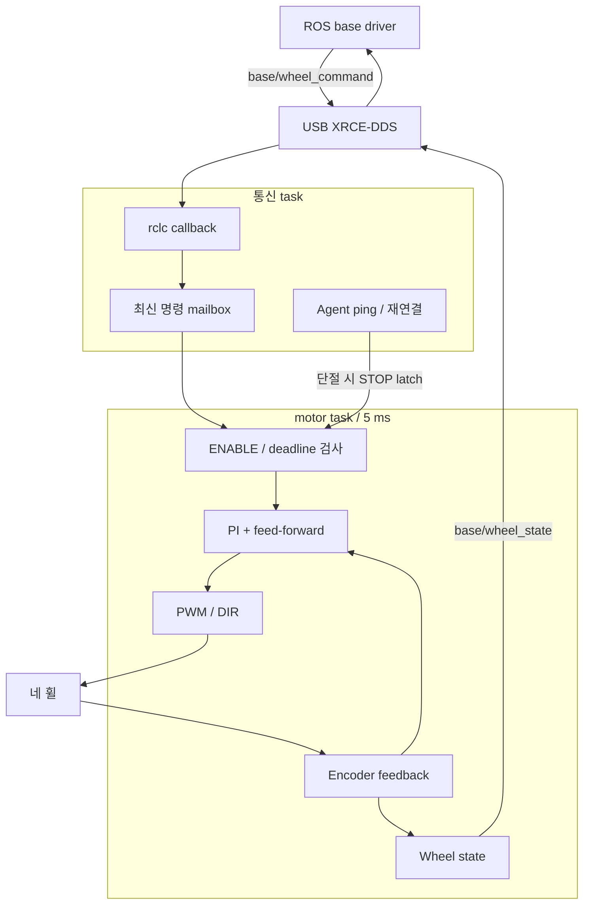

# ESP32-S3 micro-ROS motor controller

Native USB micro-ROS와 encoder, PWM/DIR로 4륜을 제어하는 펌웨어입니다. Target은 ESP32-S3 N32R16V(octal flash 32 MB / PSRAM 16 MB), PlatformIO environment는 `esp32-s3-microros`입니다. GPIO는 [PINMAP](PINMAP.md), 고정 버전은 `micro_ros.lock.json`에서 확인합니다.

| 경로 | 역할 |
|---|---|
| src/ | firmware, motor core |
| host_tests/ | 장치 없는 C++/Python 검사 |
| scripts/ | PlatformIO, 고정 dependency bootstrap |
| microros_smoke/ | micro-ROS/type-support 링크 검사 |
| imu_calibration/ | MPU6050 정지 보정 진단과 USB JSON 결과 |
| pcb/ | KiCad, 로컬 library |
| micro_ros/, .venv/ | 생성 dependency, 빌드 도구 |

도구 이동 후에는 `make firmware-setup`으로 Git wrapper 링크를 갱신합니다. Wrapper는 component root와 하위 폴더 clone 모두 revision을 고정합니다.

## ROS 인터페이스

노드 이름은 `cleany_motor_controller`, namespace는 기본 root입니다. [main.cpp](src/main.cpp)의 rclc entity 초기화를 기준으로 기록합니다.

| 종류 / 방향 | 기본 이름 | ROS 타입 | QoS와 주기 |
|---|---|---|---|
| 토픽 구독 | `base/wheel_command` | `cleany_base_interfaces/msg/WheelCommand` | Best-effort, volatile, keep-last 1 |
| 토픽 발행 | `base/wheel_state` | `cleany_base_interfaces/msg/WheelState` | Best-effort, volatile, keep-last 1; 50 Hz |
| 토픽 발행 | `base/imu_state` | `cleany_base_interfaces/msg/ImuState` | Best-effort, volatile, keep-last 1; 최대 100 Hz |

MCU에 서비스와 액션은 없습니다. 구동 허가는 WheelCommand의 ENABLE/STOP으로 처리하고, ROS `base/enable` 서비스는 [base driver](../ros2_ws/src/cleany_base_driver/docs/interfaces.md)가 제공합니다. 전체 노드는 [ROS 인터페이스 색인](../docs/ROS_INTERFACES.md)에서 찾습니다.

## Runtime



통신 task는 USB, ROS entity, Agent 재연결을 관리합니다. Motor task는 독립적으로 5 ms마다 실행하며, `motorMutex` 안에서 명령을 검사하고 PWM을 갱신합니다. 부팅 시 PWM은 0이고 구동은 disabled입니다. Zero ENABLE을 받은 뒤 VELOCITY를 허용합니다.

| 조건 | 처리 |
|---|---|
| STOP, 재연결 | Sequence high-water 유지 |
| 거부된 명령, 반복 ENABLE | Deadline과 이동 목표를 갱신하지 않음 |
| STOP latch | 대기 명령 삭제; 새 sequence로 오래된 ENABLE 차단 |
| Deadline | 수신 후 최대 250 ms; 명령 처리 전에 검사 |
| 만료, 단절 | 허가 해제; 재개에는 새 ENABLE 필요 |
| STOP, 만료, 단절 | Controller reset과 PWM 0 요청 |
| Agent ping 실패 | STOP latch → entity teardown → 재연결 |

| 항목 | 값과 규칙 |
|---|---|
| Wheel ceiling, 목표 반올림 | 10 rad/s, 0.1 rad/s 단위 |
| PWM | 20 kHz, 명령 슬루는 20 ms당 가속 1%p, 감속 3%p |
| 방향 반전 | 측정 속도 ≤0.5 rad/s를 50 ms 유지한 뒤 DIR 변경 |
| Wheel 배열 | FL/FR/RL/RR → PCB M1/M2/M4/M3, mapping `{0,1,3,2}` |
| 극성, encoder | 극성은 MCU에서만 적용; 출력축 1회전=3172 counts |
| State | 50 Hz, best-effort/volatile/keep-last-1 |
| MCU 시간, Boot ID | Monotonic µs; reboot baseline 식별 |
| USB | Agent용 framed XRCE-DDS 전용 |
| Agent ping | 100 ms 주기, 20 ms timeout |

메시지와 명령 수락 규칙은 [protocol v2](../ros2_ws/src/cleany_base_interfaces/docs/protocol.md)를 따릅니다.

## Runtime MPU6050 telemetry

The motor image also acquires MPU6050 data on J_I2C1 (SDA GPIO41, SCL GPIO42),
using the existing driver: 100 kHz I2C, 100 Hz sensor sampling, ±250 deg/s gyro,
±2 g accelerometer and 42 Hz gyro DLPF. Module/external I2C pull-ups are required.

The independent priority-2 acquisition task polls data-ready every 2 ms. It does
not take `motorMutex`. The priority-6 motor and priority-4 communication tasks
remain separate. A one-entry overwrite queue drops intermediate data if
communication stalls; reconnect does not drain a sample backlog.

The communication task publishes fixed-size `ImuState` on `base/imu_state`,
best effort / volatile / keep last 1, driven by newly acquired samples up to
the sensor rate. WheelState remains at 50 Hz. Actual rates and motor timing
under combined USB/I2C load require robot measurements.

Packets carry uncalibrated sensor-frame SI vectors, temperature, MCU MAC,
WHO_AM_I, boot ID, packet sequence, MCU acquisition timestamp and fault bits.
ImuState v2 also carries MCU-corrected gyro, the selected bias/covariance,
and calibration state/reason. Build the ROS interfaces and firmware together.
Acquisitions older than 100 ms and duplicate/backward timestamps are not sent
as new measurements. Missing/error data produces a sensor-fault heartbeat
at most 10 Hz; saturation has its own fault bit. Initialization/read errors
retry with 250 ms to 5 s backoff. IMU I2C failure does not authorize motors.

### Power-on calibration

The acquisition task calibrates once per MCU boot, independently of the Agent.
Defaults are 5 s settling, 1,000 training samples and 500 holdout samples, with
a 25 s deadline. It reuses the existing online gyro statistics. Noise/residual
failure, sensor/sample errors or timeout select the saved bench coefficients.
The selection remains fixed until MCU reboot, including across Agent reconnects.

During calibration, motor PWM stays zero, PID updates are skipped and non-STOP
commands are discarded. Completion only releases this inhibit; a fresh ENABLE
is still required. STOP, watchdog and disconnect handling remain active.
Fallback can release the calibration inhibit even if the sensor is unavailable;
sensor errors are still reported, and no angular-rate samples are fabricated.

Edit [`ros2_ws/src/cleany_base_driver/config/imu_calibration.json`](../ros2_ws/src/cleany_base_driver/config/imu_calibration.json)
to configure timing, windows, checks and measured fallback bias/covariance.
`make firmware-build` validates it and generates `cleany_config/imu_startup_config.hpp`
inside the PlatformIO build directory. The configuration is compiled into the
image; changes require rebuilding and uploading. Runtime checks samples and
observed statistics. A single acquisition-side enqueue helper attaches calibration
metadata and releases the boot inhibit on completion. The IMU task uses 6144 bytes
of stack for online statistics.

ROS topics and status are documented under
[IMU 실시간 수신](../ros2_ws/src/cleany_base_driver/docs/imu.md#imu-실시간-수신).
The standalone [diagnostic](imu_calibration/README.md) provides bench reports;
normal startup calibration is part of the motor image.

## 휠별 초기 PI와 FF

`src/main.cpp`의 `kFl/Fr/Rl/RrControllerConfig`에서 FF scale / Kp / Ki / PWM limit 순서로 설정합니다. 변경 후 rebuild와 upload가 필요합니다. FF 출력은 `target / FF scale × PWM limit`입니다.

아래 값은 2026-10-02 네 바퀴를 공중에 띄운 무부하 시험에서 얻었습니다. PI를 끄고 네 휠을 동시에 정, 역방향으로 PWM 0→100%, 5% 간격, 1.5초씩 측정했습니다.

| 휠 | FF scale (rad/s) | Kp | Ki | PWM 상한 (%) |
|---|---:|---:|---:|---:|
| FL | 12.4261 | 4.655 | 9.309 | 100 |
| FR | 12.1178 | 4.711 | 9.421 | 100 |
| RL | 11.6403 | 4.864 | 9.728 | 100 |
| RR | 11.8128 | 4.783 | 9.566 | 100 |

FF는 `PWM≈k×속도`, `FF scale=100/k`로 추정하고 마찰 잔차는 PI로 보정했습니다. PI 추정에는 gain K, 시정수 τ, delay L과 기존 50 ms 속도 필터를 포함했습니다. 계산식은 `Kp=clamp(0.6/K,2,8)`, `Ki=Kp/max(0.5,4(τ+L))`입니다.

보정값을 업로드한 뒤 네 바퀴 동시 정·역방향 **0.5, 2, 5, 10 rad/s** 명령을
각각 5초 동안 검증했다. 마지막 0.5초 평균 속도 오차는 모든 휠에서 4.5% 이내였다.
최종 상태는 구동 비허가, PWM 0, fault 0이다.

### 2026-10-13 지면 하중 실측 캘리브레이션 및 필터 고도화

현재 `src/main.cpp`는 전후이동과 횡이동의 지면 하중 시험에서 도출한 다음
휠별 설정을 사용한다. 진단 기준값은
[`controller_baseline.json`](../tools/wheel_calibration/controller_baseline.json)에
같은 값으로 보존하며, 관련 테스트가 펌웨어 설정과의 일치를 확인한다.

| 휠 | FF scale (rad/s) | Kp | Ki | PWM 상한 (%) | 주요 지면 보정 특성 |
|---|---:|---:|---:|---:|---|
| FL | 11.9352 | 6.058 | 12.118 | 100 | 전후/횡이동 균형 최적화 |
| FR | 12.2596 | 6.030 | 12.058 | 100 | 고효율 FR 휠 출력 과다 방지 |
| RL | 11.7678 | 6.246 | 12.492 | 100 | 후륜 지지 강성 보강 |
| RR | 11.3872 | 6.154 | 12.309 | 100 | 기어박스 마찰 하중 보상 (Yaw 편주 억제) |

명령 슬루는 가속 시 20 ms당 1%, 감속 시 20 ms당 3%로 설정한다.
속도 피드백 LPF 시상수는 `kVelocityFilterTimeConstantSeconds = 0.02`초다.
STOP, 만료 및 연결 단절은 슬루 감속을 기다리지 않고 PWM zero를 요청한다.

측정과 재검증 방법은 [휠 진단 안내](../tools/wheel_calibration/README.md)와
[오도메트리 평가 안내](../tools/odometry_evaluation/README.md)를 따른다.
오도메트리 내부 제어 잔차와 바닥 테이프 또는 LiDAR 기준의 실측 오차는
별도 지표로 기록한다. 측정 JSON과 PNG는 Git 제외 경로인 `artifacts/`에 저장한다.

## 1. 빌드와 장치 없는 검사

명령은 저장소 루트에서 실행합니다. 호스트 호출 시 Ubuntu 22.04 `ros2-humble` Distrobox를 사용합니다.

```bash
make firmware-setup
make test-micro-ros-setup test-motor-core
make firmware-smoke
make firmware-build
make build-base test-base
make micro-ros-agent-build
```

Type support 원본은 `ros2_ws/src/cleany_base_interfaces`입니다. Smoke/runtime은 cache를 공유하므로 순차 빌드하며, interface, metadata, 환경을 변경하면 type support를 재생성합니다.

`cmake/microros_python.cmake` exposes the pinned generator modules to IDF's
Python during CMake configuration. PlatformIO clears the process `PYTHONPATH`
before this step, so the SCons environment alone does not cover a fresh
micro-ROS/type-support rebuild. Runtime and smoke projects share this helper.

Smoke and runtime share a library cache and build sequentially. Changes to
interfaces, metadata, or build environment regenerate type support.
`sdkconfig.defaults` configures octal memory, a 1000 Hz FreeRTOS tick, and the
USB transport. The DOUT image header lets the bootloader enable OPI.

For clangd, run inside Distrobox:

```bash
esp32/.venv/bin/platformio run -d esp32 -e esp32-s3-microros -t compiledb
```

## 2. Upload와 통신

For stationary gyro calibration on `J_I2C1`, use the separate
[MPU6050 calibration diagnostic](imu_calibration/README.md).
It provides a calibration-only image, retained USB results, measured-limit
configuration, and the motor-firmware restoration procedure.

Select the device and confirm upload:

```bash
make firmware-upload CLEANY_ESP_PORT=/dev/serial/by-id/<device> CONFIRM_UPLOAD=1
```

Agent/ROS overlay를 적용하고 DDS domain 0에서 통신을 확인합니다.

```bash
source /opt/ros/humble/setup.bash
source esp32/micro_ros/agent/install/local_setup.bash
source "$(make -s print-install-base)/local_setup.bash"
export ROS_DOMAIN_ID=0
ros2 run micro_ros_agent micro_ros_agent serial --dev "$CLEANY_ESP_PORT" -b 115200
# Another terminal with the same overlays/domain:
ros2 topic echo /base/wheel_state --qos-reliability best_effort
```

Bare MCU 확인 항목은 다음과 같습니다.

- Nonzero boot ID, 증가하는 sequence/timestamp
- Disabled 상태, 목표, PWM 0, fault 없음

## 3. 실물 인수

1. 감독자, 사람 없는 구역, 검토한 제한값, 접근 가능한 물리 E-stop을 준비합니다.
2. 바퀴를 띄워 startup 0, 회전 방향, encoder 부호를 확인합니다.
3. Enable 후 새 저속 명령으로 전진, 좌측, yaw, PI, PWM slew, 반전 dwell을 확인합니다.
4. STOP, 만료, driver/Agent 종료, USB 단절, MCU reboot의 정지 시간을 측정합니다.
5. 재연결 후 새 enable과 새 명령이 필요한지 확인합니다.

Odometry, TF 소유권은 [Base 계약](../ros2_ws/src/cleany_base_driver/docs/command-and-odometry.md)을 따릅니다. 결과에는 revision, 설정, 하중/바닥, 부호, 주기, 정지 시간을 기록합니다.

## KiCad

프로젝트는 [motor_controller.kicad_pro](pcb/motor_controller.kicad_pro)이며 symbol/footprint는 project-local table에 등록됩니다. Espressif 출처와 라이선스는 [libraries](pcb/libraries/README.md)에서 확인합니다.
