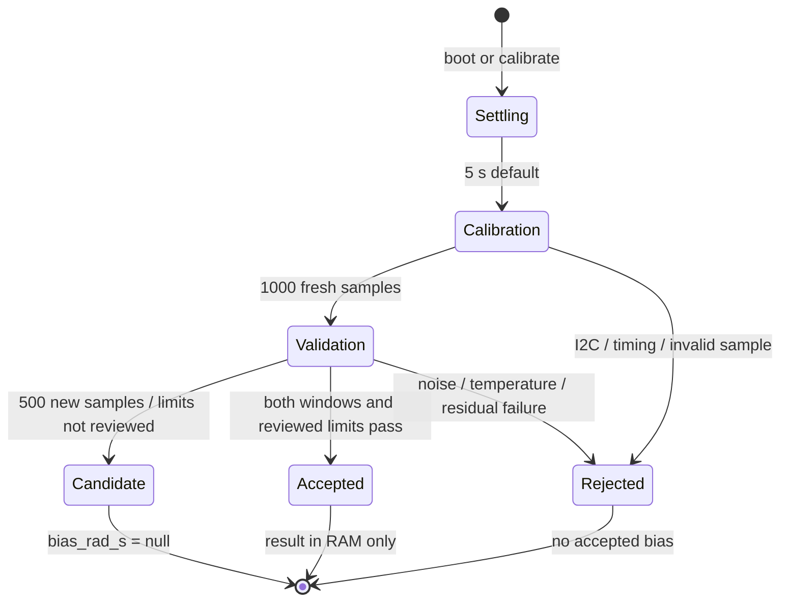
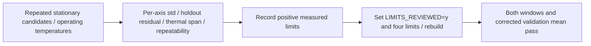
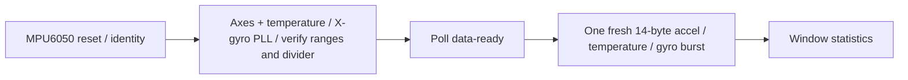

# MPU6050 gyro calibration diagnostic

Standalone ESP32-S3 firmware estimates three sensor-좌표계 gyro biases and
checks them against a separate stationary validation window. Results are
JSON lines over native USB. The diagnostic holds motor PWM/DIR outputs LOW
and runs without motor-control tasks or micro-ROS.

Normal power-on calibration now runs inside the
[motor firmware](../README.md#power-on-calibration), using its build-time
robot config. This standalone application is for acquiring bench reports.

| Task | Section |
|---|---|
| Wire and isolate the board | [Hardware](#hardware-and-preparation) |
| Build, upload, collect | [Build](#build-and-tests), [capture](#upload-and-capture) |
| Interpret or accept a result | [Limits](#configure-measured-acceptance-limits), [protocol](#usb-protocol-and-results) |
| Return to motor operation | [Restoration](#hardware-acceptance-and-restoration) |



| Default report | Meaning |
|---|---|
| accepted=false | Motion and thermal acceptance limits are not reviewed |
| error=limits_not_reviewed | Candidate acquisition completed without acceptance |
| bias_rad_s=null | No accepted bias exposed |
| Candidate fields | Bias, covariance, temperature and validation residuals remain available for selecting limits |

## Hardware and preparation

- ESP32-S3 N32R16V, matching the motor firmware's octal memory configuration.

| J_I2C1 pin | MPU6050 connection |
|---|---|
| 1 | +3V3 |
| 2 | GND |
| 3 | SCL / GPIO42 |
| 4 | SDA / GPIO41 |

Confirm pin 1 using [pinmap.md](../pinmap.md).

- Address `0x68`, `WHO_AM_I=0x68`; module/external 3.3 V I2C pull-ups required.
- Disconnect motor-driver power during flashing and diagnostic runs. MCU/IMU
  power can remain supplied over USB. Output LOW is established at `app_main`;
  it is not a guarantee about hardware pin levels during boot/reset.
- Rigidly mount the sensor and keep the entire robot physically stationary
  throughout settling, calibration, and validation.
- Stop the micro-ROS Agent, serial monitors, and other users of this USB port.

Gyro/acceleration variance checks supplement operator-confirmed rest. Constant
slow rotation can look like gyro bias even with low sample variance.

## Build and tests

Use the existing PlatformIO installation prepared by `make firmware-setup`.
From the repository root:

```bash
make test-imu-calibration
make imu-calibration-build
```

Make uses the Ubuntu 22.04 `ros2-humble` Distrobox from the host. This standalone
project does not generate or link micro-ROS type support.
Host tests cover decoding, calibration statistics and failure modes, fake
serial capture, strict accepted-result validation, and configuration refresh.

## Upload and capture

Upload replaces the motor-controller application. Select the exact device and
explicitly confirm upload after completing hardware preparation:

```bash
export CLEANY_ESP_PORT='/dev/serial/by-id/<native-USB-device>'
make imu-calibration-upload CLEANY_ESP_PORT="$CLEANY_ESP_PORT" CONFIRM_UPLOAD=1
make imu-calibration-capture CLEANY_ESP_PORT="$CLEANY_ESP_PORT" \
  IMU_CALIBRATION_OUTPUT=artifacts/imu_calibration/run1.json
```

Calibration starts once at boot. `status` returns progress or the retained
terminal result, so attaching after completion works. To restart a stationary
attempt explicitly:

```bash
make imu-calibration-capture CLEANY_ESP_PORT="$CLEANY_ESP_PORT" \
  IMU_CALIBRATION_ARGS=--calibrate \
  IMU_CALIBRATION_OUTPUT=artifacts/imu_calibration/run2.json
```

| Capture behavior | Contract |
|---|---|
| Serial ownership | Exclusive POSIX access; atomically deassert DTR/RTS to avoid resets |
| `--calibrate` | One restart command, random request nonce, matching acknowledgement required |
| Result recovery | Periodic status queries read the retained result; old buffered replies cannot complete a new capture |
| Deadline | Bounded reads/writes; default overall 60 s, override `IMU_CALIBRATION_TIMEOUT` for longer windows |

| Capture exit | Meaning |
|---|---|
| 0 | Accepted report |
| 2 | Captured rejected/unreviewed report, saved atomically; Make returns nonzero |
| 1 | Capture, serial or protocol error |


## Configure measured acceptance limits

Authoritative overrides belong in this project's `sdkconfig.defaults`.
Changing it or `main/Kconfig.projbuild` regenerates derived SDK configuration
on the next build; do not edit generated `sdkconfig.*` files.

| Kconfig setting | Default / units |
|---|---|
| `CLEANY_IMU_SETTLING_MS` | 5000 ms |
| `CLEANY_IMU_CALIBRATION_SECONDS` | 10 s |
| `CLEANY_IMU_VALIDATION_SECONDS` | 5 s |
| `CLEANY_IMU_I2C_TIMEOUT_MS` | 10 ms |
| `CLEANY_IMU_MAX_SAMPLE_GAP_MS` | 30 ms |
| `CLEANY_IMU_LIMITS_REVIEWED` | `n` |
| `CLEANY_IMU_MAX_GYRO_STD_MICRORAD_S` | 0; microrad/s |
| `CLEANY_IMU_MAX_ACCEL_STD_MM_S2` | 0; mm/s² |
| `CLEANY_IMU_MAX_VALIDATION_MEAN_MICRORAD_S` | 0; microrad/s |
| `CLEANY_IMU_MAX_TEMPERATURE_SPAN_MILLIC` | 0; millidegrees C |



No measured acceptance limits are supplied. Standard deviations are the square roots of the covariance diagonal.

| Reviewed-limit gate | Requirement |
|---|---|
| Noise | Both gyro and acceleration windows pass |
| Temperature | Combined window span passes |
| Residual | Every absolute corrected validation mean passes |
| Missing / nonpositive limits | invalid_config |
| Failed attempt | Never exposes accepted bias |

## Hardware acceptance and restoration

| Hardware acceptance | Check |
|---|---|
| Stationary repeats | Inspect candidate consistency |
| Reviewed limits | Deliberate motion, sensor disconnect and changing temperature must reject; then retry stationary |
| PWM / DIR | Measure levels with motor-driver power disconnected |
| Evidence boundary | Separate from host tests and firmware compilation |

Close capture before restoring the motor firmware:

```bash
make firmware-upload CLEANY_ESP_PORT="$CLEANY_ESP_PORT" CONFIRM_UPLOAD=1
```

Apply the normal [motor firmware acceptance procedure](../README.md#3-실물-인수)
before restoring motor-driver power and enabling motion.

## Acquisition and calculation



A missing-ready deadline or I2C error ends the attempt. Old samples are never substituted.

| Setting | Value |
|---|---|
| I2C | 100 kHz, GPIO41 SDA / GPIO42 SCL |
| Sensor sample rate | 100 Hz |
| Accelerometer / gyro ranges | ±2g / ±250 degrees/s |
| Gyro DLPF | 42 Hz (`DLPF_CFG=3`) |
| Default settling interval | 5 seconds |
| Default calibration | 1,000 fresh samples, approximately 10 seconds |
| Default independent validation | 500 new samples, approximately 5 seconds |
| Default I2C transaction timeout | 10 ms |
| Default maximum fresh-sample gap | 30 ms |

Five seconds is an experimental settling interval, not a claim of thermal
equilibrium. Characterize temperature and bias on the actual module and
increase this interval when needed.

Acceleration is decoded in m/s², including gravity; gyro in rad/s.
Accelerometer offsets/scales are not estimated by this gyro calibration.
Each window maintains vector means and full row-major 3×3 sample covariance
using Welford accumulation, without storing the sample history:

```text
candidate_bias = calibration gyro mean
corrected gyro = measured gyro − candidate_bias
validation_residual = independent validation gyro mean − candidate_bias
```

| Measurement contract | Rule |
|---|---|
| Timestamp | MCU monotonic acquisition µs, not ROS epoch |
| Invalid samples | Nonfinite, saturated, non-increasing timestamps or excessive gaps reject |
| Window duration | Less than 90% of nominal elapsed time rejects |
| Covariance | Sample measurement covariance, not covariance of estimated mean |
| Correlation | Filtered samples are temporally correlated |

## USB protocol and results

Commands are newline-terminated `status`, `calibrate`, or
`calibrate <16-lowercase-hex-digit-request-id>`. Capture uses the nonce form.
Messages use `schema="cleany.imu_calibration/v1"`.

| Message | Payload |
|---|---|
| `started` | trigger boot/command, new run ID, request ID (empty for boot/nonce-free command) |
| `status` | phase and calibration/validation sample counts |
| `result` | retained terminal report |
| `error` | malformed/unknown command |

| Terminal report | Meaning |
|---|---|
| phase | completed or failed; completed means acquisition finished |
| accepted / error | Only accepted=true indicates validated calibration |
| Identity | Sensor identity, error and operation |
| Windows | Means, covariances, timestamps and temperature ranges for calibration and validation |
| Bias / residual | candidate_bias_rad_s, bias_rad_s, validation_residual_rad_s; accepted bias otherwise null |
| Coordinates | Sensor X/Y/Z, covariance flat row-major 3×3 |

Results remain in RAM until a new attempt or reset; no NVS calibration is
written. Saved JSON is an inspection record, not automatically applied to
future boots or firmware. A new power cycle requires a new bias estimate.

### Task ownership


USB backpressure never blocks acquisition.
