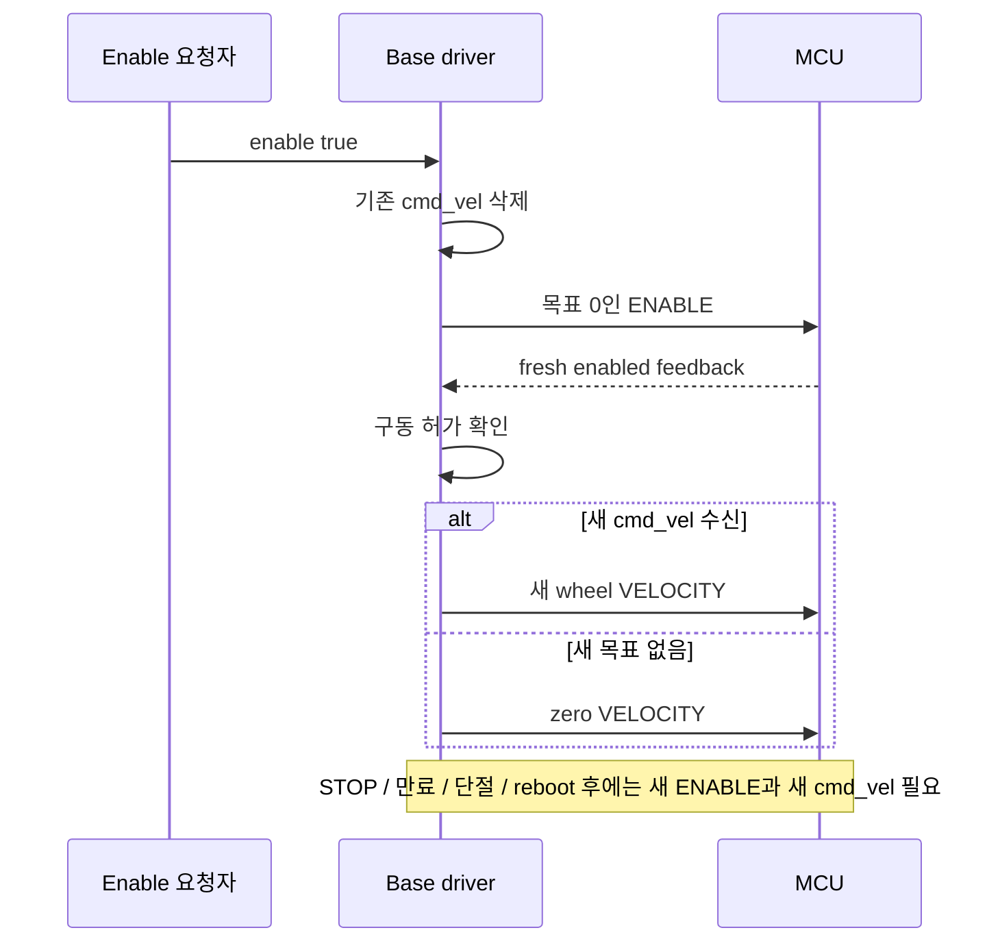
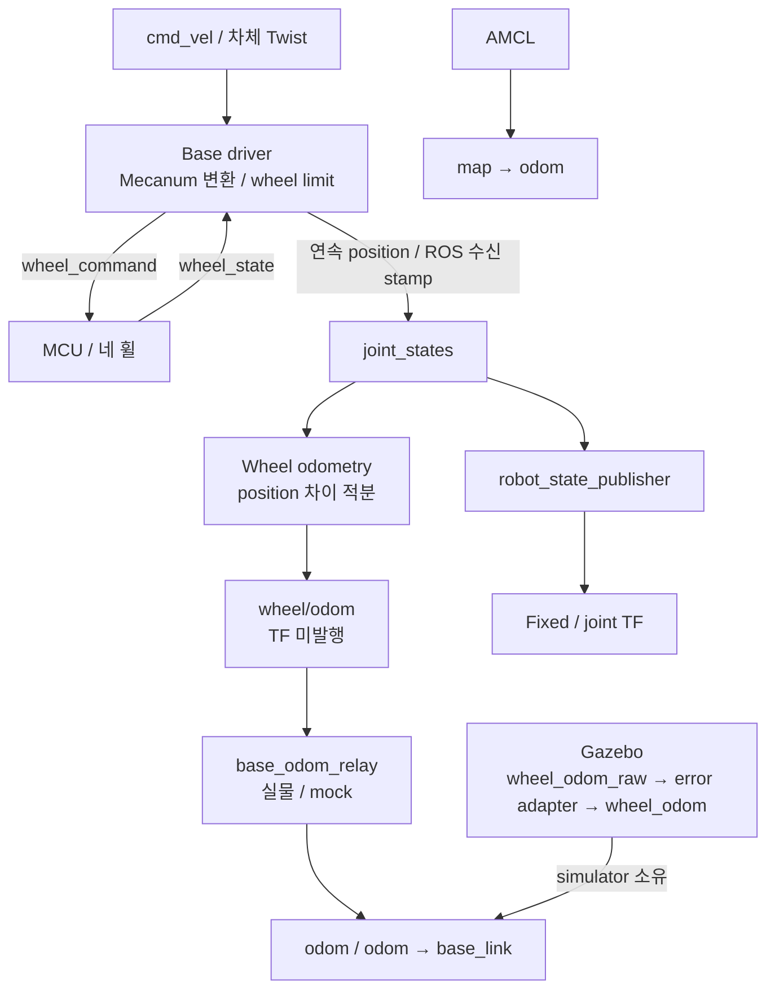

# Base 명령과 odometry

Base driver는 차체 Twist를 wheel 명령으로 변환하고 MCU feedback을 ROS 상태로 제공한다. 차체 명령은 [Mobile base](../../cleany_interfaces/docs/mobile_base.md), MCU 통신은 [protocol v2](../../cleany_base_interfaces/docs/protocol.md)를 따른다.

## 명령과 구동 허가

Driver는 enable 요청을 받으면 기존 cmd_vel을 버리고 목표가 0인 ENABLE을 보낸다. Fresh feedback에서 MCU의 구동 허가를 확인한 뒤, enable 요청 이후에 수신한 새 목표만 전송한다. 새 목표가 없으면 zero VELOCITY를 유지한다.

Mecanum 변환 후 wheel limit을 넘으면 네 바퀴를 같은 비율로 축소해 이동 방향을 보존한다.

| 조건 | 처리 |
|---|---|
| 여섯 축 중 nonfinite 포함 | STOP |
| 지원하지 않는 축 | 경고 후 무시 |
| ENABLE 전달 손실 | 같은 sequence, deadline으로 재시도 |
| STOP, 단절, 만료, reboot | 새 ENABLE과 새 cmd_vel 필요; 재연결만으로 재개 금지 |

## 설정과 시간

| 항목 | 기준 |
|---|---|
| 설정 원본 | [base_hardware.yaml](../config/base_hardware.yaml), [base_synthetic.yaml](../config/base_synthetic.yaml) |
| 실물 geometry | radius 0.0635 m / wheelbase 0.350 m / separation 0.610 m |
| MCU timestamp | MCU monotonic; ROS epoch 아님 |
| JointState stamp | ROS 수신 시각 |
| Driver deadline, cmd_vel timeout | 해당 설정값 사용 |

실물 초기 속도 제한은 바퀴를 띄운 시험용이며 바닥 주행 승인값이 아니다. Mock geometry는 합성값이므로 실물 보정값으로 사용하지 않는다. Feedback 단절 중 이동량은 관측할 수 없다.

## Diagnostics와 장애 구분

`base_driver` status의 `feedback_received`는 현재 유효한 MCU 피드백 연결 여부다. 피드백이 stale이면 driver가 수신 기록을 초기화하므로 부팅 전과 연결 상실 뒤 모두 `False`다. `fault`는 다음 acknowledged ENABLE까지 유지되는 실제 장애 이유다.

| 비활성 이유 | `fault` | 의미 |
|---|---|---|
| STOP 요청, `cmd_vel timeout`, 비유한 `cmd_vel` 거부, driver 종료 | 빈 값 | 의도한 안전 비활성. level은 기존처럼 ERROR |
| MCU fault bit, 계약 불일치, MCU 재부팅, 무허가 enable, ENABLE ack timeout, 구동 중 피드백 stale | 이유 | base 장애 |

STOP을 보낸 직후 MCU가 그 STOP을 처리하기 전에 보낸 피드백(`last_command_sequence`가 STOP보다 오래됨)은 0.25초까지 무허가 enable로 보지 않는다. 그 뒤에도 enabled면 장애다. System Supervisor는 level 대신 `fault`와 `feedback_received`로 base 가용성을 판단한다.

## Wheel odometry

Wheel odometry는 joint position 차이를 적분해 `/wheel/odom`을 발행하며 TF는 발행하지 않는다. Joint velocity는 필수 입력이 아니다. 실물 driver가 reboot, 단절 baseline과 encoder rollover를 처리해 연속 position을 제공한다.

`velocity_window_s=0`은 샘플 간 차분, 양수는 구간 평균 twist를 사용한다. 시작, 시간 역행, 긴 공백 뒤에는 관측 구간이 준비될 때까지 발행하지 않으며, 미관측 속도를 0으로 보고하지 않는다. 평균 속도의 지연은 제동, 도착 검증에 반영해야 한다.

`yaw_scale`은 유한한 양수의 회전 보정 계수이며 geometry를 바꾸지 않는다. Sim 보정값은 독립 검증 없이 실물에 적용하지 않는다. Covariance는 config/구현을 따르며 wheel odometry는 slip, 바닥 오차를 보정하지 않는다.

## TF 소유권

| TF / 출력 | 소유자 |
|---|---|
| 실물, mock /odom, odom→base_link | base_odom_relay |
| Gazebo wheel_odom_raw→error adapter→wheel_odom 및 canonical odom/TF | simulator |
| map→odom | AMCL |
| Robot fixed/joint TF | robot_state_publisher |

실물/mock과 Gazebo는 대체 실행 경로다. Canonical odom/TF 소유자는 실행마다 하나만 둔다. 외부 estimator를 사용할 때는 `relay_odom:=false`로 중복 publisher를 제거한다.

관련 안내: [ESP32](../../../../esp32/README.md), [실행](../../../../docs/RUNNING.md), [검증](../../../../docs/TESTING.md).

노드별 통신 목록: [인터페이스 표](interfaces.md).
