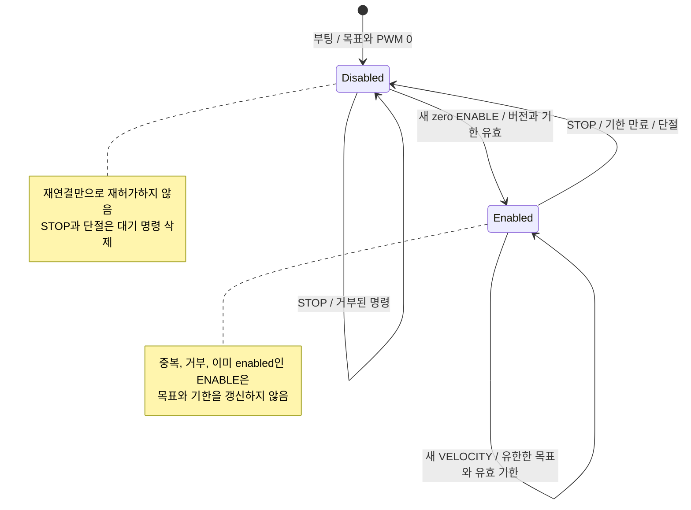

# Wheel protocol v2

ROS driver와 MCU는 이 패키지의 msg/를 원본으로 같은 계약의 type support를 빌드한다. 한 MCU의 command publisher는 driver 하나가 소유한다.

## 인터페이스와 단위

| 토픽 | 방향 | QoS / 주기 |
|---|---|---|
| base/wheel_command | ROS → MCU | best effort, volatile, keep last 1 / 50 Hz |
| base/wheel_state | MCU → ROS | best effort, volatile, keep last 1 / 50 Hz |

| 항목 | 계약 |
|---|---|
| 배열 순서 | FL, FR, RL, RR |
| PCB 매핑 | MCU에서만 M1, M2, M4, M3 및 극성 적용 |
| 각도 / 속도 | 출력축 rad / rad/s |
| Encoder / PWM | signed int32 count / signed percent |
| Encoder scale | 출력축 1회전 = 3172 counts |

## 명령 수락

| Mode | 값 | 동작 |
|---|---:|---|
| STOP | 0 | 목표 삭제, 출력 0, 허가 해제 |
| ENABLE | 1 | 네 목표가 0일 때 구동 허가 |
| VELOCITY | 2 | 허가된 상태에서 유한한 [-10,10] rad/s 목표 적용 |

Protocol version은 2다. Sequence는 uint32이며 `0 < (new-old) mod 2^32 < 2^31`일 때만 새 명령이다. MCU는 정지, 단절 뒤에도 마지막 번호를 유지하고, driver는 fresh feedback의 last_command_sequence 다음 번호를 사용한다.

`valid_until_us`는 MCU monotonic µs다. Driver는 MCU stamp와 로컬 monotonic 경과로 계산한다. ENABLE/VELOCITY는 `now < deadline <= now+250000`을 만족해야 한다.

| 예외 | 처리 |
|---|---|
| 중복, 거부, 이미 enabled인 ENABLE | 목표와 기한 갱신 없음 |
| STOP | 버전, 목표, 기한에 관계없이 정지; 새 sequence일 때만 번호 갱신 |
| Deadline 만료 | 목표, 허가 삭제 |

STOP의 새 sequence는 오래된 ENABLE의 재허가를 막는다. 매 control tick에서 **명령 처리 전에** 기한을 검사한다. watchdog_ms=250은 최대 유효기간이며 별도 watchdog 시각이 아니다.

## 정지와 재개

부팅, STOP, 만료, 단절 뒤에는 새 ENABLE과 새 cmd_vel이 필요하다. 연결 복구만으로 이전 목표를 재개하지 않는다. STOP latch와 단절은 대기 명령을 지우며, PWM/PI는 별도 motor task가 계산한다.

## 피드백

| 필드 | 의미 |
|---|---|
| boot_id | 부팅별 nonzero uint32; reboot/baseline 감지 |
| timestamp_us | MCU monotonic; JointState는 ROS 수신 stamp 사용 |
| enabled | 소프트웨어 구동 허가 |
| command_age_ms=65535 | 활성 유효 명령 없음 |
| Fault bit 0 | 명령 만료; 새 ENABLE 수락 시 초기화 |

Driver는 중복, 역순 feedback을 무시하고 실제 수신 지연을 감시한다. Encoder rollover는 modular delta로 누적한다. Reboot, 단절 뒤에는 baseline을 재설정하되 누적 각도를 유지한다. 단절 중 이동량은 관측할 수 없다.

관련 안내: [Driver](../../cleany_base_driver/docs/command-and-odometry.md), [펌웨어](../../../../esp32/README.md), [검증](../../../../docs/TESTING.md).

## IMU telemetry v2

`ImuState`는 WheelState v2와 별개의 고정 크기 메시지다. `base/imu_state`는
best effort, volatile, keep last 1이다. MPU6050의 100 Hz 취득 결과를 최신값
mailbox에서 소비해 발행하며, 연결 지연 중 누락된 샘플은 재전송하지 않는다.

- `angular_velocity_rad_s[3]`와 `acceleration_mps2[3]`는 센서 축 X/Y/Z의
  보정 전 SI 값이며 `temperature_c`는 섭씨다.
- `protocol_version=2`, `who_am_i=0x68`이다. Sensor fault bit는 1,
  saturation bit는 2다. 정상 측정이 없으면 최대 10 Hz fault heartbeat를 보낸다.
- 정상 패킷의 `timestamp_us`는 MCU acquisition 시각이고 ROS epoch가 아니다.
  Fault 패킷은 오류 보고 시각을 사용하므로 측정으로 적분하지 않는다.
- `boot_id`는 WheelState와 같은 MCU 부팅 ID다. `sequence`는 발행 패킷마다
  증가하며, 수신자는 동일 부팅 내 중복, 역순과 역행 시각을 거부한다.
- `device_mac[6]`는 ESP32의 MAC이다. 교체 가능한 MPU6050 칩의 고유 ID는 아니다.
- `calibration_state`는 `CALIBRATING=0`, `RUNNING=1`, `FALLBACK=2`다.
  MCU 부팅 때 한 번 결정하며 Agent/ROS 재시작으로 보정을 재실행하지 않는다.
- `calibration_reason`은 `NONE=0`, `TIMEOUT=1`, `SENSOR=2`, `UNSTABLE=3`,
  `SAMPLE=4`다. Runtime 상태와 오류 보고용이며 측정값 자체를 대신하지 않는다.
- `corrected_angular_velocity_rad_s[3]`는 MCU가 bias를 제거한 각속도다.
  `gyro_bias_rad_s[3]`, `gyro_covariance_rad2_s2[9]`와 함께 전달한다.
  `RUNNING` 또는 `FALLBACK`일 때만 사용하며 raw vector는 그대로 보존한다.

센서 오류 패킷과 원본 acceleration은 이 토픽을 기록해 보존한다.
Gyro-only ROS 변환, MCU 부팅 보정과 기존 측정값 fallback은
[`cleany_base_driver`](../../cleany_base_driver/docs/imu.md#imu-실시간-수신)를 따른다.
v1과 payload가 다르므로 펌웨어와 ROS 인터페이스를 함께 빌드한다.
