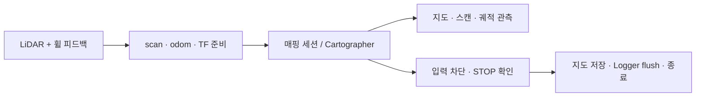

# 실물 매핑 구성

[지도 만들기](../../../../docs/implementation/how-to/mapping.md) · [센서 확인](../../../../docs/implementation/how-to/sensors.md) · [매핑 상태 계약](../../cleany_navigation/docs/mapping.md)

`hardware_mapping.launch.py`는 설치된 패키지로 hardware runtime을 시작합니다.
Runtime은 영속 센서/base/조종 launch와 매핑 관리자를 별도 프로세스 그룹으로 소유합니다.
종료 시 매핑 관리자의 저장을 먼저 기다리고 장치 launch를 종료합니다.
웹 페이지를 닫아도 지도와 기록은 종료되지 않습니다.

실물 구성에서는 base relay가 `odom → base_link`, 장착 TF가 `base_link → sensor`를 제공합니다. 매핑 세션의 Cartographer는 `map → odom`을 발행합니다. 같은 변환을 발행하는 다른 실행 구성을 함께 시작하지 않습니다.

| 프로필 | 출처와 범위 |
|---|---|
| `mapping_legacy.yaml` | 이전 실물 매핑의 x=0.029m, yaw=-7.85도. 원본 측정 artifact 미확인 |
| `mapping_evaluation_20261015.yaml` | main의 평면 보정 x=-0.070807m, y=-0.038232m, yaw=79.770070도, laser 좌표계 |

두 프로필은 서로 다른 장착/프레임 자료이므로 합성하지 않습니다. 둘 다 z=0은 평면 규약이며
실측 높이가 아닙니다. 장착을 변경했다면 해당 프로필의 사용 근거를 다시 확인합니다.
기본값은 기존 매핑 동작을 보존하는 legacy 프로필입니다. mock은 실물 geometry 대신
`base_synthetic.yaml`을 선택하며 Agent와 실물 LiDAR를 시작하지 않습니다.

설정은 설치된 package share에서 찾고, 실행 시 state_root에 확정 설정을 보존합니다.
키는 state_root/web-token(0600), 지도는 maps/, 녹화는 recordings/에 두며 저장소 소스나
`.runtime` 빌드 경로를 사용하지 않습니다. 시작 명령은 [RUNNING](../../../../docs/implementation/running.md),
설치와 외부 드라이버는 [개발환경](../../../../docs/implementation/development-setup.md)을 따릅니다.

조종 사건은 state_root의 `teleop-events.jsonl`과 회전 백업에 저장합니다. 매핑 작업 오류는
`maps/errors/<operation_id>.json`에서 확인하며, 진단 파일 저장에 실패하면
`mapping.log`의 traceback을 확인합니다. [진단 계약](../../cleany_teleop/docs/interfaces.md)을 따릅니다.
